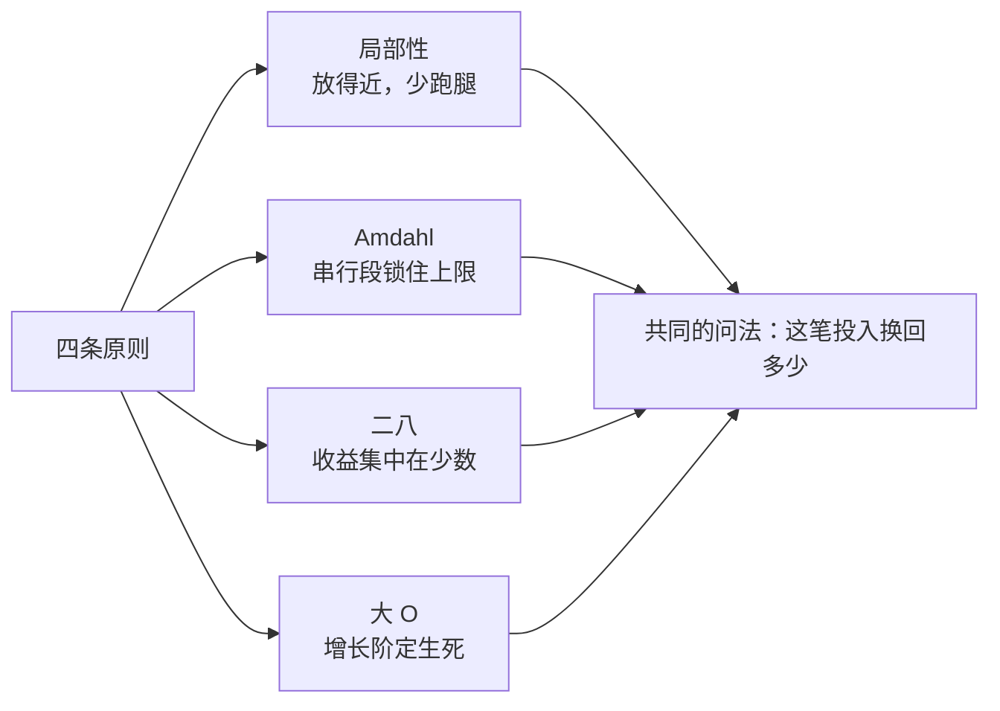
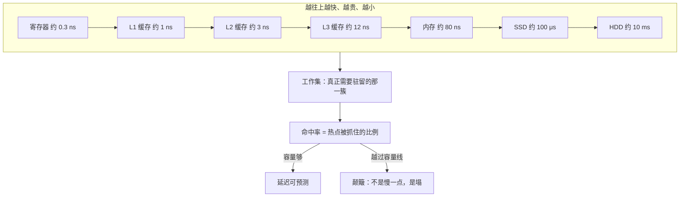
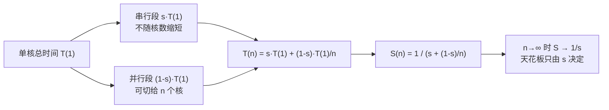
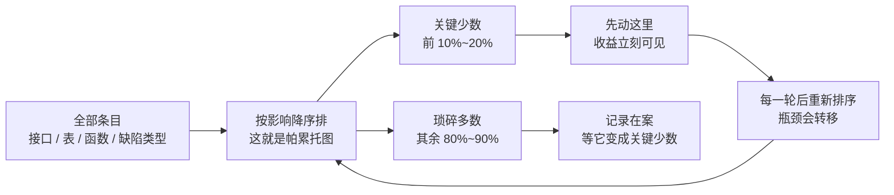
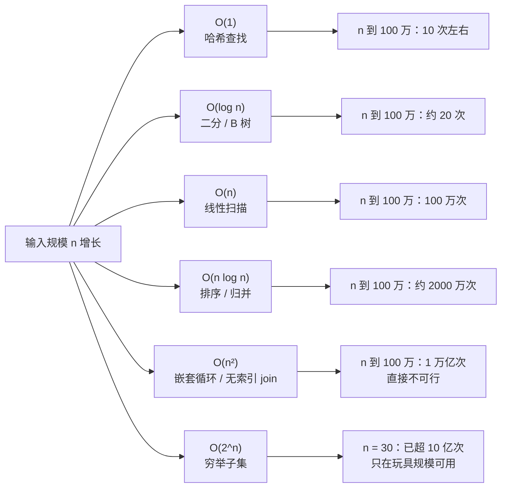

把四条原则放进一章，不是为了让篇幅好看。它们分属存储层次、并行计算、统计学与复杂度分析，问的却是同一件事：**这笔投入，到底能换回多少。**

- **局部性**拿「数据放得近」换掉反复取数的开销；
- **Amdahl** 指出「有串行段」会锁住并行的天花板；
- **二八**告诉你收益从来不是均匀分布的，先找那少数位置；
- **大 O** 只承诺增长阶，不承诺当下的速度。

四条原则合起来是一套顺序：先用二八定位（钱花在哪最值），再用大 O 判阶（这个设计能不能随规模活下去），再用 Amdahl 看上限（并行还剩下多少空间），最后靠局部性兑现（把省下来的距离变成命中）。跳过前三步直接优化，通常是在非瓶颈上追加预算——这类投入有个共同特征：改完确实变快了，只是端到端看不出差别。

它们还有一处共同的克制：**都只描述代价的形状，不描述代价的绝对值。** 形状能判断选型对不对，绝对值只能靠实测。这也决定了下面每一节都带一段本机实跑——「4.53 倍」这种数字，光靠公式推不出来。



下面四节各自独立，实跑与推算分开标注。

## 一、局部性原理

1965 到 1968 年，虚拟内存（分页）刚铺开不久，系统遇到一个棘手问题：程序一多、内存一紧张，页面就在内存和磁盘之间反复换入换出，吞吐跌到谷底。当时人们不知道原因，只能靠加内存硬扛。

1968 年，科学计算方向的学者 **Peter J. Denning** 在研究分页调度时提出**局部性原理（Principle of Locality）**，并把它拆成两个可测的分支：**时间局部性**（刚被访问过的数据，很快还会被访问）与**空间局部性**（被访问位置附近的数据，也倾向于被访问）。顺着这两条，他给出**工作集（working set）**模型：进程在一段窗口内真正需要驻留的页面集合，才是内存该保住的东西。这个集合的大小随时在变，因为它取决于程序当下走到哪一步。

这次提出的关键不在「缓存有用」这种常识，而在**代价的形状**：缺页一旦越过工作集边界，性能不是线性下滑，而是系统性坍塌。Denning 把它命名为 **thrashing**（颠簸）——CPU 大部分时间在等页面，换页本身又挤占更多内存，形成正反馈。后来所有分层设计都默认了这条前提：缓存能生效，是因为访问不均匀；访问一旦均匀，加多少层都没用。

**本质一句话：最近用过的，很快还会再用；用到的地方旁边的，往往也要用。程序的行为不是随机漫步，而是围绕一小簇热点打转。**

这句判断同时解释三件事：分层存储为什么省钱（贵的介质只服务热点）、命中率为什么是缓存的第一指标（它直接度量热点被抓到多少）、以及那些号称随机访问的负载为什么难优化（它们把前提抽掉了）。

命中率可以写成一行：`命中率 = 命中次数 / 总访问次数`，而平均访问时间 `T = h·T_fast + (1-h)·T_slow`。这行公式的含义是，慢的那一层即使贵一百倍，只要它被访问的比例小，整体就还受控；反过来，命中率从 95% 掉到 90%，平均延迟就会成倍上涨。这也解释了为什么调优缓存的正确顺序是先测命中率、再看单次延迟——前者决定总账，后者只决定其中一项。

还有一处容易被忽略的细节：**局部性是可以被程序结构改变的**。同一份数据，换成数组存储、按访问顺序重排、把热字段前置，命中率就会变。也就是说，局部性不只是硬件给的条件，也是写代码时能主动制造的性质。



落到工程上，这条原则出现在四个位置，而且跨度极大：

- **CPU 缓存与编译器**。C 的二维数组默认行优先存储，`a[i][j]` 逐行遍历命中率高，`a[j][i]` 每步跨到别的行，miss 暴增。编译器能做的有限，真正决定次序的是写循环的人。
- **Redis 的淘汰策略与编码**。`allkeys-lru` 在内存不富余时淘汰最久未用的键，留下最近用过的，这是时间局部性的字面应用；`ziplist`、`intset` 这类紧凑编码把一串小元素压在连续内存里，是在制造空间局部性。
- **MySQL 的 InnoDB 缓冲池**。页是读写的最小单位，聚簇索引把同一张表的数据按主键顺序放在一起，范围查询因此变成顺序扫描；二级索引要回表，代价就来自「跳着取数」。
- **编译器与运行时的布局优化**。字段重排、结构体拆分（hot/cold splitting）、内联，目的都是让热字段落在同一条缓存行里。

**本机实跑：同一份数据，换个次序**

```text
【1】同一份数据，两种遍历顺序（n = 1600 的二维表，元素 2560000 个）
  行优先  for r in m: for v in r        :    42.36 ms
  列优先  for j: for i: m[i][j]         :   192.00 ms
  列优先 / 行优先                       :     4.53 倍

【2】同一个 64 MiB 缓冲区，两种访问次序（各 4096 块 × 4 KiB = 16 MiB）
  连续偏移                              :     0.68 ms
  随机偏移                              :     1.38 ms
  随机 / 连续                           :     2.02 倍

★ 两组对照的元素个数、总字节数完全相同，只是次序不同
★ 差的那部分不是算力，是「取数这件事本身」
```

第一组差 4.53 倍：`m[i][j]` 让每一次内层循环都跳到另一行，等于把取数的成本按次结算。第二组只差 2.02 倍，因为两块都只搬 16 MiB，且缓冲区已在操作系统页缓存里——**同一台机器上，差距取决于谁在付取数的钱：解释器逐次付，C 层批量付。**

**边界与反例**

- **随机型负载根本不适用**。大规模哈希表扫描、矩阵转置（`a[j][i]`）、全表随机抽样，空间局部性瓦解，此时加缓存或加预取都是白费力气，方向应该转向算法本身。
- **工作集超过容量就撞墙**。局部性保证的是热点小，不是热点无限大。工作集一旦超出缓存或内存容量，命中率悬崖式下跌，CPU 里叫 cache 颠簸，OS 里叫内存颠簸。
- **集中过头也会伤人**。多核为了把热点往同一份共享缓存里塞，会让缓存一致性协议在核间频繁发失效消息，伪共享（false sharing）反过来拖垮性能。热点集中与多核并行是一对需要平衡的矛盾。
- **预取会放大错判的代价**。猜对了省一次等待，猜错了白占带宽并挤掉本来有用的行。预取器在跨步访问上表现好，在指针追逐上常常帮倒忙。

## 二、Amdahl 定律

1967 年，IBM 的计算机架构师 **Gene Amdahl** 在 AFIPS 会议上提出这条定律（原称 Amdahl's Argument），本意是给当时方兴未艾的并行机热潮降温。那时业界流行一种乐观：核越多，程序就越快。Amdahl 用一个极简模型指出，只要程序里还有必须串行的部分，加速比就有硬上限，堆硬件的收益会快速饱和。

模型假设问题规模固定，其中比例 `p` 可并行、比例 `1-p` 必须串行，并行部分用 `n` 个处理器后理想加速 `n` 倍，于是总加速比：

`S(n) = 1 / ((1 - p) + p / n)`

把 `n` 推向无穷，`p/n` 消失，剩下的 `1/(1-p)` 就是天花板。代入一组具体数字看得更清楚：若串行段占 10%、用 8 个核，`S = 1/(0.1 + 0.9/8) ≈ 4.7`，而不是 8。**这条公式最反直觉的地方是它对「优化哪一段」的排序：把一个本来就快的并行段再加速一倍，对整体几乎无感；而缩短一小段串行时间，天花板会整体抬升。**

这个结论当年并不受欢迎——它等于告诉硬件厂商，卖更多核不一定能换到等比例的收益。但四十年后的多核时代，它反而成了容量规划的第一道算式：先量串行占比，再决定要不要加机器。工程上的说法更直白：**并行化之前，先找到那个只能一个人干的环节，它决定你最多能快多少。**

还有一个常被漏掉的推论：如果串行段无法缩短，那么把并行段做得再快，收益也是有界的。此时更划算的方向是减少串行段本身的工作量——比如把一次全局广播换成按需查询，把串行日志改成异步批量落盘。改动的是串行段的长度，不是并行段的效率。

**本质一句话：一个系统的整体加速比，由其中无法并行的最大部分决定；可并行部分决定你能多快接近天花板，串行部分决定天花板本身有多高。**



两个常见的落点：

- **`make -j` 不是越大越好**。并行度从 4 提到 16，总耗时不会降到四分之一，因为依赖解析、链接、单线程收尾阶段是串行的。`-j` 的甜区通常在核数附近，再往上收益骤减。
- **分布式训练的数据并行**。用 `n` 张卡做数据并行，每张卡算 `1/n` 的前向反向，但梯度同步（AllReduce）是串行的：卡越多，同步在总时间里的占比越大，曲线会提前弯下来。

**本机实跑：真实多进程下的加速比**

```text
【1】串行段 0.5 s、并行段合计 3.5 s 的真实多进程测量（本机逻辑核心 24）
  进程数 n   串行+并行耗时   进程池启动   并行段加速   实测加速比   理论加速比
  1                4.00 s      0.00 s      1.00 x       1.00 x        1.00 x
  2                2.65 s      0.43 s      1.63 x       1.30 x        1.78 x
  4                1.87 s      0.40 s      2.55 x       1.76 x        2.91 x
  8                1.67 s      0.46 s      3.00 x       1.88 x        4.27 x

【2】串行占比决定天花板（按 1/(s + (1-s)/n) 推算）
  串行占比 s      n=4        n=16        n=64         n→∞
  1%                3.88 x    13.91 x    39.26 x    100.0 x
  5%                3.48 x     9.14 x    15.42 x     20.0 x
  10%               3.08 x     6.40 x     8.77 x     10.0 x
  20%               2.50 x     4.00 x     4.71 x      5.0 x
  50%               1.60 x     1.88 x     1.97 x      2.0 x

★ 并行段自己也没跑满：8 进程只拿到约 3 倍，差距来自固定开销与调度
★ s 从 1% 涨到 20%，天花板从 100x 掉到 5x：加核之前先量 s
```

这张表有两处值得盯住。第一，**实测加速比全线低于理论值**：8 个进程只拿到 1.88 倍，而其中并行段自己也只有 3.00 倍。串行段之外还有进程池启动（约 0.45 s）与调度开销，它们和串行段一样不随核数缩短，等于把 `s` 悄悄推高了。第二，**天花板的陡峭程度**：串行占比从 1% 涨到 20%，无限核数下的上限从 100 倍掉到 5 倍。「加机器没效果」这件事，往往在动手前就能算出来。

**边界与反例**

- **它假设问题规模固定（强缩放）**。现实中资源变多，任务常常也变大：有 64 张卡就会去训更大的模型。此时适用 **Gustafson 定律（弱缩放）**，总工作量随处理器数增长，加速比可以接近线性。「加核没用」只对死守原问题规模成立。
- **串行占比 `p` 往往不是常数**。重构、缓存、异步化常常能把串行段本身缩短甚至并行掉，天花板随之抬高。Amdahl 给的是某一刻的上限，不是永恒宿命。
- **它忽略了通信、同步、争用这些隐性串行**。公式里 `p/n` 假设并行段完美加速，真实系统里锁竞争、缓存一致性流量、I/O 都会把有效 `n` 打折，实际曲线比公式更早塌。
- **它对「延迟」和「吞吐」给出不同答案**。批处理看吞吐，串行段会被流水线掩盖；在线请求看延迟，那一段就是硬等。同一个公式，两个指标下结论可能相反。

## 三、二八定律

1896 年前后，意大利经济学家 **维尔弗雷多·帕累托（Vilfredo Pareto）** 在研究财富与土地分配时发现，意大利大约 20% 的人口拥有约 80% 的土地。他把这种「少数占大头」的观察推广到更多领域，后人称之为**帕累托法则**，俗称**二八定律**。

真正把它带进工程与管理世界的是质量大师**约瑟夫·朱兰（Joseph Juran）**。1951 年他在《质量控制手册》里提出「关键少数与琐碎多数」（vital few and trivial many）：质量缺陷并非均匀分布，少数几类缺陷造成了大部分损失，所以改进要集中火力打那关键的少数。他还顺手发明了用于排序的**帕累托图**——按影响从大到小排柱子，再叠一条累计占比折线。这张图的价值在于它把「感觉重要的」换成了「排序后重要的」。

**本质一句话：系统的产出与消耗天然不均匀，少数关键部分贡献了大部分价值或大部分问题；优化的第一步是找出那一部分，而不是平均用力。**



在计算机系统里，这条规律几乎是隐形地基：凡是带缓存、带索引、带优先级的地方，背后都是它在起作用。

- **Redis 缓存热 key**。互联网访问服从幂律，不到 20% 的热 key 扛走绝大部分流量，于是缓存只存热 key、给热 key 单独扩容，冷 key 穿透到数据库也扛得住。反过来，命中率低的系统十有八九是没做热点统计就盲目全量缓存。
- **数据库索引与慢查询**。`EXPLAIN` 一定要看 `rows`，因为一条 SQL 走不走索引，决定它扫 100 行还是 1000 万行；而线上慢查询往往集中在少数几张表和少数几条语句上。先看 `SHOW GLOBAL STATUS`，或开慢查询日志按耗时排序，抓的就是那 20%。
- **`perf` 的热点函数**。`perf top` 跑一会儿，排在前面的几个函数常常占了 70% 以上的 CPU。优化只做前几名，收益立竿见影；从第 50 名开始优化，纯属自我安慰。
- **分代垃圾回收**。JVM 与 Go 的 GC 分出新生代与老年代，正是观察到大部分对象朝生夕死、少数长寿对象占住大部分堆。把新对象集中在一个小空间快速回收，就是顺着二八定律设计。
- **存储分层与 CDN**。文件访问热度同样服从幂律，于是有了热/温/冷分层，把贵的高速介质只给那 20%。

这些落点有一个共同的前提：**必须先量出分布**。上面每一条都依赖「先排序、再动手」这个动作，而不是靠直觉猜哪几个键热。没有排序这一步，二八定律就退化成一句听起来对的口号——谁都能说「大部分请求集中在少数接口上」，但没人知道是哪些。

**本机实跑：热点到底有多集中**

```text
【1】两种幂律强度下，热点集中到什么程度（各 200000 次请求）
  α      最热 1%    最热 5%    最热 10%   最热 20%
  1.00      62.2%     76.5%     83.3%     91.0%
  1.15      80.8%     90.0%     93.9%     98.9%

【2】LRU 命中率随容量变化（α = 1.0 的访问流）
  容量占 key 总数    命中率      未命中次数
             1%      50.57%        98858
             5%      66.11%        67771
            10%      72.61%        54780
            20%      78.31%        43370
            50%      80.98%        38047

★ 同一个「最热 20%」在两套分布下占比差了一截：80/20 不是常数
★ 容量从 1% 加到 10% 命中率涨得快，10% 之后边际递减
```

这组数据把二八定律的两面都暴露了。第一，**比例不是常数**：幂律强度从 1.00 提到 1.15，最热 20% 的请求占比就从 91.0% 涨到 98.9%，`α` 再大下去就是 99/1 的超级热点。所以正确用法不是背「80/20」这个数字，而是先统计再排序，量出你那个系统真实的集中度。第二，**命中率有边际递减**：容量从 1% 加到 10%，命中率涨了 22 个百分点；从 10% 加到 50%，只再涨 8 个百分点，而内存多花四倍。

**边界与反例**

- **比例随场景漂移**。可能是 90/10，也可能是 99/1，还可能接近 60/40 的相对均匀。先统计、后排序，用数据找关键少数。
- **长尾不是没价值**。二八定律讲的是资源分配优先级，不是业务取舍清单。搜索引擎与推荐系统恰恰靠长尾内容差异化，「只服务头部」会毁掉这类产品。
- **安全场景不可只护热点**。攻击者专挑没人看护的冷接口下手，薄弱环节常常藏在长尾里。这里的姿势与缓存相反：热点要护，长尾更要扫。
- **别把帕累托法则和帕累托最优搞混**。前者描述分布不均的事实，后者是博弈论里「无法在不损害任何一方的前提下让某人变得更好」的分配状态，同名不同物。
- **优化热点过头同样有害**。当热点已经只剩 1% 时间，继续抠它收益趋近于零，此时瓶颈早已转移，每轮优化后都要重新排一次序。

## 四、大 O 复杂度

**大 O 记号的数学源头是 1894 年**，德国数论学家 **Paul Bachmann** 在《解析数论》里首次引入 `O` 记号，用来描述函数增长的上界；**1909 年 Edmund Landau** 系统化地使用它，所以它在欧洲常被称为 **Landau 记号**。数学里它描述的是「当变量趋于无穷时，一个函数被另一个函数控制住」。

把它搬进计算机科学的关键人物有三个：**Donald Knuth** 在 1976 年的文章里确立了算法分析用 `O` 表示渐近上界的惯例；**Tony Hoare** 与 **Robert Tarjan** 分别在快速排序与并查集的分析里把它变成工程语言；**Thomas Cormen 等人的《算法导论》**（1990 年首版）把它写成了全世界计算机专业的公共语法。有意思的是，大 O 刚进来时被人诟病「丢掉了常数」，而工程上真正快的实现，往往正是把丢掉的常数捡回来的那些。

**本质一句话：大 O 描述的是规模趋于无穷时，代价增长的上界形状，它故意丢掉常数与小规模行为。所以它能回答这个设计能否随规模活下去，但不能回答这段代码现在跑多快。**



**本机实跑：形状的量级差**

```text
 输入规模 n     O(log n)   O(n)        O(n log n)     O(n²)
--------------------------------------------------------------------------
 10            3          10          33             100
 100           6          100         664            10,000
 1,000         9          1,000       9,965          1,000,000
 10,000        13         10,000      132,877        100,000,000
 100,000       16         100,000     1,660,964      10,000,000,000
 1,000,000     19         1,000,000   19,931,568     1e+12
--------------------------------------------------------------------------
★ n 从 1,000 涨到 1,000,000（1000 倍）：
    O(log n)  从 9 涨到 19（约 2.1 倍）
    O(n)      从 1e3 涨到 1e6（1000 倍）
    O(n log n) 从 9,965 涨到 19,931,568（2000 倍）
    O(n²)     从 1e6 涨到 1e12（100 万倍）
```

但形状相同不代表速度相同。下面这组对照把常数的份量摊开：

```text
 同为 O(n) 的两件事，在 n = 1,000,000 时的实测耗时

  操作                    增长阶     耗时        相对倍数
--------------------------------------------------------------------
  list 求和（C 层循环）      O(n)      0.0037 s    1.0x
  Python for 循环累加        O(n)      0.0229 s    6.2x
--------------------------------------------------------------------
★ 增长阶完全一样，实测差 6.2 倍：差距全部来自常数
★ 「同为 O(n)」不代表性能可比；大 O 只保证规模上去之后的形状
```

最后一块关于「平均」与「最坏」，它决定容量规划该按哪个数做：

```text
 Python list 连续 append 100 万次的耗时分布

    总耗时          0.1301 s
    平均每次        0.13 微秒
    单次最慢        1363.40 微秒（那一瞬间触发了扩容）
    最慢 / 平均     10480 倍   <- 这就是扩容尖峰

★ 单次操作最坏 O(n)，一序列操作的摊还代价 O(1)
★ 按「最坏情况」做容量规划会严重高估；按「摊还」才贴近真实
★ 但延迟敏感场景必须看这个 10480 倍的尖峰
```

把这三段合起来看，大 O 的真实用法是选型表而不是测速仪。同样一个需求，几个方案的差别往往只在增长阶：

| 需求 | 可选方案 | 增长阶对比 | 选择依据 |
|------|---------|-----------|---------|
| 按 key 精确查找 | 哈希表 / 有序数组 | `O(1)` / `O(log n)` | 哈希更快，但不支持范围查询 |
| 范围查询 | B 树 / 哈希 | `O(log n)` / `O(n)` | B 树是唯一选择 |
| 保持有序且频繁插入 | 链表 / 跳表 / B 树 | `O(n)` / `O(log n)` | 跳表实现简单，B 树省内存 |
| 去重 | 哈希集合 / 排序去重 | `O(n)` / `O(n log n)` | 内存换时间 |
| 判断是否存在（海量元素） | 哈希集合 / 布隆过滤器 | `O(n)` 内存 / `O(1)` | 布隆用误判率换空间 |
| 多字段组合过滤 | 无索引 join / 复合索引 | `O(n·m)` / `O(log n)` | 索引是唯一答案 |

每一行的选择，本质都是在时间增长阶与空间增长阶之间做交换。这张表也说明了为什么「用哪种数据结构」这种问题没法脱离场景回答——`O(1)` 更好只在「只按 key 查」这一个前提下成立，一旦加上范围查询，`O(log n)` 才是唯一可行的选项。

**边界与反例**

- **小 `n` 时高阶层反而更快**。插入排序在 `n < 16` 时快过快排（常数小、无递归开销），所以生产级排序实现都是混合策略：快排加小区间插入排序。
- **忽略常数的代价可能是几十倍**。上面实测里同为 `O(n)` 的两个实现差 6.2 倍。在常数差距远大于增长阶差距的规模区间，大 O 给出的选型结论是错的。
- **平均、最坏、摊还是三个不同答案**。哈希表平均 `O(1)`、最坏 `O(n)`、摊还 `O(1)`。做延迟 SLA 看最坏，做吞吐规划看摊还，用错一个就得出相反结论。
- **`O` 不等于 `Θ`（紧确界）**。「这个算法是 `O(n²)`」可能意味着它其实就是 `n²`，也可能意味着它是 `n log n` 但说了个更松的上界。严谨表述尽量用 `Θ`。
- **「优化到 `O(log n)`」不总是好事**。把线性扫描换成树，需要额外内存、额外维护成本与更差的缓存局部性；`n` 只有几百时，线性扫描常常更快也更简单。
- **性能数据里的复杂度常常不是算法复杂度**。真实的慢往往来自网络往返（`O(1)` 但常数极大）、锁竞争、GC 停顿、连接池耗尽，这些都不在渐近分析里。

## 五、横向对照

| 原则 | 回答的问题 | 一句话判据 | 什么时候失效 |
|------|-----------|-----------|-------------|
| 局部性 | 性能从哪来 | 复用是否大于搬运 | 访问均匀，或工作集超出容量 |
| Amdahl | 并行还有多少空间 | 串行段占多少 | 问题规模随资源变大（转用 Gustafson） |
| 二八 | 先优化哪里 | 集中度有多高 | 长尾有独立价值，或安全场景 |
| 大 O | 这个设计能撑多大 | 增长阶是什么 | 规模小，常数主导 |

把四条按「先问什么」排一下，就是本章开篇给的那条顺序：

| 顺序 | 用哪条 | 产出 |
|------|--------|------|
| 1 | 二八 | 一份按影响排序的清单，说明钱该花在哪 |
| 2 | 大 O | 这个设计在目标规模下会不会崩 |
| 3 | Amdahl | 并行化之后还剩多少空间 |
| 4 | 局部性 | 省下来的距离能不能变成命中 |

四条原则的失效条件放在一起看，会发现它们互为备份：局部性失效的地方（访问均匀），往往正是大 O 说话的地方（看算法阶）；Amdahl 失效的地方（规模随资源增长），二八仍然有效（热点依旧集中）。一套判断里有一条能站住，就不至于走反——而四条同时失效的情况极少，多半意味着问题本身不是性能问题。

🐾 收尾一句：先定位，再判阶，再看上限，最后才动手；顺序错了，快的只是错的东西。

---

**相关阅读**：
- [计算机原则五讲（二）：故障发生时还剩什么保证](/posts/princ-chapter-02/)
- [计算机原则五讲（五）：规模一上来，系数说了算](/posts/princ-chapter-05/)
- [计算机原则五讲（六）：没有免费的优化](/posts/princ-chapter-06/)
- [每天一个计算机原则：专栏介绍](/posts/princ0001/)
