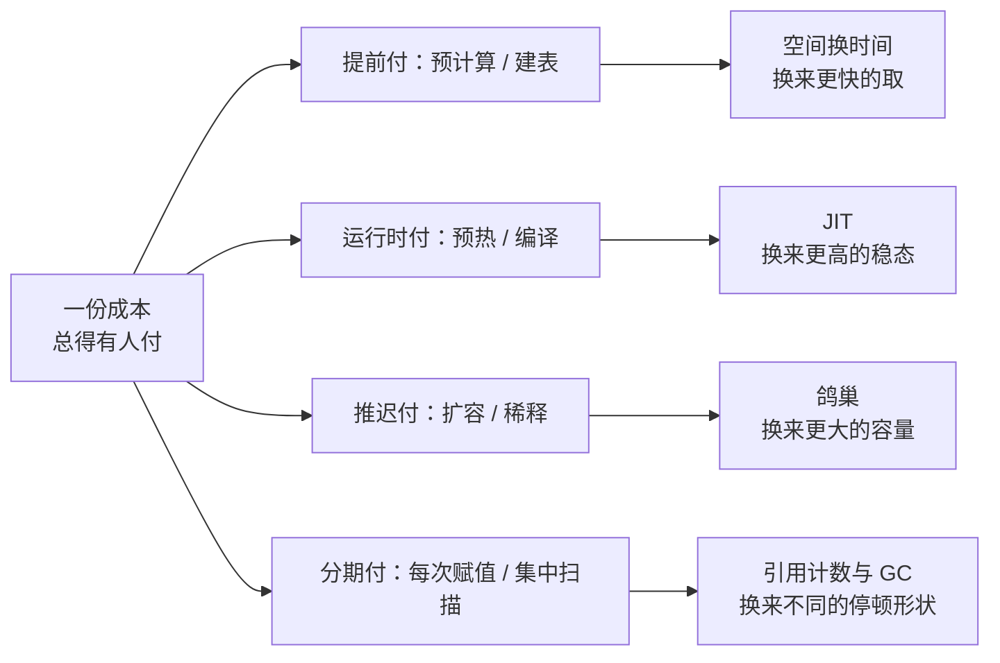
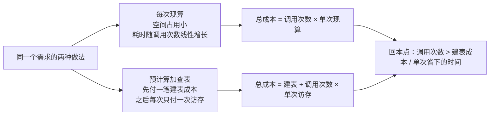
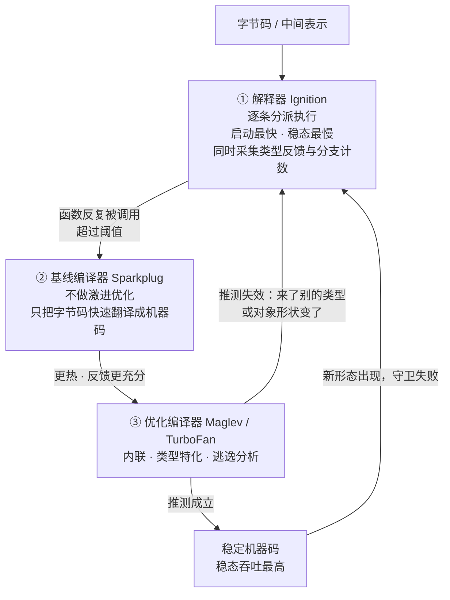
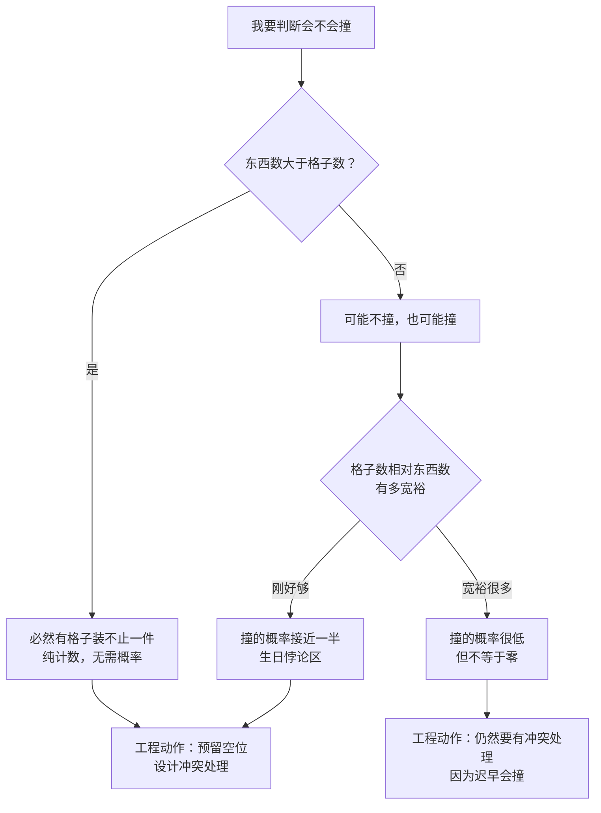
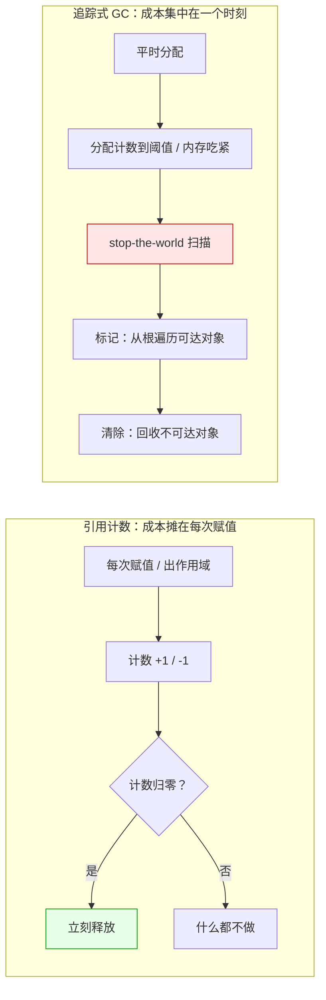
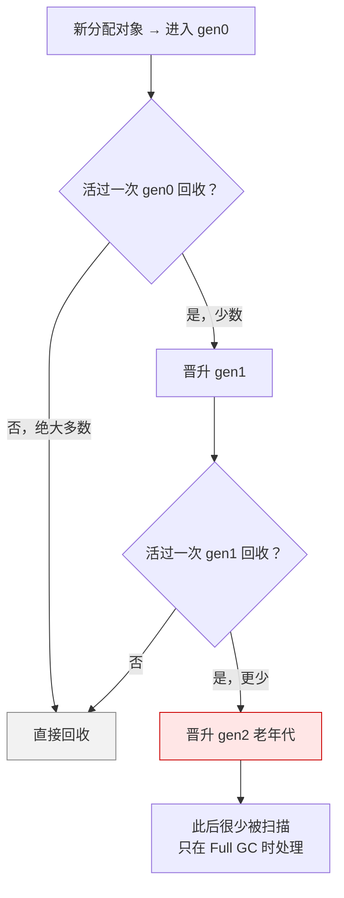

这四条原则看起来分属数据结构、编译优化、组合数学与内存管理，但它们处理的是同一件事：**代价守恒，只是分期方式不同。**

- **空间换时间**把计算成本提前付掉，换成使用时更便宜的「取」；
- **JIT** 把编译成本从启动时分摊到运行期，用预热换稳态吞吐；
- **鸽巢原理**说明容量不够时重复是必然的，代价只能推迟，不能取消；
- **引用计数与 GC** 决定释放成本是摊在每次赋值，还是集中在一个时刻。

四条合起来给出一条判断：**没有免费的优化，只有换一种付法。** 说某个方案「更快」而不说它把成本挪到了哪里，通常意味着那个地方还没被观测到。



下面四节各自独立，实跑与推算分开标注。

## 一、空间换时间

「空间换时间」（space-time tradeoff）不是某个人在某一年提出的单一理论，而是计算这门手艺里最古老的经验之一，线索能拉得很长。

**查表法**在没有计算机的年代就已存在：水手算航海位置要靠对数表，把对数预先算好印成册子，用时翻书而不是现场算。这是最朴素的空间换时间——一本书的纸张，换掉每次航行里的重复计算。**哈希表**在 1953 年由 IBM 的 Hans Peter Luhn 在内部备忘录里提出，用散列把键映射到数组下标，让查找从线性扫描变成一步定位。**存储层次**在 1960 年代成型，寄存器到缓存到主存到磁盘，每一层都是用靠近 CPU 的宝贵空间缓存下一层的常用数据。**索引**在 1970 年由 Bayer 与 McCreight 的 B 树给出：额外一份有序结构，把随机查找换成树上的少量跳转。

这四件事时代不同、层次不同，动作完全相同：**先花一笔空间，把「算」变成「取」。**

**本质一句话：空间换时间是把反复要用的计算结果提前算好、就近存好，让每次使用只花「取」的力气，不花「算」的力气。**



**本机实跑：建表贵、查表便宜**

```text
【1】判定 [2, 200000) 内全部素数（实测，两种做法结果一致）
  试除法逐个数现算          :   301.78 ms   17984 个
  筛法建表 + 顺序查表       :     5.02 ms   17984 个
    其中 建表 0.34 ms / 查表 4.68 ms
  建表内存占用              :     0.19 MiB
  一致 = True

【2】只看单点是否素数（x = 199999，各重复 200 次取均值）
  现算（试除到 √x）         :   0.0187 ms/次
  查表（一次内存访问）      : 0.000028 ms/次
  速度比                    :    667.1 倍
  建表回本所需查询次数      :       18 次

★ 查表快了两个数量级，但建表要先付一笔
★ 回本点 = 建表成本 / 单次省下的时间；查不到这个次数，表就是纯开销
```

注意第二组里那行「回本所需查询次数：18」。这个数字改变了整件事的性质：**同一个方案，查 18 次以上是优化，查 3 次就是浪费。** 「用筛法比试除快」这句话之所以不完全对，就是因为它漏了这个条件。

第一组则给出了另一面：判定 2 到 20 万之间全部素数时，筛法快 60 倍。差别不在算法优劣，而在**调用次数**——这里查了 18 万次，建表成本被彻底摊薄。

落地形态在四个层次上都能找到：

- **语言层**。Python 的 `dict` 用开放寻址加紧凑数组，把「按 key 找值」从 `O(n)` 变成 `O(1)`，代价是每个键值对都占着一段不存数据的表空间。
- **数据库层**。B 树索引把随机磁盘查找换成树上几次跳转，代价是索引文件本身要占空间，并且每次写入都要维护它。
- **系统层**。页缓存把磁盘数据常驻内存，用内存换 I/O；预读把「下一次可能要用的块」提前搬进来，用带宽换延迟。
- **业务层**。计数器、排行榜、物化视图，都是把「每次聚合」换成「每次读一个现成的数」。

**边界与反例**

- **写多读少时反噬**。索引和缓存都假设读远多于写。若写入极频繁，每次写都要更新索引或失效缓存，维护成本会超过省下的查询时间——日志表、流水表通常刻意少建索引，就是这个道理。
- **新鲜度是隐形账单**。缓存里的副本可能过期：缓存了用户资料，用户改完名，缓存没失效，就查到旧名字。你换来的时间，有一部分要用「保证一致」的复杂度去还。
- **空间本身稀缺时，买卖要反过来**。数据量大到放不进内存时，人们反而用时间换空间：gzip 用 CPU 时间换存储，稀疏矩阵只存非零元，流式处理宁可重复算也不存全量。原则永远是双向的，方向由哪头更贵决定。
- **最坏情况不买账**。哈希表平均 `O(1)`，但恶意构造的键能全部撞进同一桶，退化成 `O(n)`，这就是 HashDoS 的由来；索引在选择性差的列上（比如性别）也形同虚设。**空间花出去了、时间没换回来，是这条原则最典型的失败形态。**

## 二、JIT 即时编译

JIT 的直系祖先是动态语言的实现者，因为只有他们非这么做不可——解释执行太慢，而静态编译又拿不到运行时的类型信息。

- **1984 年，Xerox PARC**：Deutsch 与 Schiffman 的《Efficient Implementation of the Smalltalk-80 System》提出 dynamic translation，把字节码在运行时翻译成机器码。这是 JIT 作为透明优化手段的起点。
- **1987 到 1994 年，Self 语言**：Ungar、Smith、Urs Hölzle、Chambers 等人做出完整形态的自适应优化。关键的 1994 年 PLDI 论文确立了今天所有 JIT 的核心机制：**靠运行时类型反馈做优化决策，并允许优化失效后去优化回到安全状态。**
- **1999 年，Java HotSpot VM**：Sun 收购了 Self 与 Strongtalk 团队创办的 Animorphic，C1 加 C2 的分层编译由此进入工业主流。
- **2008 年，V8**：早期干脆不做解释器，直接全量编译；2015 年引入 Ignition 加 TurboFan 组成分层与去优化骨架；2021 年又补上 Sparkplug 与 Maglev，形成四级阶梯。
- **同一条路线的其他成员**：PyPy、LuaJIT、PHP 8.0、.NET RyuJIT，以及 WebAssembly 规范里的分层编译。

**本质一句话：JIT 用运行期的真实信息换更激进的优化——代价是预热成本、内存占用与去优化抖动，收益是稳态吞吐；它把编译从一次性开销变成了一个持续的投资决策。**

「持续的投资决策」这个说法是关键。AOT 编译只决定一次：编还是不编、优化到什么程度。JIT 则在运行中反复决定：这段代码值不值得编译、值不值得按当前类型特化、什么时候作废重来。它优化的是**决策质量**，付出的是**决策成本**。



**本机实跑：三档模式的差距**

```text
Node v22.22.2 / V8 12.4.254.21-node.39
==============================================================================
运行模式                    数值热循环 次/秒      单态调用 次/秒        多态调用 次/秒
------------------------------------------------------------------------------
默认（JIT 全开）               198656          2491096815       163037911
--no-opt（禁用优化编译器）        27968            73888405        36827707
--jitless（纯解释器）          15281            36918440        24029810
==============================================================================
相对默认模式的数值循环吞吐：
  默认（JIT 全开）                1.00x
  --no-opt（禁用优化编译器）          0.14x
  --jitless（纯解释器）            0.08x
```

三行数字给出一个很容易被低估的量级：**同一段代码，纯解释执行比 JIT 全开慢 12.5 倍。** 更有意思的是「单态调用」那一列：默认模式 24.9 亿次每秒，纯解释器 3691 万次每秒，差 67 倍。这个差距不是来自「翻译成机器码」本身，而来自**类型特化**：JIT 看到这个调用点一直只遇到一种形状，就把它内联成一次内存偏移；解释器每次都还要查表。

**预热不是抽象的代价，它能被逐次测出来：**

```text
默认模式：同一个 work(4000) 连续调用 400 次，逐次单次耗时（µs，越小越快）
  第  1- 6 次:    76.8   225.7    91.1    61.2    64.3    63.7
  第  7-12 次:    75.3    37.7    37.6    39.1    38.8    39.2
  第 13-18 次:    38.1    51.2    36.7    36.2    37.4    44.2
  第 19-24 次:    39.0    82.8     5.0     4.8     4.7     4.6
  第 25-30 次:     4.7     4.7     4.7     4.7     4.6     4.7
  第 31-36 次:     4.7    14.0     4.7     4.7     4.7     4.7
  第 37-42 次:     4.7     4.7     4.7     4.7     4.7     4.7
  第 43-48 次:     4.7     4.7     4.8     4.7     4.7     4.6
  第 49-54 次:     4.7     4.7     4.7     4.6     4.7     4.7
  第 55-60 次:     4.6     4.7     4.7     4.7     4.7     4.7

  前 40 次平均 32.99 µs  /  第 200 次之后平均 4.52 µs  →  冷热差 7.30x
```

```text
各模式的冷启动差距（前 40 次均值 ÷ 第 200 次之后均值）：
  默认（JIT 全开）              7.30x   （前 40 次均 32.99 µs / 稳态 4.52 µs）
  --no-opt（禁用优化编译器）       1.14x   （前 40 次均 41.81 µs / 稳态 36.74 µs）
  --jitless（纯解释器）          2.27x   （前 40 次均 139.51 µs / 稳态 61.35 µs）
```

逐次序列里有两个台阶值得看：第 7 次左右从 60 多微秒降到 37 微秒，是基线编译生效；第 19 到 21 次之间从 39 微秒掉到 4.7 微秒，是优化编译器接手。**这两次跃迁之间，同一段代码的执行路径完全不同**，而代码本身一个字都没改。

第二块表的 `--no-opt` 那行很说明问题：关闭优化编译器之后，冷热差只有 1.14 倍，也就是说**大部分「冷热差」正是优化编译器带来的**，而不是解释与编译的差别。

**边界与反例**

- **JIT 对短命进程基本没有价值**。编译器、CLI 工具、一次性脚本、批处理里的小任务，进程活不过预热期，付出的是纯成本。这也是 Go、Rust、C++ 在这类场景胜出的根本原因：AOT 不是更先进的编译，而是另一组取舍。
- **预热期就是尾延迟**。服务刚发布、实例刚扩容、缓存刚失效时，请求正好落在还没优化的代码路径上，平均延迟好看，p99 难看。
- **去优化会造成性能断崖**。一旦运行中出现新类型或新形状，优化代码被丢弃、回到解释器、重新预热。「通常很快」和「突然变慢」会在同一进程里交替出现，这在压测里常被误判为抖动。
- **内存成本是真实的**。机器码、profile 数据、元数据，让 JIT 运行时的内存占用明显高于解释器。移动端与嵌入式设备上，这个成本经常比性能收益更关键。
- **它扩大了安全面**。可写可执行内存带来 JIT spraying 这类攻击；推测执行侧信道也需要 JIT 生成的 gadget 才能发挥，很多运行时因此提供了关闭 JIT 的开关。
- **优化绝不能改变语义**。浮点与 `NaN` 的处理、对象身份比较、GC 可见性、`eval` 与反射都会限制优化空间。**如果某个优化会改变可观察行为，那它就不是优化，是 bug。**

## 三、鸽巢原理

这条原理的正式提出者是 **Peter Gustav Lejeune Dirichlet（狄利克雷）**，时间是 **1834 年**。他在研究用有理数逼近无理数时，需要一个「必然存在」的结论，不是「大概率存在」。他在论文里把它命名为 **Schubfachprinzip**，直译就是抽屉原理：如果把 n 件东西放进 m 个抽屉，且 `n > m`，那么至少有一个抽屉里放了不止一件东西。

**本质一句话：鸽巢原理讲的是规模超过容量时，重复不是意外而是必然——它把「会不会撞」这个问题，变成了一道只有加减乘除的算术题。**



**本机实跑：从纯计数到概率**

```text
  抽屉总数            : 365
  鸽子总数            : 366
  被占用的抽屉数      : 232
  单个抽屉的最大数量  : 5
  结论                : 366 > 365，必然存在抽屉 >= 2 只 （实测 5 只）
```

```text
  人数 n | 理论 P(碰撞) | 实测频率 | 位数
  -------|--------------|----------|------
      10 |      0.1169  |   0.1163 |
      20 |      0.4114  |   0.4079 |
      23 |      0.5073  |   0.5099 | ★ 已过半
      30 |      0.7063  |   0.7099 | ★ 已过半
      40 |      0.8912  |   0.8910 | ★ 已过半
      50 |      0.9704  |   0.9702 | ★ 已过半
      57 |      0.9901  |   0.9908 | ★ 已过半
      70 |      0.9992  |   0.9991 | ★ 已过半

  ★ n=23 时两两组合数 C(23,2) = 253，远大于 23
  ★ 每组重复 40000 次实验，实测频率与理论值吻合
```

第一组是原教旨版本：`366 > 365`，所以必然有抽屉装了 2 只以上，实测最大是 5 只。注意「≥ 2」和「实测 5」的差别，那是原理本身的信息边界——**它只保证存在，不保证有几个。**

第二组是它在概率上的延伸，也就是常说的生日悖论：23 个人就有超过一半的概率撞生日。这里的关键数字不是 23，而是 `C(23,2) = 253`——**虽然只有 23 个人，但两两配对的组合有 253 对**，而抽屉只有 365 个。比较的对象从来不是人数与抽屉数，而是配对数与抽屉数。

哈希表里的表现更贴近日常：

```text
  哈希桶数 = 1000，插入元素数 = 1000（负载因子正好 1.0）

  实测（2000 轮平均）非空桶数 = 632.6 / 1000
  实测（2000 轮平均）空桶数   = 367.4
  ★ 理论：空桶期望 = m·e^(-n/m) = 1000·e^(-1) ≈ 367.9

  同时，有约 368 次插入是「落进了已经有人占的桶」。
```

```text
  负载因子 | 平均链长 | 最长链长(2000 轮均值) | 相对 0.75 的查找成本
  ---------|----------|------------------------|----------------------
      0.50 |     0.50 |                    4.0 |                 0.86x
      0.75 |     0.75 |                    4.8 |                 1.00x
      1.00 |     1.00 |                    5.5 |                 1.14x
      1.50 |     1.50 |                    6.8 |                 1.43x
      2.00 |     2.00 |                    7.9 |                 1.71x
      3.00 |     3.00 |                   10.0 |                 2.29x
```

这两块解释了哈希表为什么普遍把负载因子卡在 0.75 左右：**桶数和元素数相等时，仍有 37% 的桶是空的，同时又有 37% 的插入发生了碰撞。** 「浪费三成空间」和「承受三成碰撞」同时成立，看起来矛盾，其实是同一件事的两面——空桶不是浪费，它是把碰撞概率压下去所付的价。而负载因子从 0.75 涨到 3.0，查找成本涨 2.29 倍，这就是「省空间」要交的钱。

这也解释了定向攻击为什么有效：

```text
  场景：哈希函数只取低位（m = 64 桶），攻击者提交 64 个精心构造的 key
  非空桶数 = 1（总共 64 个桶）
  0 号桶链长 = 64
```

64 个元素全进一个桶，一次查找退化成遍历 64 个节点。**鸽巢原理在这里没有教你「一定会撞」，它教你「攻击者可以决定撞在哪里」。** 随机化哈希的作用就是把「撞在哪」变回不可控。

**边界与反例**

- **它只管有重复，不管重复几次**。366 只鸽子放进 365 个抽屉，原理只保证至少有一个抽屉装 2 只以上，实测可能是 5。想要更强的结论得用广义鸽巢原理：n 件放 m 个抽屉，必有抽屉不少于 `⌈n/m⌉` 件。
- **它不告诉你哪一对撞了**。这是存在性证明的通病。工程上想定位冲突，只能靠记录与比对。
- **它假设格子是固定的**。一旦格子能动态扩张（哈希表扩容、分片增加节点），冲突就可以被稀释——但扩容本身有成本，而且扩容只是把「必然撞」推迟到更大的规模，没有取消它。
- **拿它硬套会闹笑话**。「50 个人里必有两人头发数相同」成立，因为头发数远小于 50 亿；「50 个人里必有两人身高相同」不成立，因为身高是连续量。「格子数有限」是前提，值域连续时这条原理要么不适用、要么得先量化精度。
- **它和随机是正交的**。随机化能让单次碰撞概率可控，但消不掉必然性。正确姿势是双管齐下：用随机化哈希抵御定向攻击，用冲突处理（链地址、开放寻址、扩容）接住必然发生的那次碰撞。
- **它解释了唯一索引为什么不是银弹**。唯一索引能防住重复，代价是插入时要查一次、冲突时要报错。把「不可能重复」换成「如果重复了怎么办」，正是因为按鸽巢原理，重复是迟早的事，只是这次撞在了业务键上，而不是哈希桶上。

## 四、引用计数与垃圾回收

很有意思的是，这两种方案**诞生在同一年：1960 年**。

**引用计数**：George E. Collins 在《A Method for Overlapping and Erasure of Lists》里提出，给每个对象记一个「有多少人在引用我」的计数，计数归零就释放。思路直观得像物理常识：没人拿着了，就可以扔了。**追踪式 GC**：同一年，John McCarthy 为 Lisp 实现 GC 时提出 mark-and-sweep，从一组确定的根（栈、寄存器、全局变量）出发，把所有能到达的对象标记一遍，没被标记的就是垃圾。

**本质一句话：引用计数和追踪式 GC 回答的是同一个问题——这块内存还有用吗——但一个用「谁还引用我」这种局部信息来回答，另一个用「从根能不能到达」这种全局信息来回答；这个差异决定了一个没有停顿但有循环泄漏、另一个没有循环泄漏但有全局停顿。**



**本机实跑：确定性析构与循环死穴**

```text
[1] 引用计数：对象一被引用就 +1，引用离开就 -1，归零即释放
  a = Cell()            → sys.getrefcount(a) = 2  （含 getrefcount 自己的临时引用）
  b = a                 → sys.getrefcount(a) = 3
  lst = [a, a, a]       → sys.getrefcount(a) = 6

[2] 确定性析构：引用归零的时间点可精确观测
  del x 之后 finalizer 是否已触发：True
  从 del 到对象被回收的间隔：3.90 微秒（同一语句内完成）
```

```text
[3] 引用计数的死穴：循环引用，计数永远不为零
  构造 p <-> q 环后，sys.getrefcount(p) = 3
  del p, q 之后：环仍在，两个对象都无法被引用计数释放
  当前 gc 垃圾计数 = (1259, 8, 0)  → 追踪式 GC 才能收割
  gc.collect() 回收对象数 = 2，耗时 1.465 ms
  回收后再 collect：0 个（环已被清掉）
```

那 3.90 微秒是引用计数最值钱的性质：**它把「什么时候释放」从一个不可控的时刻，变成一个可以写进代码因果链的时刻。** 这正是 C++ 的 RAII 与 Swift 的 ARC 能成立的基础——析构时机可预测，就能拿它做资源管理（关文件、放锁、提交事务）。

而循环引用是它的结构性缺陷：计数是局部信息，两个对象互相引用时，各自的计数都不为零，但整体已经不可达。这不是实现不够聪明，是信息不足——**局部信息无法判断全局可达性。**



追踪式 GC 的代价在暂停时间上，而暂停时间的形状很不一样：

```text
[4] 暂停时间：引用计数释放 vs GC 一次完整回收
  标量           | 操作                    |     耗时 | 说明
  -------------+-------------------------+----------+------------------
       100,000 | del 单向链表（引用计数）    |  2.917 ms | 逐对象立即释放，无扫描
       300,000 | del 单向链表（引用计数）    |  9.050 ms | 逐对象立即释放，无扫描
       600,000 | del 单向链表（引用计数）    | 16.008 ms | 逐对象立即释放，无扫描
       100,000 | gc.collect()（追踪式）    | 18.542 ms | 必须遍历存活对象图
       300,000 | gc.collect()（追踪式）    | 81.923 ms | 必须遍历存活对象图
       600,000 | gc.collect()（追踪式）    | 144.070 ms | 必须遍历存活对象图
```

同样的 60 万个节点，引用计数 16 ms，追踪式一次完整回收 144 ms，差 9 倍。但结论不能只读到这一层：引用计数那 16 ms 是**分散在 60 万次 del 里的**，单次约 27 纳秒，平稳；追踪式那 144 ms 是**一次停顿**，业务线程完全停下。**两者总成本接近，形状完全不同**——而在线服务里，形状往往比总量更重要。

```text
[5] 分代假说：绝大多数对象活不过第一代
  分配 400,000 个临时对象后，三代回收次数：
    gen0（新生代）:   366 次  ← 绝大多数对象死在这里
    gen1（中年代）:    33 次  ← 活过 gen0 的才被扫
    gen2（老年代）:     0 次  ← 长期存活的最后兜底
    观察到的 GC 暂停次数：399，最大暂停 1.570 ms，总暂停 94.362 ms
```

分代回收是鸽巢原理的另一种形态：**如果大多数对象很快死，就把扫描预算按存活概率分配。** gen0 扫了 366 次，gen2 一次没扫，这正是把「反复扫描全堆」换成「频繁扫小堆、偶尔扫大堆」。

```text
  语言 / 运行时        主机制             循环处理            补充
--------------------------------------------------------------------------------
  CPython            引用计数            分代循环回收器       弱引用 / finalizer
  Swift              引用计数(ARC)        需 weak/unowned 打断  编译期插入计数
  C++ shared_ptr     引用计数            需 weak_ptr 打断      手动选择
  Java HotSpot       追踪式(分代)        天然处理            G1 / ZGC 并发标记
  Go                 追踪式(并发标记)     天然处理            低延迟目标
  V8 (JS)            追踪式(分代)        天然处理            Orinoco 并发
```

**边界与反例**

- **引用计数不是没有停顿，只是停顿分散**。一次 `del` 一个十万节点的树，照样有毫秒级卡顿。「无停顿」是相对追踪式的 stop-the-world 说的，不是绝对承诺。
- **追踪式的暂停也可能是假象**。现代 JVM 的并发 GC（G1、ZGC）把大部分标记工作放在业务线程之外，暂停被压到毫秒甚至亚毫秒。「Java 一定有几百毫秒停顿」这个印象早已过时，选型要看具体收集器，不是看语言。
- **引用计数有计数溢出风险**。32 位计数在极端场景下会回绕，一些实现为此在超大对象上改用 64 位或特殊处理。
- **循环不是唯一的麻烦，还有多线程下的原子计数**。`+1/-1` 在多线程里必须原子，这个写屏障开销可能吃掉它相对追踪式的优势，这也是很多高并发运行时最终选追踪式加并发标记的原因。
- **分代假说不永远成立**。如果程序大量分配长寿对象（比如启动期构建一个巨大缓存），分代策略会把大量对象搬来搬去，反而更慢。
- **别再问哪种更好，先问在优化什么**。追求低延迟与可预测（实时系统、游戏引擎、音频处理），偏向引用计数或低停顿 GC；追求高吞吐（批处理、Web 后端），偏向分代加并发。同一个语言的不同 GC 实现，服务的就是不同的目标函数。

## 五、横向对照

| 原则 | 把成本付在哪一刻 | 一句话判据 | 什么时候不成立 |
|------|-----------------|-----------|---------------|
| 空间换时间 | 提前付：预计算与建表 | 调用次数能否过回本点 | 写多读少，或散列不均匀 |
| JIT | 运行中付：预热与重编译 | 进程活得够久吗 | 短命进程，或形态频繁变化 |
| 鸽巢 | 推迟付：扩容与稀释 | 配对数与格子数的比 | 值域连续，或格子可动态扩张 |
| 引用计数与 GC | 分期付：每次赋值或集中扫描 | 要低延迟还是要高吞吐 | 循环引用，或长寿对象过多 |

四条合起来，其实是一张「成本去哪儿了」的对照表：

| 看到的收益 | 实际付掉的是 |
|-----------|-------------|
| 查表快 600 多倍 | 建表时间加 0.19 MiB 内存，且查询次数要够多 |
| JIT 稳态快 12 倍 | 前 40 次调用慢 7.3 倍，内存更高，还有去优化断崖 |
| 哈希表 `O(1)` | 37% 的空桶，以及一次必然发生的碰撞 |
| 引用计数无全局停顿 | 每次赋值的一次计数增减，加上循环引用的补充收集 |

这张表的用法很直接：**下次看到「这个方案快多少倍」时，先问它把成本挪到哪一行。** 挪到的地方如果正好是你的短板（内存、尾延迟、启动时间、写入频率），那这次优化对你就是负收益——尽管它在别人的场景里确实是优化。

🐾 收尾一句：性能没有免费的午餐，只有不同的分期方案；看清分期，才知道这笔账该不该借。

---

**相关阅读**：
- [计算机原则五讲（十二）：省下的开销算在谁账上](/posts/princ-chapter-12/)
- [计算机原则五讲（一）：这笔投入能换回什么](/posts/princ-chapter-01/)
- [计算机原则五讲（五）：规模一上来，系数说了算](/posts/princ-chapter-05/)
- [每天一个计算机原则：专栏介绍](/posts/princ0001/)
