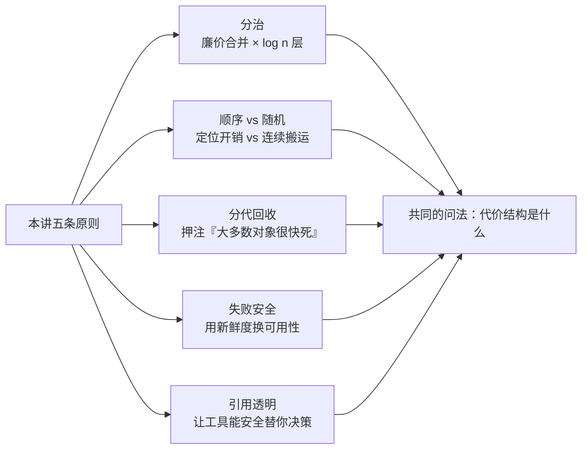
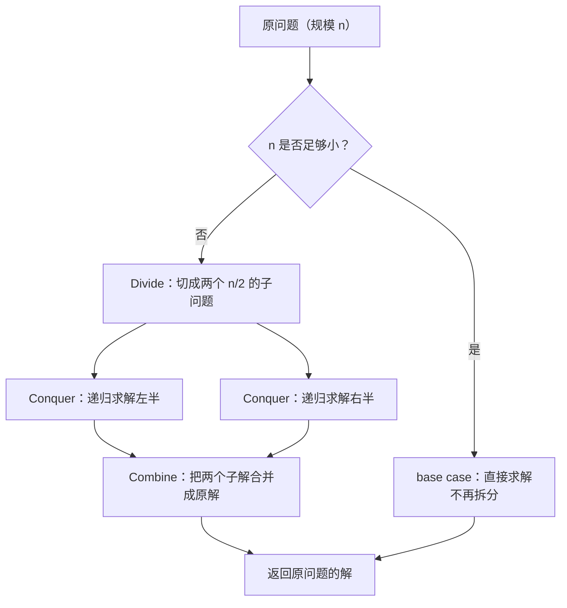
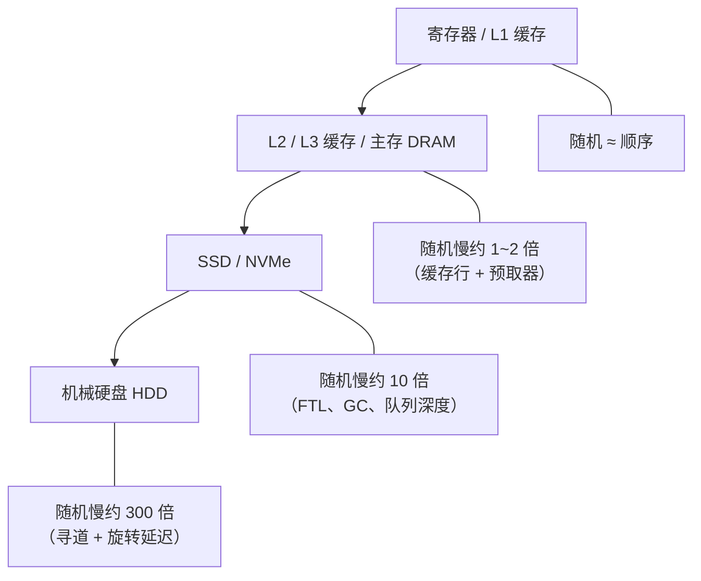
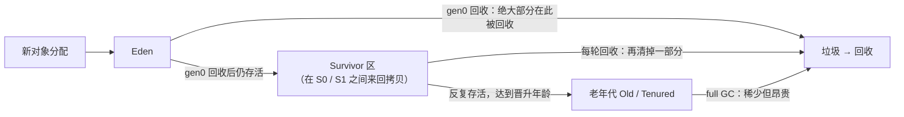
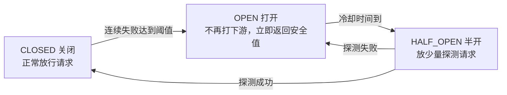
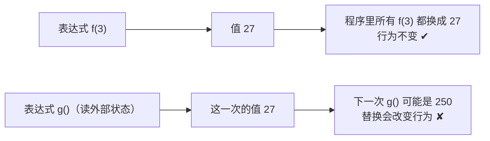

把五条原则放进一章，不是为了凑篇幅。它们表面上分属算法、存储、运行时、容错、语言五个领域，内里问的却是同一件事：**这套机制，到底拿什么换什么。**

- **分治**拿「廉价的合并」换掉相乘的代价；
- **顺序读与随机读**拿「连续搬运」换掉反复定位；
- **分代回收**拿「押注大多数对象很快死」换掉全堆扫描；
- **失败安全**拿「数据新鲜度」换「系统可用性」；
- **引用透明**拿「不写副作用」换「工具可以替你决策」。

五条原则的共同读法是：**先看清代价结构，再决定策略。** 看不清代价结构时谈优化，多半是在给非瓶颈追加预算。



下面五节各自独立成篇，所有结论都带本机实跑，或明确标注为推算。

## 一、分治：拆到不可再拆

分治作为算法范式的现代起点，通常记在 **1945 年的归并排序**上：John von Neumann 与 Herman Goldstine 在讨论 EDVAC 时就描述了「把两个已排序序列合并成一个」的思路。术语 **divide and conquer** 本身借自军事（分而治之），搬进算法语境并系统化是 1970 年代教材成型之后的事。**二分查找**是同期产物，John Mauchly 在 1946 年提出，但据 Donald Knuth 考证，**第一个在所有边界条件下都正确的二分实现，1962 年才发表**，前后隔了 16 年——思想好懂，边界难缠。

要理解分治为什么能把 `O(n²)` 拉到 `O(n log n)`，得盯住「合」那一步：两个各自有序的长度为 `n/2` 的序列，合成一个有序序列只需线性时间。**正因为「合」是廉价的 `O(n)`，拆才有意义。** 它换来的东西有三样：降低复杂度（归并排序、快速幂、Karatsuba）、制造并行性（子问题独立，MapReduce 的全部前提）、以及让问题归约（二分把「搜索」归约成「在更小范围搜索」）。

**本质一句话：分治的本质是把「子问题的解 → 原问题的解」这一步做成廉价操作——只要「合」比暴力解便宜，规模减半就能把相乘的代价变成相加，这就是 `O(n²) → O(n log n)` 的全部来源。**

三件套里，「合」不是可选项，它是分治区别于「纯递归」的那一步：



代价是怎么攒出来的：**每一层的合并总工作量恰好是 `O(n)`，而层数只有 `log₂(n)`**，乘起来就是 `O(n log n)`。合并一旦不便宜，金字塔就塌了。

**本机实跑：数量级的距离**

```text
【1】三种排序的增长行为（随机整数，取 3 次最快）
   n      merge_sort      insertion_sort    内置 sorted      n log n 参考
  100          0.10 ms           0.15 ms         0.00 ms          664
  1000         1.33 ms          14.52 ms         0.07 ms         9965
  4000         6.51 ms         249.58 ms         0.41 ms        47863
  16000       28.89 ms        8301.42 ms         4.19 ms       223452

【2】递归拆分的调用次数（n = 1000）
  merge_sort 递归调用次数 = 1999（理论上界 2n - 1 = 1999，实测吻合）

【3】小规模下分治会退化，混合策略胜出（n = 200000）
  纯递归分治              :  1460.56 ms   结果正确=True
  分治+小区间插入排序(阈值32)  :  1319.21 ms   结果正确=True
```

`n` 从 1000 涨到 16000（16 倍）：归并排序涨约 22 倍，插入排序涨约 571 倍。而递归树有 `2n - 1` 个节点，说明**拆分本身有成本**——这正是混合策略（递归到 32 个元素以内改用插入排序）快约 10% 的原因：**当子问题足够小，拆分与调用的开销已经超过它省下的比较次数。**

**边界与反例**

- **拆分可能是 `O(n)` 的复制**。切片式归并每一层都在复制数组，`log n` 层就是 `O(n log n)` 的额外搬运；原地分治（快排 partition）就是为省掉这笔。
- **合并昂贵则毫无收益**。两个子解要用 `O(n²)` 才能拼起来时，拆再多也没用。**判断能不能分治，第一件事是估合并的阶，不是估拆分的阶。**
- **子问题重叠时改用动态规划**。分治要求子问题互不重叠；一旦重叠（朴素斐波那契递归），同一子问题被反复求解，代价塌回指数。这是分治与 DP 最本质的分界。
- **递归深度是硬约束**。`log n` 层通常无虞；但线性递归的深度等于 `n`，`n = 10⁵` 就会撑爆调用栈。**深度是 `log n` 还是 `n`，比代价公式更早决定成败。**
- **切片数不是越多越好**。任务拆成 64 份、每份只干一点点活，调度、切换、合并的固定成本会吃掉全部收益。粒度存在最优值。

## 二、顺序读与随机读：机械同情心的现代版

这条规律的物理源头是硬盘。1956 年 IBM 的 **RAMAC 305** 读一块数据要分三步：**寻道**（磁头移到目标磁道，7200 转盘上平均约 8 毫秒）、**旋转延迟**（等扇区转过来，平均再约 4 毫秒）、**传输**（连续传输每秒上百兆）。关键在第三步之外：**如果下一次读的位置就在旁边，前两步的开销被摊薄到几乎为零**。随机访问要为每一次读取单独付一次定位费。

把这个道理变成工程直觉的是 **mechanical sympathy**（机械同情心）——赛车手 Jackie Stewart 的说法，软件界由 Martin Thompson（LMAX 的 Disruptor 作者）等人带火：**写软件不能只看代码，得知道底层硬件怎么干活。** 2007 年 SSD 普及后机械寻道消失了，但代价没有归零，只是换了形态：NAND 以页为单位读、以块为单位擦（写放大）、FTL 映射表要维护、随机小 IO 撑不满队列深度。于是这条原则活了下来：**LSM-tree 把随机写攒成顺序写**、**Kafka 用仅追加日志**、**对象存储按大对象设计**、**B 树叶子用链表串起来支持范围扫描**。

**本质一句话：顺序与随机的差距，是「一次定位开销」对「一段连续搬运」的比值；这个比值随介质上下浮动，但方向从不反转。**

比值多大取决于你在哪一层，**越靠下，定位开销占比越高**：



**本机实跑 + 成本模型推算**

```text
【1】内存层：顺序下标 vs 乱序下标（同一块数组，本机实测）
  顺序下标访问 :    99.36 ms
  乱序下标访问 :   191.61 ms
  倍数         :     1.93x

【2】存储层成本模型（公开典型参数推算，非本机实测）
  传输 1 GiB（4 KiB/块，共 262144 块）
  介质         随机总耗时(推算)     顺序总耗时(推算)     倍数
  HDD 7200rpm        2175.8 s             6.83 s      318.7x
  SATA SSD             21.0 s             2.05 s       10.2x
  NVMe SSD              5.2 s             0.34 s       15.4x
```

结论要看得诚实：**在内存这一层，顺序与随机的差距只有一到两倍**；到存储层，同一个 1 GiB 数据，机械盘上差 300 倍以上（36 分钟 vs 7 秒），SSD 上压到 10 倍左右。NMVe 的倍数反而高于 SATA，是因为它的顺序带宽高出太多，而被压不下去的微秒级随机延迟成了主导。**数量级差距从「三个数量级」降到一个数量级，但随机读始终是贵的。**

工程上几乎所有存储结构都在干同一件事——**把随机变成顺序**：WAL / 仅追加日志把随机写变顺序写、LSM-tree 靠内存表 + 顺序刷盘、B 树叶子链表把范围扫描变顺序读、单调递增主键把随机插入拉回顺序追加。**四种做法的共同点是：不消灭随机，而是把它集中到一处、成批处理。**

**边界与反例**

- **别把「顺序一定快」当教条**。点查一行时，随机读一个索引页远快于顺序扫全表。**顺序的优势建立在「要读的数据量大且连续」之上。**
- **SSD 时代结论要打折**。随机惩罚从 300 倍降到 10 倍，很多「机械盘时代的铁律」需要重新评估。
- **把随机写变顺序写，代价挪到了别处**。LSM-tree 换来顺序写，却带来读放大与 compaction 写放大。顺序写不是免费的，只是换了位置。
- **顺序本身可能成为瓶颈**。仅追加日志要求写入串行化，单条日志队列在极高并发下会成为热点；多流靠分片并行，而不是把它变回随机。
- **预读会浪费**。顺序扫描时系统预读后续页面，若实际只用到一小部分，就是纯粹的读放大。

## 三、分代垃圾回收：把局部性用在内存上

分代押注的是一条经验规律，叫**弱分代假说**（weak generational hypothesis）：**绝大多数对象在很年轻时就会死亡；而活得越久的对象，越可能继续活下去。** 把它变成工程方案的是两篇论文：**1983 年** Lieberman 与 Hewitt 的《A real-time garbage collector based on the lifetimes of objects》第一次按生命周期分区回收；**1984 年** David Ungar 的《Generation Scavenging》给出了「分代复制」的完整做法——**这是今天所有分代收集器的祖先**。

为什么需要它？因为**一次全堆回收的代价与「堆有多大」成正比**，而堆只会越来越大。分代把这个代价砍掉的方式是**集中投放回收预算**：大多数对象是朝生暮死的，它们全在新生代，而新生代很小，扫它的代价只与「最近分配了多少」成正比，与整堆大小基本无关；老年代回收很贵，那就少做。

**本质一句话：分代垃圾回收是把局部性原理搬到内存管理上——大多数对象很快变成垃圾，于是只对「最近分配的那一小块」频繁回收，长期存活的对象少动。**

对象的生命周期在分代回收里有一条固定路径：



顺着这条路径能看到两个成本点：**Survivor 区的拷贝**（每活过一轮就被复制一次）与**晋升**（一旦进了老年代，就得等昂贵的 full GC 才能清掉）。**把大量对象「故意」留久，等于主动把它们推向最贵的回收路径。**

**本机实跑（CPython 3.13，阈值 2000 : 10 : 10）**

```text
【1】短命对象：引用计数当场收掉，根本到不了分代 GC
  创建 1,000,000 组短命字典，耗时 246.7 ms
  gen0 回收次数 = 0      回收对象数 = 0
  gen1 回收次数 = 0      回收对象数 = 0
  gen2 回收次数 = 0      回收对象数 = 0

【2】存活对象堆积：这才真正触发分代回收
  创建并保留 1,000,000 个字典（都还活着）后：
  gen0 回收次数 = 910    回收对象数 = 0
  gen1 回收次数 = 82     回收对象数 = 0
  gen2 回收次数 = 7      回收对象数 = 0

【3】引用循环：引用计数收不掉，必须靠分代 GC
  制造 300,000 个两节点引用环后：
  gen0 回收次数 = 275    回收对象数 = 549196
  gen1 回收次数 = 24     回收对象数 = 48960
```

三组数据讲了三件事。第一，**CPython 里短命对象被引用计数当场释放，分代回收一次都没跑**——所以分代 GC 在这里只负责引用计数处理不了的那部分，以引用环为主。第二，当存活对象开始堆积，计数立刻动起来：`910 : 82 : 7` 近似贴合阈值 `2000 : 10 : 10` 的放大关系，**便宜的代跑得勤、昂贵的代跑得少**，这正是分代策略的编码方式。第三，30 万个引用环让 gen0 一口气回收了 **549196** 个对象——**这才是分代 GC 的真实战场**。

**边界与反例**

- **长命对象多的负载会吃掉分代的好处**。缓存、大数组里的对象几乎不会死，却要陪着一起被扫。**判据是存活率**：存活率低的负载收益巨大；存活率高的负载，分代白忙。这类问题叫**分代泄漏**（本该短命的对象因被长命容器持有而提前晋升）。
- **分代只解决「收集效率」，不解决「停顿」**。它让绝大多数回收变便宜，但 full GC 依然要停整个世界。压低停顿要靠并发标记、增量回收、区域化——**这是两个正交的维度。**
- **写屏障本身有成本**。每次把引用写进老对象都要多一步记账（记忆集 / card table）。写入密集的负载会明显感到这笔税。
- **垃圾产生率低时，扫新生代是额外开销**。每次回收都要检查新生代，即使里面几乎没有垃圾。
- **连最初「坚持不分代」的低延迟收集器，最后也把分代加了回来**。分代不是所有 GC 的必选项，但它是最普遍的那个选项。

## 四、失败安全：出错时退到安全的那条路

Fail Safe 来自安全工程，不是软件发明的词。工业与电气系统里，**fail-safe 指「一旦失效，就自动导向安全状态」**：电梯断电抱闸锁死、列车失电即制动、锅炉安全阀只在超压时开启。**失效不是被阻止，而是被设计成导向安全。** 与之孪生的 **Fail Fast**（快速失败）指一旦检测到不可恢复的错误就立刻停下并暴露。软件把它们系统化的是 **Michael Nygard 的《Release It!》**（2007），整理了熔断、舱壁、超时、快速失败等模式；**2012 年 Netflix 开源的 Hystrix** 把这套模式工程化。「优雅降级」这个词出现得更早，来自航空与通信系统。

为什么需要它？因为分布式系统里失败是常态，而真正致命的是失败**蔓延**。设想 A 调 B、B 调 C，C 因数据库抖动开始变慢：A、B 的线程都在等，线程池被逐个占满，重试又加重负担，**几秒后一个只影响 C 的局部问题，变成了整条链路不可用**。这就是**级联失败**。

**本质一句话：失败安全是让系统在出错时主动退到一个已知安全的、仍可工作的状态，而不是把错误原样向上抛——它买的是可用性，付的是正确性与新鲜度。**

最常见的实现是**熔断器**，形态直接借自电路：



**本机模拟 / 实跑**

```text
【1】熔断器状态机模拟：失败时不报错，而是给出安全值
  t   下游健康   调用结果                状态
  0   True       OK                       CLOSED
  1   False      FAIL(本次失败，已记账)         CLOSED
  2   False      DEGRADED(触发熔断)         OPEN
  3   True       DEGRADED(安全返回)         OPEN
  4   True       DEGRADED(安全返回)         OPEN
  5   True       OK(恢复)                 CLOSED
  汇总：正常通过 4 次，安全返回 3 次，无一例外抛给调用方

【2】配置加载：坏配置来了，是抛异常还是回退？
  Fail Fast + 坏配置 : 抛异常 JSONDecodeError（调用方必须处理）
  Fail Safe + 坏配置 : 结果={'timeout_ms': 800, ...} ← FALLBACK(沿用上次可用配置)
```

注意熔断表里 `t=3`、`t=4` 两行：下游其实已恢复健康，熔断器却**依然返回安全值**。这不是 bug，而是设计——**熔断期内不再消耗资源去验证「它是不是好了」，把验证成本推迟到冷却结束的那一次探测上**。而配置那一组数据展示了两种策略的分野：**Fail Fast 让服务当场起不来（问题暴露，但服务不可用）；Fail Safe 让服务带着上一份可用配置继续跑（服务可用，但可能长期停在旧参数上）**。没有绝对正确的答案，取决于「用旧配置继续跑」的风险和「整体不可用」的损失哪个更大。

**边界与反例**

- **降级会掩盖故障**。返回默认值那一刻，监控上可能一切正常。**所以降级必须配告警**，把「正在降级」当成显式指标，而不是把错误静默吃掉。
- **降级的「安全值」必须真的安全**。如果默认配置里带着危险开关（比如跳过校验），Fail Safe 反而制造更大的风险。
- **写路径和资金链路通常不该 Fail Safe**。用旧数据写账、用默认参数扣款都不可逆。**这类路径的正确选择往往相反：宁可拒绝。**
- **熔断的阈值和冷却时间要调**。阈值太低会抖动，冷却太长则恢复后流量进不来。熔断器本身也需要压测。
- **降级可能引入一致性问题**。返回缓存意味着读到旧值；不同服务降级到不同时刻的数据，会让系统呈现「时间错乱」。

## 五、纯函数与引用透明：可替换的表达式

**referential transparency** 这个词组最早出自 Whitehead 与 Russell 的《数学原理》（1910–1913），用来描述一种表达式：**知道它的值，就可以把它整个换掉，而不影响上下文的意义。** 把它精确化并引入现代语言讨论的是 Quine 在 1960 年的《Word and Object》。函数式编程界随后把它当成地基（Haskell 1990）。与之配套的**纯函数**（pure function）定义只有两条：**确定性**（同样输入永远得到同样输出）与**无副作用**（不改外部状态、不做 I/O）。合起来就是：**纯函数的调用就是一个可替换的表达式。**

为什么需要它？因为它决定了**编译器、缓存、调度器能不能替你做决定**。编译器最常用的三类优化——**公共子表达式消除（CSE）、循环不变量外提、指令重排**——全都有同一个前提：同一段表达式，重复求值和只求一次，结果必须一样。工程侧同理：**缓存**成立因为「同参数必得同结果」；**并行**安全因为两次纯调用之间没有依赖；**可测试**因为不依赖外部状态。

**本质一句话：引用透明意味着一个表达式可以在任何地方被它的值替换，而不改变程序的行为——纯函数就是它在代码层面的样子。**



**本机实跑**

```text
【1】替换模型
  pure_cube(3)        连续三次 = 27, 27, 27
  impure_rand(0)      连续三次 = 0.3238, 0.1508, 0.6509
  impure_balance(0)   余额=100 时 = 100，余额改为 250 后 = 250

【2】公共子表达式消除是否合法
  pure:   f(5)+f(5) = 50   ,   2*f(5) = 50   -> 相等，可做 CSE
  impure: f(5)+f(5) = 13 ,   2*f(5) = 16   -> 不等，CSE 会改变结果

【3】记忆化原样成立
  纯函数 fib(30) = 832040，真实计算次数 = 31，耗时 0.01 ms

【4】对非纯函数加缓存，会得到「错误的快」
  账户余额先设为 1000，读到 1000
  再改为 5000，再读同一参数却仍是 1000  ← 缓存返回了陈旧值
```

第 2 组数据最值得记住：**同一个优化动作，用在纯函数上结果 50 不变，用在带状态函数上从 13 变成 16**——程序的语义被优化本身改掉了。所以编译器做任何重排、合并、外提前，必须先证明引用透明。第 4 组则是它的反面：同一个 `lru_cache`，套在纯函数上是性能优化，套在非纯函数上变成正确性 bug——**现实里大量「加了缓存数据就不刷新」的事故，都是这一条。**

**边界与反例**

- **纯函数不等于「程序无副作用」**。真实程序总要读写文件、发请求。函数式的做法不是消灭副作用，而是**把它推到边界**：核心逻辑保持纯，副作用集中在一层。**追求「全程序无副作用」走不通。**
- **纯函数不等于更快**。不可变结构每次「修改」都要新建对象，比原地改动更费内存；结构共享能缓解，但仍是把成本从「正确性风险」换成了「分配开销」。
- **记忆化本身有代价**。缓存占空间，键的哈希与比较花时间。**参数空间大、命中率低的纯函数，加缓存反而更慢。**
- **引用透明不等于无状态**。把状态显式当参数传进来、新状态当返回值传出去，依然可以保持引用透明。**有状态和引用透明不冲突，冲突的是「隐藏的状态」。**
- **求值时机仍可能有语义**。惰性求值下，「纯」表达式的求值时机决定了它会不会被求值、会不会抛异常。**引用透明保证的是值一样，不保证求值时机一样。**

## 六、五条原则的横向对照与小结

| 原则 | 拿什么换什么 | 代价结构的关键量 | 失效边界 |
|------|--------------|------------------|----------|
| 分治 | 廉价合并换相乘代价 | 合并的阶、层数 `log n` | 合并昂贵 / 子问题重叠 / 深度为 `n` |
| 顺序 vs 随机 | 连续搬运换反复定位 | 定位开销 ÷ 连续搬运 | 数据量小 / 数据已在内存 |
| 分代回收 | 押注「速死」换全堆扫描 | 对象存活率 | 长命对象多 / 写引用密集 |
| 失败安全 | 新鲜度换可用性 | 降级可接受的正确性损失 | 写路径 / 资金链路 |
| 引用透明 | 无副作用换工具可推理 | 表达式可否等值替换 | 副作用无法外推 / 求值时机有语义 |

| 五条原则 | 一句话判据 |
|----------|------------|
| 分治 | 先算「合」的阶，再决定拆不拆 |
| 顺序 vs 随机 | 这段数据是被连续搬走的，还是被一次次找过去的 |
| 分代回收 | 这份负载的对象存活率高不高 |
| 失败安全 | 这条路径挂了，用户是「少看到一点」还是「做不成事」 |
| 引用透明 | 这个表达式能不能被它的值替换 |

🐾 **小结**：这五条原则分布在五个领域，读法却完全一致——**先看清代价结构，再谈策略**。分治的成败押在合并的阶上，顺序与随机的价值比随介质上下浮动但方向不变，分代回收的收益与存活率强相关，失败安全买的是可用性、付的是新鲜度，引用透明决定的是工具能否替你决策。它们都不是「技巧清单」，而是同一类问题的不同侧面：**任何工程手段的收益，都能追溯到它交换出去了什么。** 判断一个设计值不值得，问一句「它换的是什么、那个代价我付得起吗」，比背下任何一条结论都管用。

---

**相关阅读**：
- [大 O 复杂度：增长率的语言，不只是面试题](/posts/princ-big-o/)
- [空间换时间：哈希、缓存与索引的共同母题](/posts/princ-space-time/)
- [局部性原理：缓存体系的地基](/posts/princ-locality/)
- [写前日志 WAL：先记账、后落库](/posts/princ-wal/)
- [引用计数与垃圾回收：谁来负责释放](/posts/princ-refcount-vs-gc/)
- [快速失败：让 Bug 早点现形](/posts/princ-fail-fast/)
- [幂等性：让重试变得安全](/posts/princ-idempotency/)
- [墨菲定律：会出错的总会出错](/posts/princ-murphy/)
