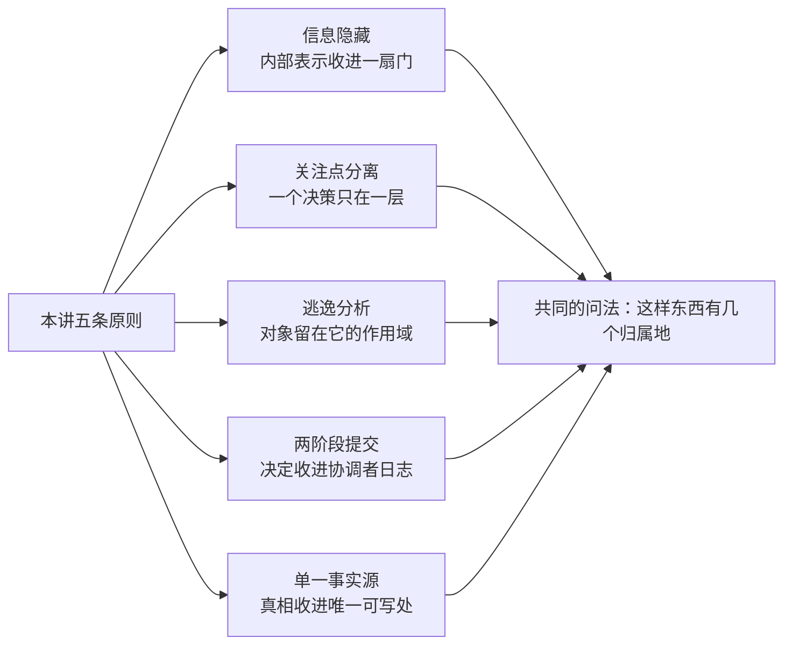
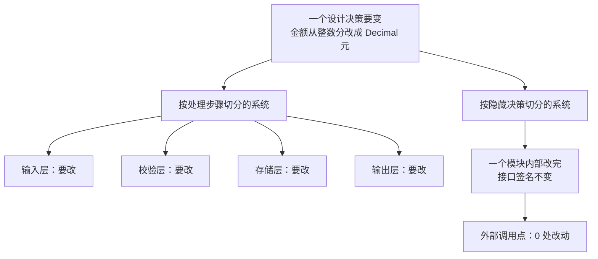
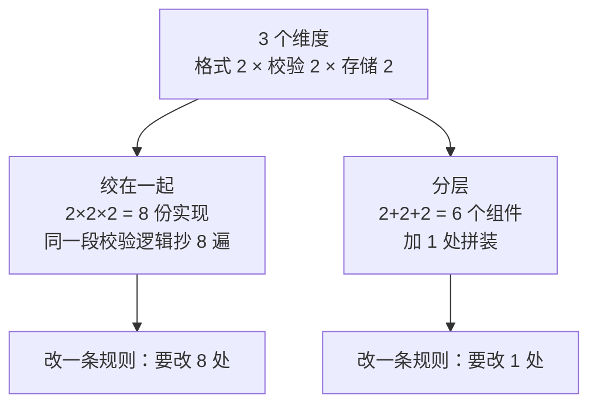
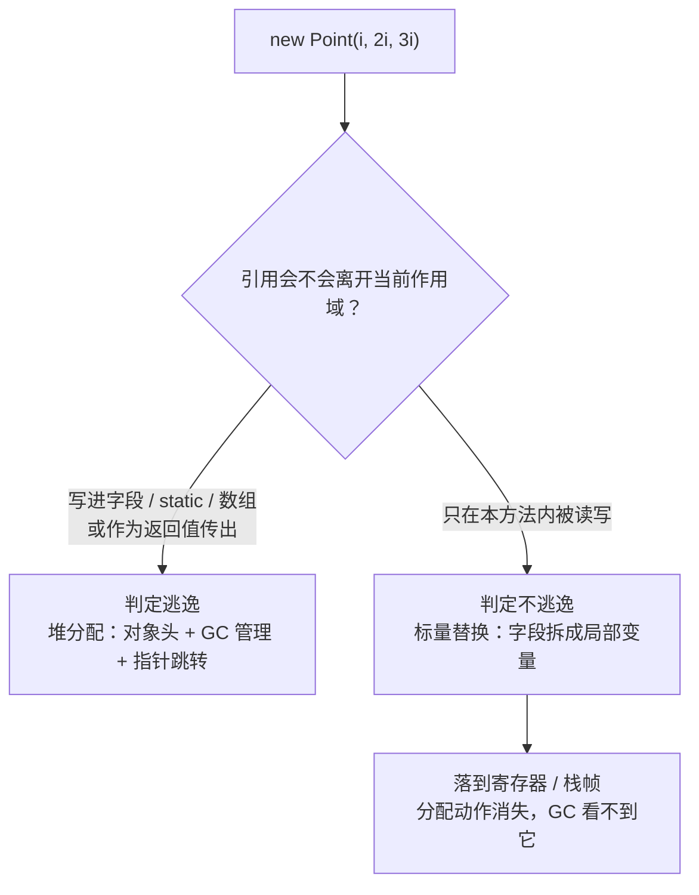
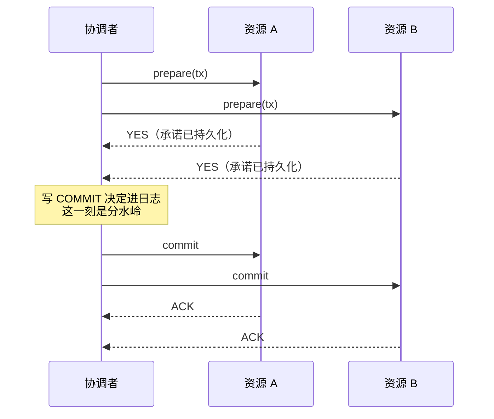
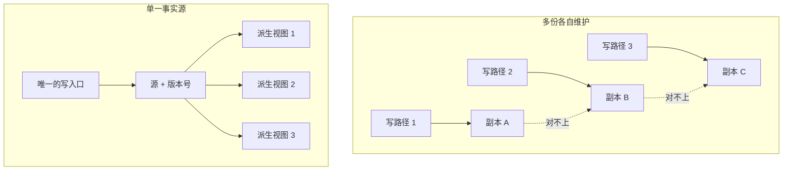

这一章的五条原则分属设计、架构、运行时、分布式事务、数据治理五个领域，追问的却是同一件事：**某样东西，应该存在于几个地方。**

- **信息隐藏**把「将来可能变的设计决定」收进一个模块，外部只看得到接口；
- **关注点分离**把一个决策只放在一层，不让它散落到 N 个分支里；
- **逃逸分析**把对象留在它被使用的作用域，能不上堆就不上堆；
- **两阶段提交**把「提交还是回滚」收进协调者的持久化日志，参与者只负责执行；
- **单一事实源**把数据的真相收进唯一可写的那一处，其余全部降级为派生视图。

各自动用的手段差别很大——一层间接、一层拼装、一次编译器证明、两轮投票、一套失效策略。但判据是共通的：**数一数这样东西现在有几个地方可以改它。** 超过一个，一致性就只剩人的自觉在维持。



下面五节各自独立成立，结论都带本机实跑输出，或明确标注为模拟。

## 一、信息隐藏：变化的隔离面

1972 年，David Parnas 在 CACM 上发表《On the Criteria To Be Used in Decomposing Systems into Modules》。当时主流的模块划分方式是按处理步骤来：一个数据处理系统，读入、转换、排序、输出，一步一个模块。这种分法直观，画在纸上也整齐。

Parnas 用 KWIC（Key Word In Context，关键词上下文索引）做了对照实验。第一种分解按步骤切：输入模块、循环移位模块、字母排序模块、输出模块、主控模块。第二种分解按「藏起来的决定」切：每个模块藏住一个将来可能变的设计决策——数据怎么存、循环移位怎么实现、排序用什么算法、输出怎么排版。

他的结论是第二种更好，理由很具体：**第一种分法下，任何一个设计决策的改变都会穿透所有模块；第二种分法下，改变被关在一个模块内部。** 两个版本功能完全等价，区别只在变化到来时的改动范围。

这里要分清两个词。Parnas 讲的是**信息隐藏**，一条模块分解准则；**封装**是后来的语言机制，private、接口、getter/setter 是它在语法上的投影。两者常被混用，关系却是单向的：封装可以用来实现信息隐藏，也可以用来假装实现了它。一个把所有字段都配上 getter/setter 的类，语法上封装得严严实实，信息上什么都没藏。

变化不可避免。真正决定改动成本的，往往不是改动本身有多大，而是它要穿透几层。只落在单个函数里的改动，改完跑一遍单测就行；穿透五个模块的改动，要重新理解五处上下文、重新验证五种组合。所谓「隔离面」就是这个意思——接口是一道面，面的一侧是可以自由变动的实现，另一侧是承诺不变的行为。

**本质一句话：信息隐藏不是把东西藏起来不让人看，而是把「将来可能改变的那个决定」收进一个模块，让变化只能从一扇门里出来。**



本机用 CPython 3.13 做了两组对照，输出节选如下。

第一组测不变量守不守得住。账户对象要求余额永远是非负整数，外部写入 60 次，其中 12 次是非法值（负数、字符串、浮点、None、布尔）。

```text
【1】裸字段 vs 带守卫的属性
  裸字段 · 不变量被破坏    : 12 次   终值 = 100000
  受守卫 · 非法写入被拦下  : 12 次   终值 = 100000
  受守卫 · 不变量被破坏    : 0 次
```

裸字段那 12 次非法写入全部生效，账户一度出现负余额，随后又被下一次合法写入覆盖——错误发生了，却没有留下任何痕迹。加 setter 之后 12 次全部被拒，终值停在最后一次合法写入上。守卫的价值不在「挡了多少次」，而在「挡不住的那一次会不会变成线上事故」。

第二组测变化的波及面。账户内部表示从整数分换成 `Decimal` 元，公开方法 `balance_cents()` 的名字、参数、返回单位都不变。外部 12 个调用点，6 个直接读内部字段 `a._cents`，6 个走公开方法。

```text
【2】内部表示迁移后的调用点存活情况
  V1（整数分）      直接抠字段: 成功 6 / 失败 0    走公开方法: 成功 6 / 失败 0
  V2（Decimal 元）  直接抠字段: 成功 0 / 失败 6    走公开方法: 成功 6 / 失败 0
```

6 个直接访问的调用点迁移后全部抛异常，6 个走公开方法的一个都没动。把实现那一处也算上，两边的迁移改动点是 7 处对 1 处——这就是上面那张图在真实代码里的样子。两次折扣计算的返回值得以保持一致（都是 850 分），靠的也是接口把单位与舍入规则固定住了。

另外说明一件容易被忽略的事：**Python 的封装靠约定，不靠语法。** 单下划线是命名约定，双下划线只是名字改写（name mangling，`_cents` 变成 `_AccountGuarded__cents`），两者都拦不住一句直接赋值。

```text
【3】绕过封装
  obj._cents = -999                  后读到 -> -999
  obj._AccountGuarded__cents = -888  后读到 -> -888
```

这不是 Python 的缺陷，而是设计取舍：把「别碰内部」交给使用者自觉，换取不必写样板代码。真正强制的边界只有编译器（Java、C++ 的 private）和进程边界（跨服务调用）。**先弄清自己的语言站在哪一档，比争论该不该封装更实际。**

**边界与反例**

- **藏错了东西**。把不变的藏起来、把会变的暴露出去，是最常见的形式主义。典型例子是「返回内部集合的引用」，调用方拿到引用可以随意增删，封装只剩一层皮。
- **getter/setter 满天飞等于没有封装**。把 `public int x` 改成 `public int getX()`，只改了调用写法，没改依赖关系。**判据是「外部能否借此影响内部状态的不变量」，不是「有没有方法」。**
- **泄漏抽象**。接口本身干净，行为却依赖内部细节：某方法「O(1) 但偶尔会阻塞 200ms」、异常类型暴露了底层驱动、返回顺序恰好是插入顺序。这些承诺没写在签名里，一样会被依赖。
- **为不存在的变化提前封装**。加三层接口、两套适配器，理由是「以后可能要换存储」。三年没换，读者却要先读三层才能找到业务逻辑。**隔离面是要付阅读成本的，只有真实存在的变化才值得。**
- **跨模块还有一层隐式契约**。并发安全、可重入、调用顺序、幂等性，这些性质不在类型系统里，却属于接口承诺的一部分。文档不写，使用者只能试出来。
- **封装挡不住反射与序列化**。Java 的反射、Python 的 `__dict__`、JSON 反序列化都会绕过构造函数。追求「任何路径都改不坏」，靠的是不变量校验点，不是访问修饰符。

## 二、关注点分离：一次只解决一件事

「separation of concerns」这个词出自 Edsger Dijkstra 1974 年的短文《On the role of scientific thought》。他谈的不是系统怎么切模块，而是人怎么思考复杂问题：研究一个东西时，要能把注意力放在它的某一个侧面，而不必同时装下全部。这是一条认知方法，后来才被工程界借去描述结构。

借过去之后衍生出不少形态。结构化编程把控制流与数据分开，MVC（Trygve Reenskaug，1979，Smalltalk）把界面、数据、交互分开，AOP（Gregor Kiczales，1997）专门处理「横切关注点」——日志、鉴权、事务这类东西会横穿所有业务模块，按功能切根本切不掉，只好在切面上下手。微服务把这条原则推到了进程边界之外。

为什么非分不可？因为**组合的数量是乘法**。三个维度各有若干取值，写在一起就是「取值 1 × 取值 2 × 取值 3」份实现；分开写是「取值 1 + 取值 2 + 取值 3」份。维度越多，差距越离谱。更要紧的是另一件事——写在一起时，同一条业务规则会被复制到每一份实现里，改一次规则就要改 N 处，漏掉一处就是行为分叉。

**本质一句话：关注点分离把「N 个维度相乘」的实现数量变成「相加」，代价是多一层拼装，以及一次跨层的调用与错误传递。**



本机用两个版本的 Python 实现做了对照。方案甲是 8 个函数，每个函数把「格式 + 校验 + 存储」写在一起；方案乙是 6 个组件（2 个格式器、2 个校验器、2 个存储器）加一处拼装。两边跑同样的 8 种组合，先确认输出完全一致，再谈规模。

```text
【0】两版输出逐条比对（8 种组合，同一笔 500 元订单）
  输出一致: 8/8
    csv/strict/mem     甲='B1,500'                   乙='B1,500'
    csv/strict/file    甲='B1,500'                   乙='B1,500'
```

```text
【1】代码规模与「同一决策被复制了几份」
  方案甲（绞在一起）: 函数 8 个, 实体行 96 行, 上限常量出现 8 次
  方案乙（分层拼装）  : 维度实现 6 个 + 公共件 2 个, 实体行 18 行, 上限常量出现 1 次
  方案甲 8 个函数两两平均相似度: 97.34%
  方案乙 4 个组件两两平均相似度: 49.66%
```

这 8 个函数由同一份模板生成，模拟的是现实里「复制粘贴出一个新分支」的典型形态，所以相似度高达 97.34%。方案乙的组件之间相似度只有 49.66%——每个组件解决不同的问题，本来就不该长得像。**代码相似度高不高，本身就是「同一个决策被复制了几份」的测量指标。**

再看一次真实的规则变更：单笔金额上限从 1000 降到 800，只改 1 处，模拟人手漏改。

```text
【2】规则变更后，对 900 元这笔单的判定
  方案甲：7 个放行 / 1 个拒绝   <- 同一笔单，行为分叉
    csv/strict/mem: 拒绝
    csv/strict/file: 放行
  方案乙：改 1 处常量，8 条流水线全部读到新上限
    判定分布 = 放行 4 / 拒绝 4（lenient 放行，strict 拒绝，与设计一致）
```

方案甲里 8 个分支对同一笔订单给出了相反结论：恰好改到的那条路径拒绝，其余 7 条放行。这类缺陷在测试里很难被抓住，因为每条路径单独看都是对的。方案乙改一处常量，8 条流水线同时生效，且放行/拒绝的分布严格由校验策略决定，不再有随机性。

最后一组看扩展成本，维度从 2 涨到 4。

```text
【3】组合扩展的成本
  格式 2 × 校验 2 × 存储 2 -> 甲: 8 个函数   乙: 6 个组件
  格式 3 × 校验 3 × 存储 3 -> 甲: 27 个函数   乙: 9 个组件
  格式 4 × 校验 4 × 存储 4 -> 甲: 64 个函数   乙: 12 个组件
```

每加一个取值，方案甲要新增一整批函数，方案乙只新增一个组件。**乘法与加法的差距，在维度少的时候看不出来，在维度多的时候是能不能维护下去的区别。**

**边界与反例**

- **分错了轴，比不分更糟**。按「controller / service / dao」横向切分，看起来是分层，实际上一条业务改动要横跨三层、改三个文件、写三次 DTO 转换。真正该按「关注点」切的是业务能力，而不是技术层次。判断方法很朴素：**一次典型需求变更，改动落在几个文件里。**
- **分离过度会制造阅读成本**。为了「以后可能换」拆出十几层，追踪一个请求要跳十几个文件，每层只做一次转发。分离的收益是「改动局部化」，代价是「阅读全局化」，两边都要计。
- **跨进程分离要重新付一遍代价**。函数调用变成网络调用之后，原本不存在的超时、重试、序列化、部分失败全都出现了。把分层原则原样搬到微服务上，得到的是分布式单体。
- **关注点会漂移**。一个层里慢慢长出别的关注点：service 里开始写 SQL，controller 里开始算业务规则，日志逻辑散落在各处。分离不是一次性动作，是需要持续维护的状态。
- **彻底分离数据与行为会得到贫血模型**。把「账算在哪」和「数存在哪」完全拆开，数据对象退化成一堆没有行为的字段，业务规则漂到 service 里，最后 service 变成上帝类。分离的粒度要跟着「变化频率」走，不是越细越好。

## 三、逃逸分析：把堆分配变成栈分配

逃逸分析（escape analysis）是编译优化里的老话题。面向对象语言的系统化处理通常追到 1999 年前后的几项工作，其中 Choi、Gupta、Serrano、Sreedhar、Midkiff 在 OOPSLA 上的《Escape Analysis for Java》给出了较完整的算法框架。它要回答的问题只有一个——**一个对象，会不会「逃出」它被创建的那个作用域？**

判据是可达性：对象的引用有没有被写进字段、静态变量、数组，有没有作为返回值传出，有没有传给一个编译器看不透的方法。只要有一条成立，就判定逃逸；全部不成立，就可以把它拆成若干个标量（scalar replacement），直接放进寄存器或栈帧。分配这个动作本身消失了。

这里要拆开两个常被混用的说法。**标量替换**是把对象的字段拆成独立的局部变量，对象结构不复存在；**栈上分配**是把整个对象搬进栈帧，结构还在，只是不走堆。HotSpot 走的是前者——`-XX:+EliminateAllocations` 控制的是标量替换，Java 里流传的「栈上分配」多数时候指的就是它的效果，而不是真的在栈上放了一个对象。Go 的逃逸分析更接近后者：判定不逃逸的变量直接放在 goroutine 栈上。

不同语言的落点不一样。Go 在编译期做——`go build -gcflags="-m"` 会把每个变量「moved to heap」的理由打出来，是 Go 性能调优最常用的一把尺子。JVM 在 JIT 期做，只对热点代码生效，但能利用运行时的类型信息，比静态分析更准。CPython 没有这层优化，`sys.getrefcount` 之外能做的很有限。

为什么需要它？因为堆分配有一整套固定成本：对象头、分配路径、GC 要扫描它、回收要移动它、访问要走指针。一个只在方法内活几行的临时对象，付这些成本纯属浪费。逃逸分析把这笔钱省掉的方式不是「让分配更快」，而是**证明这次分配根本不需要发生**。

**本质一句话：逃逸分析是编译器在证明「这个对象的引用出不了这个作用域」，证明成立就把它的字段拆成局部变量，分配这件事直接消失。**



本机用 JDK 26（build 26.0.2.1，G1，`-Xmx64m`）做了对照。两个方法做同样的事：循环 2000 万次，每次构造一个三元组对象并求字段和。区别只在引用的去向——`noEscape` 里对象用完即弃，`escapes` 里引用被写进一个 `static` 字段。两个方法都先预热 6 轮，让 C2 完成编译，再各跑 3 轮取最快值。

```text
【1】-XX:+DoEscapeAnalysis（默认开启）
noEscape        4.0 ms   校验和=1199999940000000
escapes        61.2 ms   校验和=1199999940000000
倍数          15.33x
GC 次数: 100

【2】-XX:-DoEscapeAnalysis（关闭逃逸分析）
noEscape       65.3 ms   校验和=1199999940000000
escapes        67.9 ms   校验和=1199999940000000
倍数           1.04x
GC 次数: 184
```

两组数据要连起来看。开启逃逸分析时，`noEscape` 是 4.0 ms，`escapes` 是 61.2 ms，差 15 倍；关掉之后，`noEscape` 从 4.0 ms 涨到 65.3 ms，与 `escapes` 的 67.9 ms 几乎相等。**一个不做任何分配的工作，被降到了和「每轮都分配一个对象」完全一样的速度——这个退化本身就是证据：开启时它真的没有分配对象。** 校验和两边完全一致，也排除了「优化把计算也一起省掉」的可能。

GC 次数是旁证：同样的 2000 万次循环，开启时 100 次，关闭时 184 次。多出来那 84 次，就是被标量替换省掉的分配压力。

`escapes` 那 61.2 ms 另有一层含义。它没有因为开启逃逸分析而变快，因为引用写进 `static` 字段属于最硬的逃逸形式——编译器必须假设这个方法返回后别人还会读它，标量替换无从谈起。**逃逸分析的收益只给「不逃逸」的那一类，逃逸的那一类一分钱都拿不到。**

**边界与反例**

- **它是尽力而为，不是保证**。跨方法调用、虚方法分派、复杂控制流、超过内联阈值的代码，都可能让分析失败。失败时的行为是保守地按逃逸处理，不报错、不提示。
- **只在热代码上生效**。JVM 的逃逸分析在 C2 里，方法要跑够次数才被编译。启动阶段的那几万次分配，一次都省不掉。Go 是编译期分析，没有这个问题，但反过来也拿不到运行时类型信息。
- **收益取决于分配是不是瓶颈**。业务代码里对象分配往往不是热点，CPU 花在锁、IO、日志格式化上。此时关掉逃逸分析，吞吐量可能一点变化都没有——**优化之前先确认瓶颈，不然省下的是不存在的钱。**
- **大对象不适合标量替换**。字段几十个的对象拆开之后，寄存器压力陡增，反而可能触发溢出到栈。编译器会自己放弃，但放弃的阈值不可见。
- **别为了迎合分析改代码风格**。把对象拆成三个 `long` 局部变量，收益和让编译器自己拆差不多，可读性却差很多。真正有效的动作是**减少不必要的逃逸**：临时对象不要往字段里塞，不要在没有必要的地方返回新对象。
- **栈空间有限**。栈上分配受线程栈大小约束，深递归场景下把对象挪到栈上可能换来 `StackOverflowError`。标量替换虽然不额外分配对象，但字段变多一样会挤占寄存器与栈帧，编译器会自己权衡。

## 四、两阶段提交：跨资源的原子性代价

两阶段提交（two-phase commit，2PC）的雏形见于 Lampson 与 Sturgis 1976 年的《Crash Recovery in a Distributed Data Storage System》，系统化的描述通常归给 Jim Gray 1978 年的《Notes on Data Base Operating Systems》。1991 年 X/Open 把它固化成 XA 规范，成了应用服务器与数据库之间的标准接口。

它要解决的是一个很朴素的问题：一笔事务要同时改两个资源，怎么保证「要么都成，要么都不成」。各自提交做不到——第一个提交成功、第二个失败，中间态就永久留在系统里，而且没有任何机制能自动发现它。

XA 与 2PC 常被当成同义词，层次其实不同：2PC 是协议（怎么投票、怎么决定、崩了怎么恢复），XA 是接口（`xa_start`、`xa_end`、`xa_prepare`、`xa_commit`、`xa_rollback`、`xa_recover` 这套调用约定）。同一个协议可以由 XA 实现，也可以由自研 RPC 实现，跨语言系统里后者更常见。

2PC 的办法是把提交拆成两轮。第一轮问所有参与者「你能不能提交」，参与者检查完资源、把承诺写进自己的日志，然后投票；第二轮协调者收集完票，做出唯一决定，写进自己的持久化日志，再逐个通知参与者执行。

**本质一句话：两阶段提交把「提交还是回滚」这个决定从参与者手里收走，交给协调者一次性写进持久化日志——决定只有一处，其余动作都只是执行这个决定。**



这张图上最关键的不是两轮，而是中间那个 `Note`。**在决定落盘之前，所有参与者都还来得及反悔；决定落盘之后，参与者再怎么宕机，重启后也只能照做。** 协议的正确性完全押在这一条上。

本机用两个 SQLite 库模拟两个资源，初始各 1000，做一笔 300 元的转账，期望合计始终为 2000。资源端用 journal 表记录 prepare 承诺（承诺内容包括变更量），commit 时才真正改账，恢复时按协调者日志重放。这里**没有实现 XA，只模拟协议行为**——真实数据库的 prepare 阶段会持有行锁直到决定下达，SQLite 没有这个能力。

先看没有协调的情况。

```text
【1】单阶段顺序写（没有协调）
    A 扣款提交成功
    B 加款失败：触发单笔入账上限 1200（模拟第三方风控拒绝）
  结果                         A=  700  B= 1000  合计= 1700
    与期望值 2000 的差 = -300 元
```

A 扣款已提交，B 加款被拒，300 元凭空消失。这不是理论上的风险。所有「先写 A 再写 B」的代码，第二个写失败时的默认结果都是它。也正因为如此，这类缺陷通常不会在测试里暴露——只有 B 真的失败时才会出现。

正常路径与反对票路径：

```text
【2】双方都投赞成票
    prepare  A: YES (已记录承诺)   B: YES (已记录承诺)
    prepare 之后（未决定）          A= 1000  B= 1000  合计= 2000   journal: A=PREPARED B=PREPARED
    A: 已提交    B: 已提交
    commit 之后                A=  700  B= 1300  合计= 2000   journal: A=COMMITTED B=COMMITTED
    落盘写事务次数 = 5

【3】转出方投反对票（余额不足）
    prepare  A: NO (余额不足，投反对票)   B: YES (已记录承诺)
    A: 已中止（账面未动）    B: 已中止（账面未动）
    abort 之后                 A= 1000  B= 1000  合计= 2000
    落盘写事务次数 = 4   账面一分未动
```

注意 prepare 之后那一行：两个资源都投了赞成票，账面却一分未动，合计仍是 2000。承诺不等于生效，这是 2PC 与「先改后补偿」式方案的根本区别。场景 3 里 A 因余额不足投反对票，B 虽然已经承诺，仍然被中止，账面回到初始状态。

崩溃才是这个协议真正的考场。

```text
【4】协调者写下 COMMIT 决定后崩溃（B 尚未落实）
    协调者已提交 A，然后在提交 B 之前断电
    崩溃后                      A=  700  B= 1000  合计= 1700   journal: A=COMMITTED B=PREPARED
    ...重启，进入恢复流程
    恢复重放 tx-crash @资源B: 已提交
    恢复后                      A=  700  B= 1300  合计= 2000   journal: A=COMMITTED B=COMMITTED

【5】决定只存在内存里，进程崩溃
    协调者在写决定之前崩溃，决定丢失
    崩溃后                      A= 1000  B= 1000  合计= 2000   journal: A=PREPARED B=PREPARED
      资源A journal[tx-nolog] = PREPARED
      资源B journal[tx-nolog] = PREPARED
    但协调者日志里查不到这个 txid，恢复流程不知道该提交还是回滚
    恢复重放: 没有处于 PREPARED 的资源，无需动作
    恢复后                      A= 1000  B= 1000  合计= 2000   journal: A=PREPARED B=PREPARED
```

场景 4 是协议生效的样子：崩溃瞬间账面确实不一致（1700），但协调者日志里那条 COMMIT 决定还在，重启后恢复流程读日志、重放 B 的提交，账面重新收敛。**中间态存在，但它有确定的终局。**

场景 5 是协议失效的样子：决定还没来得及落盘，进程就没了。两个资源各自停在 PREPARED，账面上看还是干净的 2000，可它们的 journal 都锁着，既不能提交也不能回滚。恢复流程翻遍协调者日志也找不到这个 txid——**不知道该往哪走，这才是 2PC 最贵的地方：它把「不一致」换成了「不确定」，而后者需要人来裁决。**

代价可以量化：

```text
【6】一次转账的持久化写次数对照
    单阶段顺序写 : 2 次落盘
    两阶段提交   : 5 次落盘（2 次 prepare + 1 次决定 + 2 次落实）
    代价倍数     : 2.50x，另加 prepare 到决定之间的资源锁定时间
```

2.5 倍落盘之外，还有两轮网络往返、prepare 到决定之间的锁持有期，以及协调者日志本身的持久化开销。这些成本在低冲突场景下可以接受，在高并发写同一行时会被锁等待放大。

**边界与反例**

- **协调者是单点**。协调者日志丢了就是场景 5，所有参与者卡死等人工。生产实现里协调者日志通常要三副本。
- **同步阻塞无法避免**。prepare 之后、决定之前，参与者必须持有资源。参与者在这一刻失联，协调者和其他参与者只能等——等超时，然后由人决定。3PC 试图用第三轮把阻塞去掉，代价是在网络分区下可能做出错误决定。
- **它保证原子性，不保证隔离性**。prepare 期间其他事务能不能看到未提交的修改，取决于隔离级别，与 2PC 无关。
- **决定之后仍然可能长时间不一致**。commit 阶段参与者失联，只能靠重试加幂等收敛；网络分区期间，一部分参与者已提交、一部分没有，外部观察到的仍是中间态。
- **长事务会把代价放大到不可接受**。跨三个系统的转账如果中间夹着一次外部 HTTP 调用，锁的持有时间就是那次调用的超时时间。所以长流程几乎不用 2PC。
- **替代方案只是换了代价的位置**。Saga 用补偿换掉阻塞，代价是中间态对外可见、补偿逻辑要自己写且可能失败；TCC 用 Try 阶段预留资源换掉长锁，代价是业务要改造；本地消息表把跨库事务降级成本地事务加最终一致，代价是延迟。**没有免费的原子性，只有把成本挪到不同位置。**

## 五、单一事实源：谁说了算

SSOT（single source of truth）这个词出自信息管理领域，1990 年代随主数据管理（MDM）与数据仓库建设流行起来，指的是「一个数据项在全组织范围内只有一个权威来源」。工程上它并不新鲜：数据库范式化的核心动作就是消除冗余存储，Git 的每次提交只有一个父节点、只有一条历史，Kubernetes 用声明式的单一期望状态驱动整个集群收敛。

为什么需要它？因为副本会漂移，而漂移的原因不是「有人故意写错」——是「有两个地方都可以写」。只要存在两条写路径，两条路径之间就必然出现时间差、失败差、遗漏差。这不是纪律问题，是结构问题。

**本质一句话：单一事实源不是「只存一份」，而是「只有一个地方可以改」——其余所有出现都必须是能随时重建的派生视图。**



本机模拟了一件商品的单价出现在四个位置：定价源、展示价签、下单计价、对账报表。读写交错进行——每次调价后立刻读三次，模拟线上真实时序。调价 200 次，每次以 75% 的概率同步到各副本（模拟人工与异步同步的成功率）。

```text
【甲】4 份各自维护
  调价 200 次，副本没跟上的累计次数 = 138
    展示价签: 落后 46 次
    下单计价: 落后 45 次
    对账报表: 落后 47 次
  期间读 600 次，读到非最新价 128 次 (21.3%)
  第 63 次调价后四个位置的取值：
    定价源     = 140.03
    展示价签 = 139.92   <- 与源不一致
    下单计价 = 139.92   <- 与源不一致
    对账报表 = 139.92   <- 与源不一致
```

第 63 次调价那一刻，三个下游都没跟上：源已经走到 140.03，三处副本还停在 139.92。这一行数据比「三个价格各不相同」更值得警惕——**三个副本的取值完全一致，拿它们互相校验是查不出问题的，因为它们的错误是同步的。** 唯一能对上的基准只有源，而源恰恰是最少被查询的那一个。21.3% 的陈旧读意味着每五次读价就有一次拿到过期数字。

再看三种以「一份源」为前提的派生策略，成本单位是模拟的相对值（回源 10，缓存 1）。

```text
【乙】源 + 写时推送失效（失效消息送达率 98%，丢失 5 条）
  缓存命中 405/600 (67.5%)，平均读取代价 3.92
  读到旧价 15 次 (2.5%)

【丙】源 + 读时校验版本
  缓存命中 400/600 (66.7%)，平均读取代价 6.33
  读到旧价 0 次

【丁】源 + 纯回源
  平均读取代价 = 10.00   漂移 = 0
```

三组数字排在一起，就是一条一致性-成本前沿：

| 做法 | 副本漂移 | 陈旧读 | 平均读取代价 | 复杂度 |
|------|----------|--------|--------------|--------|
| 甲 多份各自维护 | 138 次 | 21.3% | 约 0（读本地） | 低 |
| 乙 源 + 写时失效 | 0（无副本） | 2.5% | 3.92 | 中 |
| 丙 源 + 读时校验 | 0 | 0% | 6.33 | 中 |
| 丁 源 + 纯回源 | 0 | 0% | 10.00 | 高（源是硬依赖） |

模式乙最值得琢磨：它结构上没有第二份真相，可失效消息丢一条，缓存就变成一份没人管的副本。2.5% 的陈旧读比起模式甲的 21.3% 好看得多，但这个数字不是白来的——**SSOT 的性质需要一条可靠的失效链路去维持，链路一断，它立刻退化成多副本问题。** 缓存本质上就是副本，任何缓存都必须回答「失效策略是什么」；回答不出来，它就不是优化，是隐患。

模式丙一条消息都不会丢，代价是每次读都要一次轻量往返，缓存只省下传输的数据量，省不掉往返。模式丁最干净，也最脆——源一挂，所有读取全部失败。

**边界与反例**

- **SSOT 不等于「一个数据库」**。常见形态是「一个写入路径 + 多个只读副本」，物理上仍是多份，但只要只有一个地方能写，就不算破坏 SSOT。**判据是写者数量，不是副本数量。**
- **源会变成单点**。模式丁的可用性完全依赖源，这也是缓存存在的理由。选择 SSOT 就必须同时回答「源挂了怎么办」，而不是假设源不挂。
- **组织边界能让 SSOT 失效**。两个团队各自维护一份客户信息，技术上没有任何手段能强制合并——除非把写权限收到一个团队手里，而那往往是组织问题，不是技术问题。
- **派生必须可重建**。所谓派生视图，指的是「删掉它，能从源一键重建」。做不到这一点，它就是一个需要独立维护的源，只是名字叫视图。
- **过度 SSOT 会造出巨型服务**。把所有数据塞进一个「唯一真相」的服务，写路径是单点了，服务本身的耦合度也跟着上升。合理的粒度是「一个业务概念一个源」，不是「全公司一个源」。
- **时间维度上 SSOT 也需要版本**。同一份数据在不同时刻有不同的值，没有版本号，「谁是最新」这个问题就只能靠时间戳猜，而时间戳在分布式环境里并不可靠。

## 六、五条原则的横向对照与小结

| 原则 | 拿什么换什么 | 代价结构的关键量 | 失效边界 |
|------|--------------|------------------|----------|
| 信息隐藏 | 一层间接换变化传播半径 | 接口的稳定性、变化穿透的模块数 | 藏错对象 / 泄漏抽象 / 为不存在的变化设计 |
| 关注点分离 | 一次拼装换组合数从乘到加 | 维度数量、单个维度的取值数量 | 分错轴 / 分离过度 / 关注点漂移 |
| 逃逸分析 | 编译器证明换掉堆分配 | 逃逸判定的成功率、分配是否瓶颈 | 分析失败 / 冷代码 / 大对象 |
| 两阶段提交 | 两次往返与阻塞窗口换原子性 | 参与者数量、锁持有时间、日志持久化 | 协调者单点 / 决定丢失 / 长事务 |
| 单一事实源 | 读取成本换掉副本漂移 | 写者数量、失效策略、派生可重建性 | 源成单点 / 组织分裂 / 缓存没有失效策略 |

| 五条原则 | 一句话判据 |
|----------|------------|
| 信息隐藏 | 这个决定将来要变的时候，改动会穿透几个模块 |
| 关注点分离 | 同一段业务规则，现在复制在几个地方 |
| 逃逸分析 | 这个对象的引用，出得了当前方法吗 |
| 两阶段提交 | 这个决定写进日志了吗，写完还会不会变 |
| 单一事实源 | 这份数据，现在有几个地方可以改它 |

🐾 **小结**：这五条原则表面在谈模块划分、分层、编译优化、分布式事务、数据治理，落到根上都在回答同一个问题——**这样东西应该有几个归属地**。Parnas 把「会变的决定」收进一个模块，Dijkstra 把「不同的关注」拆到不同层，编译器把「不需要堆的对象」留在栈上，2PC 把「提交与否」收进协调者的日志，SSOT 把「真相」收进唯一可写的那一处。

反过来看，它们的失效方式也是同一个：**一旦某样东西有了第二个归属地，一致性就只能靠人的自觉去维护，而人会漏。** 副本漏同步、规则漏改一处、缓存漏失效、日志漏落盘——事故的形态千差万别，起因都是同一个「第二处」。

判断一个设计稳不稳，与其看它套了什么模式，不如问一句：**这个决定、这份数据、这个状态，现在有几个地方可以改它。** 答案是一个，剩下的都是工程问题；答案是两个，剩下的都是时间问题。

---

**相关阅读**：
- [计算机原则五讲（一）：分治、顺序与随机、分代回收、失败安全、引用透明](/posts/princ-chapter-01/)
- [C++ 中的 Pimpl 模式：封装实现细节的艺术](/posts/239109f/)
- [最少惊讶原则：接口设计的隐形标准](/posts/princ-least-astonishment/)
- [契约式设计：把应该写成必须](/posts/princ-dbc/)
- [JIT：让程序在奔跑中变快](/posts/princ-jit/)
- [写前日志 WAL：先记账、后落库](/posts/princ-wal/)
- [ACID 与 BASE：两种一致性契约](/posts/princ-acid-base/)
- [CAP 定理：分布式的取舍三角](/posts/princ-cap/)
- [快速失败：让 Bug 早点现形](/posts/princ-fail-fast/)
- [引用计数与垃圾回收：谁来负责释放](/posts/princ-refcount-vs-gc/)
