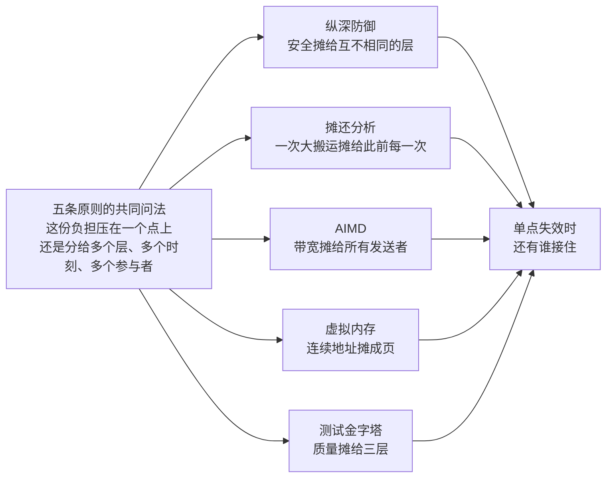
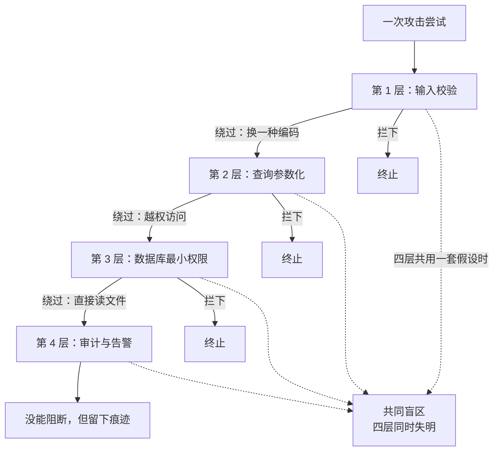
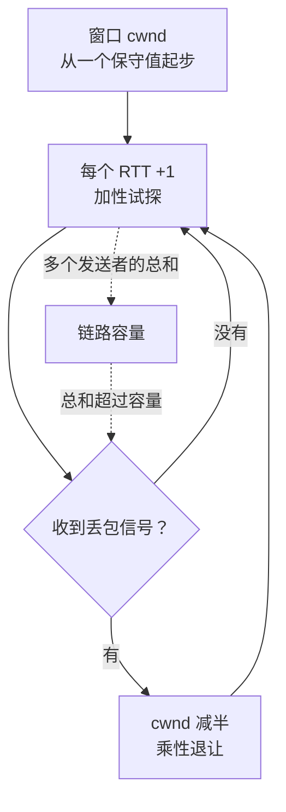
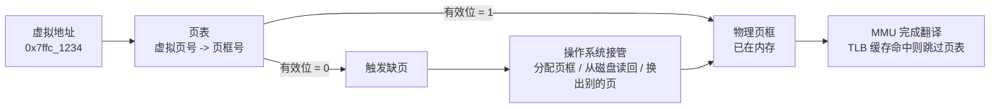
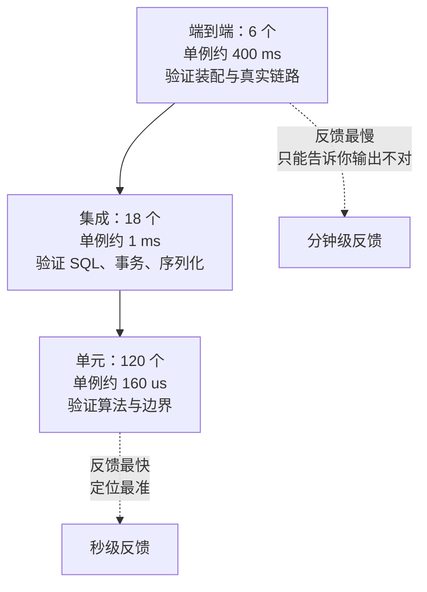

安全、算法、网络、操作系统、软件测试，五个领域各取一条。表面看它们的做法毫无关系：叠加检查层、摊薄搬运成本、用丢包调发送速率、把地址翻译成页、把用例分三层摆放。

共同的问法是「这份负担压在哪」：

- **纵深防御**不要求任何一层做到完美，把「挡住攻击」摊给若干条互不相同的通路；
- **摊还分析**不要求每次操作都便宜，把一次性的大搬运摊到此前每一次小额操作上；
- **AIMD** 不要求发送者知道链路容量，把「该发多快」的判断摊成一次次试探与退让；
- **虚拟内存**不要求物理内存连续，把「一段连续的地址空间」摊成一个个 4 KiB 的页，落到哪里由页表决定；
- **测试金字塔**不要求端到端测试覆盖一切，把质量保证摊到三层，按反馈成本分配用例数量。

这五条被违反时的症状也相似：某个单点被要求承担全部，它一旦失效，后面没有第二道接住。



下面五节各自成立，每节都带本机实跑输出，模型类结论会注明是模拟。

## 一、纵深防御：不赌任何一层不出错

纵深防御（defense in depth）原本是军事术语，指放弃「一道城墙守住全城」的思路，改成要塞、护城河、内墙、岗哨层层设防，让进攻方每前进一步都要再付一次代价。1990 年代末，NSA 主导的 IATF 框架把它当成信息安全的核心策略，此后成为安全工程里最常被引用的一条结构原则。更早的思想源头可以追到 Saltzer 与 Schroeder 1975 年的《The Protection of Information in Computer Systems》，那篇论文列出的八项设计原则里，最小权限、完全中介、权限分离都在讲同一件事：不要把所有判断交给一个组件。

它要解决的是一个概率问题。任何一层检查的正确性，都建立在某个假设上：输入校验假设攻击者用的是「合法字符集里的非法组合」，WAF 假设攻击流量有可识别的特征，数据库账号假设攻击者拿不到更高权限。攻击者不需要攻破所有层，只需要找到一个假设不成立的点。

这里有一个容易被忽略的推论：**叠加层数不等于降低风险，降低风险的是「层与层之间的独立性」。** 如果四层防线由同一个团队、按同一份检查清单、用同一套正则实现，那它们在面对「清单之外的手法」时会同时失明，叠四层和叠一层没有区别。

**本质一句话：纵深防御不是把同一道检查做四遍，而是让每一层用不同的机制挡住不同类别的失败——层与层之间不能共享同一个假设。**



本机用 40 类攻击手法、50000 次尝试做了两组对照。每层「看得见」85% 的手法，看见之后有 90% 的概率真的拦下。第一组让四层共享同一套可见集合（同源多层），第二组让每层独立采样自己的可见集合（独立多层）。

```text
【1】叠加层数与穿透率（50000 次尝试，40 类手法，单层视界 85%、拦下率 90%）
  层数    同源多层（共用一套假设）    独立多层（每层机制不同）
  1 层    11720 次  23.44%            11848 次  23.70%
  2 层    7869 次  15.74%             2746 次  5.49%
  3 层    7513 次  15.03%             663 次  1.33%
  4 层    7517 次  15.03%             148 次  0.30%
```

只有一层时两个数字几乎相同（23.44% 与 23.70%），因为「同源」和「独立」在单层上没有区别，差异只是随机噪声。从第二层开始两条曲线分开：独立多层按 0.235 的幂次往下掉，2 层 5.49%、3 层 1.33%、4 层 0.30%；同源多层掉到 15.74% 就基本停住，第 3 层、第 4 层分别是 15.03% 与 15.03%，与共同盲区的大小（15%）重合。

那 15% 就是「四层都没见过的手法」。再叠第五层、第六层，穿透率仍然是 15.03%：**同一个假设叠几次，得到的都是一个假设。** 这也解释了为什么很多系统「层层防护」却仍被一个简单的越权打穿——每层都在校验同一个东西。

第二组把模型换成真实代码。同一批输入分别喂给两个实现：一个是「黑名单过滤 + 字符串拼接」，过滤掉 `or`、`--`、`;` 这三类最经典的特征；另一个是「同样的过滤 + 参数化查询」。

```text
【2】黑名单过滤 vs 参数化查询（SQLite，同一批输入）
  载荷                  过黑名单  拼接+黑名单         参数化查询
  P1 经典永真式         拦截      返回 0 行           返回 0 行
  P2 UNION 注入         放行      返回 3 行（越权）   返回 0 行
  P3 注释截断           拦截      返回 0 行           返回 0 行
```

P1 与 P3 是黑名单认识的形状，被拦在门外。P2 是 `x' UNION SELECT name, role FROM users WHERE '1'='1`，里面没有 `or`，也没有注释符和分号，黑名单原样放行，拼接之后整张用户表被读了出来。参数化查询下同一个字符串只是一个值：

```text
【3】参数化查询下 P2 载荷的真实取值
  作为字符串存进占位符 -> "x' UNION SELECT name, role FROM users WHERE '1'='1"
  表里匹配到同名用户数 -> 0
  整表行数             -> 3
```

用户表里没有叫这个名字的用户，所以匹配 0 行。**第二层的价值不在「比第一层更严」，而在「它根本不解析这个字符串」**——机制不同，第一层的盲区到了第二层就不成立。这才是纵深，重复一遍同类校验只是把同一扇门装了两把一样的锁。

**边界与反例**

- **同源叠加是假纵深**。上面 15.03% 那一行就是它的定量形态：无论叠多少层，穿透率等于共同盲区的比例。判断方法很简单，问一句「如果这一层被绕过，下一层靠什么与它不同」。
- **共享依赖会把独立性抹平**。四层都从同一个配置中心读规则、都依赖同一个身份服务、都由同一个团队维护，那么配置中心挂掉时四层一起失效。纵深防御要防的不只是攻击，也包括故障。
- **层数是有成本的**。每层都有延迟、有误报、有运维负担。误报率 1% 的四层串联，正常请求被误拦的概率接近 4%，用户会用脚投票。
- **纵深不能替代修复**。第四层是审计与告警，它的作用是「出事之后能查」，不是「拦住」。把检测当成阻断，等于给漏洞配了一个记录员。
- **没有日志的纵深无法调优**。不知道请求是被哪一层拦下的，就不知道该收紧还是放松哪一层。分层的价值一半来自拦截，一半来自「能定位」。

## 二、摊还分析：单次很贵，长期便宜

摊还分析（amortized analysis）在 1985 年由 Tarjan 在《Amortized Computational Complexity》里整理成一套方法，给出三种算法：聚合分析、记账法、势能法。它要回答的问题很具体：**一串操作的总代价，平均到每一次是多少。**

为什么不能直接用最坏情况？因为最坏情况会把「偶尔一次昂贵」误判成「每次昂贵」。一个动态数组，第 n 次插入可能要把 n 个元素搬到新空间，最坏 O(n)；但如果按最坏情况去评估，这个结构就没法用了，而实际上连续插 n 次的总搬运量是 2n，摊到每次是常数。

三种方法里，记账法最直观：每次便宜操作时，往一个「账户」里存一点余额，等到那次昂贵的操作发生时再一次性支取。余额永远不能为负，这就是摊还上界的证明。势能法把这个账户换成「数据结构的势」，适合分析状态会自然积累的结构，比如伸展树、并查集。

**本质一句话：摊还分析不改变任何一次操作的最坏代价，它改变的是这笔代价由谁支付——把一次大的搬运费摊到此前每一次小额操作上，前提是这个账户在任何时刻都不透支。**


最简的模型是二进制计数器。一个 k 位的计数器从 0 开始自增，第 i 次自增翻转的位数等于 i 末尾连续 1 的个数加一，最坏要翻 k 位，但 n 次自增的总翻转次数是 2n。

```text
【1】二进制计数器自增的位翻转次数（摊还 O(1) 的最简模型）
  自增 20000 次，累计位翻转 39995 次，平均 2.000 次/次自增，最坏 6 次
  上限 2N = 40000，实测 39995（100.0%）
```

20000 次自增共翻转 39995 次，平均每次 2 次，最坏那次翻了 6 位。**最坏与平均差了 3 倍，而 n 每翻一倍，最坏值只多 1**——最坏是 O(log n)，摊还是 O(1)，两个结论同时成立，并不矛盾。

动态数组是这条原则最常落地的地方，也是最容易做错的地方。本机用 Python 列表切片实现了三种扩容策略，真搬元素，n = 20000。

```text
【2】n = 20000 次写入，三种扩容策略的真实搬运量（list 切片，真搬）
  策略                扩容次数  总搬运元素  单次最大   摊销/次   耗时ms
  固定增量 +10            2000    19990000     19990    999.50     37.9
  固定增量 +1000            20      190000     19000      9.50      1.0
  容量翻倍 x2               16       32767     16384      1.64      0.6

  以翻倍策略为基准，固定增量的搬运量代价：
    固定增量 +10            610.1 倍
    固定增量 +1000            5.8 倍
```

固定增量 +10 的策略，扩容 2000 次，单次最大搬运 19990 个元素与翻倍策略的 16384 在同一量级，但总搬运量差 610 倍。原因在摊销值那一列：999.50 与 1.64。固定增量的摊销值是 n/(2m)，**随 n 线性增长，所以它的摊还复杂度是 O(n) 而不是 O(1)**；翻倍策略的总搬运量被几何级数封顶在 2n 以内，摊销值恒为常数。

单次最大搬运量接近，总搬运量差三个数量级——**只看最坏一次的耗时，两个方案看不出区别；只看平均，也看不出区别；必须看总账。** 这就是摊还分析要算的那笔账。

真实实现比教科书更保守。CPython 3.13 的 list 采用的不是翻倍，而是 `newsize = size + size // 8 + 6`，也就是每次只多留约 12.5% 的余量。

```text
【3】CPython 3.13 真实 list 的容量增长（1,000,000 次 append）
  sys.getsizeof(空 list) = 56 字节；1 元素 = 64 字节
  前 14 次扩容（元素数 -> 容量）: 1->4 5->8 9->16 17->24 25->32 33->40 41->52 53->64 65->76 77->92 93->108 109->128 129->148 149->172
  扩容次数 = 86，总搬运元素 = 8445096，单次最大搬运 = 938736
  摊销每次 append 搬运 8.45 个元素，摊还值 1000000 次 append 总耗时 284 ms
  若按容量翻倍，理论总搬运约为 2n = 2,000,000；CPython 实际 8445096（8.4 倍）
```

同样 100 万次 append，CPython 总搬运量 844.5 万个元素，摊到每次 8.45 个，是翻倍策略理论值（2 个）的 4.2 倍。多出来的代价换来的是内存利用率：1.125 倍增长下，列表末尾的闲置槽位最多只有 12.5%；翻倍策略最多闲置一半。**摊还 O(1) 只承诺「常数上界」，不承诺「常数小」。** 这两个方案都是摊还 O(1)，代价差 4 倍，取值取决于你更缺内存还是更缺内存带宽。

**边界与反例**

- **摊还不是平均**。平均是对随机输入的期望，摊还是对**任意**操作序列的最坏总代价求均值，不依赖概率假设。两者结论一样时是巧合，不一样时以摊还为准。
- **硬实时场景不认摊还**。单次 900 毫秒的扩容尖峰，摊到一百万次上是 0.9 微秒，但控制环路的截止期只关心那一次尖峰。实时系统里要的是最坏值可预测，摊还值再漂亮也没用。
- **操作次数不够多时退化为最坏**。只往数组里插 3 个元素，「摊还 O(1)」这句话没有任何意义。摊还结论的前提是「足够长的序列」。
- **不可变数据结构会改写结论**。持久化数组每次修改都要复制一条路径，摊销值从常数变成 O(log n)，因为「账户」里存不下余额，前一次操作省下的空间在下一次不能被复用。
- **势能法的势函数选错会得出错误上界**。势能必须是操作前非负、且能覆盖当次真实代价的量，选得随意就能「证明」任何结论。
- **摊还不能跨结构比较**。两个结构都是摊还 O(1)，一个常数 2、一个常数 8.45，工程上差 4 倍，这个差距只有实测能看出来。

## 三、拥塞控制 AIMD：网络不能被你一个人占满

1988 年 Jacobson 在 SIGCOMM 发表《Congestion Avoidance and Control》，把「网络会拥塞」这件事从工程直觉变成了协议里的显式机制：慢启动、拥塞避免、快重传。1989 年 Chiu 与 Jain 在《Analysis of the Increase and Decrease Algorithms for Congestion Avoidance in Computer Networks》里回答了一个更根本的问题：在没有任何集中调度者的情况下，多个发送者各自调整速率，什么形式的调整规则能让它们收敛到公平且高效的分配上。

答案是加性增、乘性减（additive increase, multiplicative decrease）。没有丢包时每个 RTT 把拥塞窗口加一，出现丢包时把窗口减半。

为什么必须是「加性增、乘性减」，而不是反过来？Chiu 与 Jain 用一张二维图给出了几何解释：两个发送者的窗口状态是平面上的一个点，加性增让它沿 45 度方向向右上移动，乘性减让它朝原点方向按比例收缩。前者保持两个发送者的差值不变、只增加总量，后者按比例压缩、把差值也一起压缩。两条轨迹叠起来，状态点会一步步靠近「总量贴住容量、两者相等」的那条线。反过来用乘性增、加性减，差值会被放大，状态点朝不公平的方向漂移。

这条原则要解决的问题是：**链路的容量没有任何一个发送者知道，而且它随时间变化。** 发送者能观测到的只有间接信号——丢包、往返时延上涨、显式拥塞通知。AIMD 的答案是「把猜测变成可纠正的小步试探」：加性增是最小步长的探测，乘性减是对「猜多了」的快速纠正。

**本质一句话：AIMD 把「网络还有多少余量」这个没人知道的问题，变成一串可以由丢包随时纠正的本地猜测——增得慢是为了不撞墙，退得快要为了尽快让出。**



本机做了一组离散时隙模拟：4 个发送者共享一条容量 100 的链路，缓冲区 60，丢包按需求比例分摊，统计第 5000 到 8000 时隙的稳态表现。

```text
【1】链路容量恒为 100，4 个发送者，第 5000~8000 时隙统计
  算法                        利用率   丢包率     公平性   结束时 cw
  AIMD（+1 / x0.5）            99.6%    7.38%     0.9994   33.2 26.1 36.7 16.1
  MIMD（x1.05 / x0.5）         97.7%    9.32%     0.8489   2.0 2.1 114.0 3.9
  固定速率（各 25）           100.0%    0.00%     1.0000   25.0 25.0 25.0 25.0
  固定速率（各 30，超额 20%）  100.0%   16.67%     1.0000   30.0 30.0 30.0 30.0
```

四行数据要连起来读。固定速率各 25 是这一组的**上界**：利用率 100%、丢包 0%、完全公平，因为它恰好等于容量的四分之一。这个方案唯一的问题是前提——它要求发送者事先知道容量是 100，而且要求容量不变。

AIMD 没有这个前提，代价是 7.38% 的丢包。这 7.38% 不是缺陷，是**探测成本**：窗口必须一直往上加，直到撞上容量才收到丢包信号，撞的那一下总要丢掉一些。换成乘性增的 MIMD，公平性从 0.9994 掉到 0.8489，结束时四个发送者的窗口是 2.0、2.1、114.0、3.9——一个吃掉了绝大部分带宽，另外三个饿着。**这就是「加性增」不可替换的原因：乘性增会把差距一起放大。**

容量变化时差距更明显。

```text
【2】链路容量中途从 100 掉到 65（第 3000~5000 时隙），再恢复
  算法                        全程利用率  全程丢包率  低容量期丢包率
  AIMD                             99.7%       7.58%            8.3%
  MIMD                             98.4%       9.33%            9.5%
  固定速率（各 25）               100.0%       8.74%           14.0%
  固定速率（各 30）               100.0%      23.95%           28.3%
```

容量掉到 65 的那 2000 个时隙里，固定速率各 25（总量 100，超出容量 54%）的丢包率从全程的 8.74% 涨到 14.0%，固定速率各 30 的从 23.95% 涨到 28.3%。AIMD 在同一段里只有 8.3%，因为它收到了丢包信号并退了半步。**固定速率那一列的利用率始终是 100%，这个 100% 不代表效率：容量降到 65 之后，它靠超发把链路灌满，多出来的部分全记在丢包那一列。**

AIMD 不承诺瞬时公平。四个发送者从 30、5、5、5 这种偏斜状态起步，2000 个时隙内的表现如下。

```text
【3】从 [30, 5, 5, 5] 这种偏斜起步，2000 时隙内的总和与最大/最小比
  时隙      AIMD 和   AIMD 峰谷比    MIMD 和   MIMD 峰谷比
  0            49.0           5.2       47.2           6.0
  200         114.4           1.8       92.6          42.6
  400         100.1           5.4      108.3           4.6
  600          98.3           2.5       73.5          68.2
  800          93.7           3.4      104.8          24.9
  1000        101.8          12.9      113.0          47.5
  1200        123.0           1.5       86.6          74.9
  1400        122.3           2.1      108.0          59.6
  1600        106.3           3.7      101.7          73.5
  1800        114.3           6.0      116.4          67.7
  2000        109.4           6.9      123.9         112.0
  2200         98.4           1.6      112.9          14.1
  2400        119.6           2.3      100.7          37.7
  2600        102.8           4.7      171.2         157.1
  2800        109.4           6.8       82.7          18.3
  终态 AIMD cw: 41.3 13.8 42.6 27.5  -> 最大/最小 3.1
  终态 MIMD cw: 59.8 3.9 1.8 44.6  -> 最大/最小 32.9
```

AIMD 的窗口总和一直贴着容量（93.7 到 123.0），峰谷比在 1.5 到 12.9 之间来回，静态看很不整齐；MIMD 的总和会漂到 171.2（容量是 100），峰谷比一路冲到 157.1，终态最大与最小差 32.9 倍。**AIMD 保证的是「总和贴住容量、长期份额收敛」，不是「每一时刻都整齐」。**

单个发送者的窗口序列是最直观的一张图：每个时隙加一，撞到丢包就砍半。

```text
【4】单个发送者在 100 容量链路上的锯齿（逐时隙取值，每行 20 个）
   41  42  43  44  45  46  47  48  49  50  51  52  53  54  55  56  57  58  59  60
   61  62  63  64  65  66  67  68  69  70  71  72  73  74  75  76  77  78  79  80
   81  82  83  84  85  86  87  88  89  90  91  92  93  94  95  96  97  98  99 100
  101 102 103 104 105 106 107 108 109 110 111 112 113 114 115 116 117 118  59  60
   61  62  63  64  65  66  67  68  69  70  71  72  73  74  75  76  77  78  79  80
   81  82  83  84  85  86  87  88  89  90  91  92  93  94  95  96  97  98  99 100
  101 102 103 104 105 106 107 108 109 110 111 112  56  57  58  59  60  61  62  63
   64  65  66  67  68  69  70  71  72  73  74  75  76  77  78  79  80  81  82  83
   84  85  86  87  88  89  90  91  92  93  94  95  96  97  98  99 100 101 102 103
  104 105 106 107 108 109 110 111 112 113 114 115 116 117 118 119 120 121 122 123
  200 时隙内最小值 41，最大值 123，减半事件 2 次
```

118 之后掉到 59，112 之后掉到 56，两次都是精确的一半。**锯齿的形状本身就是协议的设计：上升段是试探，断崖是纠正。** 任何试图把这个锯齿磨平的改动（比如把减半改成减 10%），都会让纠正变慢，代价是更长的拥塞期。

**边界与反例**

- **丢包不等于拥塞**。无线链路上的误码也会表现为丢包，把误码当成拥塞信号去减半窗口，是早期 TCP 在 WiFi 上性能差的主要原因。这也是后来出现显式拥塞通知和基于时延的算法的动因。
- **缓冲区越大，信号越晚**。中间设备把队列做得很深，丢包要等到队列彻底填满才发生，此时排队时延已经从毫秒涨到秒级，这就是 bufferbloat。信号没丢，但来得太迟。
- **高带宽长时延链路收敛太慢**。加性增每个 RTT 只加一个包，要把带宽从零探到 10 Gbps 需要的时间在工程上不可接受。这正是 CUBIC、BBR 这类算法存在的理由，它们改的是「增」的那一段，保留的仍是「乘性退」的纠正思路。
- **RTT 不公平**。同样的加性增，往返时延短的连接每秒能加更多次，长肥管道上的连接抢不过它。AIMD 保证的是同 RTT 下的公平，不是跨 RTT 的公平。
- **AIMD 只调节发送速率，不解决总量超标**。如果所有发送者都作弊不减速，链路照样崩，所以协议之外还需要准入控制和流量整形。
- **模拟里的时隙与真实 RTT 差着数量级**。上面的数字验证的是算法形态（上升斜率、减半点、总量贴容量），不是真实网络的具体吞吐值。

## 四、虚拟内存与分页：不存在的连续大内存

按需调页最早在 1962 年的 Manchester Atlas 计算机上实现，那是第一台把「地址」和「物理位置」分开的机器。1968 年 Denning 在《The Working Set Model for Program Behavior》里给出了理论描述：程序在一段时间内只访问一小部分页面，只要把这部分留在内存里，缺页就不会失控。后来的 Multics、VAX 把这套机制变成通用操作系统的标配。

它要解决的矛盾很朴素。程序想要的是「一段从 0 开始、连续、独享、可以任意大的地址空间」；物理内存提供的是「若干块被其他进程切得七零八落的 4 KiB 页框」。这两件事对不上：连续的要求一旦落到物理上，碎片就足以让一个 100 MB 的分配失败，而实际空闲内存还有 2 GB。

虚拟内存的办法是插入一层翻译。程序看到的是虚拟地址，MMU 用页表把它翻译成物理地址，翻译的粒度是页。没被访问过的页根本不需要有物理页框，访问到的时候再触发缺页，由操作系统决定是分配一个新页框、从磁盘读回来、还是从别处换出。**「连续」这个要求只存在于虚拟侧，「连续」在物理侧被彻底放弃。**

**本质一句话：虚拟内存把「一段连续的地址」和「一段连续的物理内存」解耦——地址只是页表里的一个编号，落到哪个页框、什么时候落，由操作系统在第一次访问时才决定。**



本机用 Windows 的 `VirtualAlloc` 与 `GetProcessMemoryInfo` 直接观察三笔账：保留（reserve）、提交（commit）、驻留（working set）。这三者是不同的东西，混淆它们是最常见的误解来源。

```text
【1】保留 1 GiB、再提交 8 MiB、再逐页触碰（本进程实测）
  进程初始                  提交  13.01 MiB   驻留  20.55 MiB   缺页 16167
  保留 1 GiB 之后           提交  13.01 MiB   驻留  20.57 MiB   缺页 +7
  VirtualAlloc 返回         0x27900000000（保留区与提交区之比 128 : 1）
  提交 8 MiB 之后           提交  21.03 MiB   驻留  20.58 MiB   缺页 +6
  逐页写 1 字节之后         提交  21.03 MiB   驻留  28.58 MiB   缺页 +2048
  按 4 KiB 页计：提交 2048 页，实际驻留 2048 页
```

逐行读这五条。保留 1 GiB 之后，提交仍是 13.01 MiB，驻留从 20.55 MiB 微涨到 20.57 MiB，**两个数字都没动**——因为保留只是「把这段虚拟地址划走，别人不许用」，没有分配任何物理资源，也没有建立页表项。这两行的缺页增量（+7、+6）是进程里其他部分的噪声，与保留动作无关。

提交 8 MiB 之后，提交从 13.01 涨到 21.03（+8.02 MiB），驻留仍是 20.58 MiB 没动。**提交意味着「系统承诺这块地址可以用，不够时会从页面文件里补」，它记的是额度，不是内存。** 真正让驻留涨起来的是最后一步：逐页写 1 字节，2048 页各触发一次缺页，缺页数正好 +2048，驻留 +8.00 MiB。

**提交涨了 8.02 MiB、驻留一点没动——这 8 MiB 就是「承诺了但还没兑现」的部分**：地址空间可以是 1 GiB，承诺可以是 8 MiB，实际驻留可以是 0，三者都合法，都对应同一个进程。

页表本身也有成本，而且这个成本决定了它必须是多级的。

```text
【2】地址空间与页表的算术（48 位虚拟地址，4 KiB 页，PTE 8 字节）
  可寻址页数              = 2^36 = 68719476736（68.7 G 页）
  单级平坦页表大小         = 512 GiB
  四级页表一整条路径       = 4 x 512 x 8 = 16384 字节
  映射 8 MiB 需要页表项    = 2048 个（外加各级目录项）
  平坦表 / 四级路径 的比值 = 33554432 倍
```

48 位地址、4 KiB 页，意味着 687 亿个页。每个页一条 8 字节的页表项，单级平坦页表要 512 GiB，比大多数机器的物理内存还大，**为每个进程准备一张这样的表在物理上不可能**。改成四级、每级 512 项之后，一条完整翻译路径只要 16 KiB，而且没被用到的地址区间整棵子树都不必存在。33554432 倍这个比值，就是「用间接层解决规模问题」的价格标签。

最后一组测的是页粒度带来的副作用。两块独立的 64 MiB 提交区，一块按地址顺序逐页写 1 字节，一块按随机顺序逐页写 1 字节，两边都是 16384 次写入、16384 页。

```text
【3】两块独立的 64 MiB 提交区，首次触碰顺序不同（各 16384 页）
  顺序首次触碰：   11.7 ms
  随机首次触碰：   18.6 ms   随机/顺序 = 1.58 倍
  两边都是 16384 页，都是每页写 1 字节
```

写入次数一样，页面数量一样，耗时差 1.58 倍。差异来自预读与 TLB：顺序访问时硬件和操作系统都能预判下一页在哪，页表项也集中在相邻位置；随机访问每次都要重新走一遍翻译，TLB 命中率低。**分页把「一次访问」的成本从「一个字节」放大到「一个页」，于是访问顺序重新变得重要。**

这也解释了为什么虚拟内存在给了程序「连续大内存」的幻觉之后，性能仍然强烈依赖访存模式：幻觉是地址上的，代价是页上的。

**边界与反例**

- **缺页不是免费的**。上面 2048 次缺页换 8 MiB 内存，平均每页一次陷入内核。分配大块内存后逐页触碰一遍（预热），比让它在业务高峰期随机缺页要划算得多。
- **工作集超过物理内存就会颠簸**。页面在内存和磁盘之间来回换，CPU 大部分时间在等 IO，吞吐量会塌方式下降。判断指标是缺页率，不是「内存用了多少」。
- **提交额度是硬上限**。Windows 的 commit limit 等于物理内存加页面文件上限，Linux 的 overcommit 策略也各有阈值。提交额度用光时，`malloc` 会失败，即使任务管理器里「可用内存」看起来还很充裕。
- **大页是在换 TLB 命中率**。2 MiB 或 1 GiB 的大页能大幅减少页表项数量，代价是内部碎片和分配难度，而且大页的换出代价更高。
- **共享内存让「独享」失效**。写时复制、文件映射、共享库都会让多个进程的虚拟页指向同一个物理页，此时「我的内存」只是一个会计概念，改一个字节可能触发一次复制。
- **NUMA 机器上还有一层「哪一页」**。地址翻译完成之后，物理页框属于哪个节点决定了访问延迟，跨节点访问可能慢一倍，这一层虚拟内存完全不管。

## 五、测试金字塔：把测试放在对的层

测试金字塔的说法通常归给 Mike Cohn 2009 年的《Succeeding with Agile》：底层大量单元测试，中层少量集成测试，顶层极少数端到端测试。反过来的形态被 Alister Scott 在 2012 年称为「冰淇淋筒」——大量手工或端到端用例压顶，单元测试几乎没有。

它不是一条审美主张，而是一条成本主张。三层的单次执行成本差三个数量级，失败时的定位精度也差三个数量级。把用例放在哪一层，决定了你多久能拿到反馈、拿到反馈之后多久能知道问题在哪。

**本质一句话：测试金字塔不是「单元测试的数量必须比端到端多」，而是按反馈成本与定位精度把每个用例放到能最早暴露它的那一层——贵的层只留那些非它不可的验证。**



本机搭了一个三层的小系统：一个算钱的纯函数、一个 SQLite 存储、一个命令行入口。三层测试分别是 120 个单元用例、18 个集成用例、6 个端到端用例，端到端用子进程真实调用命令行。

```text
【1】三层测试的规模与单例成本（BUG 为空）
  层              用例数    单例均耗时    全套耗时   这套用例实际触达
  unit               120        160 us     19.2 ms   total_cents
  integration         18        989 us     17.8 ms   total_cents + repo_sum
  e2e                  6      398.6 ms   2391.3 ms   app_main + repo_sum + total_cents + fmt
```

单例成本 160 微秒、989 微秒、398.6 毫秒，比值是 1 : 6 : 2491。端到端那 398 毫秒里绝大部分不是业务逻辑，是进程启动、解释器初始化、模块导入——**你为「真实」付的钱，主要付给了与业务无关的部分。**

成本只是一半，另一半是「能不能抓到」。往同一个代码库里分别注入三个真实缺陷，跑三层测试，记录失败数与第一个失败的落点。

```text
【2】注入缺陷后的失败分布（失败数/总数，括号内为第一个失败的落点）
  缺陷              单元测试                  集成测试                  端到端测试
  无缺陷            0/120                     0/18                      0/6
  B1 舍入截断       59/120 pyramid.py:78      10/18 pyramid.py:100      1/6 pyramid.py:136
  B2 SQL 列名写错   0/120                     18/18 pyramid.py:31       6/6 pyramid.py:132
  B3 千分位丢失     0/120                     0/18                      1/6 pyramid.py:136
```

三个缺陷，三种互补的覆盖。B1 是把四舍五入改成截断，单元测试挂了 59 个，全套 19 毫秒跑完就能定位到「哪个输入差了一分」；集成测试只挂 10 个，因为它只覆盖了部分折率；端到端只挂 1 个，因为只有一例的尾数刚好跨过 0.5。

B2 把 SQL 里的列名写错，单元测试**一个都没挂**——它根本走不到 SQL。集成测试 18 个全挂，报错原文是 `no such column: price`，位置精确到那一行。端到端 6 个也全挂，但报错是「退出码 1：sqlite3.OperationalError」，要靠人去翻子进程的 stderr。

B3 把千分位分隔符去掉，单元和集成全绿，只有端到端挂了 1 个：`输出 5000.00，期望 5,000.00`。**这一条只有真实调用命令行才看得见，因为它验证的是「装配起来之后的样子」。**

三行合起来说明一件事：**没有哪一层能替代另一层，但可以让大多数用例待在便宜的层。** B1 这种精度问题，整套单元测试跑完不到 20 毫秒就把 59 个失败点摆出来了；如果只有端到端，同样的结论要等 6 个用例跑完 2.4 秒，而且只知道「金额不对」。

最后算一笔「全部改成端到端」的账。

```text
【3】把 138 个单元/集成用例全部改写成端到端（冰淇淋筒）的代价推算
  端到端单例 398.6 ms x 138 = 55.0 s
  单元单例 160 us x 138 = 0.02 s
  反馈时间比 = 2491 倍
```

138 个用例从 0.02 秒变成 55 秒，差 2491 倍。这个数字的现实后果不是「慢一点」，而是**没人会在每次保存时跑它**。一次提交要等一分钟，开发者就会改成一天跑一次、或者只在合并前跑，缺陷的平均发现时间从分钟级变成天级。测试的价值与反馈频率成正比，与执行成本成反比。

**边界与反例**

- **金字塔不是教条**。前端项目里单元测试的价值远低于组件测试，微服务项目里契约测试比纯单元更重要，数据管道更依赖端到端比对。形状应该跟着「哪一层的失败最贵」走，不是跟着图走。
- **大量的浅层单元测试等于零**。120 个用例都在测同一个 getter，覆盖率高、信心为零。单元测试的价值在边界与异常路径，不在数量。
- **端到端不可省**。只有它能验证「装配是否正确」——依赖注入有没有接错、配置文件有没有读到、序列化格式有没有对齐。这些东西每一层单独看都对，合起来就是不对。
- **脆弱的测试比没有测试更贵**。一个随机失败的端到端用例会让整个流水线失去可信度，团队很快就会学会「重跑一次」。维护成本必须计入总账。
- **覆盖率是过程指标，不是目标**。覆盖率只说明哪行代码被执行过，不说明断言是否有效。为了数字去补 `assert True`，是这类指标最常见的异化。
- **层次划分要跟变更频率对齐**。经常改的业务规则放单元层，改动少的装配逻辑放端到端层。反过来放，每次改规则都要重跑最贵的那一层。

## 六、五条原则的横向对照与小结

| 原则 | 拿什么换什么 | 代价结构的关键量 | 失效边界 |
|------|--------------|------------------|----------|
| 纵深防御 | 多层运维成本换掉「单层必须完美」 | 层间独立性、共同盲区占比 | 同源叠加 / 共享依赖 / 误报累积 |
| 摊还分析 | 单次最坏延迟换掉整体线性总量 | 扩容因子、操作序列长度 | 硬实时 / 操作次数少 / 不可变结构 |
| AIMD | 探测期的丢包换掉「必须知道容量」 | 增的步长、减的比例、RTT | 无线误码 / 深缓冲 / 高 BDP / RTT 差异 |
| 虚拟内存 | 一次翻译与缺页换掉物理连续与全额驻留 | 页大小、工作集、缺页率 | 颠簸 / 提交额度 / 大页碎片 / NUMA |
| 测试金字塔 | 分层维护成本换掉反馈时间与定位精度 | 单例成本比、失败分布 | 教条化 / 浅层用例 / 脆测 / 只看覆盖率 |

| 五条原则 | 一句话判据 |
|----------|------------|
| 纵深防御 | 这一层被绕过之后，下一层靠什么与它不同 |
| 摊还分析 | 这串操作的总账除以次数，还是个常数吗 |
| AIMD | 拿不到全局信息时，你的调整规则会不会自己纠偏 |
| 虚拟内存 | 这个「连续」的要求，是地址上的还是物理上的 |
| 测试金字塔 | 这个用例放在最便宜又能抓到它的那一层了吗 |

🐾 **小结**：这五条原则分属安全、算法、网络、操作系统、软件测试，做法各不相同——叠层、摊账、试探、翻译、分层。落到根上，它们都在回答同一个问题：**这份负担，现在压在一个点上，还是分给了多个点。**

纵深防御把「不出错」的负担从一层分给多层，所以它要求层间不同源；摊还分析把「一次大搬运」的负担分给此前每一次操作，所以它要求账户不透支；AIMD 把「该发多快」的判断分给所有发送者，所以它要求调整规则能自行纠偏；虚拟内存把「连续」的负担分给页表，所以它要求翻译层足够便宜；测试金字塔把「质量保证」的负担分给三层，所以它要求用例待在能最早暴露问题的地方。

反过来看，它们的失效方式也指向同一处：**当某个单点被要求承担全部，它就不再是一层，而是唯一的依靠。** 四层同源的防线，穿透率停在 15%；固定增量的数组，总搬运量涨到 610 倍；固定速率的发送者，容量一降丢包就翻倍；要求物理连续的内存分配，碎片一来就失败；全靠端到端的测试套件，反馈慢到没人愿意跑。

判断一个设计扛不扛得住变化，与其问它加了多少层、多少测试、多少缓存，不如问一句：**这份负担现在压在几个点上，其中一个失效时，还有谁接住。** 答案是多个且彼此独立，剩下的都是调参问题；答案是一个，剩下的都是时间问题。

---

**相关阅读**：
- [计算机原则五讲（二）：信息隐藏、关注点分离、逃逸分析、两阶段提交、单一事实源](/posts/princ-chapter-02/)
- [计算机原则五讲（一）：分治、顺序与随机、分代回收、失败安全、引用透明](/posts/princ-chapter-01/)
- [最小权限原则：安全的第一道闸](/posts/princ-least-privilege/)
- [信任边界放哪一层：XFF 的「边界 strip」与后端兜底之辩](/posts/net-xff-trust-boundary/)
- [大 O 复杂度：增长率的语言，不只是面试题](/posts/princ-big-o/)
- [空间换时间：哈希、缓存与索引的共同母题](/posts/princ-space-time/)
- [局部性原理：缓存体系的地基](/posts/princ-locality/)
- [停等与滑动窗口：让管道不空转](/posts/princ-sliding-window/)
- [写前日志 WAL：先记账、后落库](/posts/princ-wal/)
- [缓存一致性：多核与多副本的同一个问题](/posts/princ-cache-coherence/)
- [快速失败：让 Bug 早点现形](/posts/princ-fail-fast/)
- [契约式设计：把应该写成必须](/posts/princ-dbc/)
