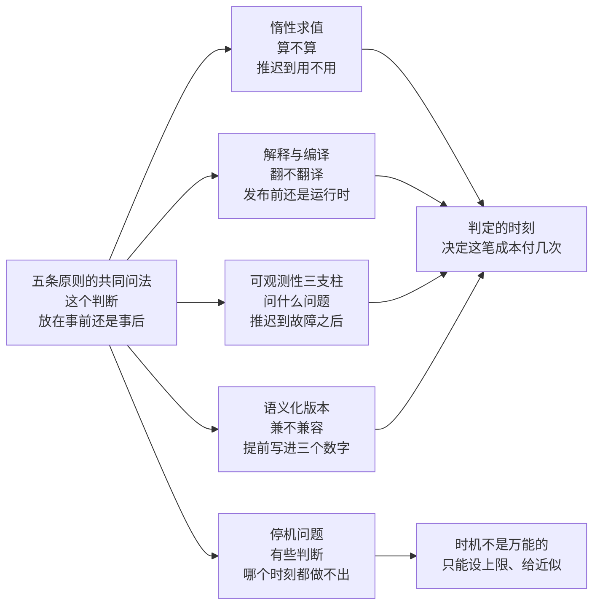
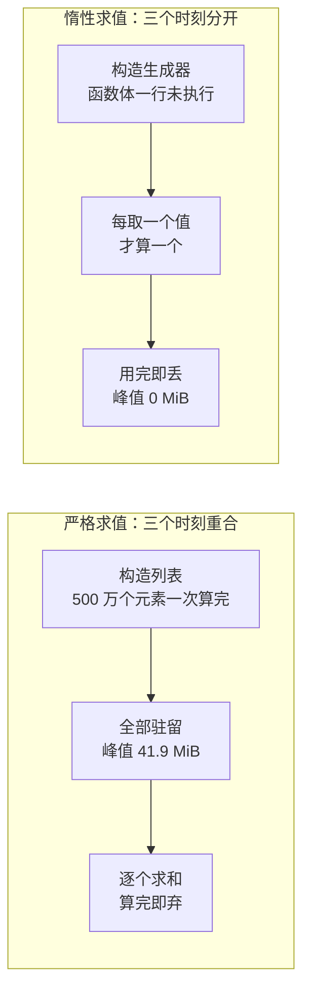
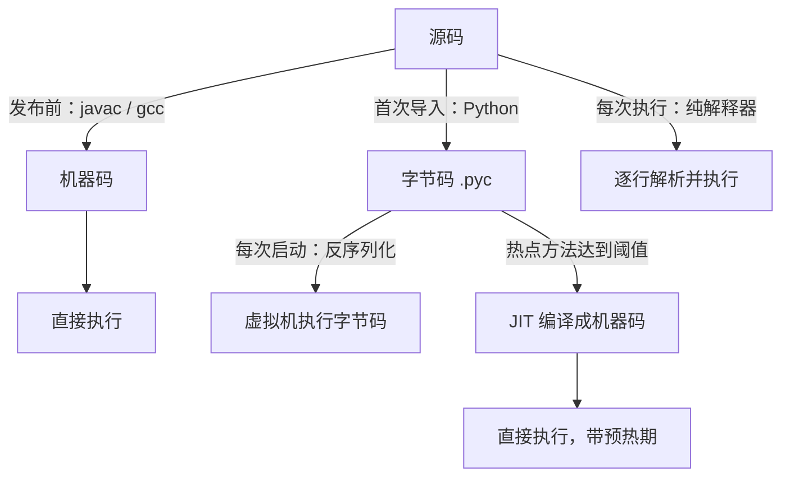
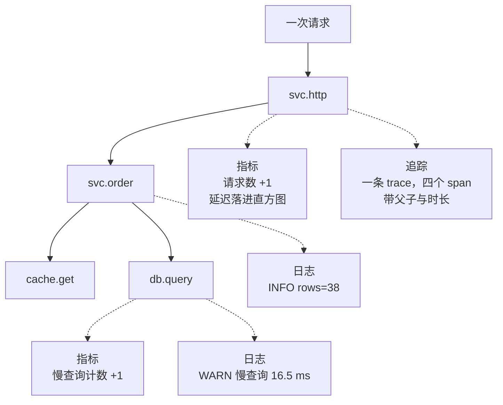
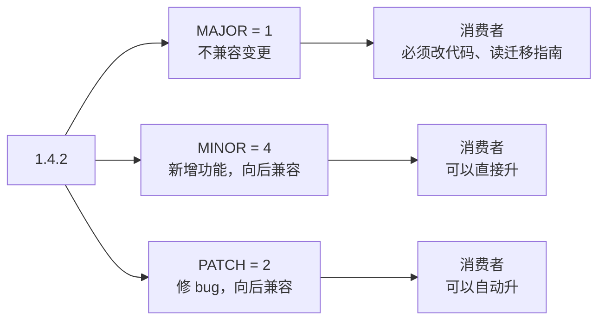
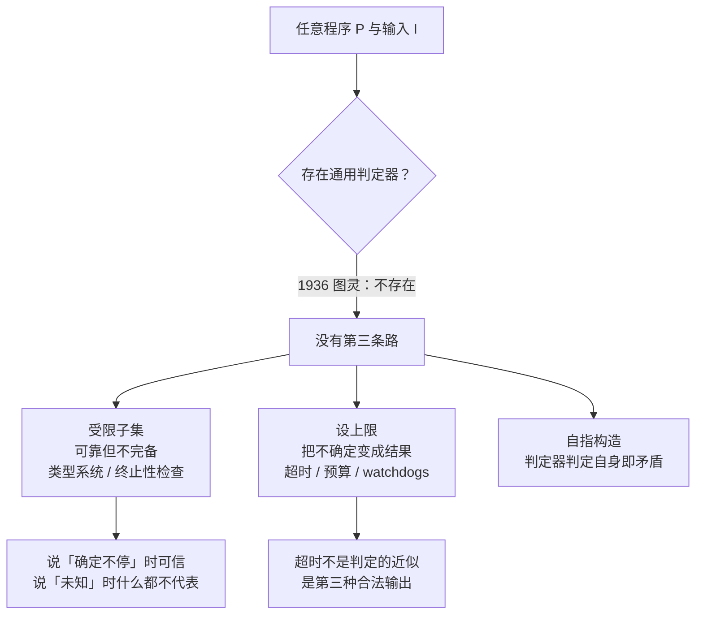

惰性求值、解释与编译、可观测性、语义化版本、停机问题，分属语言运行时、工程运维、协作约定与计算理论。它们的做法看上去也不搭界——推迟计算、提前翻译、事后追查、写进数字、承认做不到。

共同的问法是：**一个判断，你打算在什么时候做出。**

- **惰性求值**把「这个值要不要算」推迟到「真的要用它」那一刻；
- **解释与编译**把「翻译成机器码」放在发布之前、加载之时，还是每次执行；
- **可观测性三支柱**不预设你要问什么，把「该问什么问题」推迟到故障发生之后；
- **语义化版本**反过来，把「这次升级会不会破坏你」提前写进三个数字，让它在发布那一刻就生效；
- **停机问题**给出边界：有些判断，放在哪个时刻都做不出来。

前四条讲的是选时机，第五条讲的是时机本身解决不了的那部分。



判断放在什么时候，等于在决定「这笔成本付几次」。下面五节各自成立，每节都带本机实跑输出，模型类结论会注明是模拟。

## 一、惰性求值

β-归约的次序在 λ 演算里从一开始就有得选。最左最外归约（normal order，先代换再归约）与先求值实参（applicative order）在纯函数语义下结果相同，但终止性不同：前者在更多程序上能停下来。Haskell 1990 把这套按需归约定为默认语义，非严格（non-strict）成了这门语言的身份特征。

工程里更常见的是库级形态——Python 的生成器与 `itertools`、Rust 的 `Iterator`、Java 的 `Stream`、SQL 的执行计划、Spark 的 RDD。它们都没有改变语言的求值模型，只是把「算」这个动作从「构造集合的那一刻」挪到了「取下一个元素的那一刻」。

它要解决的问题很直白——不是所有算出来的值都会被用到。对五百万个数求和，中间那四百九十九万个元素只是过客，算出来、放进内存、被加一次、然后被丢掉。如果每一步只保留当前这一个值，中间状态根本不必同时存在。

**本质一句话：惰性求值把「算」和「用」拆成两个时刻，省下的是永远不会被用到的那部分计算，付出的是这两个时刻之间的一切不确定性——异常、副作用、资源释放，全都跟着值一起被推迟。**



本机用同一笔加法做了对照，N = 5,000,000：

```text
【1】严格求值 vs 惰性求值：同一笔加法的内存与时间（N = 5,000,000）
  list 先建后求和           结果   14999995  峰值     41.9 MiB  耗时   977.6 ms
  generator 流式求和       结果   14999995  峰值      0.0 MiB  耗时   958.4 ms
```

两个结果一致，内存差了 41.9 MiB，耗时只差 19 毫秒。这个 41.9 MiB 值得算一下——五百万个小整数在 CPython 里是缓存的单例，列表真正占的是指针数组，五百万个 8 字节指针正好 40 MB，加上列表本身的开销对上了。换成五百万个字符串，这个数字会涨到几百 MB，而生成器那一列仍然是 0。

耗时那一列是第一个反直觉的地方。**惰性求值没有让它变快。** 977.6 与 958.4 只差 2.0%，落在测量噪声里。生成器每取一个值都要走一次迭代器协议，开销把省下的那部分内存分配抵消了。惰性在这里换到的是峰值内存，不是时间。

第二个反直觉的地方在时间轴上。生成器对象创建出来的那一刻，函数体一行都没执行：

```text
【2】求值时机：创建生成器的那一刻，函数体一行都没执行
  刚创建时 events = []
  第一次 next 返回 1，events = ['函数体开始执行']
  第二次 next 返回 2，events = ['函数体开始执行', '第一次恢复之后']
```

`gen()` 只是造了一个对象，把参数和栈帧挂上去，然后返回。真正的执行要等到 `next()` 把它推进到第一个 `yield`。这个延迟本身是好东西——没人消费就一次都不算——但它把「创建」和「求值」拆成了两件事，接下来所有的麻烦都从这个缝隙里长出来。

第一件麻烦是异常位置漂移。`try` 包在创建处，抓不到任何东西：

```text
【3】异常位置漂移：try 包在创建处，抓不到惰性求值抛出的错
  创建 boom() 成功，异常没有在这里出现
  异常实际发生在第二次 next：第二个元素才炸
```

在严格求值里，`boom()` 调用点就是异常抛出点，栈回溯直接指向业务代码。在惰性求值里，异常抛在消费方的 `next()` 或 `for` 循环里，栈回溯指向的是那行看起来毫无问题的迭代代码。中间隔着多少个调用层级，取决于这个生成器被传了多远。

第二件麻烦是一次性。生成器是一条单向的流，走完就空了：

```text
【4】一次性：同一个生成器迭代两次，第二次是空的
  第一次 sum = 3，第二次 sum = 0
  对照组 list：第一次 3，第二次 3
```

第二次得到 0 而不是报错，这是最坏的一种失败形态——错得很安静。一个函数收下生成器参数、内部迭代了两次，第一次结果正常，第二次结果为零，日志里一切正常。

第三件麻烦是空间泄漏。生成器停在 `yield` 处时，它的整个栈帧都还活着，局部变量一个都不会释放：

```text
【5】空间泄漏：生成器停在 yield 处时，局部变量一个都不会释放
  取走第一个元素（52428800），生成器停在 yield 处
  gc.collect() 之后，缓冲区依然没被回收 —— 生成器对象还持有它的栈帧
  现在丢弃生成器：
    [50 MiB 缓冲区] 此刻才被回收
```

显式调用 `gc.collect()` 也没有用，因为这不是循环引用，是活引用——生成器对象本身就是那个引用的持有者。缓冲区要等到生成器被丢弃、或者被推进到函数末尾、或者被 `close()`，才会释放。Haskell 里把这件事叫 space leak，成因一模一样：一个未求值的表达式（thunk）挂在那里，它捕获的环境跟着一起挂在那里。`foldl` 与 `foldl'` 的区别、`seq` 与 `deepseq` 的存在，都是为了处理这个缝隙。

**边界与反例**

- **惰性不省时间，通常还更慢**。上面 977.6 与 958.4 说明在纯加法这种廉价操作上两者打平；一旦每步的计算量小于迭代器协议的开销，惰性就纯亏。判断标准是「单步计算量 / 单步调度开销」这个比值。
- **副作用顺序失控**。严格求值里，副作用的顺序就是代码顺序。惰性求值里，顺序由消费方决定，可能倒过来，可能交错，可能根本不发生。Haskell 用 IO monad 把副作用隔离出去，其他语言只能靠约定。
- **异常位置漂移，调试栈失去意义**。上面第 3 组就是它的最小形态。工程上的缓解办法是在生成器内部包一层 `try/except` 再重新抛出，把业务信息补进去。
- **不可重放**。生成器、迭代器、`Stream` 都是一次性的。需要重放的场合要么物化成列表，要么在工厂函数里重新创建。
- **空间泄漏比严格求值更隐蔽**。严格求值的泄漏是「忘了释放」，看得见；惰性的泄漏是「还没轮到释放」，看不见，内存曲线还是缓慢爬升，不像一次性分配那么刺眼。
- **共享 thunk 在多线程下要加锁**。GHC 用一个叫 blackhole 的机制标记「这个 thunk 正在被求值」，其他线程撞上就阻塞等待。省下的重复计算，换来的是同步开销和一种新的死锁形态。
- **短序列上不要用**。三个元素的列表，惰性求值省不下任何内存，只是多了一层协议开销。

## 二、解释与编译

1952 年 Grace Hopper 的 A-0 系统把符号代码翻译成机器码，那是「提前翻译」的起点。1958 年 LISP 的 `eval` 提供了另一种可能——代码在运行时才被解释。1960 年代的 FORTRAN 与 COBOL 编译器确立了 AOT（ahead-of-time）的主流地位，此后三十年「编译」几乎等同于「发布前做一次翻译」。

1995 年 Java 把这根时间轴拆成了两段——`javac` 把源码翻译成字节码，放在发布前；JVM 在运行时把字节码翻译成机器码，放在执行中。Python 的 `.pyc` 是同一件事的简化版——首次导入时把源码编译成字节码存盘，之后每次启动只做反序列化，不做解析。

它要解决的是一个成本归属问题。翻译的代价与源码规模成正比，与输入数据无关；执行的代价与输入规模成正比。这两笔钱的性质完全不同，放在同一个时刻收，总有一方要为另一方让步。

**本质一句话：解释与编译的差别不在「有没有翻译」，而在翻译结果被复用了多少次——翻完就丢是解释，存下来反复用是编译，运行中按热度决定要不要再翻一遍是即时编译。**



先看翻译这笔钱到底有多大。本机造了一个 6002 行、2000 个函数的模块，把「解析 + 生成字节码」和「执行字节码」分开计时：

```text
【1】模块规模：6002 行，99.4 KiB，2000 个函数

【2】把源码翻译成字节码，与真正执行字节码，各花多少
  compile() 解析 + 生成字节码           22.92 ms
  exec() 执行模块顶层（2000 个 def）     0.94 ms
  翻译占「翻译+执行」的比例              96.1 %
  翻译一次的钱，够调用函数 f1000         3371 次
```

96.1% 的时间花在翻译上，真正「执行」只占 0.94 毫秒——因为模块顶层只有两千个 `def`，每个 `def` 在字节码层面就是一条 `MAKE_FUNCTION` 加一次赋值，几乎不做事。一次翻译的 22.92 毫秒，够把这个模块里的函数调用三千多次。

这就是「翻译该放在什么时候」的全部张力：**如果这段代码只跑一次，翻译成本占九成以上，任何缓存都救不了它；如果它要跑一百万次，22.92 毫秒摊到每次是 23 纳秒，可以忽略。**

把翻译结果存盘，就是 `.pyc`。同一个模块，有无缓存各 import 五次取最优：

```text
【3】字节码缓存：去掉 pyc 与保留 pyc，import 这个模块各花多少
  无 pyc：解析 2000 个函数并编译         26.69 ms（importtime self）
  有 pyc：直接反序列化字节码              2.08 ms（importtime self）
  省下                                   24.61 ms（92.2%）
```

26.69 到 2.08，省掉 92.2%。省掉的正好是「解析」这一段，反序列化只要 2 毫秒。注意 `.pyc` 一点没有让执行变快，它只是把翻译从每次启动挪到了首次运行。**这就是最朴素的预编译：不改变总工作量，只改变它发生的次数。**

再往前一步是 JIT。同一份 `.class` 文件，用纯解释模式与默认的分层编译各跑一遍，循环 2000 万次，取五轮里最快的一轮：

```text
【1】同一份字节码，两种执行方式（20,000,000 次循环，五轮取最优）
  默认（分层编译 + C2 JIT）       16.8 ms
  纯解释（-Xint）               351.3 ms
  倍数                           20.9 倍

【2】进程级全程耗时（含启动与预热）
  java -version（只启动，不做业务）      47.7 ms
  java Bench 默认 JIT                  159.4 ms
  java Bench 纯解释 -Xint             1840.8 ms
  python -c pass（解释器启动）          151.3 ms
  javac 编译 Bench.java                302.9 ms（一次性）
  全程倍数                              11.5 倍
```

单轮 20.9 倍，全程只有 11.5 倍（1840.8 / 159.4）。差的那部分就是启动开销与预热：JVM 起来要 47.7 毫秒，JIT 要把方法跑到阈值才编译，编译完成之前执行的还是解释版本。**JIT 不是「编译比解释快 21 倍」这么简单，它是「用前几十毫秒的慢，换后面所有时间的快」。**

JIT 之所以能赢 `javac`，靠的是它多一份信息。`javac` 看到的只有源码，不知道这个方法在线上被调用时 `this` 具体是哪个子类、哪个分支命中率更高；JIT 看得见，于是能做去虚拟化、能按实际类型生成特化代码、能把大概率走的分支排到前面。代价是这份信息随时可能失效——加载了一个新的子类，之前生成的代码就得作废重来，这就是 deoptimization。

**边界与反例**

- **冷启动场景里 JIT 是纯成本**。命令行工具、Serverless 函数、一次性脚本，进程活不过几百毫秒，预热期占掉大半。GraalVM 的 native-image、Java 的 AppCDS、.NET 的 ReadyToRun 都是把翻译提前，用「放弃运行时优化」换「省掉预热」。
- **解释器在极短任务上更快**。一段跑 10 毫秒的脚本，编译要 20 毫秒，明显是亏的。判断标准不是「哪个更先进」，是「总执行时间 / 编译时间」这个比值。
- **字节码不是「半编译」**。它把翻译切成两段，但没有减少总工作量，只是让第一段可以存盘复用、第二段可以按需触发。
- **JIT 需要可写可执行内存**，与 W^X、SELinux 的 `deny_execmem`、iOS 的代码签名策略天然冲突。安全加固做得越彻底，JIT 越难做。
- **类型信息缺失会让投机失效**。动态语言里一个变量这轮是整数下轮是字符串，JIT 生成的整数特化代码就得分支预测失败、退回通用路径。CPython 3.11 起的 specializing interpreter 是同一思路的弱化版：不生成机器码，只把字节码特化成针对常见类型的分支。
- **AOT 看不到运行时分布，做不了去虚拟化**，所以它在面向对象密集的代码上系统性落后于 JIT。反过来，JIT 在数值密集、分支稳定的代码上优势最小，这也是为什么科学计算领域 AOT 依然是主流。

## 三、可观测性三支柱

「可观测性」这个词借自控制论，1960 年 Kalman 用它描述「能否从输出反推内部状态」。2017 年前后，Cindy Sridharan 把它带进分布式系统语境，用来区分两件常被混为一谈的事——监控（monitoring）回答的是你事先想到的问题，可观测性回答的是你事先没想到的问题。2019 年 CNCF 把 OpenTracing 与 OpenCensus 合并成 OpenTelemetry，指标、日志、追踪这三根支柱成了事实标准。

它要解决的是一个信息论问题。分布式系统里，一次请求穿过若干个服务，每个服务都可能以你没想到的方式失败。故障发生之前，你不知道该采集什么；故障发生之后，没采集的字段补不回来。「三支柱」不是三个工具的堆叠，而是三种不同保真度的数据，各自保留了不同的信息。

**本质一句话：三支柱的分工不按数据形态分，按问题的时间粒度分——指标回答「这一类请求整体怎么样」，日志回答「这一次具体发生了什么」，追踪回答「这一次的时间花在哪一段」。缺一根，就会出现「知道出事了但查不出原因」，或者「查出了原因但不知道有多大」。**



本机搭了一个三层服务——`svc.http` → `svc.order` → `svc.db` 与 `svc.cache`，下游是一个二十万行的 SQLite 表。跑 300 个请求，其中约 6% 命中一次全表扫描，约 2% 触发业务校验失败。先看指标：

```text
【1】指标：300 个请求被压成几个数字
  请求数        300
  错误数        5
  数据库调用    300，其中慢查询 17 次（5.7%）
  延迟 p50/p90/p95/p99/max  0.05 / 0.11 / 11.81 / 14.11 / 16.52 ms
  直方图       [0, 5) : 283 个
  直方图      [5, 20) :  17 个
  直方图     [20, 50) :   0 个
  直方图    [50, 100) :   0 个
  直方图  [100, +inf) :   0 个
```

三行数字把问题框住了——p50 是 0.05 毫秒，p99 是 14.11 毫秒，差 280 倍；直方图只有两个非零桶，283 个请求在 5 毫秒以内，17 个落在 5 到 20 毫秒之间。5.7% 的请求慢了两个数量级，其余 94.3% 完全正常。

这就是指标的强项，也是它的全部——它能告诉你「有多少、差多少」，不能告诉你「是谁、为什么」。5 个错误、17 次慢查询，这两组数字背后可能是完全不同的原因。

日志负责把「这一次」摊开：

```text
【2】日志：顺着一个 trace_id 把这一次串起来
  慢查询那一次  trace_id = 0707ce3e
    [WARN ] user=166 慢查询 16.5 ms，扫描全表返回 38 行
    [INFO ] user=166 订单查询完成 rows=38
  报错那一次  trace_id = 32838959
    [ERROR] user=71  ValueError: 单笔金额 952239 分超过上限 900000 分
```

同样是「出错」，一条是性能问题（全表扫描），一条是业务规则问题（金额超限）。指标把两者都记成一次异常，日志把它们分开。日志还能给出用户、参数、原始异常，这些是高基数信息，不可能塞进指标。

追踪负责切开时间：

```text
【3】追踪：把一次请求的耗时按代码路径切开
  trace_id = 0707ce3e，全程 16.52 ms
    svc.http     全长   16.52 ms  自身    0.00 ms  占全程 100.0%
      svc.order    全长   16.52 ms  自身    0.04 ms  占全程 100.0%
        cache.get    全长    0.00 ms  自身    0.00 ms  占全程   0.0%
        db.query     全长   16.48 ms  自身   16.48 ms  占全程  99.7%
```

16.52 毫秒里有 16.48 毫秒在 `db.query`，缓存命中耗时 0.00 毫秒，业务层自身 0.04 毫秒。定位到这一步，优化方向不需要讨论。**指标告诉你这 17 个请求慢，追踪告诉你慢在一个 span 上，日志告诉你那个 span 执行了什么 SQL。**

三种数据的成本结构也不同，最直接的约束是基数：

```text
【4】把 user_id 加进指标标签的代价
  当前序列数                4 条
  按 user_id 拆分           4 x 200 = 800 条
  再加 region(8)、ver(5)    4 x 200 x 8 x 5 = 32000 条
```

300 个请求撑不起 32000 条时间序列。每一条序列都要独立存储、独立索引、独立计算聚合，而大部分序列在这 300 个请求里只出现过一次。高基数维度属于日志和追踪，不属于指标——这条分工不是风格问题，是存储模型决定的。

**边界与反例**

- **指标是预聚合的，聚合了就问不出新问题**。这是它与日志、追踪最本质的差别。你在埋点时就决定了按哪个维度聚合，事后想按用户分、按版本分，只能重新埋点重跑。
- **日志成本与流量成正比，采样会丢证据**。全量日志一天几个 TB，采样 1% 又刚好丢掉那条唯一的报错。常见做法是「错误全留、正常采样」，但错误的判定规则本身要维护。
- **追踪的采样率决定了你能不能看见长尾**。1% 采样下，17 个慢请求里期望只采到 0.17 条，很可能一条都没有。慢请求恰恰是长尾，而长尾是采样最先丢掉的部分。所以有 tail-based sampling：先把整条 trace 缓下来，跑完再按耗时决定留不留。
- **没埋的字段，事后补不回来**。这是可观测性与监控的分水岭：监控的指标体系是事先设计好的，可观测性要求原始数据保真度足够高，高到你能回答没预想过的问题。
- **三支柱必须靠同一个标识串起来**。缺了 trace_id，日志是一堆孤立行，指标与日志之间也对不上号。OpenTelemetry 的核心贡献与其说是三个 SDK，不如说是统一了上下文传播。
- **可观测性不能替代测试**。它只在生产环境有效，而生产环境的故障代价远高于测试环境。两者是不同阶段的措施，不是替代关系。

## 四、语义化版本

2013 年 Tom Preston-Werner 在 semver.org 上提出 SemVer 2.0.0。动机很具体——RubyGems 的 `~>` 与 npm 早期的版本号没有统一语义，一个 `1.2` 到底意味着「至少 1.2」还是「1.2 这一支」，全看维护者心情。在此之前，Linux 内核的「never break userspace」与 Debian 的版本策略表达的是同一个诉求，只是没有提炼成通用规范。

它要解决的是一道除法。一个有 500 个依赖的项目，每次升级前都要判断「这次能不能直接升」。没有约定时，唯一可靠的办法是读 changelog、读 diff、跑全量测试，成本与依赖数量成正比；500 个依赖就是 500 次判断，没人做得完。版本号把这项工作从「每个消费者每次都做」变成「发布方做一次」。

**本质一句话：版本号不是标签，是承诺。MAJOR 加一承诺这次有不兼容变更，MINOR 加一承诺只增不改，PATCH 加一承诺只修 bug——它把「能不能直接升」的判断从消费者手里收归发布方，做一次，写成三个数字。**



承诺要能被机器执行，才有意义。本机写了一个区间匹配器，跑了十一条真值：

```text
【1】区间匹配的真值表（含 0.x 与预发布两条特例）
  版本          区间              期望   实测   一致
  1.2.3         ^1.2.3            True   True   OK
  1.9.9         ^1.2.3            True   True   OK
  2.0.0         ^1.2.3            False  False  OK
  0.2.9         ^0.2.3            True   True   OK
  0.3.0         ^0.2.3            False  False  OK
  0.0.3         ^0.0.3            True   True   OK
  0.0.4         ^0.0.3            False  False  OK
  1.2.9         ~1.2.3            True   True   OK
  1.3.0         ~1.2.3            False  False  OK
  1.3.0-rc.1    ^1.2.3            False  False  OK
  1.5.0         >=1.2.3 <2.0.0    True   True   OK
```

十一行里有两行值得单独看。`^0.2.3` 不匹配 `0.3.0`——因为 `0.x` 表示「契约还没定」，规范把 0.x 的 minor 位当 major 位用，`^0.2.3` 只覆盖到 `0.2.x`。`^0.0.3` 更窄，只覆盖 `0.0.3` 这一个版本。这条规则常被抱怨「反直觉」，但它诚实地反映了一件事：0.x 阶段没有兼容性承诺可言。

另一行是 `1.3.0-rc.1` 不满足 `^1.2.3`。预发布版本被默认挡在所有普通区间之外，只有区间里显式写了 `-` 才放行。这是保护机制——让 `npm install` 不会因为某个包发了预发布版就把你的生产依赖升上去。

排序规则也全是坑：

```text
【2】预发布的排序（semver.org 官方给出的那串例子）
  1.0.0-alpha < 1.0.0-alpha.1 < 1.0.0-alpha.beta < 1.0.0-beta < 1.0.0-beta.2 < 1.0.0-beta.11 < 1.0.0-rc.1 < 1.0.0
  相邻比较共 7 对，全部严格递增：是
  beta.2 < beta.11 成立，说明数字段按数值比而不是字符串比（字符串下 '11' < '2'）
  1.0.0-rc.1 < 1.0.0 成立，说明带预发布的版本永远小于同号的正式版
```

`beta.2 < beta.11` 这条，如果按字符串比较会得出相反结论，这是自己写版本比较最容易踩的地方。`rc.1 < 1.0.0` 这条则保证了「预发布永远早于正式版」这个直觉。

承诺能不能自动校验？把「这次改动该升哪一位」写成一次 AST 比对就行：提取两个版本里所有公开函数的签名，比对参数增删、默认值变化、参数顺序。

```text
【3】把「版本号是不是诚实」变成一次可执行的比对
  改动 A（加参数、加函数）  判定 MINOR
      - charge() 新增带默认值的参数 idempotency_key=None
      - 新增公开函数 query()
  改动 B（删参数、删函数）  判定 MAJOR
      - charge() 删掉参数 currency
      - charge() 删掉参数 idempotency_key
      - 删除公开函数 refund()
      - query() 新增带默认值的参数 verbose=False
  改动 C（手标成 2.1.0 的那次）  判定 MAJOR
      - query() 删掉参数 verbose
      - charge() 新增带默认值的参数 currency='USD'
      - 新增公开函数 refund()
```

改动 A 是标准的 MINOR——加了一个带默认值的参数、加了一个新函数，老调用方一行不用改。改动 B 是标准的 MAJOR——删参数、删函数。

改动 C 是这套工具的价值所在。如果只看 diff 的表面，这次改动像是在「加东西」——补了一个 `currency` 参数、恢复了 `refund` 函数、还多了个默认值，看起来像个 feature 版本，维护者很可能就手标成 `2.1.0` 发出去了。但 `query()` 上原本那个 `verbose` 参数被删掉了，所有传了它的调用方会在运行时收到 `TypeError`。工具判定 MAJOR，因为删除参数这件事与「看起来加了什么」无关。

**边界与反例**

- **语义化版本只管 API 形状，不管行为**。函数签名一个字节没变，返回值从「元」变成「分」、从「升序」变成「降序」，工具完全看不出来，只有测试和契约测试能挡。这是版本号承诺最大的漏洞，也是「minor 版本引入 bug」这类事故的主要来源。
- **0.x 的保护范围窄到接近无效**。`^0.2.3` 只覆盖 `0.2.x`，任何 minor 升级都要人工介入。这意味着 0.x 阶段的包实际上没有自动升级能力，与「版本号降低维护成本」的初衷相反。
- **major 号通货膨胀会让承诺失效**。一个内部包每周发一次 major，消费者很快就会学会无视这个数字，改成写死版本或者用 lockfile 锁住。承诺的价值与它的可信度成正比，与发布频率成反比。
- **lockfile 的存在本身就是对 semver 的不信任投票**。如果版本区间声明足够可靠，就不需要把整棵依赖树的精确版本固化下来。现实中几乎每个生态都有 lockfile，说明承诺在传播链路上会衰减。
- **传递依赖不认你的承诺**。你 pin 住了直接依赖，它引用的那个包破了你的运行环境，你的版本号依然是干净的。
- **不同生态对形式做了改写**。Go 用 `/v2` 路径后缀而不是改版本号，Rust 对 `0.x` 有专门规则，Python 生态里大量包长期停在 0.x。语义一致，形式不同，跨生态协作时不要假设规则通用。

## 五、停机问题

1936 年，图灵在《On Computable Numbers, with an Application to the Entscheidungsproblem》里回答了大卫·希尔伯特 1928 年提出的判定问题：是否存在一个通用算法，能对任意数学命题判定真假。答案是否定的，而停机问题是这个否定结论的核心引理。同一年，丘奇用 λ 演算给出了等价结论。1953 年，Rice 把它推广成一条更强的定理：程序的任何非平凡语义性质都不可判定。

证明的骨架是自指。假设存在判定器 `H(P, I)`，能在有限步内回答「程序 P 在输入 I 上会不会停」。构造另一个程序 `D(P)`：调用 `H(P, P)`，如果它回答「会停」，`D` 就进入死循环；如果它回答「不停」，`D` 就立即返回。然后问 `H(D, D)` 会怎么答——两种回答都导致矛盾，所以 `H` 不存在。

为什么工程上要讲这个。日常工作中天天在问类似的问题——这段代码会不会死循环、这个查询会不会一直返回、这个递归有没有终止条件、这个 `while` 循环会不会永远转下去。这些问题的形态与停机问题完全同构。

**本质一句话：停机问题的结论不是「判定很难」，而是「不存在这样的判定器」。能做的只有两件事：对受限的子集给出可靠但不完备的判定，或者设一个上限，把「不确定」当成一种合法结果返回。**



本机实现了一台四寄存器的寄存器机（`INC` / `SET` / `DECJZ` / `JMP` / `HALT`，与 Minsky 机等价，图灵完备），拿四个程序，把观察窗口从 10 步逐步放大到 10 万步：

```text
【1】同一批程序，把观察窗口从 10 步放大到 10 万步
  程序                            上限10步            上限100步           上限1000步         上限100000步
  P1 立即停                     HALT(0)           HALT(0)           HALT(0)           HALT(0)
  P2 约 1503 步                    未判定               未判定               未判定        HALT(1502)
  P3 永不停                         未判定               未判定               未判定               未判定
  P4 约 60003 步                   未判定               未判定               未判定       HALT(60002)
```

窗口从 10 步放大到 10 万步，能下结论的程序从一个变成三个。`P3` 在四列里全是「未判定」——而它到底是「还没停」还是「永远不会停」，这张表本身给不出答案。任何有限窗口都给不出。

有人会说，那就把窗口开得足够大。这条路走不通，成本还按状态数爆炸。二符号图灵机的忙碌海狸函数给出了量化：

```text
【2】有限窗口要多大才够？（2 符号图灵机，状态数 n）
  n = 1：最长运行            1 步才停
  n = 2：最长运行            6 步才停
  n = 3：最长运行           21 步才停
  n = 4：最长运行          107 步才停
  n = 5：最长运行   47,176,870 步才停
```

状态数从 1 加到 4，最长运行步数从 1 涨到 107，还在直觉范围内。加到 5，直接跳到 4717 万。这个数字是 2024 年用 Coq 形式化验证出来的结论，此前六十年里没有人能证明它。含义很直接：**要判定一台 5 状态 2 符号的图灵机「会不会停」，你可能得先跑 4717 万步。** 而 6 状态的下界已经远超 10 的 10 次方量级。状态数每加一，需要的观察窗口按天文数字膨胀，「多跑几步就知道了」这条路在第 5 个状态上就断了。

工程上真正在用的是受限子集。本机写了一个最小的静态检测器——扫 AST，找到 `while` 条件为常量真、且循环体内不存在 `break` / `return` / `raise` 的节点，判定「确定不停」；其余一律返回「未知」。十个程序，静态判定与 1 秒观察窗的实际结果对照：

```text
【3】用 AST 写一个「显然不停」检测器，能覆盖多少
  程序              静态判定    实际运行（1 秒观察窗）
  f1 空转            确定不停       1 秒内未停
  f2 while 1       确定不停       1 秒内未停
  f3 计数循环          未知         已返回
  f4 立即 break      未知         已返回
  f5 条件 return     未知         已返回
  f6 Collatz 27    未知         已返回
  f7 周期轨道          确定不停       1 秒内未停
  f8 内层 break      确定不停       1 秒内未停
  f9 条件恒真          未知         1 秒内未停
  f10 长度不变         未知         1 秒内未停

  静态判定为「确定不停」：4 个，其中实际未停 4 个
  实际未停的：6 个，静态只认出 4 个（覆盖 67%）
  判错（说它不停、其实会停）：0 个
```

四判四中，零误判，覆盖率 67%。漏掉的两个恰好是最有代表性的：`f9` 是 `while n < 10: pass`，循环变量从不改变，条件恒真，但 AST 上看不出「n 不会变」这件事；`f10` 是 `while len(s) > 0: s[0] = 1`，列表长度永远是一，条件同样恒真，规则更看不出来。**静态规则只认字面形态，不认语义。**

这个 67% 与 0 误判的组合，正好刻画了受限子集判定的性质：它给的是充分条件。说「确定不停」时可信，说「未知」时什么也不代表——既可能是会停，也可能是不会停。它永远不会给出「一定停」的结论，那需要证明，而证明本身在一般情形下不可能。

再看动态观察那一列。`f9` 和 `f10` 都显示「1 秒内未停」，这只能说明一秒内没停，不能说明永远不停。动态分析给的是必要条件。**充分条件与必要条件之间那条缝，就是停机问题留给工程的位置。**

**边界与反例**

- **Rice 定理比停机问题更强**。「这个程序会不会抛异常」「这个变量会不会为空」「这两个函数是否等价」，全部不可判定。日常遇到的静态检查工具做的都是近似，不是判定。
- **真实计算机是有限状态机，所以停机问题在物理上「可判定」**。内存有限，状态数有限，理论上穷举所有状态就能判定。但状态数是 2 的内存位数次方，这个「可判定」在实践上等于不存在。这个细节常被用来抬杠，它不改变任何工程结论。
- **超时不是判定的近似，是第三种合法输出**。把「不确定」显式建模成一个结果（`Timeout`、`Unknown`、`BudgetExceeded`），比假装能判定要诚实得多，也让上层能针对这种情况设计兜底。
- **「不可判定」不构成不写检查的借口**。类型系统、终止性检查（Coq 的 guard condition、Agda 的 termination checker）、SQL 递归 CTE 的终止要求，都是在受限子集上做的可靠判定。它们不完备，但极有用。
- **受限子集的代价是表达能力**。强归一化的类型系统保证程序终止，代价是不能写通用递归；SQL 要求递归查询有终止条件，代价是某些图算法写起来别扭。这不是缺陷，是交易。
- **动态分析的结论有时效性**。今天跑一小时没崩，不代表明天不会崩。压力测试给出的置信度与测试时长相关，与「证明」无关。

## 六、横向对照

| 原则 | 判断放在什么时候 | 拿什么换什么 | 代价结构的关键量 | 失效边界 |
|------|------------------|--------------|------------------|----------|
| 惰性求值 | 推迟到「真的要用这个值」 | 峰值内存换求值时机的确定性 | 单步计算量 / 迭代器协议开销 | 异常漂移 / 一次性 / 空间泄漏 |
| 解释与编译 | 发布前、加载时、运行时三选一 | 预热期换稳定的执行速度 | 执行总时长 / 翻译耗时 | 冷启动 / 可执行内存限制 / 类型不稳定 |
| 可观测性三支柱 | 推迟到故障发生之后 | 采集与存储成本换「事后能问新问题」 | 采样率、标签基数、保留时长 | 高基数 / 采样丢长尾 / 没埋的字段 |
| 语义化版本 | 提前写进三个数字，发布时生效 | 承诺纪律换「升级前不必读代码」 | 承诺可信度、发布频率 | 行为变更 / 0.x / major 通胀 / 传递依赖 |
| 停机问题 | 任何时刻都做不到（一般情形） | 表达能力换可靠判定 | 受限子集的覆盖范围 | Rice 定理 / 动态结论的时效性 |

| 五条原则 | 一句话判据 |
|----------|------------|
| 惰性求值 | 这个值真的会被用到吗，用到之前它占着多少东西 |
| 解释与编译 | 这段代码要跑几次，翻译成本摊到每次还剩多少 |
| 可观测性三支柱 | 我要问的是「多少」、「哪一次」，还是「慢在哪一段」 |
| 语义化版本 | 这次改动，老调用方一行代码不改能不能跑 |
| 停机问题 | 我要的是判定，还是一个可靠的上限 |

🐾 **小结**：这五条原则分属语言运行时、工程运维、协作约定与计算理论，做法各不相同——推迟计算、挪动翻译、事后追查、写进数字、承认不可判定。落到根上，它们都在回答同一个问题：**这个判断，你打算在什么时候做出，代价付几次。**

惰性求值把「算不算」推迟到「用不用」，所以它必须承受求值时机脱离控制的全部后果：异常从别处冒出来、生成器只能走一遍、栈帧攥着五十兆不撒手。解释与编译把「翻译」挪到发布前、加载时或运行时，所以它必须算清这笔固定成本摊到每次执行还剩多少：6002 行的模块翻译一次 22.92 毫秒，够调用三千多次函数；纯解释与即时编译在同一份字节码上差 20.9 倍，但全程只差 11.5 倍，差值全在预热里。可观测性把「该问什么」推迟到故障之后，所以它必须为「没预想到的问题」保留原始数据，代价是高基数维度进不了指标、1% 采样最先丢掉长尾。语义化版本把判断提前，写成三个数字，所以它必须为这三个数字负责——删掉一个带默认值的参数，表面看是加了个新特性，判定仍是 MAJOR。

停机问题站在这一串的外面。它说的是：有些判断，无论你把它放在事前、事中还是事后，都做不出来。这时候正确的做法不是加大窗口、换更强的工具，而是承认这类判断不存在，把问题改写成「设一个上限，超出就当不确定处理」。超时、预算、watchdog、资源配额，全都属于这一类——它们不判定，只兜底。

回过头看这五条，选择时机的判据其实只有一句：**这个判断需要多少信息，这些信息在哪个时刻才齐。** 信息在发布前就齐，提前判定最便宜（编译、版本号）；信息要等运行时才有，推迟判定最准确（JIT、追踪）；信息永远不会齐，就别判定了，设个上限。

---

**相关阅读**：
- [计算机原则五讲（九）：把负担摊开](/posts/princ-chapter-09/)
- [计算机原则五讲（八）：同一份东西该存在几处](/posts/princ-chapter-08/)
- [计算机原则五讲（七）：拿什么换什么](/posts/princ-chapter-07/)
- [计算机原则五讲（六）：没有免费的优化](/posts/princ-chapter-06/)
- [计算机原则五讲（四）：把没说出口的约定写下来](/posts/princ-chapter-04/)
- [计算机原则五讲（一）：这笔投入能换回什么](/posts/princ-chapter-01/)
- [基于 CMake 和 git 提交数自动管理版本号](/posts/9aed61e6/)
- [Java 的编译运行机制与静态类型](/posts/c61b0101/)
- [Python 生成器与协程底层深度解析](/posts/3fa74aea/)
