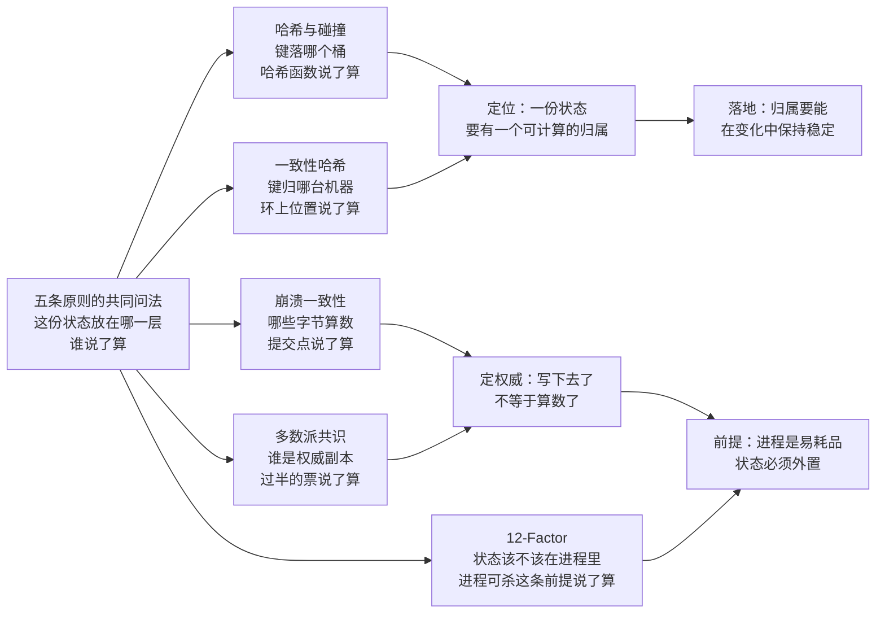
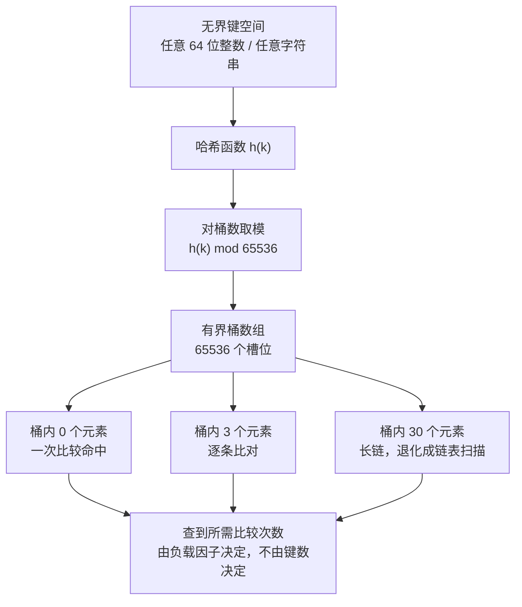
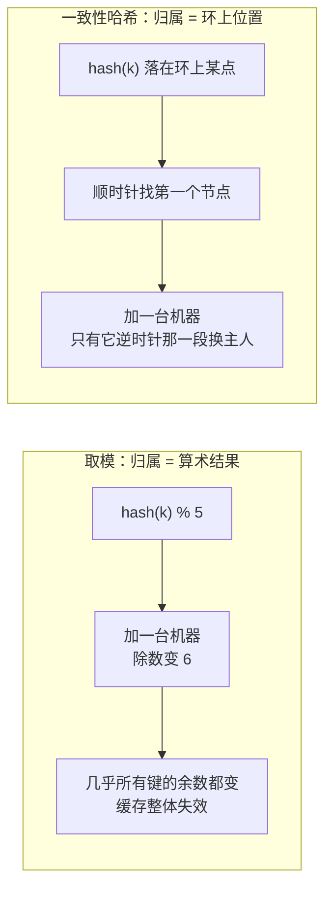
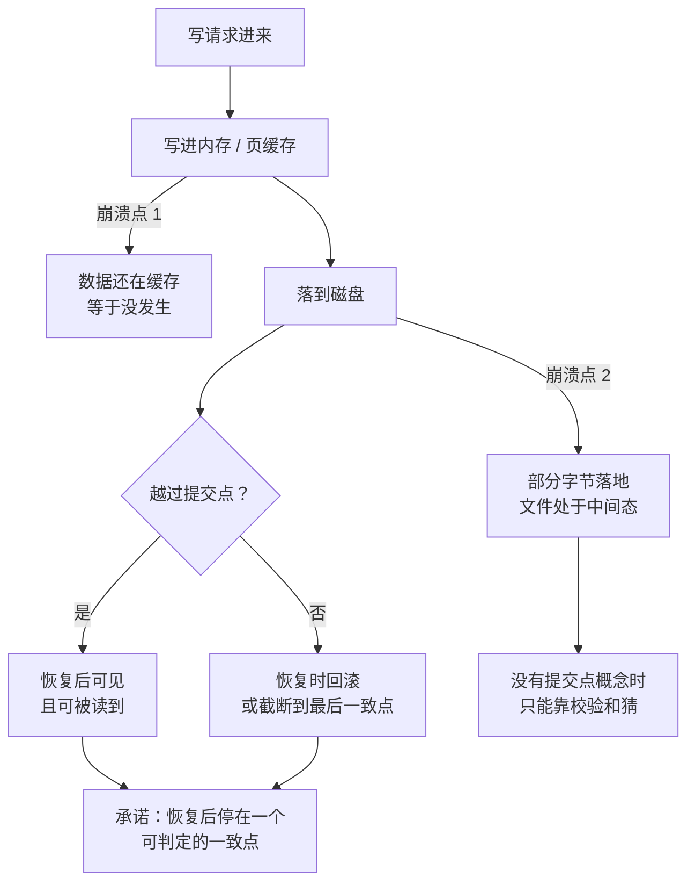
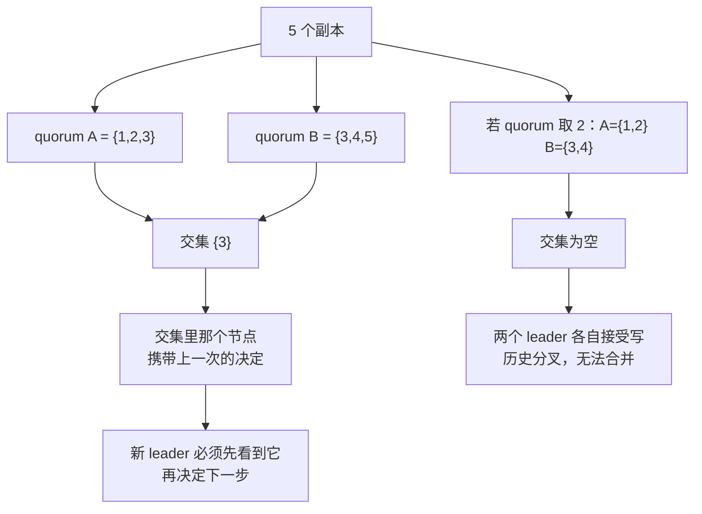
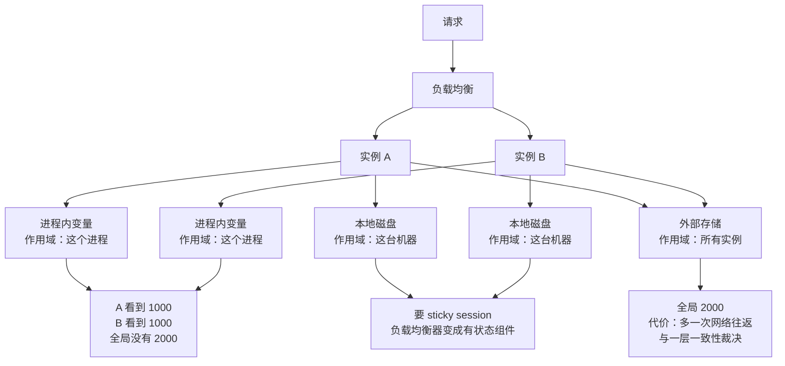

哈希与碰撞、一致性哈希、崩溃一致性、多数派共识、12-Factor，分别属于数据结构、分布式存储、持久化、共识协议与工程架构。做法看着毫不相干：算一个余数、在环上找位置、写日志再改名、数票、把变量搬出去。

共同的问法是：**这份状态放在哪一层，谁说了算。**

- **哈希与碰撞**把「这个键落在哪个桶」交给哈希函数决定，代价是压缩映射必然产生的碰撞；
- **一致性哈希**把「这个键归哪台机器」从算术结果改成环上的位置关系，让成员变化只波及邻居；
- **崩溃一致性**把「哪些字节算数」交给提交点决定，而不是交给「写完了」这个感觉；
- **多数派共识**把「谁是权威副本」交给票数决定，并且要求过半；
- **12-Factor**先取消前提：进程不许持有状态，于是前四件事从「可选技巧」变成「必需设施」。

前四条讨论状态怎么定位、怎么落地、怎么定权威，第五条讨论状态该不该待在进程里。



五个小节各自独立成立，每组结论都带本机实跑输出；涉及断电的那一段是按页截断的模拟，已在原文标明。

## 一、哈希与碰撞

1950 年代 IBM 内部为了给汇编器做符号表，开始用「算一个函数值当数组下标」的办法替代顺序查找。Hans Peter Luhn 1953 年的备忘录提出用散列加链地址组织符号表；同一时期 IBM 701 的汇编器用线性探测实现符号表，Amdahl 参与其中。1950 年代后期，Dumey（1956）与 Peterson（1957）把开放寻址写成通用方法并给出分析，1973 年 Knuth《TAOCP》第三卷把负载因子、链长、探测次数统一成一套可计算的理论。

这门技术要解决的问题很朴素：键的集合没有边界，数组的下标有边界。用户 ID 可以是任意 64 位整数，用户表只有 65536 个槽位。两者之间必须有一座桥，而桥的宽度是固定的，所以过桥的人必然要挤。

**本质一句话：哈希不是「把键变成唯一编号」，是用固定大小的空间去索引无界的键空间；碰撞不是实现缺陷，是压缩映射的必然产物，工程上能选的只是「这笔租金怎么付」。**



先把「碰撞为什么躲不掉」量化。桶数固定为 65536，键从一万加到一百万：

```text
  桶数固定 m = 2^16 = 65536
        键数 n     负载因子     空桶占比     最长链     平均链长      查到需比对
       10000     0.15    85.5%       2     0.15       1.08
       65536     1.00    36.8%       5     1.00       1.50
      200000     3.05    20.7%      10     3.05       2.53
     1000000    15.26     0.0%      30    15.26       8.63
```

三件事值得看。

第一，负载因子为 1 的时候，空桶占比 36.8%，正好是 1/e。这不是巧合：n 个球随机扔进 n 个盒子，一个盒子空的概率是 (1-1/n)^n，极限就是 e 的负一次方。教科书里那个「大约 37% 的桶是空的」结论，在这台机器上一位小数都不差。

第二，最长链从 2 涨到 30，涨了 15 倍，而负载因子涨了 100 倍。长链增长慢于负载因子，这是均匀哈希下最长链的典型行为（量级在 log n / log log n 附近）。所以「桶里挂了几条」这件事本身不致命，致命的是它没有上界。

第三，最后一列才是用户能感知的指标。负载因子 15.26 时，一次成功查找平均要比对 8.63 条记录，链式法的理论值 1 + α/2 = 8.63。**哈希表退化不是突然发生的，是随负载因子线性滑下去的。**

再看「碰撞概率」这条曲线。生日界的近似式是 p ≈ 1 - exp(-n²/2m)，m 是哈希空间大小：

```text
      哈希位宽       键数 n       理论 p         实测 p     轮数
        32       1000   0.000116     0.000200   5000
        32      10000   0.011574     0.013500   2000
        32      50000   0.252513     0.245000    400
        32     100000   0.687813     0.705000    200
  碰撞概率到 50% 所需的键数：32 位 77,163 个，64 位 5,056,937,541 个
```

四行都贴着理论值。第一行的理论命中是 0.58 次、实测 1 次，属于小样本抖动；第四行在 200 轮下理论该命中 138 次、实测 141 次，偏差 2%，落在标准差之内。

真正要记住的是最后那行：**32 位哈希只要七万七千个键，就有一半概率出现碰撞；64 位要五十亿个。** 这两个数字决定了系统设计里的一条分界线——「哈希值当 ID 用」时，32 位是不够的，七万个对象就到了赌运气的规模。

分布质量比碰撞率更容易被忽略。同一批五万个键、同一千个桶，换四种哈希函数：

```text
  桶数 1024，键数 50000（负载因子 48.8）
  哈希函数                   用到的桶     最长链      链长标准差      卡方/自由度
  crc32                  1024      56       2.40        0.12
  md5 前 8 字节             1024      70       7.00        1.00
  bad: 所有字节求和             131    2623     274.81     1546.68
  bad: 只取首字母                1   50000    1561.74    49951.17
```

最后两行是故意写坏的。所有字节求和的哈希，五万个键只用到 131 个桶，最长链 2623 条；只取首字母，全部落进同一个桶，退化成一条五万节点的链表。这两个「哈希函数」在语法上完全合法，编译器不会报错，单元测试也可能通过——只要测试数据不够多。

第一行和第二行还藏着一个细节。md5 的卡方/自由度是 1.00，正好是均匀随机分布的期望值；crc32 只有 0.12，波动远小于随机。原因是这批键是 `session:0` 到 `session:49999`，结构化输入撞上了 crc32 这种线性函数，分布比随机还整齐。**这说明「测出来的均匀性」依赖输入的形状，不依赖哈希函数的名气。** 反过来也成立：crc32 对顺序键极其整齐，对刻意构造的对抗输入却可以按需制造碰撞。

最后一组对照是「碰撞发生了，代价多大」。同样负载下，链式法与线性探测的成功查找比较次数：

```text
      负载因子      链式法       线性探测      线性/链式
      0.25     1.12       1.14       1.02
      0.50     1.23       1.40       1.14
      0.75     1.34       2.45       1.83
      0.88     1.40       4.46       3.19
```

链式法那一列几乎就是理论值 1 + α/2：四个负载因子对应 1.125、1.25、1.375、1.44，实测 1.12、1.23、1.34、1.40，都略低一点，因为五万次抽样没有充分覆盖长链尾部。线性探测从 1.14 涨到 4.46，负载因子 0.88 时贵了 3.19 倍。差别来自「碰撞的传播方式」：链式法里碰撞只影响那一个桶，线性探测里一次碰撞会把后面若干个桶一起拖慢（一次聚集）。这就是为什么开放寻址的实现都要把负载因子压在 0.7 以下，超过就扩容。

**边界与反例**

- **哈希表不保证有序**。要范围查询、要按序遍历，得用 B+ 树或跳表。HashMap 的迭代顺序在扩容后会变，这不是 bug，是压缩映射的必然后果。
- **哈希值不是唯一标识**。上面那组数字说明 32 位在七万量级就开始碰撞。用哈希值当主键、当去重依据、当缓存键而不做二次校验，等于赌自己的数据量永远不到生日界。
- **「均匀」不等于「抗攻击」**。crc32 在顺序键上比 md5 还整齐，但它是线性函数，攻击者可以反解出碰撞。HashMap 的哈希碰撞拒绝服务攻击（2011 年多语言同时中招）就是靠这个原理，此后 Java 8 在链表长度超过 8 时转红黑树，把最坏情况从 O(n) 压到 O(log n)。
- **扩容是摊销成本，不是免费**。负载因子到阈值要重建整张表，一次扩容 O(n)。摊还到每次插入是 O(1)，但单次扩容的停顿是真实存在的，实时系统要预留余量。
- **链式法的内存开销在指针上**。每个节点一个指针，负载因子低时指针比数据还大。开放寻址省指针，但删除要打墓碑标记，长期运行后墓碑会污染探测路径。
- **持久化哈希要防篡改**。当哈希用于校验而非索引时（文件指纹、内容寻址），要求的是抗碰撞性而不是均匀性，这两件事由不同性质的函数提供，不能互换。

## 二、一致性哈希

1997 年，MIT 的 Karger、Lehman、Leighton、Levine、Lewin、Panigrahy 在 STOC 上发表《Consistent Hashing and Random Trees》，为 Akamai 的 Web 缓存网络解决一个具体问题：缓存节点会上下线，键到节点的映射不能每次都全量重算。2007 年 Amazon 的 Dynamo 论文把这套方法带进分布式存储，并推广了「虚拟节点」这个工程细节。

它要解决的是取模的脆弱性。五台机器，键按 `hash(key) % 5` 分配。加到六台，除数从 5 变成 6，几乎每个键的余数都变了。缓存集体失效，请求全部穿透到后端——这就是「重分布」的代价。

**本质一句话：一致性哈希把「归属」从一次算术结果换成环上的位置关系，于是成员变化只影响环上相邻的那一段，而不是全体重新洗牌。**



先看取模有多贵。两万个键，五台机器加到六台：

```text
  取模（key % 机器数）            搬家  83.2%   （理论 (n)/(n+1) = 83.3%）
```

83.2%，理论值 5/6 = 83.3%。这不是「大部分要搬」，是「几乎全部要搬」。分母变了，所有键的下标都跟着变。

一致性哈希的搬家比例应该接近 1/(n+1) = 16.7%。实测却不是：

```text
  一致性哈希 vnode=1           搬家  97.6%   5 台负载 16~19644（变异系数 1.956）  6 台负载 16~19522（变异系数 2.172）
  一致性哈希 vnode=10          搬家  68.0%   5 台负载 592~11743（变异系数 1.073）  6 台负载 476~13603（变异系数 1.413）
  一致性哈希 vnode=50          搬家  17.0%   5 台负载 2655~6215（变异系数 0.300）  6 台负载 2322~4376（变异系数 0.179）
  一致性哈希 vnode=150         搬家  17.5%   5 台负载 3072~5256（变异系数 0.188）  6 台负载 2829~4037（变异系数 0.124）
  一致性哈希 vnode=400         搬家  20.0%   5 台负载 3491~4958（变异系数 0.131）  6 台负载 3038~3991（变异系数 0.095）
```

单个虚拟节点时，搬家 97.6%，比取模还差。原因看下一组数字就明白——五台机器在环上的分布是这样的：

```text
  vnode=1    a= 0.4%  b= 0.8%  c= 0.5%  d=98.2%  e= 0.1%   最大/平均 = 4.91
  vnode=10   a= 3.0%  b=58.7%  c= 5.3%  d= 4.8%  e=28.2%   最大/平均 = 2.94
  vnode=50   a=31.1%  b=19.4%  c=13.3%  d=19.7%  e=16.5%   最大/平均 = 1.55
  vnode=150  a=26.3%  b=18.3%  c=15.4%  d=21.9%  e=18.2%   最大/平均 = 1.31
```

每台机器只放一个点时，`d` 独占 98.2% 的键，其余四台分剩下的 1.8%。加进第六台机器，它落在环上某一处，从某个节点手里切走一大段——切走多少完全取决于位置，与「六分之一」无关。**所以「只影响邻居」这个性质是对的，但「只影响六分之一」这个预期是错的**：如果邻居本来就占了 98%，影响面就是 98%。

把虚拟节点加上去，情况立刻改善。每个物理节点在环上放 150 个点，负载的变异系数从 1.956 降到 0.188，最大/平均从 4.91 降到 1.31，搬家比例回到 17.5%，接近理论的 16.7%。

虚拟节点数量与均衡度的关系：

```text
   vnode        最大/平均负载       变异系数
       1          4.911      1.956
       5          2.237      0.952
      10          2.936      1.073
      25          1.633      0.349
      50          1.554      0.300
     100          1.475      0.319
     200          1.205      0.174
     400          1.240      0.131
```

从 1 个点加到 25 个点，最大/平均从 4.911 掉到 1.633；再加到 200 个点，到 1.205。收敛速度大致是 1/√v：变异系数与虚拟节点数的平方根成反比。这解释了为什么生产系统普遍用 100 到 200 个虚拟节点——再往上收益递减，而环的内存与查找开销是线性的。

注意 10 个点那一行（2.936）比 5 个点（2.237）还差。这不是测量错误，是单次实验的随机性：这个虚拟节点数是 30 次重复的均值，但 10 个点的分布恰好比 5 个点更偏。**虚拟节点不保证每次都更均匀，它只是降低期望的不均匀度。** 要判断是否够用，看的是长期均值，不是某一次的观感。

最后一组实验是节点抖动。一台机器短暂离线，然后又回来：

```text
  vnode=10   离线时搬家 28.2%  回归时搬家 28.2%  最终回到原位的比例 100.0%
  vnode=150  离线时搬家 18.2%  回归时搬家 18.2%  最终回到原位的比例 100.0%
```

关键在最后一列：100%。离线时它的那段键交给顺时针的下一个节点，回归后原样收回。整个过程中没有任何一次「全量重算」，也没有一个键被搬到与它无关的机器上。**这才是「一致性」三个字的意思：映射函数对成员变化的响应是局部的、可逆的。**

**边界与反例**

- **虚拟节点是必需品，不是优化项**。单点或少量节点的一致性哈希，在均衡度上比取模还不堪。上面 98.2% 那台机器就是证据。
- **热点键仍然会打穿**。一致性哈希均衡的是「键的数量」，不是「键的访问量」。一个百万 QPS 的键落在哪台机器，那台机器就是热点，环帮不上忙，要靠键拆分或本地缓存。
- **环的维护本身是分布式问题**。谁掌握这个环？每个客户端自己算，还是查一个配置服务？配置服务挂了怎么办？Dynamo 用 gossip 传播成员表，代价是收敛延迟与临时的不一致视图——两个客户端可能短暂地认为同一个键属于不同节点。
- **重新平衡不等于数据迁移完成**。环更新是一瞬间的事，把 20% 的数据真的搬过去是几小时的事。这段窗口里读请求会打到新节点然后 miss，需要双读或转发。
- **它不解决副本一致性**。环只决定「主副本在哪」，副本之间怎么同步、读哪个副本，是另一层的问题。把一致性哈希当成一致性方案，是名字带来的最大误解。
- **节点异构时要用权重**。八核机器与两核机器放同样多的虚拟节点，等于给后者压两倍的负载。按容量分配虚拟节点数，本质上是在环上做加权。

## 三、崩溃一致性

数据库侧的思想从 1970 年代就开始了：System R 用影子页（shadow paging）保证「要么看到旧页，要么看到新页」；1980 年代的日志恢复把随机写改成顺序写；1992 年 Mohan 等人的 ARIES 把 WAL、steal/no-force 缓冲策略、重复历史统一成一套恢复算法。文件系统侧慢一些：1994 年 McKusick 的 soft updates、2001 年 ext3 的日志，都是在回答同一个问题——掉电之后，元数据能不能自洽。

「崩溃一致性」作为一个独立话题被反复讨论，很大程度是 2014 年 OSDI 那篇《All File Systems Are Not Created Equal》的功劳：它实测出各家文件系统对 `fsync` 与 `rename` 的保证并不相同。2018 年 PostgreSQL 邮件列表那次长达数月的争论（fsync 错误被吞掉），则让「写完不等于落盘」这件事成了常识。

它要解决的问题是：真实世界的存储没有「要么全做要么全不做」这个原语。一条记录 40 字节，可能只写进去 20 字节；一批 50 行，可能提交了 30 行。崩溃点落在任意位置，恢复过程必须能判断「哪些算数」。

**本质一句话：崩溃一致性的单位不是字节，是提交点；系统能承诺的从来不是「一个字节都不丢」，而是「恢复后总是停在某个一致点上，且系统知道那是哪个点」。**



本机做了一组确定性实验：四条写入路径，都在第 8000 条记录处调用 `os._exit(0)`，不走 `close`、不走 `flush`，等价于此处的进程级崩溃。记录 40 字节，内部带代际号、序号、载荷与 CRC。

```text
  写入策略                          文件字节     可读记录             内容代际           判定
  原地覆盖 r+b（不截断）               800000    20000        1 代 + 2 代         新旧拼接
  截断重写 O_TRUNC                320000     8000          只有第 1 代         静默丢尾
  写 .tmp + os.replace         800000    20000          只有第 1 代         完整一代
  追加写 + 定长 CRC                320020     8000          只有第 1 代        残尾可检出
```

四行，四种完全不同的失败形态，逐一拆开。

第一行最危险。原地覆盖（打开文件、把指针挪回开头、逐条重写、不截断）崩掉之后，文件长度是 800000 字节，正好两万条，一条不多一条不少：

```text
  文件 800000 字节 = 20000 条完整记录，末尾无残留字节
  第 0~7999 条是第 2 代（新写入的 8000 条），第 8000~19999 条是第 1 代（上一代残留的 12000 条）
  每条记录的 CRC 都自洽，seq 下标也对得上 —— 逐条校验查不出问题
  唯一破绽是记录内部那个代际号：[2, 2, 1, 1]
```

大小检查通过、行数检查通过、单条 CRC 检查通过。三项全绿，文件是一份「前 8000 条是新的、后 12000 条是旧的」的拼接体。任何只看文件长度的巡检、任何只看单条完整性的校验，都会放过它。**这是崩溃一致性里最难查的一种：每一行都是对的，整个文件是错的。**

第二行是另一种失败。截断重写（`O_TRUNC` 之后从头写）崩掉后只剩 8000 条，两万条里丢了 12000 条，而文件本身完全自洽——它就是「只有 8000 条」的样子。没有任何东西能告诉读者「本该有两万条」。这就是「静默丢尾」：数据丢了，系统不知道自己丢了。

第三行是标准解法。写临时文件、`fsync`、`os.replace` 原子改名。崩在改名之前，目标文件仍是完整的上一代：

```text
  写 .tmp + os.replace         800000    20000          只有第 1 代         完整一代
```

读者永远看到「某个完整世代」，不存在中间态。代价是每次写都要拷贝一份完整数据——对整文件替换没问题，对 100 GB 的数据库文件就不可能。

第四行是追加写 + 定长记录 + CRC，崩掉之后尾部多出 20 字节：

```text
  文件 320020 字节，可读记录 8000 条（seq 0~7999），尾部残留 20 字节
  残留 20 字节 = 第 8000 条记录的前半截，CRC 字段还没写进去
  恢复动作：把文件截到 320000 字节，丢掉这 20 字节，数据回到最后一致点
```

残尾能被精确定位，因为校验和覆盖了每条记录的全部内容，而记录长度固定，所以「最后一个能完整校验的位置」是唯一确定的。截到那里，数据回到最后一致点。**这是「能恢复到哪个点」的一个具体形态：不是零丢失，是丢到一条记录的边界。**

对照第一行与第四行，差别不在「有没有校验和」，而在「有没有一个可以退回的位置」：CRC 追加写里有，原地覆盖的拼接里没有——前面是新的、后面是旧的，中间那条边界恰好是崩溃点，而这个点在文件里没有留下任何痕迹。

再往下是断电这一层。上面四组都是进程崩溃，操作系统页缓存还在，数据最终会落到盘上。真实断电时，页缓存里没刷的部分直接消失，而且消失的粒度是页，不是记录：

```text
  参照文件 1600000 字节，40000 条记录
     保留页       保留字节      可读记录      残尾字节           判定
       1       4096       102        16        残尾可检出
       2       8192       204        32        残尾可检出
       8      32768       819         8        残尾可检出
      16      65536      1638        16        残尾可检出
```

这一组是按页截断的模拟，不是真实断电实测。它说明的是一件事：4096 字节的页边界与 40 字节的记录边界不对齐，所以任何「以页为单位落盘」的系统，崩溃后都可能停在一条记录的中间。**记录级校验和的必要性，就来自页大小与记录大小不互整除这件事。**

最后把一致性交给事务边界，看同一个崩溃点会发生什么：

```text
  提交了 7 批（350 行），第 8 批插入 20 行后崩掉
  integrity_check = ok
  存活行数 350，最大 seq 349，是否 50 的整数倍：是
  语义：丢掉的是整批未提交的行，不是「半批」；数据库本身没有中间态
```

350 行，正好 7 批，序号 0~349 连续无空洞。第 8 批插进去的 20 行全部消失。数据库没有因此变成「有 370 行但缺中间几行」的状态，因为它在一批开始时就决定了这批要么整体可见、要么整体不可见。

**边界与反例**

- **`write` 返回成功不等于落盘**。`write` 只把数据交给页缓存。要落盘得 `fsync`，而 `fsync` 的语义在各文件系统、各内核版本上并不完全一致，SSD 的写缓存还可能吞掉它。这也是「写完就返回成功」的接口在崩溃后不可信的根本原因。
- **`rename` 的原子性有前提**。POSIX 保证同文件系统内的 `rename` 是原子的；跨文件系统是拷贝 + 删除，不原子。临时文件必须与目标同目录同文件系统，放到 `/tmp` 再改名会退化成「拷贝」。
- **目录项也要 `fsync`**。新建文件后只 `fsync` 文件本身，掉电后可能文件内容在、目录项不在，文件变成孤儿。严格做法是 `fsync` 文件、`fsync` 父目录，两次。
- **多副本不是一致性方案**。三副本各自可能处于不同的一致点，恢复后需要一层「谁是权威」的裁决，而这一步的判据是票数，不是文件的完整程度。
- **事务边界定得越粗，丢得越多**。一批 50 行崩了丢 50 行，一批 5 万行崩了丢 5 万行。批次大小是「吞吐」与「最坏丢失量」之间的直接换算，没有免费的中间值。
- **校验和只能发现，不能修复**。发现残尾之后能做的只有截断或从副本重建，所以校验和必须配合「有别的副本可用」或「有可重放的日志」才有意义。

## 四、多数派共识

quorum 这套思路最早成形于 1979 年 Gifford 的加权投票（weighted voting），用读写集合的交集来模拟「一个逻辑副本」。十年后 Lamport 写出了 Paxos 的雏形，那份手稿直到 1998 年才正式发表。2014 年 Ongaro 与 Ousterhout 的 Raft 把「选主 + 日志复制 + 成员变更」拆成三个可独立实现的部分，共识算法才真正进入工程界。

它要解决的问题是：三副本里有一个挂了，剩下两个能不能继续写？如果能，那么当网络把它们切成两半时，两边都认为自己能写，分歧就产生了。共识算法要在这两者之间划一条线：**宁可停下来，也不给出可能被回滚的确认。**

**本质一句话：过半不是民主表决的礼仪，是相交性的保证——任意两个超过半数的集合必然有交集，所以新选出的 leader 里一定有人见过上一次的决定，历史不会被覆盖。**



先把「相交」这件事穷举一遍。n 个节点，quorum 取 ⌊n/2⌋ 与 ⌊n/2⌋+1，统计不相交的 quorum 对有多少：

```text
     节点数 n  quorum q        不相交的 quorum 对       两个 quorum 最小并集
         3         1                    3                    2
         3         2                    0                    4
         4         2                    3                    4
         4         3                    0                    6
         5         2                   15                    4
         5         3                    0                    6
         7         3                   70                    6
         7         4                    0                    8
         9         4                  315                    8
         9         5                    0                   10
```

规律很干净：q 取 ⌊n/2⌋ 时，不相交的对数随 n 迅速变大（3、15、70、315）；q 取 ⌊n/2⌋+1 时，恒等于 0。最后一列给出原因：两个 quorum 的最小并集是 2q，当 q = ⌊n/2⌋+1 时 2q > n，两个集合必须共享至少 2q - n 个元素。**这就是鸽巢原理的应用：把 2q 个东西塞进 n 个格子，q > n/2 时必定有格子被塞了两次。**

具体到 n = 5、q = 3：

```text
  n=5，q=3：quorum 共 10 个，两两组合 45 对
  其中交集为空的：0 对
  交集恰好 1 个节点的：15 对
  交集 2 个节点的：30 对
  平均交集大小 1.67，理论值 q²/n = 1.80
```

45 对组合里没有一对是不相交的；最差情况也共享 1 个节点（15 对属于这种）。所以「新 leader 一定见过旧决定」不是概率事件，是结构性保证——只要它拿到了 3 票，这 3 票里至少有 1 个节点参与过上一次的 3 票。

读路径也一样。写完再用读 quorum 去读，读到旧值的概率等于「读集合恰好避开了所有写了新值的节点」：

```text
    写 quorum W   读 quorum R   W+R       陈旧读概率    判据 W+R>n
             1            1     2       80.0%         不满足
             1            2     3       60.0%         不满足
             1            3     4       40.0%         不满足
             2            1     3       60.0%         不满足
             2            2     4       30.0%         不满足
             2            3     5       10.0%         不满足
             3            1     4       40.0%         不满足
             3            2     5       10.0%         不满足
             3            3     6        0.0%          满足
```

九种组合里只有 W = R = 3 满足 W + R > n，陈旧读概率归零。其余八种都有概率读到旧值，最差的是 1 写 1 读，80%。注意 W = 2、R = 3 这一行：W + R = 5，等于 n 而不大于 n，仍然有 10% 的陈旧读——**「刚好等于」不算相交，判据必须是严格大于。**

这些数字还可以换成另一种看法：Dynamo 风格的「可调一致性」不是在「强一致」与「最终一致」之间滑，而是在一条离散的概率曲线上滑，每一档对应一个具体的陈旧读比例。R = 1 是「快，但四成概率读到旧值」；R = 3 是「慢，但读到的一定是最新的」。

最后看分区实验。五个副本随机切成两组，各组凑够 q 票就自选 leader，跑两万次：

```text
   quorum            出现双主的分区比例            双主时的平均陈旧写
        2                62.0%                 2.00
        3                 0.0%                 0.00
```

q = 2 时，62.0% 的分区会出现双主，平均每次有 2 个节点的写会被回滚。这个 62% 可以精确算出来：两侧都 ≥ 2 的切法有 C(5,2) + C(5,3) = 20 种，全部切法 2^5 = 32 种，20/32 = 62.5%，实测 62.0% 与之一致。q = 3 时，两侧都 ≥ 3 需要至少 6 个节点，五个节点永远凑不出来，所以双主概率是 0。

代价也在这里。q = 3 意味着五个节点里只活两个，系统就已经不可写；只剩一个节点时，它连选主都做不到：

```text
  存活 1 票：能选出主吗 不能；能提交写吗 不能
  这是设计取舍：宁可不服务，也不给出可能被回滚的确认
```

**边界与反例**

- **过半保证的是安全性，不是可用性**。它换来的是「不会分叉」，付出的是「少数派不可写」。要两者兼得只能改假设：更快的网络、更少的节点、或者接受分区期间降级读。
- **偶数节点没有额外收益**。四节点的过半是 3，五节点的过半也是 3，但四节点的容错能力（1 个）比五节点（2 个）差。这就是集群规模普遍取奇数的原因。
- **Raft 的 leader 不是独裁者**。它接受写之前要把日志复制到过半节点并收到确认，读也要走一次 quorum 确认（read index）或者租约。跳过这一步的「leader 直读」在网络分区时可能返回旧值。
- **成员变更比日志复制更危险**。旧配置的 quorum 与新配置的 quorum 可能不相交，所以要用单步变更或联合共识（joint consensus）过渡。这是 Raft 论文里最容易实现错的一节。
- **拜占庭故障需要更强的条件**。上面的所有结论都假设节点只会「停」不会「撒谎」。若有节点作恶，quorum 要提到 (2n/3)+1 以上，这就是 PBFT 一类算法的起点。
- **它的成本是延迟**。一次写要等最慢的那个 quorum 成员确认，尾延迟被放大。跨地域部署时，多数派意味着跨可用区往返，物理距离直接变成写入延迟。

## 五、12-Factor

2011 年，Heroku 的 Adam Wiggins 把平台运行应用时踩过的经验整理成十二条，发在 12factor.net 上。第七条讲端口绑定，第六条讲「进程是无状态的」，第九条讲「通过快速启动与优雅关闭换取健壮性」。2013 年容器化流行之后，这些条目从「平台约束」变成了「部署前提」——容器可以被随手杀掉、随时重建，进程里存的东西跟着一起消失。

它要解决的是一个作用域问题。状态的有效范围决定它能被谁看见：变量在函数里，只有那次调用能看见；在进程里，只有这个进程能看见；在磁盘上，只有这台机器能看见；在外部存储里，所有实例都能看见。**水平扩容的前提是「任何一个实例都能处理任何一个请求」，而只要状态停在进程里，这个前提就不成立。**

**本质一句话：进程是易耗品，状态必须外置；一旦状态外置，「谁是权威」就从「只有我一个」变成了必须由哈希、提交点与 quorum 共同裁决的问题。**



本机做了三组对照。两个进程并发处理同样的 1000 次请求，计数分别放在三个地方：

```text
  状态放在哪                           实例 A 已处理      实例 B 已处理        全局可见总数
  进程内变量                               1000          1000          1000
  各自的本地文件                             1000          1000          1000
  外部存储（SQLite）                        1000          1000          2000
```

前两行，两个实例各干了 1000 次，全局看到的是 1000。不是 2000 的一半，是「任何一个实例视角下都只有 1000」。第三行，全局 2000，一次不多一次不少。

差值 1000 就是「状态作用域」的具体金额。它不会报错，不会告警，只会让统计报表慢慢偏掉、让限流阈值失效、让库存卖超。

第二组是重启。三个地方各存 500：

```text
  重启前：进程内 500 / 本地文件 500 / 外部存储 500
  重启后：进程内 0        / 本地文件 500       / 外部存储 500
  进程内那份没有任何东西能恢复它：它随进程的地址空间一起消失
```

进程内那份归零，没有任何东西能救它——它没有落盘过，也没有第二份拷贝。这不是「丢了」，是「从未存在于进程之外」。本地文件与外部存储都还在，差别在下一步。

第三组是本地盘的局限。实例 A 把「已发 7 张优惠券」记在自己的目录里：

```text
  实例 A 把「已发优惠券 7 张」记在自己的盘上：inst/count-inst-a.json
  下一次请求被路由到实例 B，它的目录里有没有这份文件：没有
  B 读到的计数：0；A 读到的：7 —— 要靠 sticky session 才能不出错
  而 sticky session 本身就是一种状态：负载均衡器记住了「谁是谁」，它变成了有状态组件
```

这是最容易忽略的一环。把状态从进程挪到本地盘，看起来「持久化」了，但它只是换了一个作用域——从「这个进程」换成「这台机器」。多实例部署时，这个作用域的边界与负载均衡的路由边界不重合，于是必须引入一个「同一用户永远打到同一台机器」的约定。

而这个约定本身就是状态：负载均衡器的会话表。它挂掉之后，所有请求重新洗牌，本地盘上那些「已发 7 张」的记录全部变成孤岛。**状态没有消失，只是从应用进程搬到了基础设施里，并且搬到了一个更难备份的地方。**

**边界与反例**

- **「无状态」是目标，不是事实**。连接池、线程池、本地缓存在每个进程里都有，关键是它们能被随时丢弃并重建。判据是「杀掉这个进程，会不会丢数据」，而不是「有没有变量」。
- **外置状态要付网络往返**。每一次计数都要跨网络，延迟从纳秒变成毫秒。所以真实系统会做本地批处理 + 定期刷出，代价是崩溃时丢掉最后一批，也就是把「提交点」这条边界往前挪了一段。
- **不是所有状态都该外置**。会话数据、幂等键、任务进度必须外置；编译产物、静态资源、本地缓存外置反而更慢。判断标准是「需不需要被多个实例同时看见」。
- **12-Factor 假设了可靠的平台**。它假定有日志收集、有健康检查、有滚动发布。在没有这些基础设施的环境里照搬，会把复杂度从代码转移到运维。
- **它不解决数据本身的一致性**。把状态搬进数据库之后，剩下的问题——写哪个副本算数、崩溃后停在哪——一条都没少，只是换了负责的组件。
- **进程模型决定了它能不能成立**。一个启动要 40 秒、关闭要等 30 秒的应用，即使状态全外置，也做不到「随手杀」。第九条（可抛弃）与第六条（无状态）是一对，缺一个都跑不通。

## 六、横向对照

| 原则 | 谁说了算 | 拿什么换什么 | 代价结构的关键量 | 失效边界 |
|------|----------|--------------|------------------|----------|
| 哈希与碰撞 | 哈希函数决定键落哪个桶 | 空间换查询速度，碰撞是必付租金 | 负载因子 α | 分布不均 / 对抗输入 / 扩容停顿 |
| 一致性哈希 | 环上位置决定键归哪台机器 | 局部重分布换全局重算 | 虚拟节点数与变异系数 | 热点键 / 环的维护 / 迁移窗口 |
| 崩溃一致性 | 提交点决定哪些字节算数 | 一致性换可用字节数 | 批次大小与 fsync 次数 | 写缓存 / rename 前提 / 多副本裁决 |
| 多数派共识 | 过半的票决定谁是权威 | 可用性换不分叉 | quorum 大小与 W+R 关系 | 少数派不可写 / 延迟 / 拜占庭 |
| 12-Factor | 进程可杀这条前提决定状态归属 | 网络往返换水平扩容 | 状态作用域边界 | 本地缓存 / 平台依赖 / 启动时长 |

| 五条原则 | 一句话判据 |
|----------|------------|
| 哈希与碰撞 | 我的键数量，离生日界还有多远 |
| 一致性哈希 | 加一台机器，有几个键要搬家，新来的那台会不会变成热点 |
| 崩溃一致性 | 崩在这里，恢复后停在哪个一致点，系统知不知道那是哪个点 |
| 多数派共识 | 这个确认一旦返回，有没有可能被回滚 |
| 12-Factor | 杀掉这个进程，会丢什么，谁来接住它 |

🐾 **小结**：这五条原则分属数据结构、分布式存储、持久化、共识协议与工程架构，做法各不相同——算余数、找环上位置、定提交点、数票、把变量搬走。落到根上，它们回答的是同一个问题：**这份状态放在哪一层，谁说了算。**

哈希与碰撞讲的是「归属要能算」。桶数是固定的、键是无界的，于是碰撞不是意外而是结构性的。一百万键压进六万五千个桶，平均链长 15.26，一次查找要比对 8.63 条；32 位哈希在七万七千个键上就有一半概率碰撞。这些数字决定了你的哈希表在多大负载下开始退化、你的哈希 ID 在多大体量下开始撞车。

一致性哈希讲的是「归属要能稳住」。取模把归属绑在分母上，换一个分母就全部重算，实测 83.2% 的键要搬家。把归属改绑到环上的相对位置，只影响邻居，但邻居可能占着 98% 的负载——于是虚拟节点从优化项变成必需品，150 个点把变异系数从 1.956 压到 0.188，搬家比例回到 17.5%。

崩溃一致性讲的是「落地要有边界」。写完不等于落盘，落盘不等于算数。原地覆盖在崩溃后留下一份「两万条完整记录、每条 CRC 都对、前后属于两代」的文件，三项常规检查全绿；截断重写会安静地少掉一万两千条；只有原子改名与带校验和的追加写，能让恢复过程知道自己该退到哪。

多数派共识讲的是「权威要有交集」。q > n/2 时，任意两个 quorum 必相交，45 对组合里没有一对交集为空；q ≤ n/2 时，五个节点有 62% 的切法能切出双主，平均每次丢 2 个节点的写。「刚好等于一半」不满足相交条件，W = 2、R = 3 在五副本上仍有 10% 的陈旧读。

12-Factor 站在这一串的最前面：它一旦成立，上面四件事全都变成必需。两个实例各处理 1000 次请求，进程内计数让全局只看到 1000；把计数挪到各自的本地盘，全局还是 1000，只是多了一个 sticky session 的新包袱；挪到外部存储，才有 2000，代价是每次计数多一次网络往返与一层一致性裁决。

回头看，判断「状态该放哪」的判据其实只有一句：**这份状态需要被谁看见，它能在多久内被重建。** 只有一个请求要看见，放栈上；只有一个进程要看见，放内存；只有一台机器要看见，放本地盘——但要记住这台机器随时会消失；所有实例都要看见，就必须外置，然后立刻面对定位、落地与权威这三个问题。

---

**相关阅读**：
- [计算机原则五讲（十）：判断在什么时候做](/posts/princ-chapter-10/)
- [计算机原则五讲（九）：把负担摊开](/posts/princ-chapter-09/)
- [计算机原则五讲（八）：同一份东西该存在几处](/posts/princ-chapter-08/)
- [计算机原则五讲（七）：拿什么换什么](/posts/princ-chapter-07/)
- [计算机原则五讲（六）：没有免费的优化](/posts/princ-chapter-06/)
- [计算机原则五讲（二）：故障发生时还剩什么保证](/posts/princ-chapter-02/)
- [Redis 热 Key 问题](/posts/e57dc762/)
