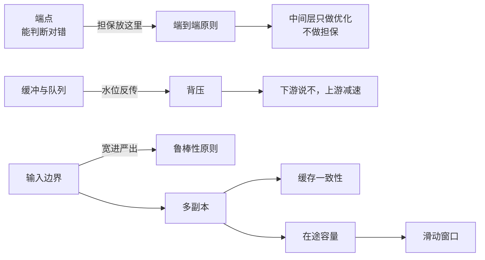
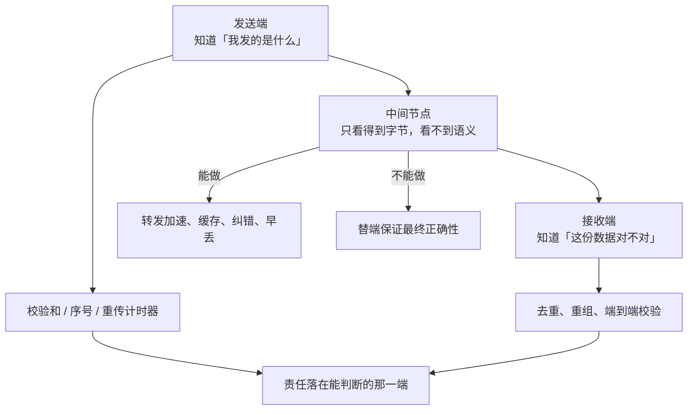
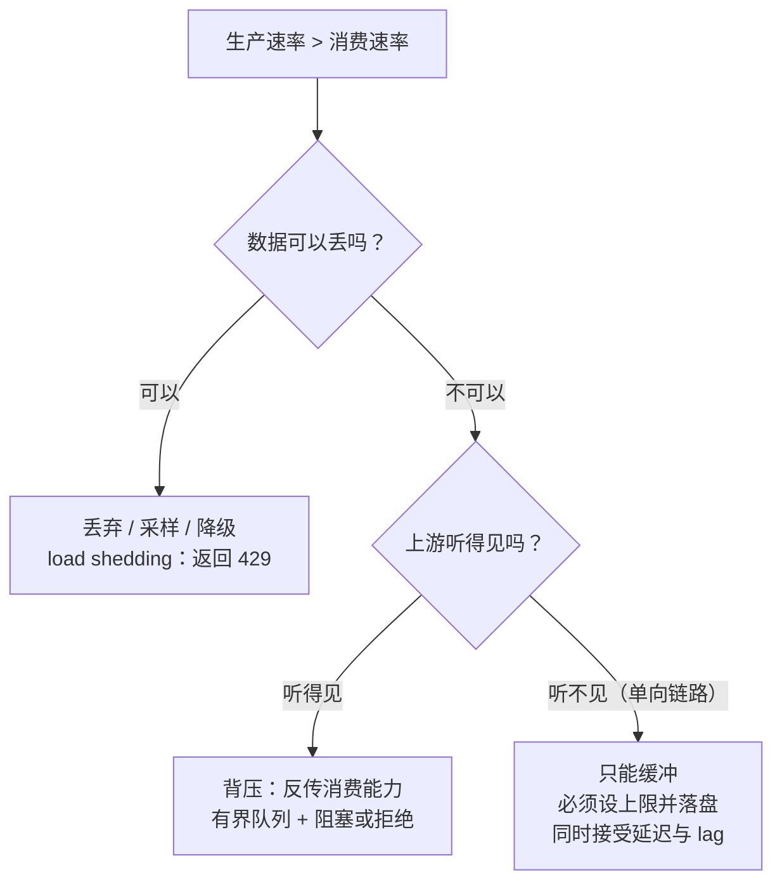
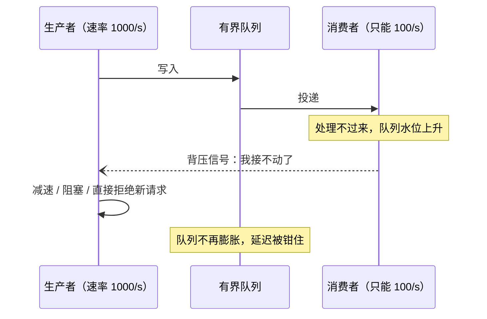
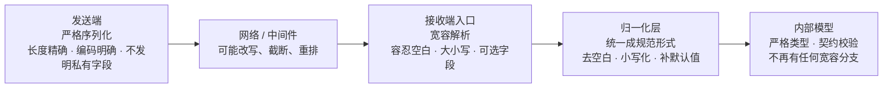
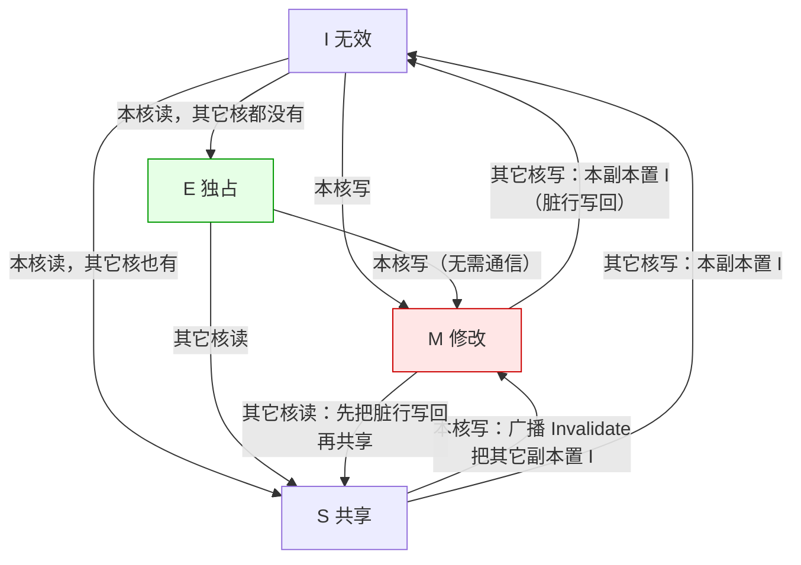
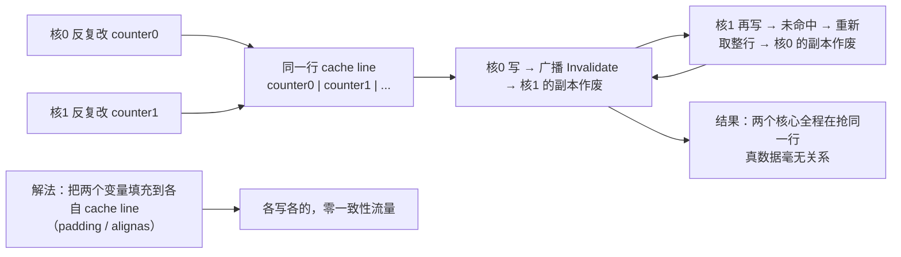
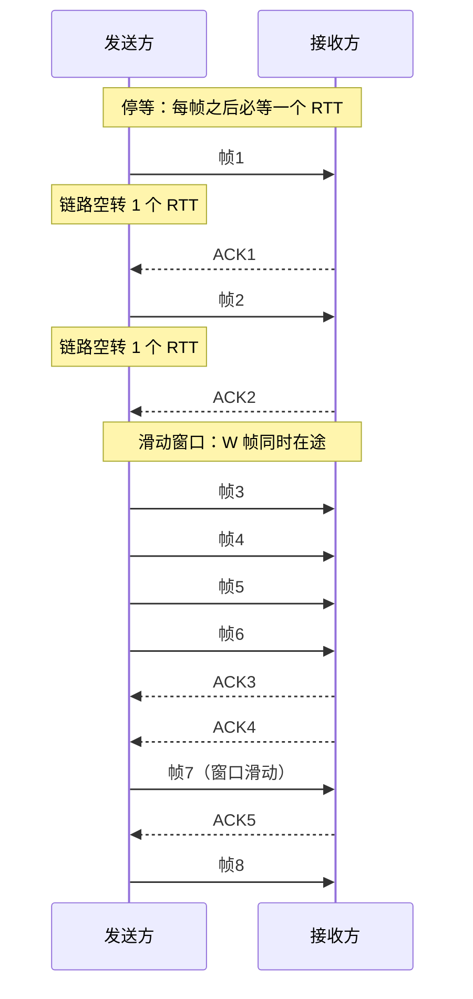

把五条原则放进一章，是因为它们都在回答同一个问题：**一条链路上的责任，应该放在哪一层。**

- **端到端原则**说最终判定权必须留在端点，中间层只能加速、不能担保；
- **背压**说下游的「我接不动了」必须能被上游听见，否则系统只能拿内存和延迟去顶；
- **鲁棒性原则**说接收要宽松、发送要严格，宽容得有边界和期限；
- **缓存一致性**说多副本这个结构必然要交一笔税，问题只是谁来交、交多少；
- **滑动窗口**说在途数据量要能盖住一个往返，窗口公告本身就是背压的协议实现。

它们的分歧点也在这里：**越靠近端点，判断越准确但成本越高；越靠近中间层，速度越快但担保越弱。** 五条原则合起来，其实是在给这条滑尺标刻度。



下面五节各自独立，实跑与模拟分开标注。

## 一、端到端原则

1984 年，MIT 的 **Jerome Saltzer、David Reed 与 David Clark** 发表《End-to-End Arguments in System Design》，提出后来被称作**端到端原则**的思想。

背景是一场大争论：当时的通信网络分成两派。一派认为网络应该聪明，由中间节点（交换机、路由器）负责可靠性、纠错、乱序重组，终端只负责收发；另一派认为终端才该负责这些，网络只做尽力而为的转发。ARPANET 早期走的是智能网络路线，但这篇论文扭转了方向，其论证深刻影响了 TCP/IP 的设计：网络层只管尽力转发，可靠性、完整性全部上移到传输层与应用层。

**本质一句话：一个功能应当放在真正使用它、且能判断它是否正确的那一端实现；中间层可以做优化，但永远不该替端做最终担保。**

这个判据的锋利之处在于它不谈性能，只谈「谁能判断」。中间节点看得见字节，看不见语义：它不知道这 6 个字节是不是一个完整订单，也不知道这份数据对应用意味着什么。所以它能做的只有加速，不能担保——**位置决定了能力边界，而不是实现水平决定。**

换句话说，这条原则不是「中间层不许做事」，而是「中间层做的事不算数」。它做的事越多，端上该做的一件都不能少——两头都做，中间那份就只剩加速的价值。



**本机实跑：校验点放在哪**

```text
【1】校验放在哪：6 跳链路、每跳损坏率 2%、20000 次试验（实测）
  只在每跳入口校验（损坏可能发生在校验之后）
    错误数据被当成正确数据交付 : 2300 / 20000 = 11.500%
  终点校验
    错误数据被当成正确数据交付 : 0 / 20000 = 0.000%

【2】重传范围：链路级 ARQ vs 端到端重传（同样 20000 次消息）
  链路级（每跳自己重传）    :   122384 次传输，平均 6.12 次/消息
  端到端（整条路径重传）    :   135168 次传输，平均 6.76 次/消息
  端到端 / 链路级           : 1.10 倍传输量

★ 逐跳校验省传输，却漏掉了「本跳内部引入的损坏」
★ 端到端校验贵在重传范围，换来「要么对、要么报错」
★ 中间节点能做的只是加速纠错，最终判定权必须在终点
```

第一组数字是这条原则最硬的证据：**每跳都校验，仍然有 11.5% 的错误数据被当成正确数据交付**。原因是校验点在本跳入口，本跳内部产生的损坏它看不见。这不是实现水平问题，而是位置问题——站在中间的人无法替终点担保，因为他手里的信息不足以判断对错。

第二组补上代价：端到端校验要多传 10%。所以这条原则不是「只在端上做」，而是「端上必须做，中间可以做但不作数」。

落地形态跨度很大，从协议一直到应用：

- **TCP 的可靠传输只存在于两端协议栈**。发送端给每个字节编号、维护重传计时器，接收端校验、去重、按序号重组，中间路由器对这些一无所知。链路层 CRC 也会丢弃坏帧，但那只是早丢早省带宽的优化。
- **TLS 把密钥协商与加解密留在两端**。中间代理可以转发密文却读不出内容，除非它主动终止 TLS——而中间人式监听的存在，本身反证了端到端加密的意义。
- **文件传输在两端比哈希**。上传完成后算一次 SHA 比对，这一步只能放在源与目标两端，因为只有端知道「我传的这份是不是你那份」。
- **区块头的全节点验证**。每个全节点独立校验交易与区块哈希，不信任邻居转来的「已校验」结论。

**边界与反例**

- **中间可以做不改变语义的优化**。CDN 缓存、HTTP 代理、TSO、链路层 CRC，它们不替端担保正确性，只是让数据更快更早被处理。判据是：去掉它端到端依然正确，加上它只是更快。若中间层做了改变语义的事（代理改写响应、网关透明解密），就必须承担相应的正确性责任。
- **端太弱时，逐跳也有存在价值**。早期哑终端没有能力做复杂校验，智能网络才有意义；极简传感器同理。这条原则的前提是端有足够能力。
- **性能可以下沉，裁决不能外包**。你可以在每一跳做压缩、纠错、缓存，但「这份数据对不对」的最终裁决永远属于消费它的那个端。把裁决外包，等于把信任交给每一个自己不认识的节点。

## 二、背压

「背压」这个词是从流体力学借来的：管道下游堵住，压力会反推到上游。计算机里最早的工业级实现不是某个框架，而是**网络协议本身**。

- **1981 年，RFC 793** 用**滑动窗口**做流量控制：接收方通过 `rwnd` 告诉发送方「我还能收多少」，窗口归零时发送方必须停下等。这是背压最朴素也最可靠的形态：数据的送达速率由接收方决定。
- **1965 年，Dijkstra 的信号量**与生产者消费者问题，第一次在程序里把「缓冲」与「同步」作为一对矛盾摆上台面：缓冲容量有限，生产快于消费就必须有人等。
- **2015 年 5 月，Reactive Streams 1.0.0 发布**，把背压写成接口约定：发布者不能想推就推，订阅者通过 `request(n)` 主动索取，`onNext` 的节奏由下游决定。
- **2017 年，Java 9 把它收编进标准库**，`java.util.concurrent.Flow` 的四个接口就是 Reactive Streams 的翻版。
- 同一时期，**Kafka 用 pull 模型**给出另一种答案：消费者自己拉，拉多少由自己决定，背压不需要额外机制，模型本身就带。

**本质一句话：背压是让下游的「我接不动了」能被上游听见；没有背压的系统，只能拿内存和延迟去替下游挨打。**

被压垮的过程非常标准：消费变慢，队列变长，内存上涨，GC 变频繁，处理更慢，延迟上升，上游超时，重试把到达率又抬高，队列更长。缓冲从来不是解决方案，它只是把「丢数据」换成了「延迟债」，并且常常在最需要它的时候一起爆掉——**债不是不还，是集中还。**



**本机实跑：内核替你按住生产者**

```text
发送端 SO_SNDBUF = 64 KB   接收端 SO_RCVBUF = 64 KB
[阶段一] 对端完全不读：send 到第 192 KB 时抛出 BlockingIOError
         → 生产者被内核按住了（这就是 TCP 的背压），数据没有凭空消失
[阶段二] 对端开始慢速读（200ms / 32KB）：发送端可继续发送，对端已读出 192 KB
```

```text
生产者固定写入 100 块 × 4 KB，消费者每块耗时 20ms：
highWaterMark = 16 KB      write() 返回 false:  25 次   缓冲峰值(内存):   16 KB
highWaterMark = 1024 KB    write() 返回 false:   0 次   缓冲峰值(内存):  400 KB
```

第二组是应用层背压的对照：水位线设为 16 KB 时，`write()` 反复返回 `false` 提示上游暂停，内存峰值被钳在 16 KB；设成 1024 KB 时它一次都不喊停，内存峰值反而到了 400 KB。**「几乎不触发背压信号」听起来是好事，实际意味着缓冲在替你承担全部压力**——这两者的吞吐未必差多少，但内存曲线和故障表现完全不同。



**边界与反例**

- **单向链路做不了背压**。短信下发、日志外发、传感器采样，上游根本不会听你的。这时只能丢加上限：降采样、丢弃策略、落盘并设死上限，并且把丢弃率当指标看。
- **背压会把延迟传染给上游**。如果这条链在关键路径上，全体阻塞会拖垮 SLA。此时正确的选择是在边界上丢（返回 429 或降级），而不是让整条链一起慢下来。背压保护系统，load shedding 保护 SLA。
- **无界队列等于关闭背压**。无参构造的 `LinkedBlockingQueue`、无限创建线程的 `CachedThreadPool`、把并发队列当缓冲池，都是把背压换成 OOM 或线程风暴的经典写法。
- **多生产者有队头阻塞**。一个慢消费者会拖住所有生产者，解法是按生产方隔离（独立队列、独立连接、优先级队列），而不是把队列开得更大。
- **背压不等于限流**。限流按外部配额切（QPS、租户额度），背压按内部容量切（队列水位、处理速率）。前者挡外部洪水，后者保内部节奏。
- **缓冲不是原罪，无上限才是**。Kafka 的日志、MQ 的持久化队列可以很大，因为它们把不可控的内存增长换成了可观测的 lag。有界、可观测、可落后，这三点齐了，缓冲才安全。

## 三、鲁棒性原则

**1980 年，Jon Postel** 在 TCP 的早期规范 RFC 760 里写下这句被引用了半个世纪的话；1981 年的 **RFC 793** 把它正式列为通用原则：做事情要保守，接收别人的东西要宽容（be conservative in what you do, be liberal in what you accept from others）。

它要解决的问题非常具体。异构实现永远存在：某个实现把字段少写一个空格，某个实现晚升级，某个规范刚改而新旧实现同时在线。如果每个接收端都严格拒绝一切不合规输入，任何一次规范演进都会把网络割成互不相通的两半——**升级这件事本身，会让「严格」变成一种破坏性行为。** 宽容接收，本质上是给渐进部署买的一份兼容性保险。

**本质一句话：接收端的宽容是为异构实现与渐进部署买的兼容性保险，发送端的严格是给对端的一份确定性承诺；而宽容必须有边界、有观测、有期限，否则它会从保险变成漏洞。**

这句话的后半段是后来补上的。Postel 原话没有设限，结果宽容被滥用：最典型的战绩是 HTML，浏览器对畸形 HTML 近乎无限的容忍换来了整个 Web 的向后兼容，也让它成为 XSS 的温床。所以这条原则后来被正式限缩：**2023 年，Martin Thomson 与 David Schinazi 发布 RFC 9413《Maintaining Robust Protocols》**，系统记录了宽容接收造成的长期伤害，并给出三条修正方向：接收端应当严格，除非有明确、可写进规范的宽容理由；宽容只能用于已知的、有限的问题；宽容要有期限，并与版本或能力协商绑定。



这张图的重点在最后一段：**宽容只能存在于入口和归一化层之间，绝不能渗进内部模型。** 一旦宽容分支散布到业务代码里，它就会变成事实上的规范。

**本机实跑：同一个标准库里的两种态度**

```text
  int("   42   ")                    → 接受：42
  int("+42")                         → 接受：42
  int("1_000")                       → 接受：1000
  float("1e3")                       → 接受：1000.0
  float("  .5 ")                     → 接受：0.5
  float("nan") / float("inf")        → 接受：(nan, inf)
  json.loads('{"a": 1,}')            → 拒绝：JSONDecodeError: Illegal trailing comma before end of object
  json.loads('{"a": 1}')             → 接受：{'a': 1}
```

```text
  strict=False（默认）: 解析出 2 行
     ['name', 'note']
     ['Alice', '未闭合的引号\nBob,第二行\nCarol,第三行\n']

  strict=True: 拒绝解析 → Error: unexpected end of data
```

`int` 与 `float` 极其宽容，`json` 却严格到拒绝一个尾随逗号。这不是不一致，而是按场景做的取舍：`int()` 面对的是人随手敲的数字，`json` 面对的是机器生成的结构化数据，后者一旦含糊就必然有歧义。「宽容还是严格」从来不是气质问题，是场景问题——**判据是「这份输入有没有第二个合理解释」，而不是「我愿不愿意帮对方一把」。**

第三组证据说明宽容为什么会变成漏洞：

```text
  原始请求头（同一个 Content-Length 出现两次）：
     Host: shop.example
     Content-Length: 6
     Content-Length: 13

  解析器 A（取首个）→ Content-Length = 6
  解析器 B（取末个）→ Content-Length = 13

  A 认为 body 只有 6 字节：'0\r\n\r\nG'
  B 认为 body 有 13 字节：'0\r\n\r\nGET /a'

  两者相差 7 字节。多出来的 'ET /a' 会被链路上后一个解析器当成「下一个请求」的开头。
```

这段是请求走私的经典形态。注意它出错的地方：两个解析器各自都很「宽容」（都接受重复头），差别只在取第一个还是最后一个。**含糊的输入会把分歧从你的进程转移到链路上，而链路上的分歧就是漏洞。**

**边界与反例**

- **含糊即错，不能猜**。当两种解释会导致不同语义时，拒绝是唯一正确答案。猜测只会把分歧转移出去。
- **宽容会掩盖对端的 bug，让错误实现活得比正确实现更久**。你的接收端越宽容，发错的一方越没有动力改。整个生态的质量由最宽容的那个接收端决定。
- **一旦接受了非标准输入，就有人开始依赖它**。之后想收紧就变成破坏性变更。所以宽容从第一天起就要标注为未定义行为，并给出收紧时间表。
- **宽容不等于语义等价**。只容忍表达形式的差异（空白、大小写、字段顺序、可选字段缺失），绝不容容忍语义歧义（多个长度、冲突编码、`01/02/2024` 到底是哪天）。
- **宽进严出不能用在输出侧**。「我输入比较宽松」推不出「我输出也可以随意」，恰恰相反：你越宽容地收，越应该严格地发，否则宽容债越滚越大。
- **解析差异本身就够用**。`127.1`、`0x7f.1`、`2130706433` 是同一个地址的不同写法；大小写不敏感比较、Unicode 归一化、前导零，都可能让「校验时看的东西」和「真正用的时候用的东西」不一样。访问控制绕过、SSRF、ACL 失效，很多出在这里。

## 四、缓存一致性

要让多个核共享内存，缓存就必须解决一个矛盾：**缓存的意义是让每个核都有一份副本各自快速访问，但副本一多，谁的是最新的就成了问题。**

这个问题在 1960 年代末就已出现（1967 年 Maurice Wilkes 提出 cache 概念时就讨论过多处理器的缓存问题），真正成为工程焦点是 1980 年代初的多处理器时代。

**本质一句话：缓存一致性解决的是同一份数据的多份拷贝在写发生后如何失效或同步；它不是缓存本身的属性，而是多副本这个结构必然要交的税。**



**本机模拟：三个场景的一致性流量**

先说清边界：本机没有 gcc，Python 有 GIL、Node 无法控制内存布局，都不适合直接测 cache line 行为。所以这里跑的是一个 **MESI 状态机模拟器**，逐条执行协议规则并统计一致性流量。**下面的数字是「协议会走多少步」的计数，不是纳秒级性能实测。**

```text
场景 A：两个核访问【同一个】变量（真共享）
    核0 R 行X         未命中 → 总线读，本核置 E
    核1 R 行X         未命中 → 总线读，本核置 S
    核0 W 行X         busRdX → 无效化 1 个副本，本核置 M  ★流量+1
    核1 R 行X         未命中 → 总线读（含脏行写回），本核置 S
    核1 W 行X         busRdX → 无效化 1 个副本，本核置 M  ★流量+1
    → 命中 0 / 未命中 3 / 总线事务 5 / 无效化 2
```

```text
场景 B：两个核各改【自己的】变量，但两者同处一行 cache line
    核0 W 行L         busRdX → 无效化 0 个副本，本核置 M  ★流量+1
    核1 W 行L         busRdX → 无效化 1 个副本，本核置 M  ★流量+1
    核0 W 行L         busRdX → 无效化 1 个副本，本核置 M  ★流量+1
    ...（此后每一次写都重复这条）
    → 命中 0 / 未命中 0 / 总线事务 12 / 无效化 11

场景 C：把两个计数器各自填充到独立 cache line
    核0 W 行L0        busRdX → 无效化 0 个副本，本核置 M  ★流量+1
    核1 W 行L1        busRdX → 无效化 0 个副本，本核置 M  ★流量+1
    核0 W 行L0        命中（已是 M），零流量
    ...（此后全部命中）
    → 命中 10 / 未命中 0 / 总线事务 2 / 无效化 0
```

```text
  伪共享（紧挨） : 总线事务 12 次，无效化 11 次
  填充隔离后     : 总线事务  2 次，无效化  0 次
  ★ 一致性流量相差 6 倍，变的只是两个变量的地址
```

场景 B 与 C 的差别只有一件事：两个逻辑上无关的变量是否落在同一条缓存行。**这就是伪共享的定义，也是它难排查的原因：代码里两个变量隔了几十行，物理上却是邻居。** 一行缓存通常是 64 字节，能装 16 个 `int`——这个粒度对编译器透明，对写代码的人却是隐形的。



**边界与反例**

- **「一致性」这个词严重超载**。至少有三层含义：CPU 核间一致性、缓存与数据库的一致性（业务语境）、分布式副本一致性。同一个词三个完全不同的问题，讨论前先对齐说的是哪一个。
- **一致性协议不是越强越好**。协议越强通信越多，扩展性越差。业界没有最强协议，只有在某个核数规模下够用的协议；核数上去之后总线监听本身成瓶颈，这直接催生了 NUMA 与非共享架构。
- **伪共享的止损要看实测**。padding 会让结构体变大、破坏原有局部性，滥用反而更慢。正确做法是先 profile（Linux 下 `perf c2c` 看 HITM 与 cache-to-cache 指标），确认真是伪共享再改。
- **`volatile` 不是万能的**。它解决可见性与重排，不解决原子性。`volatile int` 做 `++` 依然是读改写三步，多线程同时执行照样丢更新。
- **写失效不是永远最优**。如果某行会被频繁读写，或大量核共享只读副本，失效加重新取的成本可能高于直接把新值推给持有者。协议选型取决于访问模式，这也是 MOESI、MESIF 存在的理由。
- **伪共享不只出现在多线程里**。单线程访问跨缓存行的数据结构（链表节点、哈希桶里的链表）也会有类似问题，只是没有跨核流量那么刺眼。那时它叫缓存不友好，本质是同一件事：访问模式和硬件粒度对不上。

## 五、滑动窗口

这一切要从**自动重传请求（ARQ）**说起：发送方发出数据后，若超时没收到确认就重发。最早的方案叫**停等**：发一帧，等一个 ACK，收到再发下一帧。

它的实现极其简单，所以被早期链路协议广泛使用：IBM 的 BSC、1977 年的 XMODEM 都是停等式。实现的简单换来的是效率的灾难。

**本质一句话：停等把链路容量浪费在等待上，滑动窗口用同时在途把等待填满；判据只有一条，在途数据量（窗口）能不能覆盖一个 RTT 内的链路容量（BDP）。**

**本机实跑：停等到底浪费了多少**

```text
  链路带宽        : 100 Mbps
  往返时延 RTT    : 50 ms
  帧大小           : 1500 字节
  时延带宽积 BDP   : 625,000 字节 （= 在途数据量）
  填满管道所需帧数 : 417 帧

  停等协议：每发 1 帧就停下等 ACK，一个 RTT 只送 1 帧
    吞吐 = 帧大小 / RTT = 12000 bit / 0.05s = 240.0 kbps
    链路利用率 = 0.240 %  ★ 99.76% 的链路在空转
```

```text
      窗口 W |         在途字节 |             吞吐 |      链路利用率 | 判断
  ---------+--------------+----------------+------------+------
         1 |        1,500 |        0.24 Mbps |      0.24% | 停等
         4 |        6,000 |        0.96 Mbps |      0.96% | 管道半空
         8 |       12,000 |        1.92 Mbps |      1.92% | 管道半空
        16 |       24,000 |        3.84 Mbps |      3.84% | 管道半空
        64 |       96,000 |       15.36 Mbps |     15.36% | 管道半空
       128 |      192,000 |       30.72 Mbps |     30.72% | 管道半空
       256 |      384,000 |       61.44 Mbps |     61.44% | 接近打满
       417 |      625,500 |      100.00 Mbps |    100.00% | ★ 打满，再加窗也无用
       512 |      768,000 |      100.00 Mbps |    100.00% | ★ 打满，再加窗也无用
      1024 |    1,536,000 |      100.00 Mbps |    100.00% | ★ 打满，再加窗也无用
```

百兆链路上用停等，利用率 0.24%。而窗口加到 417 帧之后，继续加窗吞吐一点都不涨，只多占内存。**这条曲线有一个明确的拐点，拐点位置就是 BDP**——这就是「最优窗口」的来源，也是「窗口该开多大」这个问题唯一有依据的答法。

窗口还决定了重传语义。两种经典策略的差别只在丢一帧时要重发多少：

```text
  设定：窗口 W = 8，一次传送 1000 帧，其中恰好 1 帧丢失

            丢失帧在窗口内的位置 |     GBN 重传帧数 |     SR 重传帧数
  ---------------------+--------------+------------
           第 1 帧（偏移 0） |            8 |           1
           第 2 帧（偏移 1） |            7 |           1
           第 4 帧（偏移 3） |            5 |           1
           第 8 帧（偏移 7） |            1 |           1
```

```text
      序号位数 k |     序号空间 2^k |     GBN 最大窗口 2^k-1 |      SR 最大窗口 2^(k-1)
  -----------+--------------+--------------------+---------------------
           3 |            8 |                  7 |                    4
           4 |           16 |                 15 |                    8
           8 |          256 |                255 |                  128
          16 |        65536 |              65535 |                32768
```



至于序号位数为什么要有那张表：**序号空间必须比窗口大，否则新旧帧的序号会绕回并撞在一起，接收方无法区分「新帧」与「重传的旧帧」**——GBN 要求 `2^k - 1`，SR 要求 `2^(k-1)`，差的就是逐帧确认多占的那一份序号预算。

**边界与反例**

- **窗口开大不是万能的，它有维护成本**。窗口越大，发送缓冲区越大，重传语义越复杂，内存开销越高。窗口是用内存换带宽，在内存受限的嵌入式设备上这笔交换可能不划算。
- **窗口解决链路空转，不解决链路拥塞**。流量控制防的是接收方来不及处理，拥塞控制防的是中间链路被压垮。TCP 里两者叠加，发送窗口取 `rwnd` 与 `cwnd` 的较小值。只调大窗口而不看拥塞控制，可能直接把网络打崩。
- **BDP 是最优窗口的下界，不是充分条件**。达到 BDP 只保证管道填满，真实吞吐还受接收端处理能力、内核缓冲区大小、丢包率影响。「窗口够大但还是慢」时，该去查这些。
- **别把滑动窗口与拥塞窗口混为一谈**。前者是接收方广播的（我还能收多少），后者是发送方自己估的（网络还能塞多少）。搞混这两个，会得出「调大 `rwnd` 就能提速」这种只在特定情况下成立的结论。
- **SR 理论上更优，工程上不总是更优**。逐帧计时器在几十万条连接的内核里是实打实的开销，这正是 TCP 长期用累积确认加 GBN 语义、直到 SACK 才部分引入 SR 好处的原因。
- **它和背压是同一件事的两个视角**。背压讲慢消费者反向施压，滑动窗口讲接收方公告自己还能收多少。接收窗口就是背压机制在协议层的具体实现。

## 六、横向对照

| 原则 | 责任放在哪 | 一句话判据 | 什么时候失效 |
|------|-----------|-----------|-------------|
| 端到端 | 端点 | 谁能判断这份数据对不对 | 端能力太弱，或中间层改变了语义 |
| 背压 | 下游往上反传 | 下游接不动时，上游知不知道 | 单向链路，或队列无界 |
| 鲁棒性 | 接收入口与发送端 | 两种解释会不会有不同语义 | 含糊却被接受，宽容没有期限 |
| 缓存一致性 | 副本之间的协议 | 写发生后其它副本怎么失效 | 访问模式与缓存行粒度对不上 |
| 滑动窗口 | 接收方公告，发送方适配 | 在途数据量能否盖住一个 RTT | 瓶颈不是链路容量而是拥塞或处理能力 |

把五条按「发生在哪一段」摆开，可以看到它们管的是链路的不同环节：

| 环节 | 管什么 | 用哪条 |
|------|--------|--------|
| 数据该不该信 | 正确性的最终裁决 | 端到端 |
| 输入能不能收 | 语义边界与兼容性 | 鲁棒性 |
| 发多快 | 速率与容量的匹配 | 背压、滑动窗口 |
| 多份拷贝怎么同步 | 副本之间的一致性 | 缓存一致性 |

一个常见的设计错误是把这几条混着用：用中间层的校验代替端到端校验（把担保交给了看不见语义的节点）、用无界队列代替背压（把速率问题拖成内存问题）、用宽容解析掩盖发送端的 bug（把漏洞留在了链路上）、用加大窗口解决拥塞（把流量控制当成拥塞控制）。**它们各自解决一个环节，替换使用就等于绕过了那一环的保护**——看起来都做了，实际每一环都缺了一块。

🐾 收尾一句：责任要放在能看见语义的那一层；放不下去的，就只能靠有界、可观测、有期限来约束。

---

**相关阅读**：
- [计算机原则五讲（二）：故障发生时还剩什么保证](/posts/princ-chapter-02/)
- [计算机原则五讲（四）：把没说出口的约定写下来](/posts/princ-chapter-04/)
- [计算机原则五讲（九）：把负担摊开](/posts/princ-chapter-09/)
- [每天一个计算机原则：专栏介绍](/posts/princ0001/)
