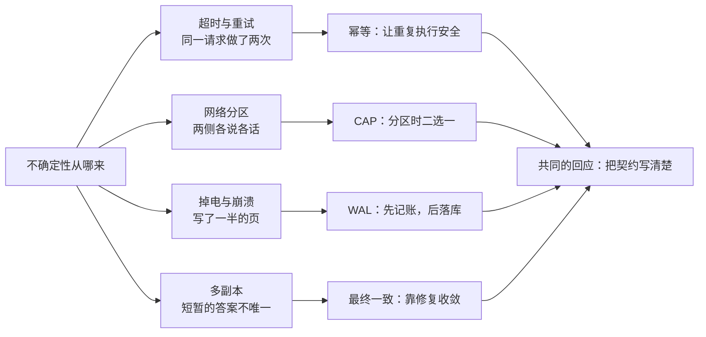
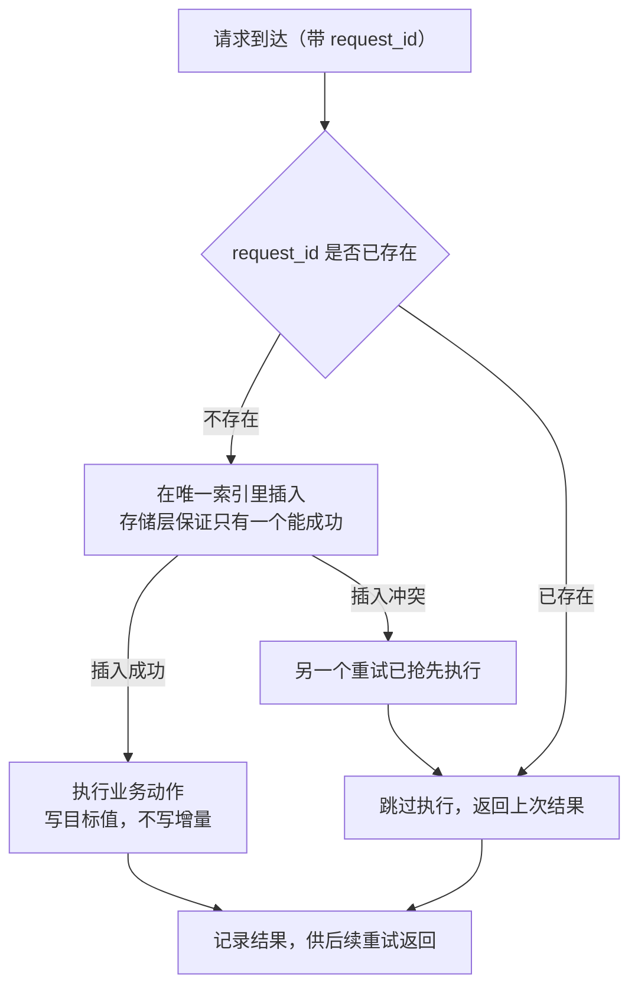
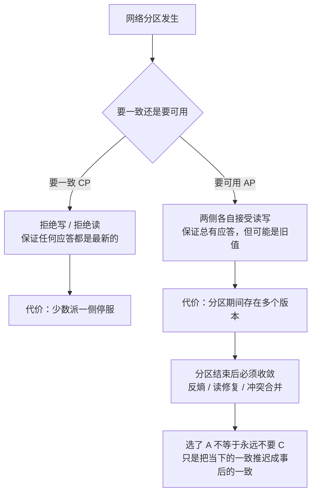
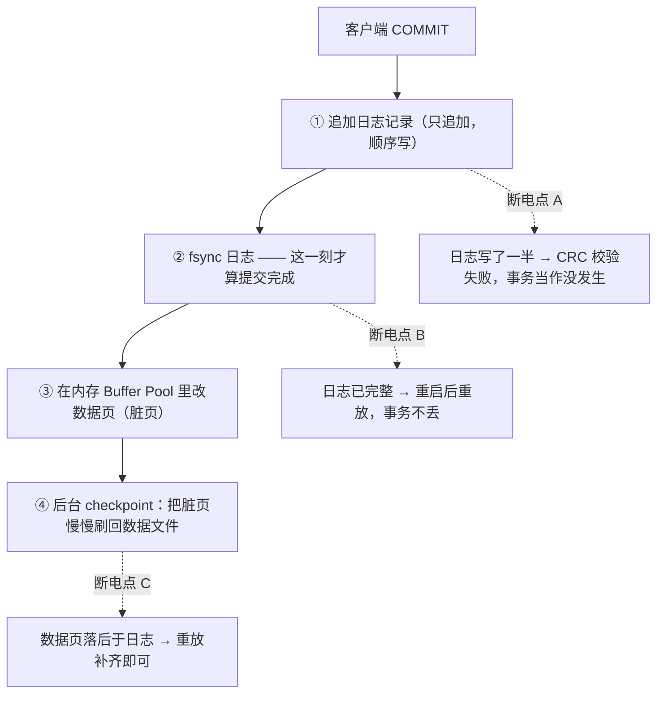
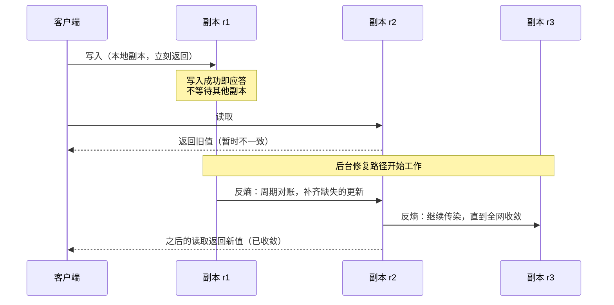
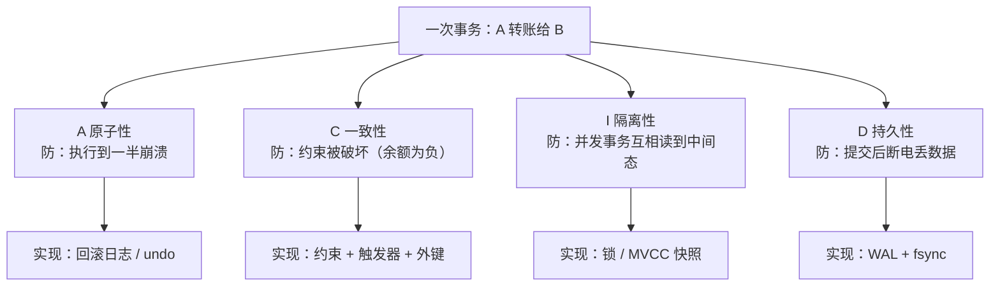

把五条原则放进一章，是因为它们回答的是同一个问题的五个侧面：**当「不确定」发生时，系统还剩什么保证。**

- **幂等**处理时间上的不确定：请求发出去了，回执没回来，重试会不会做两次；
- **CAP** 处理网络的不确定：分区发生的那一刻，是拒绝服务还是先服务；
- **WAL** 处理掉电的不确定：写到一半断电，重启后能不能说清「到哪一步了」；
- **最终一致**处理副本的不确定：多份数据短暂分歧，靠什么收敛；
- **ACID 与 BASE** 则把上面这些取舍写成两份合同，一份偏向「答案唯一」，一份偏向「服务不断」。

它们共享一个前提：**不可靠不是异常，而是常态。** 网络会丢包、进程会崩、机器会断电、时钟不可信。这些原则不是要消灭故障，而是要在故障发生时，仍然能给出一个可判断的状态。



下面五节各自独立，实跑与引用分开标注。

## 一、幂等性

「幂等」（idempotent）这个词最早来自抽象代数：对某个二元运算，若元素满足 `x · x = x`，就称它是**幂等元**。19 世纪数学家本杰明·皮尔斯（Benjamin Peirce）在 1870 年首先使用了这个概念。

它被引进计算机世界，是分布式系统发展的必然。网络不可靠是铁律，于是**超时重试**成为所有可靠通信的标配——但「重试」和「重复执行」只有一线之隔。到了 HTTP 时代，RFC 7231 把幂等性正式写进协议语义：**GET、HEAD、PUT、DELETE 被定义为幂等方法**（同一请求执行多次与执行一次效果相同），**POST 不是**（每次执行都会产生一个新资源）。

这个区分的实用价值在于，它把「能不能安全重试」这件事从调用方猜测变成了协议承诺。写接口的人只要把语义定对，调用方不需要知道服务端实现。

**本质一句话：幂等承诺的不是「不会失败」，而是「失败之后重试，结果和成功一次相同」。它把不确定的重试，变成可以无限次尝试的操作。**

落地手法按「从协议到存储」排三层：

- **协议层**。GET/HEAD/PUT/DELETE 幂等、POST 不幂等。设计 REST 接口时，创建类操作用 POST 就必须自带幂等方案，更新类操作用 PUT（整体覆盖）天然幂等，DELETE 重复删除也返回成功。这是第一道免费护栏。
- **应用层，最常用的是幂等键加唯一索引**。客户端每次请求带一个全局唯一的 `request_id` 或业务单号，服务端把它作为唯一索引落库，先查后插。支付回调是典型场景：第三方异步通知会重复推送多次，商户侧必须用商户订单号做唯一约束。
- **存储层**。唯一索引或 Redis 的 `SET NX` 提供原子性：两个并发重试同时到达时，只有一个能插进去，另一个拿到冲突错误后转去查询已有结果。

**本机实跑：三种写法，三种结局**

```text
【1】同一次请求被投递 3 次（网络重试），期望只生效 1 次
  非幂等实现（每次自增）     最终值 = 3，期望 = 1，偏差 = +2
  幂等实现（按幂等键去重）   最终值 = 1，期望 = 1，偏差 = +0
  执行序列：
    执行 -> 计数 1
    跳过 -> 计数 1
    跳过 -> 计数 1

【2】幂等键选错：同一个业务动作换了 3 个新 id
  最终值 = 3（幂等键退化成「每次都是新请求」）

【3】键对了、写法错了：余额 +20 重放 3 次
  写成目标值（balance = 120）  最终 = 120，偏差 = +0
  写成增量（balance += 20）    最终 = 160，偏差 = +40

★ 重试必然发生，去重不是可选项
★ 幂等键决定「同一次」的判定粒度；写操作是赋值还是增量，决定去重有没有用
```

第三组是最容易被忽略的一层：**幂等键只解决「这是不是同一次请求」，写法才决定「同一次请求重复执行会不会叠加」。** 把余额写成目标值（`balance = 120`）是幂等的，写成增量（`balance += 20`）就不是，哪怕去重逻辑完全正确。这也解释了为什么很多「已经加了幂等键」的系统仍然会重复扣款——键是对的，动作用错了。



**边界与反例**

- **追加与计数类操作天然不幂等**。日志追加、`counter += 1`、发短信、扣库存的 `-=`，重复执行副作用叠加。要么接受「至少一次」语义，要么包一层幂等键去重。
- **幂等键要求先查后插的原子性**。查重和执行之间有窗口时，两个并发重试都会查到「不存在」然后双双执行。所以幂等键必须落成数据库唯一索引或 Redis 原子命令，由存储层保证只有一个能插进去。
- **带时间戳或随机数的请求不适用简单重试**。比如用当前时间生成签名的请求，重试时签名已变，服务端会当成新请求。这类场景要把幂等键独立出来，而不是依赖会变的载荷。
- **超时重试的「结果未知」窗口要靠查询解决**。扣款超时后，客户端不该盲目重试扣款，而应先查订单状态，查不到再重试。幂等键防的是重复执行，查询接口回答的是到底执行了没有。
- **幂等不等于忽略并发**。幂等只承诺「同一请求重复执行安全」，两个不同请求并发时的正确性，仍要靠锁、唯一约束与状态机共同保证。

## 二、CAP 定理

CAP 不是一开始就叫「定理」，它最初是个**猜想**。

**2000 年 7 月**，UC Berkeley 的 Eric Brewer 在 ACM 的 PODC 会议上提出一个判断：一个分布式系统无法同时满足**一致性（Consistency）、可用性（Availability）、分区容忍（Partition tolerance）**这三条。当时没有证明，他称之为 CAP Conjecture。**2002 年**，MIT 的 Seth Gilbert 与 Nancy Lynch 把这条猜想形式化证明了，至此 CAP 从行业直觉变成可证明的结论。**2012 年**，Brewer 自己写了一篇《CAP Twelve Years Later》纠偏：当年那句「三选二」被简化得走了样，P 不是一道选择题，而是分布式系统的既定前提；真正的选择只在 C 与 A 之间，而且只**在分区发生的那段时间里**才需要做。

**本质一句话：CAP 说的是，一旦网络分区，系统必须在「给出可能错的答案」和「不给答案」之间选一个；分区不是选项，它是既成事实。**



**本机实跑：一次分区下的两种选择**

```text
【1】3 副本断成 {A} 与 {B,C}，1000 次写请求（模拟，多数派门槛 = 2）
  CP：写必须拿到多数派（写请求按节点均摊，1/3 落在被隔离的 {A}）
    {B,C} 一侧（2/3）  接受，值继续往下走
    {A}   一侧（1/3）  拒绝，客户端拿到错误
    合计   接受 663 次，拒绝 337 次，可用性 66%
    代价   少数派一侧完全停写；好处是恢复后只有一份历史

  AP：两侧各自接受
    合计   接受 1000 次，拒绝 0 次，可用性 100%
    其中   少数派一侧 333 次写，多数派一侧 667 次写
    恢复后   同一个 key 有两串历史，必须选一个
      按「多数派胜」合并   少数派的 333 次写被丢弃
      按「后写胜」合并     多数派的 667 次写被推翻

【2】三选二里的那个「二」
  分区期间   一致性与可用性只能要一个（P 不是选项，是既成事实）
  无分区时   两者可以同时满足
  真正的取舍   分区发生时，是拒绝服务，还是先服务、再收敛
```

这组数据最值得看的是 AP 那一半的最后一句话：**分叉不是免费的，它把「现在的选择」变成了「将来的取舍」。** 按多数派合并，少数派的写全部丢失；按后写胜合并，多数派的写被推翻。两条规则都没有错，错的是以为合并规则可以不选。

现实里的四个落点：

- **CP 阵营：etcd 与 ZooKeeper**。宁可不可用，也不给错数据。集群失去多数派时直接拒绝服务，这正是 1/3 那一侧的表现。
- **AP 阵营：Cassandra 与 Dynamo 系**。总是接受写入，靠 quorum（`R + W > N`）、向量时钟与读修复在后台收敛。
- **按分片分别决策**。Cassandra 的 `LOCAL_QUORUM` 可以让同一分区内部保一致性、跨分区保可用性，也就是说 CP/AP 是光谱而不是人设。
- **同城强一致加异地异步**。一致性强度不必全局统一，可以按故障域分段。

**边界与反例**

- **「三选二」是最大的误读**。P 不是能放弃的选项——只要跨网络部署，分区迟早发生。真正的形态是「分区发生时，C 与 A 二选一」。宣称自己是「CA 系统」的分布式产品，要么在分区时不诚实，要么偷偷把 P 的定义放宽了。
- **选择是分区期间的临时状态，不是永久人设**。绝大多数系统在没有分区时同时保 C 和 A。分区结束后，AP 系统要做反熵、读修复、冲突合并，把分歧收敛掉。
- **CAP 完全不谈延迟**。它只管分区，可现实里 99.99% 的时间网络是通的，此时真正的取舍是延迟与一致性，这就是 **PACELC**：分区时选 A 还是 C，否则选 L（延迟）还是 C。MySQL 异步复制平时就是在选 L。
- **CP/AP 是光谱，不是二分**。很多系统在分区时既不是纯 C 也不是纯 A，而是按数据分片、按请求类型分别处理。简化成「我们是 CP 还是 AP」，往往说明还没想清楚哪些数据不能脏、哪些请求不能等。

## 三、写前日志

WAL 不是谁灵光一现的设计，它是从**扇区的物理性质**里被逼出来的。

磁盘的最小可寻址单位是扇区（传统 512 B，现在常见 4 KB），而数据库的页通常是 8 KB 或 16 KB，一次页写入要跨过好几个扇区。断电恰好发生在两次扇区写之间时，盘上就留下一个「改了一半」的页，也就是**撕裂页（torn page）**。这时候最尴尬的不是数据是旧的，而是**根本无从判断它改到哪一步**。

WAL 的做法是把这件事换个方向解决：不去修改那个可能被撕裂的页，而是先按顺序追加一条完整的记录，落盘成功后再去改页。页改坏了没关系，日志还在，重放就好。

**本质一句话：WAL 把「随机、跨扇区、可能中途断电的页覆盖写」，改造成「顺序追加、可校验、可重放的记录序列」；日志是唯一的事实来源，数据页只是它的物化缓存。**



**本机实跑：六十行手搓一个 WAL**

```text
------------------------------------------------------------
实验一：没有 WAL，直接改数据文件
------------------------------------------------------------
[T0] 已提交状态      : {"balance": 100, "version": 1}
[T1] 写成一半就断电  : '{"balance": 80'
     (目标 29 字节，实际落盘 14 字节)
[T2] 重启后读文件    : JSONDecodeError: Expecting ',' delimiter: line 1 column 15 (char 14)
[结论] 旧值 100 和新值 80 一起没了——撕裂写把整个文件毁掉

------------------------------------------------------------
实验二：先写日志（WAL），再改数据（checkpoint 延后）
------------------------------------------------------------
[T0] 重放 1 条历史日志 → 内存状态: {'balance': 100}
[T1] 日志已 fsync    : {"op": "set", "key": "balance", "value": 80}
[T2] 数据页还没刷新就断电（模拟 checkpoint 之前宕机）
[T3] 重启后重放 2 条日志 → 恢复结果: {'balance': 80}
[结论] fsync 过的日志就是事实来源；数据页只是日志的物化缓存

------------------------------------------------------------
实验三：顺序追加 vs 在文件里随机改写（同一块盘，20000 次）
------------------------------------------------------------
顺序追加 20000 x 512B : 0.011s   (1,882,034 次/秒)
随机改写 20000 x 512B : 0.130s   (154,212 次/秒)
顺序写快 12.20 倍
```

实验一最能说明问题：**撕裂写把旧值和新值一起毁掉。** 直觉上「改坏了顶多是旧值」并不成立，因为一个字节级的半成品会连「能读懂」这个前提都破坏。实验三补上另一半：WAL 不只是为了安全，顺序追加本身就比随机改写快一个数量级。

真实引擎里的日志文件长这样，注意 `Log sequence number` 与 `Pages flushed up to` 的差值——它就是「已经记账但还没落库」的那段：

```text
LOG
---
Log sequence number          25874196321
Log flushed up to            25874196321
Pages flushed up to          25638016233
Last checkpoint at           25638016233
```

**边界与反例**

- **fsync 才是分界线，写成功不是**。没有 fsync，你写进的是操作系统的页缓存——进程崩了数据还在，机器断电就没了。`innodb_flush_log_at_trx_commit=0/2`、`appendfsync no` 都在主动把承诺打折：性能表上好看，事故报告里难看。
- **WAL 保证单机持久化，不保证分布式一致**。日志只在本机盘上。要让日志跨机器可靠，必须叠复制协议（Raft、Paxos、半同步），而复制又要面对分区与延迟的取舍。
- **写放大与 checkpoint 压力是真实成本**。一条记录至少写两次（日志加数据页）；`innodb_log_file_size` 或 `max_wal_size` 配小了，checkpoint 会频繁触发，甚至追不上日志生成速度。
- **日志不是备份**。WAL 治的是崩溃与掉电，治不了介质损坏、误删库、被勒索加密。真正的方案是日志归档加定期全量加异地存放。反过来，手工清空 `pg_wal/` 等于当场放弃恢复能力。
- **不是所有数据都值得 WAL**。纯缓存、可重建的数据不需要；一次写入天然小于一个扇区且不跨边界时撕裂风险很低。但只要数据不可重建且会被原地覆盖，日志就是必需品。
- **顺序追加也不是免费的**。单条日志流的吞吐受顺序带宽约束；LSM-Tree 把随机写变成顺序写，代价转嫁给了 compaction 与读放大，账只是换了个地方记。

## 四、最终一致性

最终一致性的谱系，比多数人以为的要长。

**1975 年**，Johnson 与 Thomas 在 RFC 677 里提出用时间戳解决副本冲突，这是 Last-Write-Wins 的雏形。**1987 年**，Xerox PARC 的 Demers 等人发表《Epidemic Algorithms for Replicated Database Maintenance》，给出一整套**反熵（anti-entropy）**与 **gossip** 机制：副本之间周期性互相传染数据，直到全网收敛。**1989 到 1995 年**，同样是 PARC 的 Bayou 项目，Douglas Terry 等人在 SOSP 1995 明确提出了 eventual consistency 这个术语，并配上一套今天还在用的 session guarantees。Bayou 的动机非常具体：移动计算，笔记本会断网，断网也得能用。**2007 年**，Amazon Dynamo 把这套思路推向工业主流，quorum、向量时钟、读修复、Merkle 树反熵、hinted handoff 都在那篇论文里。**2011 年**，INRIA 的 Marc Shapiro 等人提出 **CRDT**，把「合并」从靠时间戳猜升级为靠数学性质保证。

**本质一句话：最终一致性是把一致性的责任从写路径转移到后台修复策略上；它承诺的不是「数据会自己变一致」，而是「只要停止写入，并且有一套在跑的修复机制，副本最终会收敛到同一个值」。**

这个措辞里有两个条件，缺一不可：停止写入，以及修复机制在跑。少了任何一个，「最终」都不会到来。



**本机实跑：不修复就永不收敛**

```text
  无修复（写后不管）                初始不一致  174 → 结束  174，耗时 200 轮
  读修复（只修被读到的那 25% 键）       初始不一致  173 → 结束  158，耗时  15 轮
  周期反熵（每 10 轮全量对账）         初始不一致  172 → 结束    0，耗时  30 轮
  周期反熵（每 50 轮全量对账）         初始不一致  173 → 结束    0，耗时 100 轮
```

第一行是关键：空转 200 轮，不一致的键数一个没少。**「最终一致」里的「最终」，是被修复机制推出来的，不是时间自己走出来的。** 第二行说明读修复的局限：它只修被读到的部分，剩下 75% 的键原地不动。第三、四行是同一策略的两个频率，收敛速度与对账开销直接互换。

第二组证据关于「收敛」与「正确」的区别：

```text
  并发自增总数（三个副本本地自增之和）：420
  ------------------------------------------------------------
  r1：LWW 计数 =  140    G-Counter 计数 =  420
  r2：LWW 计数 =  140    G-Counter 计数 =  420
  r3：LWW 计数 =  140    G-Counter 计数 =  420

  LWW：三副本最终值 [140] —— 收敛了，但只剩 140，并发写被静默覆盖
  G-Counter：三副本最终值 [420] —— 收敛，且每一次自增都留下了
```

两边都收敛了，但只有一个是对的。**收敛是技术属性，正确是业务属性**，把两者混为一谈是这类系统最常见的失误：监控上一切正常（副本一致），业务上数字少了一大半（并发被覆盖）。

**边界与反例**

- **「最终」没有时限，可能永远不来**。副本长期离线、墓碑被过早 GC、修复任务静默失败，都会让某些键永远不收敛。必须以复制延迟为指标持续观测，而不是相信最终会自动发生。
- **收敛不等于业务正确**。上面那组 420 变成 140 就是例子。冲突解决策略是业务决策，不是技术默认值：库存用 LWW 会超卖，点赞数用 LWW 会少算，用户资料用 LWW 一般无所谓。
- **读到旧数据会直接破坏业务不变量**。「注册完立刻登录」「转账后立刻查余额」「下单后立刻查订单」都需要 session guarantee（read-your-writes、monotonic reads）。办法不是改回强一致，而是给会话提供保证：粘性路由、写后读走主库、会话内版本号。
- **删除比写入更容易出问题**。删除在副本上表现为墓碑，墓碑被过早清理而被删数据从慢副本复活，就会得到一条删不掉的幽灵记录。
- **反熵的成本随数据量增长**。全量对账在 TB 级不可行，必须靠 Merkle 树或分片摘要只比不同部分，而这又引入新的实现复杂度与故障模式。
- **别把 CAP 当成「最终一致对强一致」的二选一**。CAP 里的 C 指线性一致性，分区不发生时不适用。真实系统是在一致性谱系上取点：线性一致、顺序一致、因果一致、读己之写、单调读、最终一致。

## 五、ACID 与 BASE

**ACID 这个词是 1983 年造出来的。** 德国学者 **Theo Härder** 与 **Andreas Reuter** 在《Principles of Transaction-Oriented Database Recovery》里，把当时积累起来的一堆「事务应该满足什么」的共识归纳成一个缩写。但真正把事务做成工业标准的是 IBM 的 **Jim Gray**，他在 1970 到 1980 年代关于原子性、隔离级别、恢复系统的工作，构成了现代数据库事务的理论地基。

四个字母各指一件事，而它们各自防的是不同的事故：



**本质一句话：ACID 与 BASE 不是好方案和差方案，而是两份取舍不同的合同：ACID 承诺任何时刻读到的都是唯一正确的值，代价是可能拒绝服务；BASE 承诺服务永远接受请求，代价是读到的答案在一段时间内没有唯一值。**

**本机实跑：ACID 四条逐条验证**

```text
[0] 环境
  sqlite3 版本 : 3.53.1
  日志模式     : wal
  初始状态     : 账户1 = 1000, 账户2 = 1000, 总额 = 2000
```

```text
[A] Atomicity（原子性）：要么全做，要么全不做
  事务内：账户1 扣 800 后，事务内可见总额 = 1200（已破坏 2000）
  ROLLBACK 后：总额 = 2000  → 中间态被完整抹掉
  违反约束（CHECK constraint failed: balance >= 0）→ 整个事务回滚
  最终总额 = 2000  ★ 守恒，中间态没有泄漏
```

```text
[I] Isolation（隔离性）：并发事务互相看不见未提交的中间态
  已提交的余额            : 1000
  写事务内改成的值(未提交) : 100
  另一个连接此刻读到      : 1000（等待 1 ms）
  ★ WAL 模式下 sqlite 允许「一写多读」：读事务不阻塞写事务，
    但它看到的仍是写事务开始前的已提交快照——这就是隔离（快照读）。
```

```text
[D] Durability（持久性）：COMMIT 返回后，数据必须活过崩溃
  COMMIT 后主库文件 4096 字节，WAL 文件 16512 字节
  ★ 先写 WAL（顺序追加）再返回成功；主库文件甚至还没更新——
    这就是「先记账、后落库」，崩溃后靠 WAL 重放恢复。
```

注意 `[D]` 与上一节的呼应：**ACID 的 D，落地的实现就是 WAL。** 这两条原则不是并列关系，而是一条原则在两个层面的表述。

把同样的转账放到三个最终一致的副本上，四条契约被逐条放宽：

```text
[BASE 对照] 把「转账」放到 3 个最终一致的副本上：ACID 的四条被逐条放宽
  t0 在副本0 扣款 800 后，各副本余额 = [200, 1000, 1000]
      → 同一逻辑值，三个副本读到三个答案：这是 BASE 的「软状态」
  反熵推进后余额 = [1000, 1000, 1000]
  第 8 轮收敛  → 「最终一致」
```

所以真正的问题不是「选 ACID 还是选 BASE」，而是「这类数据能不能容忍一段时间内答案不唯一」：

| 数据类型 | 契约 | 典型实现 | 为什么 |
|---------|------|---------|--------|
| 钱 / 库存 / 订单 | ACID | 单库事务加唯一索引 | 错了要赔 |
| 用户账号 / 权限 | ACID | 单库事务 | 安全边界 |
| 商品详情 / 配置 | BASE | 缓存加失效 | 晚几秒无所谓 |
| 点赞 / 浏览 / 计数 | BASE | 本地计数加异步归并 | 近似值可接受 |
| 搜索索引 / 推荐 | BASE | CDC / 消息队列 | 追求吞吐 |
| 跨机房主数据 | ACID 局部加对账 | 同城强一致、异地异步 | 分区时保可用 |

**边界与反例**

- **ACID 的 C 其实是应用的责任**。数据库能保证的只是一部分约束（主键、外键、CHECK）。「每个订单必须属于一个有效用户」「库存不能被两个订单同时占用」这类业务一致性，靠的是事务、隔离级别与应用逻辑三者合力。把 C 全甩给数据库是最常见的误解。
- **隔离级别不是有或无，是四档**。从读未提交到可串行化，中间还有读已提交与可重复读。级别越高越安全，也越容易阻塞或冲突重试；选错级别（比如扣库存时用了读已提交）会引进幻读与丢失更新。
- **BASE 不等于随便不一致**。它承诺的是最终一致，前提是没有新的写入。如果写入永不停歇、或补偿逻辑有 bug，系统可能永远收敛不了，那就不是 BASE，是不一致。BASE 需要能度量收敛时间，否则只是一句口号。
- **BASE 的代价被低估得最狠**。ACID 的成本（锁、日志、同步）在数据库里，压测就能暴露；BASE 的成本（对账、补偿、幂等、去重）在业务代码里，要等真出问题才暴露。看起来更简单的方案，往往是把复杂度藏到了更晚的地方。
- **别把 CAP 和 ACID 混着谈**。CAP 说的是分区时在一致性（线性一致）与可用性之间取舍；ACID 的 C 是事务约束，两者根本不是同一个 C。
- **同城强一致加异地最终一致，是当下最常见的折中**。它不是站队，而是按距离分层：同一机房内做到强一致，跨地域用异步复制收尾。一致性强度不必全局统一，可以按故障域分段。

## 六、横向对照

| 原则 | 治哪种不确定 | 一句话判据 | 主要代价 |
|------|-------------|-----------|---------|
| 幂等 | 重试 | 同一请求做两次，结果变不变 | 幂等键存储与唯一索引 |
| CAP | 网络分区 | 分区时拒绝服务还是先服务 | 要么停服，要么事后合并 |
| WAL | 掉电与崩溃 | 写到一半断电，能否说清位置 | 写放大与 checkpoint 压力 |
| 最终一致 | 多副本分歧 | 谁是修复机制，它多久跑一次 | 对账开销与业务侧冲突处理 |
| ACID / BASE | 契约选择 | 这类数据能否容忍暂时不唯一 | 锁与同步，或对账与补偿 |

把这五条串起来看，会发现它们的分工很整齐：

| 层面 | 谁负责 | 承诺 |
|------|--------|------|
| 单机、单请求 | 幂等 + WAL | 重复安全、崩溃可恢复 |
| 跨机、多副本 | 最终一致 + CAP | 有分歧但会收敛，代价是分区时的取舍 |
| 业务契约 | ACID / BASE | 用哪种一致性强度对待哪类数据 |

一个常见的设计错误，是把顺序搞反：还没做幂等就先上重试，还没搞清收敛机制就先宣布「我们最终一致」，还没分清哪些数据不能脏就先选 CP 还是 AP。**这几条原则的顺序是「先把单点做对，再谈分布式」——倒过来做，分布式只会把单点的问题放大，而且放大到难以定位。**

🐾 收尾一句：不可靠是前提，契约是回应；写不清契约的系统，故障来了只能靠猜。

---

**相关阅读**：
- [计算机原则五讲（一）：这笔投入能换回什么](/posts/princ-chapter-01/)
- [计算机原则五讲（三）：责任放在哪一层](/posts/princ-chapter-03/)
- [计算机原则五讲（十一）：状态归谁管](/posts/princ-chapter-11/)
- [每天一个计算机原则：专栏介绍](/posts/princ0001/)
