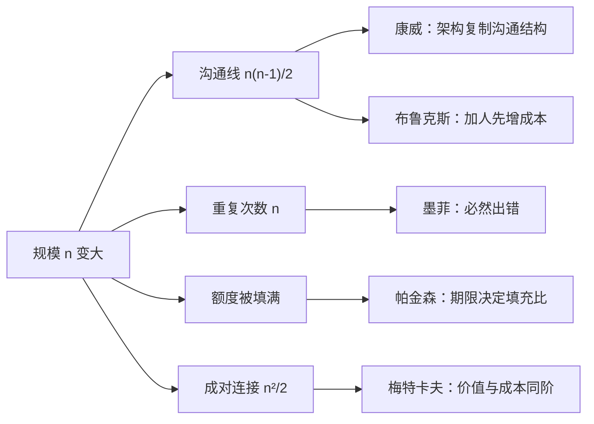
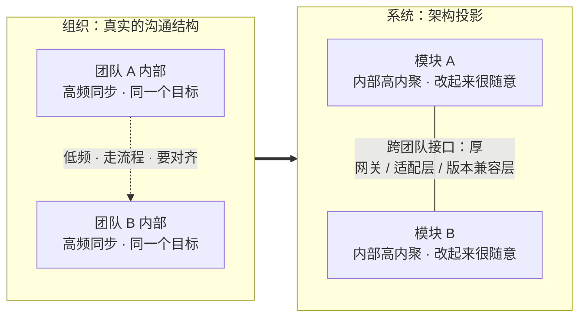
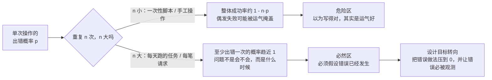
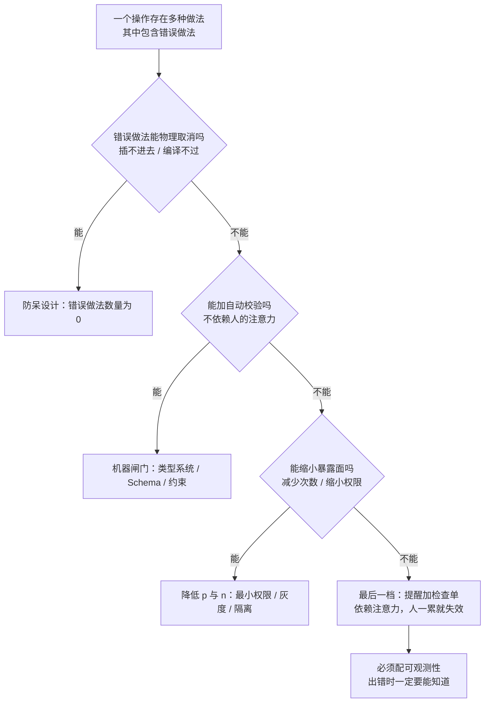
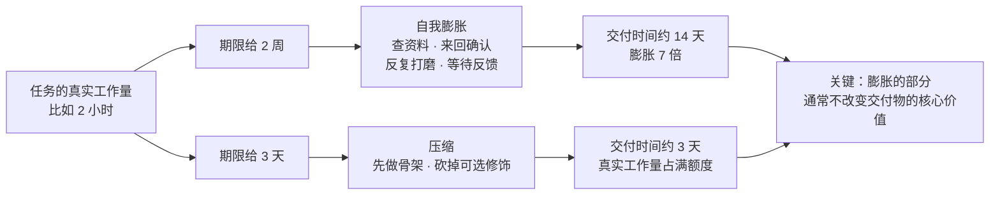
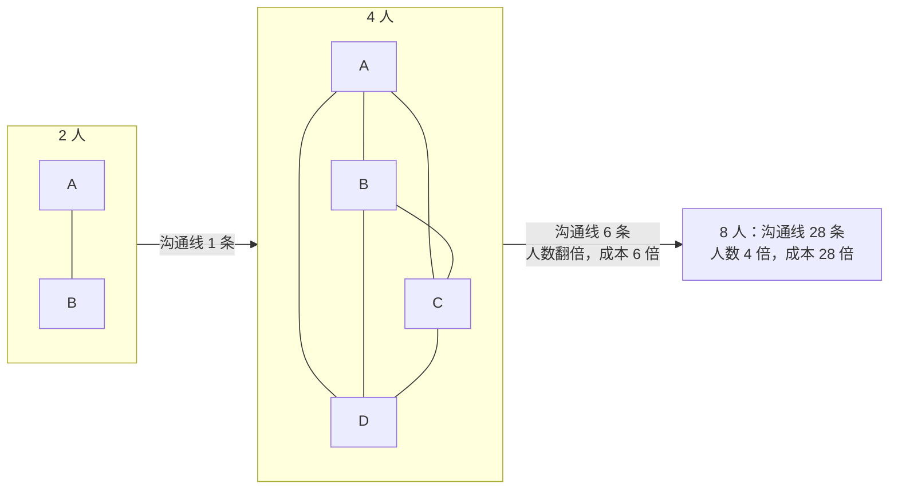
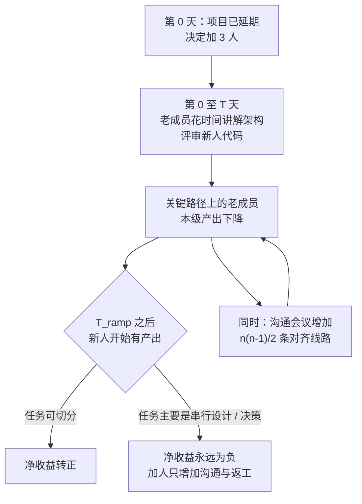
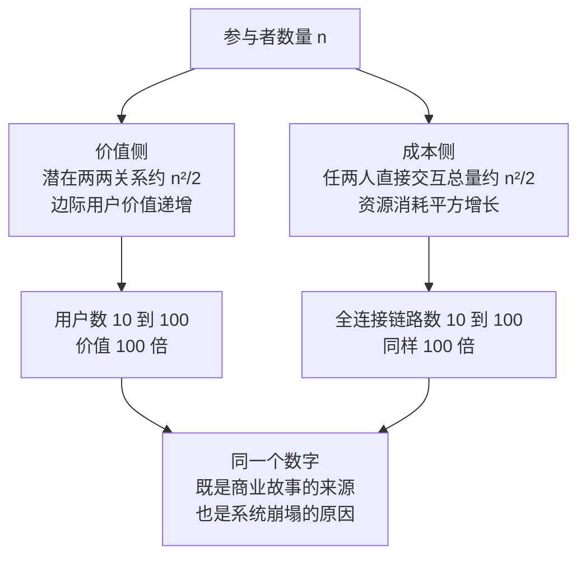
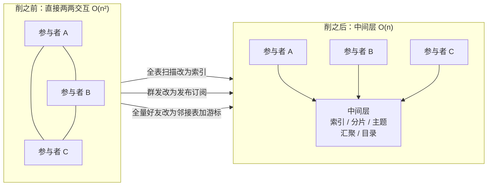

这五条原则常被当成格言引用，但它们真正的价值在于**都能算**。

- **康威定律**：架构是沟通结构的投影，改架构先改沟通路径；
- **墨菲定律**：非零错误率在足够多次重复下必然兑现，`1 - (1-p)^n`；
- **帕金森定律**：额度会被需求侧填满，多给的时间不会变成更多的价值；
- **布鲁克斯定律**：沟通线是 `n(n-1)/2`，加人先增成本；
- **梅特卡夫定律**：价值按 `n²` 增长，成本也按 `n²` 增长。

它们共享同一个结构：**一个随规模变化的系数，乘在一个看起来很小的单位成本上。** 规模小的时候系数接近 1，谁都不在意；规模一上去，系数就主导结果。这也解释了为什么这些定律的应验总显得突然：不是情况变坏了，是系数终于跑到了前面。



下面五节各自独立，实跑与模拟分开标注。

## 一、康威定律

1967 年，Melvin Conway 写下一篇短文《How Do Committees Invent?》，1968 年 4 月发表在《Datamation》杂志上。核心结论只有一句：设计系统的组织，受限于产出「这些组织沟通结构的副本」这样的设计。

这句话常被读成「组织怎样，架构就怎样」的描述，但它其实更硬：**它说的是约束，不是倾向**——约束的意思是没有别的选项，不是「大概会这样」。一个团队拿不到对方的接口决定权，就只能在中间加一层适配；两个团队需要频繁确认才能推进，接口就会变薄、变碎；一个团队内部天天同步，模块内部就会长出一堆隐式约定。

**本质一句话：康威定律等于系统架构是组织沟通结构在代码里的投影；想改架构，先改沟通路径。**



**本机实跑：改动确实沿归属边界聚集**

```text
样本：最近 3996 次非合并提交（跳过 232 次发版提交，剔除 pom/文档类文件），覆盖 3326 个源码文件
同改 >= 3 次的文件对：2055 对
其中【同顶层模块】1771 对（86.2%） / 【跨模块】284 对（13.8%）
其中【共同目录层数 >= 3】（几乎同一包内）1026 对（49.9%）

同改最频繁的 8 对文件：
   44 次  [同模块/2层]  ReferenceCountedOpenSslEngine.java  ⟷  SSLEngineTest.java
   41 次  [同模块/8层]  ReferenceCountedOpenSslContext.java  ⟷  ReferenceCountedOpenSslEngine.java
   36 次  [同模块/2层]  DnsNameResolver.java  ⟷  DnsNameResolverTest.java
   35 次  [同模块/2层]  ReferenceCountedOpenSslEngine.java  ⟷  OpenSslEngineTest.java
   ...
各顶层模块的「活跃作者 / 文件数」——模块越小，人越少：
  codec-http               文件  363  作者 148
  handler                  文件  296  作者 114
  microbench               文件  159  作者  38
```

统计口径很粗，但结论清楚：**86.2% 的同改对落在同一个顶层模块内，49.9% 甚至几乎在同一包里。** 改动没有均匀散布在整个仓库，而是聚成一簇一簇，簇的边界和模块边界重合。这正是康威定律的可观测形态——**如果架构真的和沟通结构脱钩，同改对应该均匀分布，而不是聚成一团。**

还有一个反向的读法更值得注意：**跨模块的 13.8% 就是那道「厚接口」的位置。** 它们数量不多，却往往是评审最难、最容易被卡住的地方，因为每一次改动都要跨过组织边界。


**边界与反例**

- **它是观察性趋势，不是自然定律**。可以被反向操纵（Inverse Conway），也可以被技术手段部分抵消：清晰的接口契约、契约测试、自动化兼容性检查，都能降低跨团队协调成本，从而削薄那道厚接口。
- **要看真实的沟通图，而不是汇报线**。真正决定架构的是非正式网络（谁常问谁、谁和谁在一个群里、谁 review 谁的改动）。用组织架构图倒推架构，经常推错。
- **拿现有架构倒推组织，会把历史固化**。「这块代码一直是他写的，那就归他」——技术债会就此变成人事债，再也拆不动。
- **有些边界不由沟通决定**。合规的数据隔离要求、网络与硬件拓扑、语言与许可证、供应商边界，都可能与康威方向相反。这时需要人为搭沟通桥（接口委员会、SDK、契约仓库），而不是硬造组织。
- **拆过头会反噬**。服务粒度一旦一比一压到团队上，任何跨服务改动都要走跨团队流程，交付周期反而变长，这就是分布式单体。粒度要与变更频率匹配，而不是与人数匹配。
- **异步协作没有取消这条定律，只是改了距离的定义**。分布式团队加文档驱动协作，会让接口先行的架构更容易长出来，因为沟通本来就是异步的、契约化的。

## 二、墨菲定律

这句话的出处没有想象中古老。**1949 年**，美国空军在加州 Muroc 干湖（后来的爱德华兹空军基地）做 MX981 项目，测试人类对突然减速的耐受极限。参与测试的工程师之一叫 **Edward A. Murphy Jr.**，当时是莱特航空发展中心的试飞工程师。

据说起因是一次传感器装反：明明有一整套接法可以避免，却偏偏装错了方向，于是有了那句「凡是可能出错的事，就一定会出错」。但这条定律真正的价值不在抱怨，而在它给出的算式。

**本质一句话：只要一个流程存在非零的出错概率，那么在足够多的重复次数下，出错就是必然事件；所以可靠性不来自「人小心一点」，而来自把错误做法的数量压到零。**



**本机实跑：概率不是修辞**

```text
单次成功率 p      重复 10 次        重复 100 次       重复 1000 次
--------------------------------------------------------------------
0.999999          0.001%            0.010%            0.100%
0.9999            0.100%            0.995%            9.517%
0.999             0.996%            9.521%            63.230%
0.99              9.562%            63.397%           100.000%
0.95              40.126%           99.408%           100.000%
```

```text
  p = 0.999999   每秒一次、跑满一天 → 至少失败一次的概率 = 0.0828
  p = 0.9999     每秒一次、跑满一天 → 至少失败一次的概率 = 0.9998
  p = 0.999      每秒一次、跑满一天 → 至少失败一次的概率 = 1.0000（已到浮点精度上限）
  p = 0.99       每秒一次、跑满一天 → 至少失败一次的概率 = 1.0000
```

第一张表最值得盯的是 `p = 0.9999` 那一行：单次失败率万分之一，重复一千次之后，至少失败一次的概率是 9.5%。**「万分之一」和「十次里有一次」说的是同一个系统**，差别只在你看的是单次还是长期。

第二张表把尺度换成时间：一秒一次、跑满一天是 86400 次。`p = 0.9999` 在这时已经接近 1。**这就是为什么「偶发」这个词在长跑任务里没有意义：次数足够多，偶发就是常发。**

那么解法是什么？把错误做法从流程里删掉，而不是提醒人小心：

```text
  [不防呆] 8 引脚、无键位限制，全部接法 = 8! = 40320
    错误接法数 = 40319 种（随机盲插"很难"接反）
  [危险中间态] 8 引脚、只有 1 个键位区分方向
    选对方向概率 = 1/2，错误接法 = 1 种，但这条错路"插得进去"
  [完全防呆] 键位 + 不对称壳体：错误接法 = 0 种

  模拟 10000 次"用力硬插"：
    中间态：插反 5030 次 / 10000（错误率 ≈ 50.30%）
    防呆态：插反    0 次 / 10000（错误率 = 0.00%）
```

中间态那 50.30% 是关键：**当错误做法只有一种、且物理上插得进去时，出错概率不再是万分之一，而是二分之一。** 这就是「只有一个键位」比「八个引脚乱插」更危险的原因：前者把 40319 种错误压缩成 1 种，代价是把那 1 种的命中率提高到了 50%——**减少错误选项并不等于降低出错概率，除非剩下的那条路也走不通。**

```text
  Mode = Literal["read", "write"]
  parse_mode("read")   → READ                       （合法值，正常返回）
  parse_mode("reaad")  → 类型检查器报错             （错的那条路静态就不通）
  对比：mode.strip().lower() 手工归一化
        → 静默接受 " REAAD " 之类的拼写错误，无任何提示
```

代码里的防呆是同一个思路：**让错误做法编译不过，而不是让它跑起来再检查。**



**边界与反例**

- **它不是消极不作为的许可证**。「反正会出错，那就不做了」是最常见的误读。正确用法恰好相反：既然错误必然发生，那就预先设计好错误发生后的行为（降级、隔离、快速恢复），以及让错误无法发生。它要求的是更多设计，不是更少。
- **不是所有小概率都值得设防**。设防有成本。判据是期望损失：`p × n × 单次损失`。一个 p 极小又便宜的错误可以只做观测；一个 p 很小但损失是整库被删的错误，必须防呆。
- **它会自我实现**。如果整个团队都相信「我们一定会搞砸」，就容易放弃投入，把失败当成本来就该发生。区分方法很朴素：说出你在这次故障里，把哪几种错误做法从流程里删掉了。说不出来，就是拿它当借口。
- **观测比预防更优先**（在成本受限时）。预防依赖「你想到了所有错误做法」这个不可能的前提，观测只需要你承认「我可能没想到」。这也是日志、指标、追踪的投入优先级往往高于防御性代码的原因。
- **注意必然事件的边界**。如果一个错误做法的概率是真的零（物理不可能、编译不可能、数据库不可能），它就不在定律管辖范围内。所以「把错误做法数量压到零」的收益是实打实的：它把这条定律从流程里彻底移除了一部分。
- **别让防呆变成防人**。有些团队把防呆做成对人的不信任（层层审批、处处留痕），成本极高而错误率不降。有效的防呆是无感的：插头插不反、类型检查自动跑、CI 直接拦。需要人记住才能生效的防呆，本身就是一条墨菲定律的候选。

## 三、帕金森定律

**1955 年 11 月 19 日**，英国历史学家、海军史学者 **Cyril Northcote Parkinson** 在《经济学人》上发表了一篇讽刺短文《Parkinson's Law》，开篇第一句就是那句名言：工作会膨胀，直到占满所有可用的时间。

这篇短文原本讽刺的是官僚机构的膨胀，后来被引入项目管理与性能工程，因为两者共享同一个机制：**额度一旦被给定，需求侧就会去填满它。**

**本质一句话：资源额度会被需求侧占满，所以性能优化的唯一正确入口是找到真正的瓶颈（关键路径）；给资源扩容或给任务延期，都只会把额度填满，而不会缩短交付。**



**本机模拟：填充比随期限上升**

```text
 给的期限      实际交付耗时     填充耗时      填充占比     交付物核心价值
-----------------------------------------------------------------------
 2 小时        120 分钟          0 分钟        0%           完整
 4 小时        199 分钟          79 分钟       40%          完整
 1 天(8h)      382 分钟          262 分钟      69%          完整
 1 周(40h)     2309 分钟         2189 分钟     95%          完整
 1 个月(160h)  9221 分钟         9101 分钟     99%          完整
-----------------------------------------------------------------------
结论：期限越长，填充占比越高；但"交付物核心价值"这条线一直是平的。
```

最后一列是这张表真正的结论：**期限从 2 小时放到 1 个月，填充占比从 0% 涨到 99%，而交付物的核心价值一直是「完整」。** 多出来的时间没有被换成更好的结果，只是被消耗掉了——这也是「延期」和「加人」两种手段经常同时失效的原因，它们动的是额度，不是瓶颈。这也解释了为什么「再给两周会做得更扎实」这句话经常不成立：如果扎实的标准事先没有指标，那两周大概率会被填充而不是被用于验证。

同样的机制在性能维度上更直接。一个请求要经过四段，把非瓶颈段的耗时砍掉，端到端几乎不动：

```text
 基线（A=20ms, B=200ms, C=30ms, D=10ms）
   端到端 = 260ms

 ① 把 C 从 30ms 优化到 3ms（提速 10 倍）
   端到端 = 233ms        降幅 10.4%   ← 投入 10 倍提速，只换来 10% 收益

 ② 把 C 从 30ms 优化到 0ms（理论极限，免费）
   端到端 = 230ms        降幅 11.5%   ← 把 C 优化没了，也就这么多

 ③ 把 B 从 200ms 优化到 100ms（提速 2 倍）
   端到端 = 160ms        降幅 38.5%   ← 只提 2 倍，收益是 C 的 3.7 倍

 ④ 把 B 从 200ms 优化到 20ms（提速 10 倍）
   端到端 = 80ms         降幅 69.2%

 ⑤ 把 A/B/C/D 全部提速 10 倍
   端到端 = 26ms         降幅 90.0%   ← 天花板由"最慢那段的剩余"决定
```

① 与 ③ 的对比是这一节的核心：**C 段提速 10 倍只换 10%，B 段提速 2 倍换 38.5%**——后者投入更小、收益更大，唯一的原因就是 B 是瓶颈。这也印证了开篇那句话：额度一旦被填满，往里加资源（或从中抽资源）都不改变结果，唯一有效的是动那一段真正决定总额度的部分。

还有一层：利用率越高，排队延迟越不成比例地上升。

```text
 利用率 ρ      平均排队延迟（相对服务时间）
--------------------------------------------------------------------
 0.50          2.0 倍
 0.80          5.0 倍
 0.90          10.0 倍
 0.95          20.0 倍
 0.99          100.0 倍
```

**边界与反例**

- **它不是压工期的理由**。期限太短会砍掉必需的工作（测试、文档、异常处理），把成本转移到后期。正确区间是略紧但覆盖必要工作量，超出这条线之后的每一分压缩都在借高利贷。
- **优化瓶颈的前置条件是真的找到了瓶颈**。很多瓶颈其实是测量假象：埋点本身的开销、测试环境与线上配置不同、缓存命中率差异、连接池大小与实际并发不匹配。在错误的瓶颈上优化，比不优化更糟，因为你还会相信它有用。
- **瓶颈会移动**。把 B 从 200ms 优化到 20ms 之后，瓶颈很可能变成 A 的 20ms，或者新出现的数据库锁。优化是一个循环，不是一次性动作。
- **不是所有资源都该被填满的反面**。有些资源的低利用率本身就是收益：内存留余量吸收突发、磁盘留空间避免元数据碎片、连接池留空避免等待。把「必须留余量」当成帕金森式浪费是另一种误读。
- **人的工作不是纯可压缩的**。创意、调试、设计这类任务有明显的不可压缩内核，压缩期限只会降低质量或把工作推给别人。这条定律在可分解、结果可验证的任务上最准，在需要发散思考的任务上最不准。
- **要小心它与「多给时间做扎实」的冲突**。对安全性关键的系统，冗余审查、更多测试、更慢的发布节奏确实必要。判断标准是：多出来的时间有没有转成可验证的质量指标（覆盖率、故障率、缺陷密度）。没有指标的扎实，就是填充。

## 四、布鲁克斯定律

**Frederick P. Brooks Jr.（1931 至 2022）** 是 IBM 在 1960 年代最著名的操作系统项目 **OS/360** 的项目经理，那是一个投入上千人年、最终交付但严重超期超预算的项目。**1975 年**，他把这段经历写成《The Mythical Man-Month》，全书的核心洞察都围绕一个词：**人月（man-month）**。

人月之所以是神话，是因为它假设人与人是可替换的、可相加的。但人一多，就多出一项随人数平方增长的成本：**沟通。**

**本质一句话：软件项目的产出受制于沟通成本和不可分割的串行工作，两者都随人数非线性增长，所以加人只在项目足够小、任务足够可分时有效；对已经延期的项目，加人只会让关键路径更长。**



**本机模拟：沟通线的代价**

```text
参数：单人满产出 = 1 单位/天；沟通占比随人数上升；有效产出 = n × (1 - c)

 人数 n   沟通线 n(n-1)/2   人均沟通占比 c    稳态有效产出    相对 5 人的倍数
--------------------------------------------------------------------------------
 3        3                  12%               2.64            0.64x
 5        10                 18%               4.10            1.00x
 8        28                 23%               6.13            1.49x
 12       66                 28%               8.63            2.10x
 20       190                34%               13.21           3.22x
 40       780                42%               23.20           5.65x
--------------------------------------------------------------------------------
★ 人数从 5 涨到 40（8 倍），产出只涨到 5.65 倍 —— 边际收益持续递减
```

```text
延期项目加人后的时间线（原 5 人，加 5 人，T_ramp = 30 天）

  第 0~30 天：  新人产出 ≈ 0，老成员分出 25% 时间做教学
                → 总产出 4.10 降至 3.08（75%，负收益区）
  第 30~60 天：  新人半产出，老成员仍在补课
                → 总产出 5.44（133%，刚刚回本）
  第 60 天+ ：   稳态产出 7.41（180%）

★ 结论：如果项目剩余工期 < T_ramp（本例 30 天），加人是纯粹净损失
```

第二块输出里最关键的是那个条件：**剩余工期小于上手时间时，加人一定是净损失。** 注意这不是「效果差」，而是负值：前 30 天总产出从 4.10 掉到 3.08。**已经延期的项目，剩余工期恰恰最可能短于上手时间**，这就是这条定律标题里「已经延期」四个字的重量。

任务能否切分，决定了加人有没有意义：

```text
任务类型                          可切分性   加人效果
--------------------------------------------------------------------
修 100 个独立的编译警告            高         接近线性，加人立刻有效
给 200 个接口补单测                高         接近线性
写一个全新模块（接口未定）          低         负收益（接口一直在变，代码要重写）
定位一个线上疑难 bug               极低       负收益（多个人同时改会互相掩盖）
重构核心数据结构                   极低       负收益（串行决策，沟通成本最高）
翻译 100 篇文档                    高         接近线性
--------------------------------------------------------------------
判据：任务能否被切成互不通信的独立单元？
      能 → 加人有效；不能 → 加人先增成本
```

这张表把布鲁克斯定律从「别加人」修正成了「看任务类型」。**它的判据只有一条：任务能不能切成互不通信的独立单元**——能切，加人接近线性；不能切，加人先增成本。多数让人焦虑的项目，恰恰是「接口还没定」的那一类，也正是最不适合加人的那一类。



**边界与反例**

- **它不是永远别加人**。对高度可切分、沟通需求低的工作（数据标注、独立页面、批量补测试），加人是有效的。准确含义是「加人不会缩短已经延期的软件项目」，不是「人多总是不好」。
- **它最准的场景是已经延期**。原书针对的是 late project 的追加人力。在项目启动阶段按合理规模配人是正常做法，不属于定律管辖范围。
- **故障现场是最需要控制人数的地方**。多人同时改同一系统会互相掩盖证据。正确做法是一个主操人加若干只读观察者，而不是围观团。
- **小团队的加人未必是负的**。从 1 人到 2 人往往收益极高（能分工、能互审），从 2 到 3 也常常正收益。负收益通常出现在过了沟通成本拐点之后，这个拐点按经验常在 5 到 8 人，取决于任务耦合程度。
- **小团队不是万能药**。过小的团队缺少必要的技能多样性、Bus Factor 低、认知负荷过载。规模问题的答案是减少耦合，而不是永远保持三个人。
- **别拿它当拒绝协作的借口**。「加人没用，所以我不需要 review、不需要对齐」是把定律读反了。它反对的是靠加人解决延期，支持的是降低沟通成本，而降低沟通成本恰恰需要纪律严明的接口与文档。

## 五、梅特卡夫定律

**梅特卡夫定律**得名于 **Robert Metcalfe**，以太网的发明者之一、3Com 的创始人。关键年份是 **1980 年**，那一年他提出用一条简单的关系来说服客户买网卡：网络的价值与连接数的平方成正比。

从销售话术到工程原则，中间隔着一层常被忽略的对称性：**价值按 `n²` 增长，任两人直接交互的成本也按 `n²` 增长。**

**本质一句话：网络价值按连接数（约 n²）增长，但它的工程含义是双刃的——任何「任两人直接交互」的机制成本同样是 n²；所以规模化的关键不是让所有人连上所有人，而是用中间层把平方级交互削成线性或 n log n 级。**



**本机实跑：平方项在小数值上就已失控**

```text
 参与者 n     两两关系 n(n-1)/2    占 n² 比例
--------------------------------------------------------
 10           45                   45.0000%
 100          4,950                49.5000%
 1,000        499,500              49.9500%
 10,000       49,995,000           49.9950%
 100,000      4,999,950,000        49.9995%
 1,000,000    499,999,500,000      49.99995%
--------------------------------------------------------
★ n 到 1000 以上，n(n-1)/2 与 n²/2 的差距已可忽略
  —— 工程估算里直接用 n²/2 就够
```

```text
 假设每个"两两关系"每轮需要 1 个单位的资源（一次网络调用 / 一行数据 / 一次检查）

 n = 1,000     → 每轮 499,500 单位
 n = 10,000    → 每轮 49,995,000 单位（比上一档多 100 倍）
 n = 100,000   → 每轮 4,999,950,000 单位（再多 100 倍）

★ 也就是说：用户数涨 10 倍，全连接式的成本涨 100 倍
★ 这就是"用户从 1 万涨到 10 万，机器加了 10 倍却还是扛不住"的算术原因
```

第二块把抽象关系换成了具体代价：**用户涨 10 倍，成本涨 100 倍。** 机器加 10 倍只是跟上了用户数，没有跟上平方项，所以「加了机器还是扛不住」不是运维不力，是量纲不匹配。

解法只有一个方向：**在中间插一层，把成对交互改成经由中心。**

```text
 场景：n 个用户要"看到彼此的更新"

 方案 A（全展开）：每轮 n(n-1)/2 次投递
 方案 B（发布订阅）：每个用户只订阅自己关注的主题，投递次数 ≈ n × r（r = 平均命中数）

 n        方案 A（n²/2）        方案 B（n×r，取 r=3）   A / B 倍数
--------------------------------------------------------------------
 100      4,950                 300                     16.5x
 1,000    499,500               3,000                   166.5x
 10,000   49,995,000            30,000                  1,666.5x
 100,000  4,999,950,000         300,000                 16,666.5x
--------------------------------------------------------------------
★ 规模越大，中间层（订阅/索引）的价值越大 —— 倍数本身就是 n/(2r)
```



**边界与反例**

- **`n²` 是上限模型，不是实测规律**。Briscoe、Odlyzko、Tilly 在《Metcalfe's Law is Wrong》里给出两条关键反驳：人维护的有效关系是有限的（Dunbar 数大约 150），所以新增用户不会真的带来 `n` 条新关系；电话网络的连接度在 1980 年代就接近饱和，`n²` 预测的增长从未发生。更贴近现实的模型是 `n log n`。
- **估值叙事是它最容易的误用**。用 `n²` 把用户数直接换算成公司价值，是互联网泡沫时期最有破坏力的简化之一。用户数增长与可货币化的价值增长之间没有平方关系。
- **不是所有网络都有 `n²` 的成本**。如果交互是广播式（一个人发、所有人收），成本是 `O(n)`；如果是本地化的（社区、分片、邻近节点），成本同样更低。判据是：这个系统的交互是人人对人人，还是人对中心、人对邻居。
- **`n²` 有时是刻意的设计**。小规模场景下（十来个节点的集群、小团队的全体心跳），`O(n²)` 完全可接受，甚至更简单可靠。别为了消灭 `n²` 而引入一个早产的中间层。
- **网络效应不等于护城河**。多归属、补贴战、连接数不等于活跃度，这三个因素都会让理论上的网络效应在现实中失效。理论上 `n²`，实测可能是 `n^1.2`。
- **它和布鲁克斯定律共用同一个 `n(n-1)/2`**。人之间的沟通路径、网络里的成对连接，是同一个组合数。所以团队规模与系统规模在这一点上是同一个约束，都要靠分层与中间层解决，而不是靠更努力地连接。

## 六、横向对照

| 定律 | 那个系数 | 一句话判据 | 什么时候失灵 |
|------|---------|-----------|-------------|
| 康威 | 沟通结构到架构的投影 | 改架构前，沟通路径改了吗 | 接口契约足够硬，或边界由合规决定 |
| 墨菲 | `1 - (1-p)^n` | 这个错误做法能不能被取消 | 概率真的为零，或期望损失很低 |
| 帕金森 | 额度填充比 | 多给的时间换成了什么指标 | 任务不可压缩，或指标事先定好 |
| 布鲁克斯 | `n(n-1)/2` | 任务能否切成互不通信的单元 | 任务高度可分，或项目尚未启动 |
| 梅特卡夫 | `n²/2` | 交互是人人对人人还是人对中心 | 交互可广播、可本地化，或关系数有上限 |

五条摆在一起，会看到两对同源关系——它们不是类比，是同一个公式出现在两个场景里：

| 同源 | 共用什么 | 含义 |
|------|---------|------|
| 布鲁克斯与梅特卡夫 | `n(n-1)/2` | 团队沟通与网络成对连接是同一个组合数，解法都是分层 |
| 帕金森与布鲁克斯 | 额度与瓶颈 | 加资源只填额度，不缩短关键路径；加人只增沟通，不缩短关键路径 |

这两对关系背后是同一条判断：**规模问题不能用「更努力」解决，只能用「改结构」解决。** 康威说改沟通路径，梅特卡夫说加中间层，布鲁克斯说减耦合，帕金森说只动瓶颈，墨菲说取消错误做法。五条都在说同一句话，只是作用在不同的对象上。

🐾 收尾一句：这些定律不是用来解释失败的，是用来在动手之前算出系数；算不出来的时候，先假设系数已经很大。

---

**相关阅读**：
- [计算机原则五讲（一）：这笔投入能换回什么](/posts/princ-chapter-01/)
- [计算机原则五讲（七）：拿什么换什么](/posts/princ-chapter-07/)
- [计算机原则五讲（十二）：省下的开销算在谁账上](/posts/princ-chapter-12/)
- [每天一个计算机原则：专栏介绍](/posts/princ0001/)
