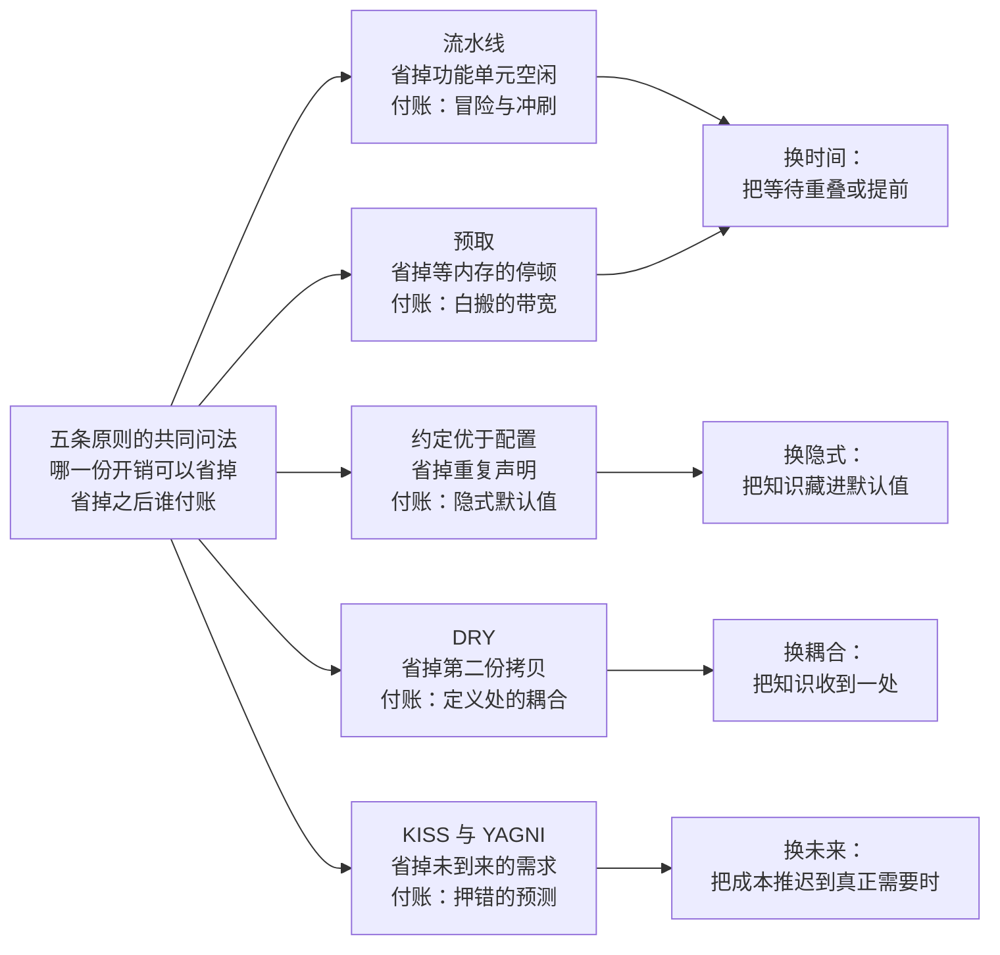
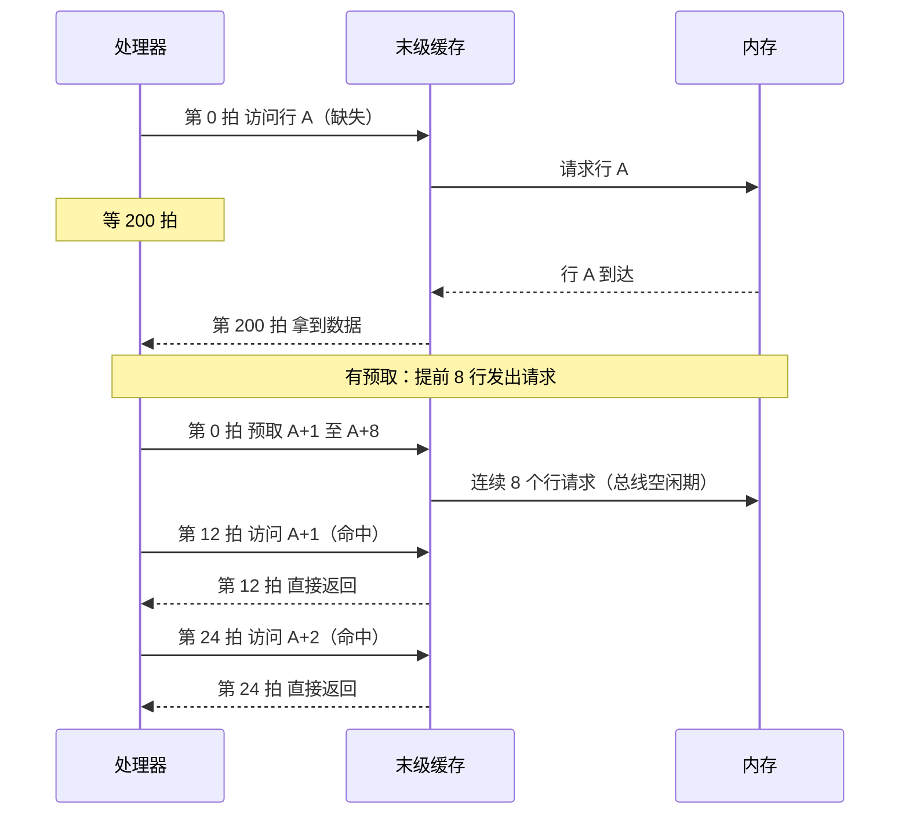
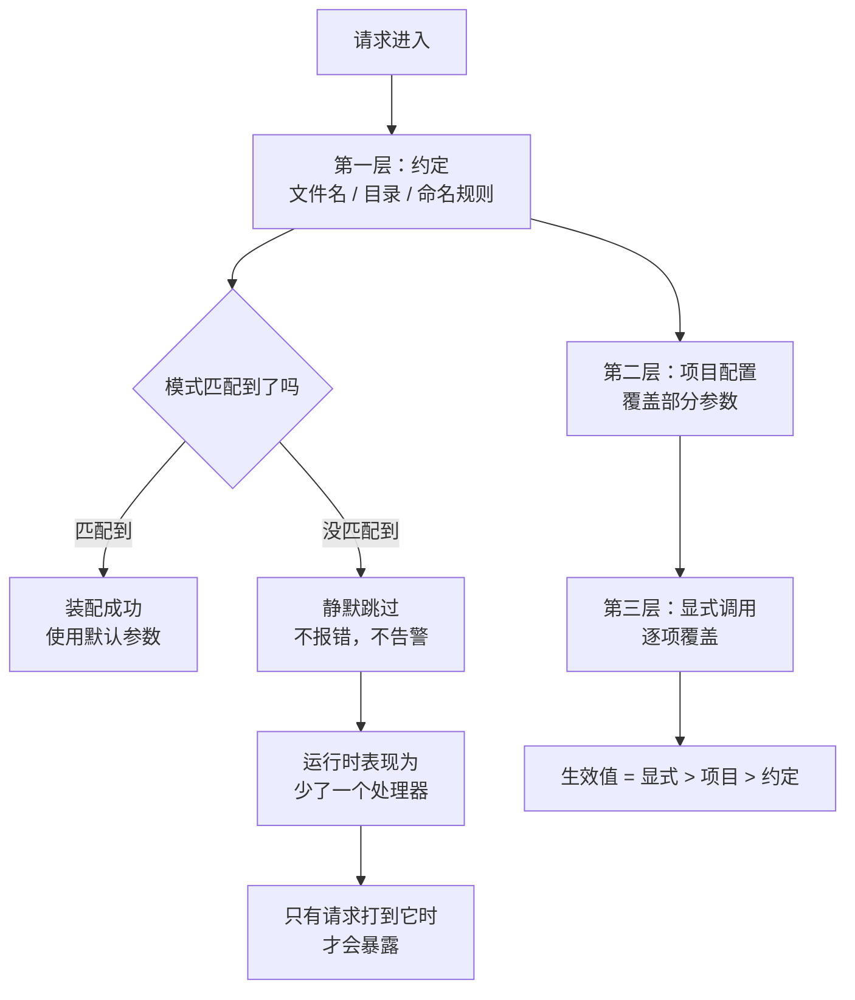
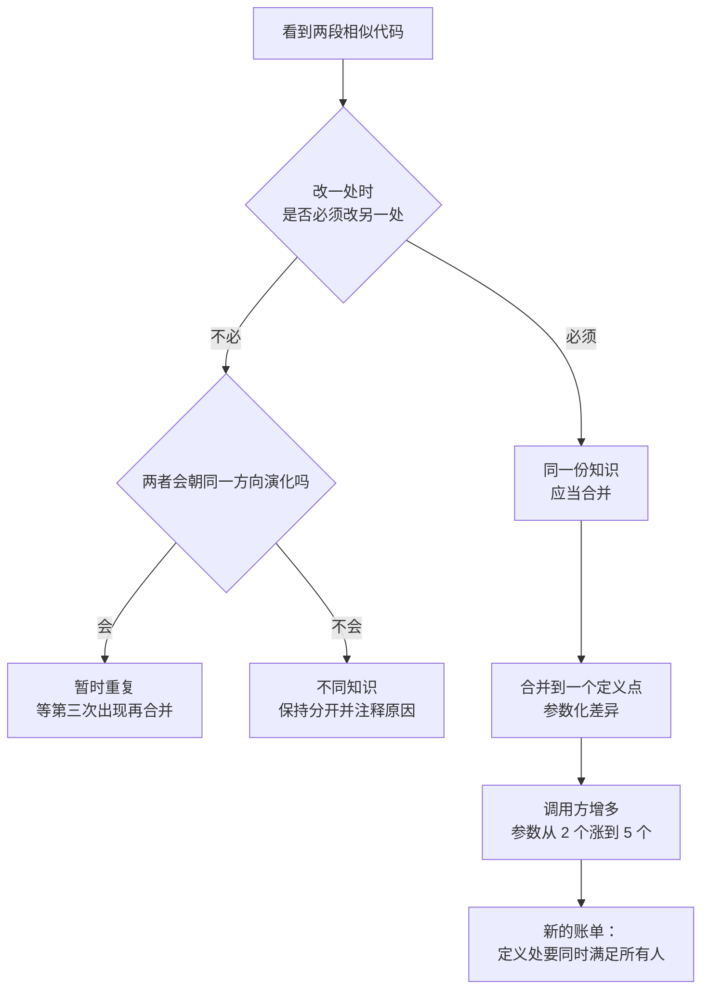
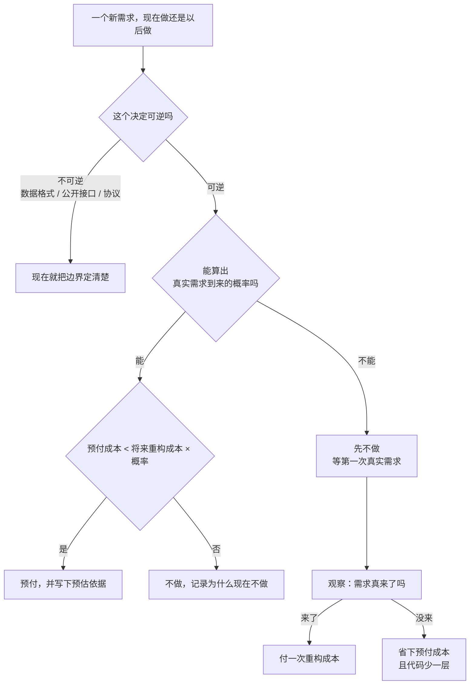

流水线、预取、约定优于配置、DRY、KISS 与 YAGNI，前两条在处理器内部，后三条在代码仓库里。做法差别很大：把指令拆成五段错开走、在还没用到时把数据搬上来、把重复写十遍的配置项变成默认值、把抄了三份的税率收成一个常量、把还没人提的需求直接不做。

共同的问法是：**哪一份开销可以省掉，省掉之后谁付账。**

- **流水线**省掉的是功能单元的空闲时间，账单是冒险检测与预测失败时的冲刷；
- **预取**省掉的是等内存的停顿，账单是猜错时白搬的带宽与被挤出去的缓存行；
- **约定优于配置**省掉的是重复声明，账单是隐式行为：默认值一改，没人看过的那几个模块跟着改；
- **DRY**省掉的是第二份拷贝，账单是耦合：一份定义要同时满足所有调用方，参数会越加越多；
- **KISS 与 YAGNI**省掉的是还没到来的需求，账单是把宝押在了预测上。

前四条把开销挪到别处，最后一条把开销推到以后。五条没有一条真的消灭了开销。



五个小节的数字都来自本机实跑，脚本在 `.workbuddy/_tmp_princ06/`。其中流水线与预取的距离扫描是周期级与缓存级模拟，已在原处标明；步长延迟那一组是 Node 22 在 32 MiB 数组上的真实测量。

## 一、流水线

1961 年 IBM 的 Stretch（7030）第一次把一条指令拆成若干段、让相邻指令的不同段同时占用不同硬件，IBM 内部管这叫 pipelining。1964 年 CDC 6600 走得更远：Cray 给它配了多个独立功能单元和一个记分牌（scoreboard）来调度，指令之间的重叠不再靠固定节拍，而靠运行时判断依赖。1980 年代中期 MIPS R2000 把五级流水（取指、译码、执行、访存、写回）做成 RISC 的标准形态，Hennessy 与 Patterson 后来把这套结构量化成 CPI、IPC、加速比这一组指标。

它要解决的问题很具体：一条指令的五道工序里，每道工序只用到一小块硬件。取指用指令缓存与 PC，译码用译码器，执行用 ALU，访存用数据缓存，写回用寄存器堆。让一条指令独占全部五拍，等于让 ALU 在取指时空转四拍，让数据缓存空闲四拍——这四拍里它一次都没被用到。

**本质一句话：流水线不缩短任何一条指令的时间，它让不同指令的不同阶段同时占用不同的硬件；省下的是功能单元的空闲，账单是冒险处理与冲刷。**

```mermaid
flowchart LR
    subgraph P1["第 1 拍"]
        A1["I1 取指"]
    end
    subgraph P2["第 2 拍"]
        B1["I1 译码"]
        B2["I2 取指"]
    end
    subgraph P3["第 3 拍"]
        C1["I1 执行"]
        C2["I2 译码"]
        C3["I3 取指"]
    end
    subgraph P4["第 4 拍"]
        D1["I1 访存"]
        D2["I2 执行"]
        D3["I3 译码"]
    end
    subgraph P5["第 5 拍"]
        E1["I1 写回"]
        E2["I2 访存"]
        E3["I3 执行"]
    end
    subgraph P6["第 6 拍"]
        F1["I2 写回"]
        F2["I3 访存"]
    end
    subgraph P7["第 7 拍"]
        G1["I3 写回"]
    end
    P1 --> P2 --> P3 --> P4 --> P5 --> P6 --> P7
```



三张表放在一起看。第一张是一万条指令在五种调度下的周期数，指令流按 62% 算术、23% 负载、7% 存储、8% 分支生成，访存依赖在没有转发时按等三拍算、有转发时按插一拍算，分支罚则两拍：

```text
  指令流：10000 条   ALU 6196 / load 2331 / store 657 / branch 816
  五级流水：IF 取指 / ID 译码 / EX 执行 / MEM 访存 / WB 写回；分支罚则 2 拍

                        调度方式     总周期    气泡  冲刷      IPC  相对串行
      每条指令独占五拍（无重叠）      50000       0     0    0.200     1.00x
  流水线理想（零冒险，只付填充）      10004       0     0    1.000     5.00x
        流水线 + 转发 + 预测 90%      11967    1963    93    0.836     4.18x
        流水线 + 转发 + 预测 70%      12297    2293   258    0.813     4.07x
        流水线 + 转发 + 预测 50%      12635    2631   427    0.791     3.96x
        流水线 + 转发 + 完美预测      11781    1777     0    0.849     4.24x
      流水线 + 不转发 + 预测 90%      13744    3740    93    0.728     3.64x
```

四件事值得拆开看。

第一，理想流水线把 IPC 从 0.2 拉到 1.0，加速 5.00 倍，这个 5 正好等于级数。它成立的前提是「每拍都有一条指令进入」和「每条指令都不等任何人」。这两条前提在真实程序里一条都不成立。

第二，转发（forwarding）值 0.108 的 IPC。不转发时，每条依赖前一条结果的指令都要等结果写回寄存器堆，一万条指令多付 1777 拍；转发把 ALU 的结果从执行段直接接回下一拍的输入，只留 load 之后那一拍无法绕过的空档，多付 186 拍。0.849 与 0.728 的差，就是「结果走不走寄存器堆」这一条路径的价钱。

第三，分支预测的收益比直觉小。预测准确率从 100% 掉到 50%，一万条指令只多付 854 拍。原因在指令流的构成：分支只占 8.16%，罚则只有两拍，816 次分支里错一半是 408 次，乘二等于 816 拍，占总周期的 6.8%。**分支的代价 = 分支密度 × 预测失败率 × 罚则，三个因子都不大时，预测器再差也伤不到筋骨。** 反过来说，一段循环体很短、分支很密的代码（解释器的字节码分派、正则匹配的内层循环）会把这个乘积顶满，那时预测器就是命门。

第四，气泡与冲刷不是同一回事。气泡是「这一拍没有指令发射」，冲刷是「已经进管道的指令要作废重来」。前者浪费一拍，后者还要把取指队列清空、把 PC 改回去。表里的「冲刷」列只统计分支失败次数，实际代价已经折算进「气泡」列。

第二张表是填充与排空的摊销。同一条指令流只改变长度，理想调度，不带任何冒险：

```text
      指令数     总周期    填充占比      IPC
           5         10       40.0%    0.500
          10         15       26.7%    0.667
          50         62        6.5%    0.806
         500        591        0.7%    0.846
       10000      11781        0.0%    0.849
```

五条指令的循环，四成周期花在「管道还没填满」和「最后几条在里面走完」上。这就是短函数、密集调用在流水线上不划算的原因：调用一次，管道冲刷一次，再填一次——这笔填充成本按调用次数计费。工程上的对策是内联（把小函数体搬进调用点，省掉这次填充）与循环展开（把循环体做长，让填充摊薄）。

第三张表是深度。级数从 5 加到 20，分支罚则按「级数减一除以二」放大：

```text
      级数  分支罚则     总周期      IPC  预测 50% 时 IPC
         5         2      11967    0.836            0.791
        10         4      12158    0.823            0.741
        15         7      12442    0.804            0.677
        20         9      12633    0.792            0.639
```

预测准确率 90% 时，加深流水线只掉 0.044 的 IPC，因为每级逻辑变少、时钟可以更快，这笔账通常是划算的。预测准确率 50% 时，掉到 0.639，掉了 0.152。**这才是当年 Pentium 4 那条 31 级流水线被放弃的原因：它把频率押在了「分支可预测」上，而分支密集的代码把这个假设打穿了。** 深度本身不是优点——它是拿罚则换频率，只有频率的收益盖过罚则的增长才划算。

**边界与反例**

- **它不降低单条指令的延迟**。一条指令仍然要走五段——五级流水就有五拍的下限——流水线只让后面的指令提前开始。对「一次调用只做一件事、然后等结果」的场景（RPC 往返、单次磁盘同步读），流水线一分钱都省不下来。
- **依赖链是无解的**。指针追逐（`p = p->next`）、递归下降、逐元素累加 `s += a[i]`，每一步都要等上一步的结果，硬件只能靠乱序执行去别的地方找活干，找不到就停。这也是为什么链表遍历比数组遍历慢，而且慢在延迟上，不在带宽上。
- **流水线寄存器有成本**。每加一级就要多一组锁存器，面积、功耗、时钟树都得跟着涨；级数越深，单级逻辑越少，锁存器开销占比越高。
- **超线程是另一种填充**。一个物理核的两套寄存器上下文，让一个线程等内存时另一个线程占用执行单元。它填的是同一条流水线的空拍，代价是共享缓存与执行端口，两个线程互相拖慢是常态。
- **编译器在替你做这件事**。把独立的计算挪到 load 之后、把循环展开、把分支改成条件传送，目的都是让管道别空着。看 `-O2` 与 `-O0` 的汇编差异，多数差异不是为了少几条指令，而是为了排得更满。

## 二、预取

1967 年 IBM 360/91 在指令部件里放了预取缓冲，一边执行当前指令一边把后面的指令取进来。数据侧的预取晚了二十多年才普及：1990 年 Jouppi 在 ISCA 上发表预取缓冲（prefetch buffer）的设计与分析，把「取早了放哪、取错了怎么丢」这两个问题讲清楚；1990 年代中期 Alpha 21164 起有了显式的预取指令（fetch 与 fetch_m），此后 x86 的 `prefetcht0`、ARM 的 `PRFM` 成了标配，编译器与运行库可以直接把「我马上要用这一行」告诉硬件。

它要解决的问题是一个数量级差：一次末级缓存命中是十几拍，一次内存访问是两三百拍，中间隔着一个数量级。等指令真的去取那个地址，流水线只能停在那里；而在它真正停下来之前，内存总线其实是闲的——等的是延迟，闲的是带宽。

**本质一句话：预取不减少搬运量，它把搬运提前到还有空闲带宽的时候；省下的是等待，账单是猜错时白搬的流量与被挤出去的缓存行。**



先看硬件到底能提前多少。本机是 32 MiB 的 `Int32Array`，明显超出末级缓存，单线程顺序遍历与各种步长的耗时：

```text
  数组 8388608 个 int32，共 32 MiB，超出末级缓存

  访问模式                        次数      耗时 ms      每次 ns    有效 GB/s
  步长 1（顺序）               8388608        4.9       0.59        6.8
  步长 2                   4194304        3.3       0.80        5.0
  步长 4                   2097152        3.1       1.50        2.7
  步长 8                   1048576        1.8       1.74        2.3
  步长 16                   524288        1.5       2.96        1.4
  步长 32                   262144        1.4       5.30        0.8
  步长 64                   131072        0.6       4.92        0.8
  伪随机跳转（4M 次）            4194304       75.1      17.90        0.2
```

步长 1 是 0.59 纳秒一个元素，折合 6.8 GB/s，这是单线程能把内存带宽吃到的量级。伪随机跳转是 17.90 纳秒一次，慢 30 倍，有效带宽掉到 0.2 GB/s。**中间这 30 倍不是「随机访问天生慢」，是「预取器认不出你要去哪」的价钱。**

步长那一列更有意思。步长 16 正好是一个 64 字节缓存行，每次访问都落在新行上，按理说每次都是缺失，实测 2.96 纳秒；步长 64 大步跨过 256 字节，反而只要 4.92 纳秒，比步长 32 的 5.30 还略快。原理是硬件里有两种预取器：一种盯「连续地址流」，一种盯「固定步长」。固定步长的访问模式对后者来说是完美信号，它照样能提前把行搬进 L2。真正让预取器失效的不是「每次都不命中」，而是「下一次去哪说不清」——地址可预测时，连缺失都能提前搬；地址不可预测时，命中率再高也救不了。

把预取距离做成可调参数，在缓存模拟器里扫一遍。访问流两万次，七成顺序推进、三成随机跳转，缓存 512 行，缺失按 100 拍、命中按 4 拍折算：

```text
    预取距离   命中率  取行次数 浪费行/访问  流量 KiB  平均停顿
           0     0.9%     19815        0.00      1238   99.1 拍
           1    41.8%     23248        0.17      1453   59.9 拍
           2    54.9%     27005        0.35      1688   47.3 拍
           4    64.4%     35483        0.77      2218   38.2 拍
           8    69.2%     55259        1.75      3454   33.6 拍
          16    70.5%     99955        3.98      6247   32.3 拍
          32    70.6%    193363        8.65     12085   32.2 拍
```

距离从 0 到 1 只加一行前瞻，命中率从 0.9% 跳到 41.8%，停顿从 99.1 拍降到 59.9 拍，这是最便宜的一步。到 8 行时命中 69.2%，停顿 33.6 拍。再往后是明显的边际递减——距离越远，多搬的行越多，省下的停顿越少：距离 16 比 8 多搬 81% 的流量，只换来 1.3 拍的改善；距离 32 多搬三倍半的流量（12085 KiB 对 3454 KiB），改善 0.1 拍。

**这张表就是「省掉的开销由谁付账」的账本：前四行是净赚，后两行是花钱买零点几拍。** 真实的预取器不会用一个固定距离，而是按访问间隔与队列压力动态调整，原理就是把工作点压在曲线的拐点上。

方向猜错时的账更难看。距离固定为 8，让一部分预取往反方向发：

```text
  距离 8、但有一半的预取方向猜错：
    方向错概率   命中率  取行次数 浪费行/访问  流量 KiB  平均停顿
            0%    69.2%     55259        1.75      3454   33.6 拍
           20%    64.1%     62024        2.09      3876   38.4 拍
           50%    53.0%     70274        2.50      4392   49.1 拍
```

方向错八成时，命中率还剩 31.7%（比完全不预取好），但停顿已经回到 69.6 拍，因为每次缺失仍然要等，而多搬的流量还在占带宽。**预取的最坏情况不是「没帮上忙」，是「帮了倒忙」：它消耗带宽、挤占缓存，还让本该命中的行被换出去。**

**边界与反例**

- **带宽是共享的**。单线程看到的空闲带宽，在多核同时跑内存密集任务时不存在。预取把别人的带宽挪给自己，整体吞吐可能下降。云上多租户的「邻居吵闹」问题里，激进预取是常见诱因。
- **它会污染缓存**。取进来的行占着位置，如果没被用到，就把别的有用行挤走了。距离越大、精度越差，污染越重，这也是上表「浪费行/访问」这一列涨到 8.65 的含义。
- **不可预测的访问没法预取**。哈希表查找、树遍历、图遍历、稀疏矩阵的行索引，下一个地址依赖上一个取回的值，硬件只能等。这类负载的优化方向是改数据结构布局（把指针换成下标、把节点做紧凑），不是加预取。
- **软件预取要付指令开销**。`prefetcht0` 是一条指令，插在循环里会占发射槽、增加代码体积；插得太早，行可能在用到前就被换出去；插得太晚，等于没插。距离要按循环体的周期数估算，估错了就是白搬。
- **它是一条侧信道**。预取的时序差异能被用来探测地址是否在缓存里，Spectre 一类攻击的不少变体就靠这个读内存。加固手段之一是限制跨权限边界的预取，代价是性能。
- **顺序扫描的「预取」常常是 readahead 而不是硬件**。`posix_fadvise(POSIX_FADV_SEQUENTIAL)`、Windows 的 `FILE_FLAG_SEQUENTIAL_SCAN`、数据库的预读窗口，都是软件层在替硬件做同一件事：把「马上要读」的判断提前。判据也一样——读的规律性有多强，窗口就能开多大。

## 三、约定优于配置

1976 年 Make 就有了隐式规则：写 `foo.o: foo.c` 时不必写编译命令，Make 知道 `.c` 该用 `cc -c` 编。1996 年 JavaBeans 把 `getX`/`setX` 定为属性访问的命名约定，框架靠反射找方法，配置文件里一个字都不用提。2004 年 Rails 把这个思路提炼成口号「convention over configuration」：模型叫 `Order`，表就叫 `orders`，主键就叫 `id`，控制器叫 `OrdersController`，路由自动生成。同年 Maven 定下 `src/main/java`、`src/test/java` 的标准目录，2009 年 Servlet 3.0 用注解取代了 `web.xml` 里成百上千行的 `<servlet>` 声明。

它要解决的问题是：**每一条显式声明，都是一份「本来可以被推导出来」的知识。** 声明越多，改一处忘一处的概率越高，配置文件本身也变成需要维护的代码。

**本质一句话：约定优于配置不是「不需要配置」，是把默认值从「每个项目各写一遍」搬到「框架里写一遍」；省下的是重复声明，账单是隐式行为——默认值一改，没人看过的那几个模块跟着改。**



本机搭了十二个处理器做对照，文件按 `<name>_handler.py` 命名，其中一个故意写成 `couponHandler.py`。一种装配方式是扫目录按模式匹配，另一种是维护一张十二行的注册表：

```text
      装配方式  装配成功  漏掉的处理器                  启动时的表现
      约定扫描     11 个        coupon              无报错，照常启动
    显式注册表     11 个        coupon            启动即失败，抛异常
```

两种方式都只装上了十一个，差别在「什么时候知道少了」。约定扫描漏掉 `couponHandler.py` 之后，服务照常启动、健康检查照常通过、日志里一个字都没有；要等到有请求打到优惠券处理器，才会看到一个莫名其妙的 404 或者空结果。显式注册表在启动第三行就抛 `FileNotFoundError`，容器起不来，发布流水线当场红灯。

**约定的第一个代价就在这里：它把「配置错误」从启动期挪到了运行期，从「响亮的失败」换成了「安静的缺失」。** 这不是约定本身的缺陷，是使用约定时没加护栏。护栏很简单——启动时断言装配数量（期望十二个、实际十一个就退出），或者启动时把装配清单打到日志里，让 review 的人一眼看见少了什么。

第二个代价更隐蔽。约定意味着「不写就是用默认值」，那么改默认值就等于同时改了所有没写的地方。把默认超时从 30 秒改成 60 秒，一次提交、一行 diff：

```text
        模块  显式覆盖  旧生效值  新生效值 是否静默改变
       order        否       30s       60s         变了
      refund        否       30s       60s         变了
      coupon        否       30s       60s         变了
        user        否       30s       60s         变了
        cart        否       30s       60s         变了
       stock        否       30s       60s         变了
  ...（其余 6 个模块同上）
```

十二个模块里十个跟着变了，只有 `pay`（15 秒）和 `ship`（90 秒）因为显式覆盖而没动。

```text
  受影响模块：10 / 12 个；显式声明过的只有 2 个，其余 8 个在改动中被一并改动且无人 review
  同一份改动若走全显式配置：配置文件要改 12 行，diff 里能看见每一处
```

这就是「省掉重复声明」的账单——账单本身不进 diff。那八行改动在 diff 里根本不存在，评审看不到，回滚的时候也不知道该回滚谁。**约定的便利与它的风险是同一件事的两面：不写，所以省事；不写，所以不可见。**

工程上的折中是「约定给默认值，关键项显式写」。判断哪些算关键项，有个现成的标准：**默认值错了会造成不可逆后果的，必须显式。** 超时、重试次数、并发上限、批量大小、密钥、数据保留期、权限开关，这七类都属于「悄悄改成两倍没人发现、发现时已经出了事故」。样式类、日志格式类、目录结构类，跟着约定走没有风险。

**边界与反例**

- **约定必须可发现**。Rails 有一张路由表可以打印，Maven 有 `effective-pom`，Spring Boot 有 `/actuator/configprops`。没有「把生效配置导出来看一眼」的能力，约定就变成了猜谜。
- **跨团队约定会漂移**。同一个仓库里，三个团队各自理解「handler 放哪」，一年后就有了三套目录。要么把约定写成 lint 规则，要么把约定收进脚手架生成。
- **默认值不能是「危险的安全值」**。默认监听 `0.0.0.0`、默认不校验证书、默认口令为空、默认关闭鉴权，这些年出的问题都源于「默认值选了好用而不是选了对」。这类参数的正确做法是「没有显式配置就拒绝启动」。
- **显式覆盖要能一把捞出来**。`git grep` 能搜到的覆盖才叫覆盖；藏在数据库、环境变量、配置中心三层里的覆盖，出问题时没人能拼出全貌。
- **框架的自动配置会制造「魔法」**。排查一个「为什么这个 bean 被创建了两次」的问题，读三遍源码不如打印一次条件评估报告。约定带来的认知成本，最终要靠可观测性还回去。

## 四、DRY

1999 年 Hunt 与 Thomas 在《The Pragmatic Programmer》里把它列为第一条原则：Don't Repeat Yourself，每一项知识在系统里只能有一个权威的、无歧义的表示。这个说法比「不要复制粘贴代码」严格得多，因为它管的不是文本，是知识。

它要解决的问题是时间差。同一条规则写了两份，改一份忘一份，两份就开始漂移；漂移到某个时刻，两个入口对同一笔订单算出两个不同的价格——而对账的人要在几十万行日志里找出哪一份是对的。

**本质一句话：DRY 的对象是「知识」而不是「代码文本」，判定标准是「改一处是否必须同时改另一处」，不是「两段代码长得像不像」。**



先看工具能不能替你做这个判断。用 token 序列比对四对片段，相似度超过 0.80 就建议合并：

```text
        片段对   相似度  同一份知识     照相似度合并
    同名不同义     0.93          否     合并（错误）
    同义不同写     0.88          是     合并（正确）
      逐字照抄     0.79          是   不合并（错误）
      骨架相同     0.53          否   不合并（正确）
```

四对里判错两对。「同名不同义」是两个函数都写 `round(x * 0.13, 2)`，一个算增值税、一个算佣金，文本一字不差，相似度 0.93，但它们服务两条完全不同的业务规则，合并之后任何一方调价都要拉着另一方一起改。「逐字照抄」是同一个校验函数抄了两份、只改了形参名，相似度 0.79，低于阈值，工具建议不合并，可它就是标准的重复。

**这就是 DRY 最容易被工具带偏的地方：文本相似度衡量的是「像不像」，DRY 要判断的是「是不是同一件事」。** 前者可以从代码算出来，后者只能从需求里读出来。真正可靠的做法是在代码里留下判断依据：注释写清这段规则来自哪条业务约束，合并时对照约束，而不是对照字符。

再看漏改的代价。三个入口（Web、API、批量）各自内联税率，一次调价把 13% 改成 9%，只改了两个：

```text
        入口     旧价     新价 与应收的偏差
         web  1130.00  1090.00        +0.00
         api  1130.00  1090.00        +0.00
       batch  1130.00  1130.00       +40.00
```

一千块的订单，批量入口多收四十。这个数字不会报错，不会让测试变红（如果测试只覆盖了 Web 入口），只会出现在客户的账单上、出现在月底的对账差异里。**重复的代价不是多写了几行，是两份拷贝各自演化出一段没人知道的历史。**

合并当然也要付账。把三份收成一份，这一个函数就要同时满足三个入口的差异，参数从两个涨到五个：

```text
            版本    定义处  调用点                    每个调用点要传的参数
        三份拷贝      3 处    3 个                                 x, rate
        一份定义      1 处    3 个     x, rate, rounding, currency, region
```

`rounding`（舍入方式）、`currency`（币种）、`region`（地区）这三个参数，在合并之前是硬编码在各自函数体里的常量，合并之后变成调用方必须知道的东西——差异没有消失，只是从函数体搬到了签名上。**DRY 把「改三处」换成了「一处改、三处传参」，省掉的是漏改，账单是调用方的认知负担与定义处的耦合。** 当这条参数列表涨到八个、十个，新来的人宁可再抄一份，也不愿意读懂它。

**边界与反例**

- **错误的抽象比重复更贵**。两份看起来一样的代码，如果背后的业务规则不同，合并之后每一次需求变更都要在同一个函数里加条件分支，最终变成一个谁都不敢动的巨型 switch。判断标准还是那条：改一处是否必须改另一处。
- **三次法则**。第一次出现就写，第二次出现可以抄（这时你还不知道两者是否会分叉），第三次出现再抽象。抽象的依据是「已经稳定下来的共同点」，而不是「将来可能有的共同点」。
- **跨服务的共享库是分布式单体**。两个服务共用一份「模型定义」，任何一方改字段都要两边一起发布、一起回滚。这时候「两份定义 + 一份契约测试」往往比「一份共享库」更便宜：重复的是结构，共享的是契约。
- **测试代码可以重复**。一个测试用例把前置条件写全，比抽出一个 `setup` 工厂再传五个参数更容易读。测试的可读性优先于 DRY，这条在社区里叫 DAMP（Descriptive And Meaningful Phrases）。
- **生成出来的重复不算重复**。协议代码、序列化桩、SQL 映射，用工具从契约生成，人不去改生成物，这份「重复」就没有漂移风险。真正的单点定义是那个契约文件。
- **配置与代码之间的重复最容易被放过**。字段名在实体类、SQL、前端表单、校验规则里各写一遍，这四份是同一份知识。对抗方式是让其中三份从第四份生成，而不是靠人去对齐。

## 五、KISS 与 YAGNI

KISS 出自 1960 年 Lockheed 的 Skunk Works。Kelly Johnson 给设计团队立了条规矩：能飞的飞机要能被一个普通机修工在前线用一把扳手修好，「Keep it simple, stupid」。YAGNI 出自 1990 年代末的极限编程圈，Ron Jeffries 把它写成「You Ain't Gonna Need It」，态度比 KISS 更硬：不要因为「以后可能要」就现在写。

两条合起来说的是同一件事：**为未来的需求预付成本，是一件赔率不明的事。**

它要解决的问题是复杂度的复利。一个抽象基类、一层插件机制、一个配置开关，单看都不贵；叠在一起之后，读代码的人要先在脑子里跑一遍框架，才能知道这一行到底做了什么；每加一个功能，要改的地方从一处变成四处。

**本质一句话：YAGNI 不是不做设计，是把「为将来预留」的成本与「将来真到来时重构」的成本放在一起比，只在前者明显更低时才预付；而多数情况下前者更高，因为你对将来的预测不准。**



本机写了两个版本处理同一批两千行订单数据。一个是一个函数、九行有效代码；另一个是分层结构，抽象基类加注册表加策略：数据源、校验器、错误策略、输出格式四个接缝，六十五行有效代码、十个类、四个抽象方法。先证明两者处理规则完全一样，再比较结构：

```text
          实现  保留行数        结果指纹
      一个函数      1816    20d94ba7dfaf
      分层架构      1816    20d94ba7dfaf
```

同样的输入、同样的保留行数、同样的结果指纹。规则等价，差别只在结构：

```text
        规模指标    一个函数    分层架构    倍数
      有效代码行           9          65    7.2x
              类           0          10       -
            函数           1          14   14.0x
     import 语句           0           1       -
        抽象方法           0           4       -
```

七倍的代码量换来四个扩展点。接着让两个真实变更分别落到两份实现上。第一个变更是「价格超上限时截断到上限，不再整行丢弃」，第二个是「增加手机号格式校验」：

```text
                    变更    一个函数    分层架构      改动后指纹    等价
        价格超限改为截断       2 / 1      12 / 2    7c43c0543eec      是
          增加手机号校验       2 / 0       9 / 1    c760ba0e2217      是
```

两个变更改完之后，两份实现的结果指纹仍然一致，说明改动都正确。但改动量是 2 比 12、2 比 9：**每次真实变更，分层版本要动的行数都是简单版本的四到六倍。**

第二个变更（手机号校验）恰好命中了预埋的「校验器」接缝，按说是分层结构最该发挥作用的场合，结果还是九行对两行。原因很直接：加一个校验器要新建类、写 `name`、写 `check`、注册、再把名字加进校验列表，五处；简单版本只要在循环里加两行 `if`。**扩展点降低的是「改动位置的分散程度」，不是「改动的行数」。** 它在你需要「不修改既有代码就加功能」时有价值（比如插件由第三方提供），在你只是自己加一条规则时，它只是一层额外的手续。

第一个变更更说明问题。它没落在四个接缝中的任何一个上：它要改的是「失败之后怎么处理这一行的内容」，而错误策略接缝的参数是 `absorb(row, reason)`，其中 `reason` 只是一个字符串常量 `"invalid"`，没有告诉策略「哪条规则失败了」。于是新策略只能在内部把三个判断条件重新写一遍。**接缝存在，但接缝传递的信息不够，抽象漏了。**

四个扩展点里，两个变更用到了一个半。剩下两个半（数据源、输出格式、错误策略的信息完整性）是为「以后可能要」付的钱。

**边界与反例**

- **不可逆的决定要提前**。数据格式、公开 API 的形状、协议版本、安全边界、多租户的隔离维度，这些一旦上线就很难改。YAGNI 管的是「可逆的实现选择」，不管「不可逆的契约」。
- **有硬约束的不能等**。合规要求、审计日志、数据保留期、加密算法，属于「等需要时再加就来不及」的一类，因为补数据的成本远高于一开始就留。
- **简单不等于把复杂度丢给调用方**。一个要求调用方按特定顺序调三个函数才能用的接口，不是 KISS——复杂度没有消失，只是从实现者手里转到了使用者手里。KISS 的判断标准是「整体复杂度」，不是「我的代码行数」。
- **YAGNI 依赖重构能力**。敢不做，是因为将来改起来不难；改起来不难的前提是测试覆盖、CI、可小步发布。没有这些，按需重构会变成一次大手术，那时「当初为什么不多留个扩展点」就成立了。
- **KISS 常被用来拒绝必要的抽象**。三个地方都要做的同一件事，抽出来是简化；拒绝抽出来，重复的复杂度会以数量取胜。判断依据仍然是 DRY 那条：改一处是否必须改另一处。
- **预测的准确率可以事后核对**。把「我们觉得以后会需要」写进注释或 ADR，半年后回看命中率。这个动作很便宜，它让下一次预付有依据，而不是凭感觉。

## 六、横向对照

| 原则 | 省掉的是什么 | 账单付给谁 | 代价结构的关键量 | 什么时候不该省 |
|------|--------------|------------|------------------|----------------|
| 流水线 | 功能单元的空闲周期 | 冒险检测、转发通路、冲刷 | 分支密度 × 失败率 × 罚则 | 依赖链长 / 单次延迟敏感 / 代码极短 |
| 预取 | 等内存的停顿 | 带宽、缓存容量 | 预取距离 × 准确率 | 访问不可预测 / 带宽紧张 / 多租户共享 |
| 约定优于配置 | 重复声明 | 隐式默认值的可见性 | 覆盖比例与默认值变更频率 | 参数错了不可逆 / 跨团队约定 |
| DRY | 第二份知识拷贝 | 定义处的耦合与参数膨胀 | 改一处是否必须改另一处 | 两处会分叉演化 / 跨服务边界 |
| KISS 与 YAGNI | 未到来需求的实现成本 | 将来的重构成本 | 预测命中率与可逆性 | 不可逆契约 / 硬约束 / 缺重构能力 |

| 五条原则 | 一句话判据 |
|----------|------------|
| 流水线 | 这段代码里，有多少拍是「有指令但没法发射」 |
| 预取 | 下一次要访问的地址，现在说得出来吗 |
| 约定优于配置 | 这个默认值改了，谁会跟着变，看不看得见 |
| DRY | 改一处，是否必须同时改另一处 |
| KISS 与 YAGNI | 这个扩展点，过去半年被用过几次 |

🐾 **小结**：这一章的五条原则分处处理器内部与代码仓库两端，看起来毫无关系，落到根上是同一个动作：把一份开销挪个位置。

流水线挪的是时间上的空闲。一万条指令，串行要五万拍，理想流水线一万拍，加速五倍；真实的转发加九成预测只有 0.836 的 IPC，四倍出头；不转发掉到 0.728；二十级深流水在五成预测下掉到 0.639。它省下的从来不是单条指令的时间——单条指令该走几拍还是几拍——而是功能单元闲着的那几拍。填充与排空还提醒了一件事：五条指令的循环有四成周期在填管道，所以短函数与密集调用在流水线上天生吃亏。

预取挪的是空间上的距离。顺序遍历 0.59 纳秒一个元素，伪随机跳转 17.90 纳秒，三十倍差距几乎全是「预取器认不出下一个地址」的钱。距离从 0 拉到 8，命中率从 0.9% 涨到 69.2%，停顿从 99.1 拍降到 33.6 拍；再拉到 32，流量涨到三倍半，停顿只再降 1.4 拍。方向错八成时，命中率还有 31.7%，停顿却回到 69.6 拍——预取最坏的结果不是没帮上忙，是帮了倒忙。

约定优于配置挪的是「知识写在哪」。十二个处理器，约定扫描漏掉一个，服务照常启动；显式注册表漏掉同一个，容器起不来。默认超时从 30 秒改到 60 秒，十二个模块里十个跟着变，只有两个显式覆盖的没动，而 diff 里只有一行。省下的声明越彻底，账单越隐蔽。

DRY 挪的是「知识存几份」。三个入口各写各的税率，调价漏改一处，一千块的订单多收四十；合并成一处，参数从两个涨到五个，账单从「漏改」换成「耦合」。而工具给出的相似度会同时犯两种错：0.93 的不同知识建议合并，0.79 的同一份知识建议不合并——两个方向都错。

KISS 与 YAGNI 挪的是「现在付还是以后付」。同一批两千行输入，九行与六十五行给出完全相同的结果；两个真实变更，一个要改二行对十二行，一个要改二行对九行。四个预埋的扩展点用到一个半，而用到的那一个也没有让改动更短。

回头看这五条，判据其实可以收到一句：**这份开销现在省掉，是把它挪给了另一个时刻、另一层硬件、另一个人，还是真的让它消失了。** 挪给硬件、挪给带宽、挪给未来的自己，都是正当的交易，只要你知道账单迟早落在谁头上；把账单藏进「默认值」和「没人看的 diff」里，才是这些问题真正的来源。

---

**相关阅读**：
- [计算机原则五讲（十一）：状态归谁管](/posts/princ-chapter-11/)
- [计算机原则五讲（十）：判断在什么时候做](/posts/princ-chapter-10/)
- [计算机原则五讲（九）：把负担摊开](/posts/princ-chapter-09/)
- [计算机原则五讲（八）：同一份东西该存在几处](/posts/princ-chapter-08/)
- [计算机原则五讲（七）：拿什么换什么](/posts/princ-chapter-07/)
- [计算机原则五讲（一）：这笔投入能换回什么](/posts/princ-chapter-01/)
- [计算机原则五讲（六）：没有免费的优化](/posts/princ-chapter-06/)
- [计算机原则五讲（四）：把没说出口的约定写下来](/posts/princ-chapter-04/)
- [Pipeline 模式：流水线架构的设计与实现](/posts/pipeline-pattern/)
