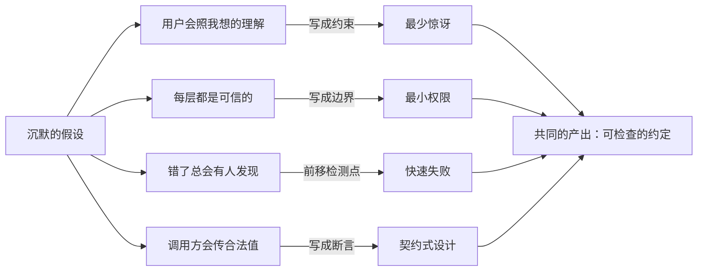
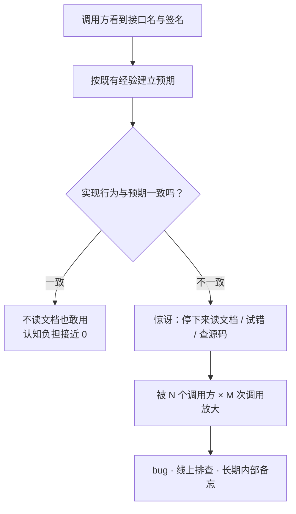
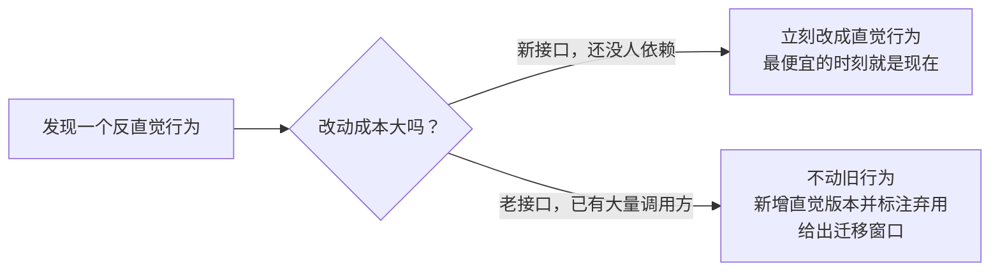
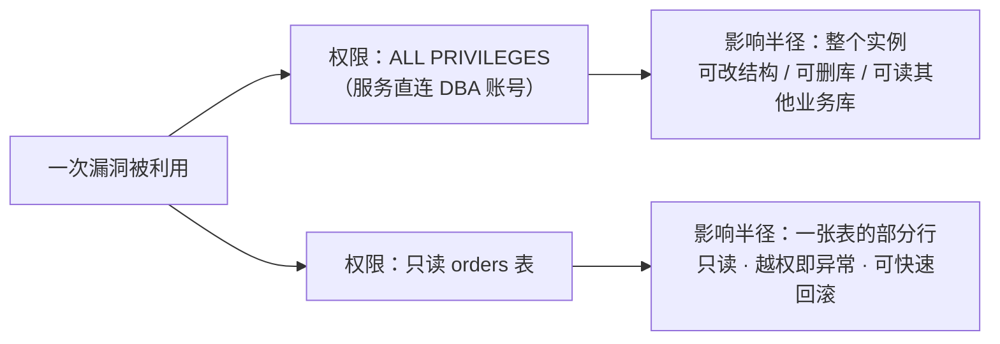
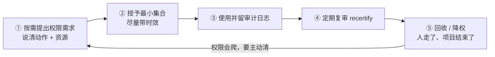
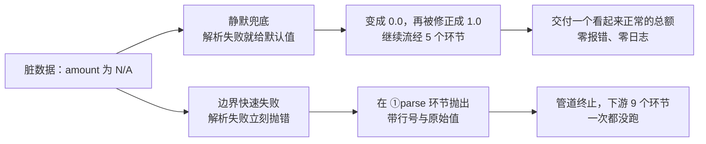
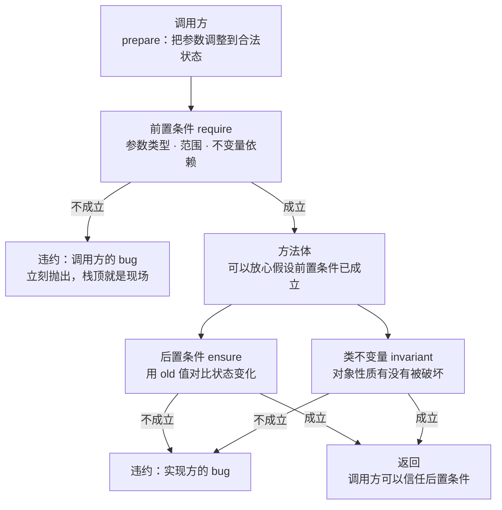
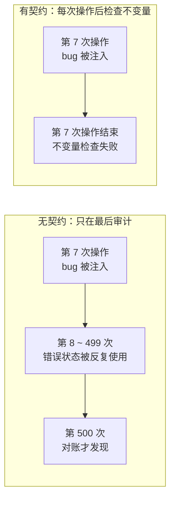

这四条原则看似分属交互设计、安全、容错与类型理论，实际都在做同一件事：**把默会的前提写成显式的、可检查的东西。**

- **最少惊讶**把「用户会怎么理解这个接口」这个隐含假设，变成对行为的硬约束；
- **最小权限**把「每一层都可信」这个隐含假设，换成「每一层都会失守」；
- **快速失败**把「错误迟早会被发现」这个隐含假设，改成「在错误发生的现场就发现」；
- **契约式设计**把「调用方应该传合法的值」这句口头约定，写成可执行断言。

它们的共同敌人是**沉默的假设**。一个系统里最贵的 bug，往往不是写错的代码，而是「所有人都以为别人知道」的那部分约定：默认参数会被共享、内部接口不会被乱调、字段一定是数字、这个函数不会返回负数。这些假设一旦不写下来，它就只在出问题的那一刻才被看见。



下面四节各自独立，实跑与引用分开标注。

## 一、最少惊讶原则

POLA 没有唯一的提出者，它是从人机交互到编程语言、API 设计里慢慢固化成共识的一条准则。措辞很朴素：**系统的行为，应该与使用者基于既有经验所形成的预期一致。**

在工程界留下脚印的节点大致有三段：早期的人机交互研究把它写成「界面要可预测」；编程语言设计把它变成「相近的语法要有相近的语义」；到了公共 API 时代，它又变成了「不要让调用方必须读源码才能用对」。三段说法不同，指向一致：**使用者带着旧经验来，设计者的责任是别让他为这份经验付代价。**

**本质一句话：最少惊讶是让接口的行为符合使用者已经形成的直觉；惊讶不是用户的问题，是设计者的账单。**

账单这个词是准确的，因为它有明确的放大机制：一个反直觉行为会被 N 个调用方乘以 M 次调用放大，最后变成 bug、线上排查和一份长期存在的内部备忘。**惊讶的成本不由设计者承担，却由设计者造成**，这就是它值得被写成原则的原因。

工程上最容易制造惊讶的位置是**默认值与参数语义**，因为它同时踩中三件事：调用方不写就看不见、写错了也不会报错、改起来又是破坏性变更。上面两条实测里最贵的几个行为都属于这一类：`push` 的默认列表被两次调用共享，是默认值在函数定义时求值；`d.get("b")` 返回 `None` 而 `d['b']` 抛异常，是同一个操作的两套语义；`datetime.now()` 不带时区，是默认值选了一个「看起来完整、实际缺一半」的表示。**默认值的每一次选择，都是在替调用方做决定，而调用方通常不知道自己被做了什么决定。**



**本机实跑：一堆「有理由但需要记住」的默认行为**

```text
data.sort() 的返回值 = None   ← 不是排好序的列表
data 本身 = [1, 2, 3]    sorted(...) = [1, 2, 3]
d.get("b") = None    d['b'] → KeyError('b')
push(1) = [1]
push(2) = [1, 2]   ← 两次调用共享同一个默认列表
0.1 + 0.2 = 0.30000000000000004
float('nan') == float('nan') → False
bool([]) = False  bool('') = False  bool(0) = False  bool('0') = True
s.strip() = 'wal'   但 s 还是 '  wal  '
datetime.now() 带时区吗？ None ← naive，无时区信息
```

```text
[1, 10, 2].sort()                  → [1, 10, 2]
typeof null                        → "object"
[] == false                        → true
null >= 0 / null == 0              → [true, false]
Number('') / Number(null) / Number(undefined) → [0, 0, NaN]
typeof NaN                         → "number"
[1,2,3] + [4,5,6]                  → "1,2,34,5,6"
[1, 2, 3].map(parseInt)            → [1, NaN, NaN]
'b' + 'a' + + 'a' + 'a'            → "baNaNa"
```

这些都不是 bug，每一条单独看都有它的理由：`sort()` 返回 `None` 是为了强调原地修改；`typeof null` 是 1995 年一个 32 位标签设计的历史残留；`map(parseInt)` 是因为 `map` 会多传一个下标参数。**但「有理由」和「不惊讶」是两件事**：理由留在设计者脑子里，惊讶落在使用者手上。



**边界与反例**

- **惊讶是相对的**。同一个行为对专家是直觉，对新手是惊吓（NumPy 的广播、pandas 的链式赋值警告）。目标不是「谁都不惊讶」——那不存在——而是锚定目标用户的心智模型。
- **一致性优先于局部最优**。C 的 `struct tm` 月份从 0 开始，Python 的 `datetime` 从 1 开始；Python 2 的 `/` 做整除影响了一代使用者，Python 3 改成真除法，代价是十几年的迁移。能改的惊讶行为，往往要先付兼容性学费。
- **它不是「不要创新」**。真正的新范式必须先教：Rust 的所有权、Git 的 DAG、Go 的显式 `error`。使用者觉得惊讶，常常是因为缺一个概念模型，而不是接口难用——这时要做的是讲清模型并一致贯彻，而不是加糖语法掩盖它。
- **过度迎合直觉会养出坏 API**。隐式类型转换、自动重试、隐式网络请求、猜你想要的默认值，都是把惊讶推给了未来和运维。
- **警惕「我的直觉不等于用户的直觉」**。设计者最熟悉自己的抽象，也最容易低估别人的惊讶。用数据说话：文档搜索量、issue 里 `question` 与 `confusing` 标签的分布、新手 onboarding 时长，都能把惊讶变成可度量指标。
- **它管「符合预期」，不管「符合审美」**。一个丑但一致的接口，胜过一堆漂亮但各说各话的接口。

## 二、最小权限原则

1975 年，Jerome Saltzer 与 Michael Schroeder 在《Proceedings of the IEEE》上发表《The Protection of Information in Computer Systems》，这是安全工程史上被引用最多的论文之一。论文提出 8 条保护机制设计原则，第四条是 Least privilege：每个程序和每个用户，都应当使用完成工作所必需的最小权限集合来操作。

这条原则的思维方式比它的条文更有价值：**它不问你「会不会被攻破」，而是假设「一定会被攻破」，然后问「攻破之后能损失多少」。** 前一个问题永远没有确定答案，后一个问题可以设计。

**本质一句话：最小权限是假设每一层都会失守，于是用权限边界把失守的代价钳死；它不信任的是单点，不是人。**



**本机实跑：目录越界**

```text
服务根目录 = public/    同级文件 = internal.txt

[无校验] 请求 readme.txt             → public data
[无校验] 请求 ../internal.txt        → internal-only: 这里本不该被这个服务读到
[无校验] 请求 C:/Windows/win.ini     → ; for 16-bit app support

[白名单] 请求 readme.txt             → public data
[白名单] 请求 ../internal.txt        → <PermissionError: 越界访问被拒绝：../internal.txt>
[白名单] 请求 C:/Windows/win.ini     → <PermissionError: 越界访问被拒绝：C:/Windows/win.ini>
```

这个实验的价值在于它同时展示了前后两件事：**漏洞本身（路径穿越）与影响半径（还能读到什么）。** 最小权限不负责拦住第一下，它负责让第一下之后不至于全盘皆输。前半段那三个请求全部成功，说明「有没有漏洞」和「有权限做多少事」是两个独立问题。

权限不是一次授予就完了，它会随时间爬。真实系统里通常有三类主体需要分别处理：**人**（开发、运维、DBA）拿的是带时效的临时凭证，避免离职后凭证仍有效；**服务**拿的是只覆盖自己所用表与接口的账号，避免一个服务的 SQL 注入变成整个实例的事故；**进程**在操作系统层面降权运行，避免 Web 服务以 root 启动。三类主体各自的边界不同，但判据是同一条：**这个主体完成工作，最少需要碰哪些东西。**



**边界与反例**

- **过紧的权限会把人逼出影子权限**。拿不到正式权限，就会出现复制凭证、共享 root、私搭跳板机，结果比给权限更危险，因为没人在审计它。所以必须提供合法快通道：临时提权、到期自动回收、事后复盘留痕。
- **权限会爬**。项目结束、职责变更，权限却留在原地。没有定期复审，最小权限一年之后就不最小了。这条对个人同样成立：翻翻你的 API key 列表，多半有一半已经没用了。
- **它需要治理成本**。一服务一账号、一环境一密钥，意味着密钥管理、轮换、注入都得有工程支撑；否则大家会用「共用一套」来省钱，安全性反而倒退。
- **权限不等于隔离**。容器共享内核，权限收缩挡不住内核漏洞逃逸；最小权限必须与命名空间、沙箱、虚拟机或硬件隔离叠加使用。
- **只有权限、没有检测，等于只挡了一半**。还需要审计日志（谁在什么时候用了什么权限）与快速吊销（必要时一分钟内让凭证彻底失效）。
- **它治的是影响半径，不是漏洞本身**。注入漏洞、依赖 CVE 的第一下它拦不住；它保证的是第一下之后不至于全盘皆输。

## 三、快速失败

**1985 年，Tandem Computers 的 Jim Gray** 在《Why Do Computers Stop and What Can Be Done About It?》里给出一对概念：**fail-fast module** 要么产生正确结果，要么立刻发出失败信号，绝不产生「看起来正确」的结果；**fail-stop processor** 出错就停，而不是带着错误状态继续跑。

这两个定义里最值得记的是后半句的措辞：**「绝不产生看起来正确的结果」。** 这句话把视角从「怎么不出错」换成了「出错之后输出长什么样」，而后者才是决定事故规模的东西。

**本质一句话：快速失败是承认错误一定会发生，于是把发现的时刻尽量前移到错误发生的现场；它优化的不是不报错，而是报错的位置。**

「位置」这个词是这条原则的核心。同一个错误，在第 3 行被拦住和在 500 行之后被审计发现，代价差几个数量级：前者只毁一条记录，后者毁掉整批结果的可信度，还多出一段「到底哪里开始错的」排查。



**本机实跑：五级管道的对照**

```text
[静默兜底]
  → 全程零报错；已穿越环节 20 个（4 行 × 5 环节）
  → 汇总金额：130545 分 —— 看起来是个正常数字，实际混入了脏数据

[快速失败]
  → 在第 3 行的 ①parse 环节抛出：amount 不是合法数字：'N/A'
  → 已穿越环节 11 个；管道在此终止，后面 9 个下游环节一次都没跑
  → 进入汇总的金额：123104 分（只算了 2 行）

  结论：静默模式让脏数据多流经 9 个下游环节；
        且最终交付的 130545 分里，有 7441 分是凭空补出来的。
```

```text
    ①parse           → 0.0
    ②check-positive  → 1.0
    ③discount        → 0.9
    ④tax             → 0.95
    ⑤to-cents        → 95
```

第二块输出解释了那 7441 分是怎么凭空长出来的：`N/A` 被填成 0.0，紧接着「金额必须为正」的修正逻辑把它抬到 1.0，然后一路乘上折扣、税率、换算成分。**每一环都在「尽力修复」，合起来就是一次凭空造数。** 这是静默修复最危险的形态：它不是在容错，而是在编造。

这些「静默吞掉」的行为不只出现在业务代码里，语言默认就给你留了一份。下面这组对照里，同一个错误在非严格模式与严格模式下是两种命运：

```text
代码写法                      非严格模式                    严格模式
--------------------------------------------------------------------------
给未声明的变量赋值             静默通过（错误被吞）             ReferenceError: leakedGlobal2 is not defined
给只读属性 NaN 赋值           静默通过（错误被吞）             TypeError: Cannot assign to read only property 'NaN'
delete Object.prototype      静默通过（错误被吞）             TypeError: Cannot delete property 'prototype'
函数形参重名                  静默通过（错误被吞）             SyntaxError: Unexpected string
给 Object.freeze 对象赋值     静默通过（错误被吞）             TypeError: Cannot assign to read only property 'n'
--------------------------------------------------------------------------
非严格模式下"静默通过"：5 / 5        严格模式下"静默通过"：0 / 5
```

**边界与反例**

- **内部严格不等于对外严格**。快速失败说的是内部契约要严格；对外部输入必须宽容，再把宽容后的结果归一化。把二者搞混，就会得到一个「用户少传一个字段就 500」的系统。
- **一条坏数据不该毁掉整批**。批处理里 fail-fast 会放大故障：一条脏记录让 10 万条任务全挂。工程做法是逐条校验加失败隔离（死信队列、跳过并记录），关键是把「跳过多少条」做成指标——静默跳过就等同于静默修复，只是换了个位置。
- **校验要放在闸门，不是撒满全流程**。每个函数都做一遍防御性检查的代价是代码里到处都是「万一」，而真正该拦的地方反而漏了。集中闸门加内部信任才划算。
- **误报率高会把人逼到绕过校验**。如果校验器三天两头误报、每次都要人工介入，团队会学会关掉它。快速失败的可用性前提是：它报的错都是真的、都可定位。
- **必须配可观测性**。只崩得早而没有结构化错误、没有上下文（哪个租户、哪条消息、哪个版本），你只是把一次静默错误换成了一次无从下手的崩溃。
- **别用 assert 实现生产校验**。`python -O` 会把 `__debug__` 置为 False，`assert` 整句消失。要「一定生效」就用显式 `raise` 或交给类型系统与数据库约束。

## 四、契约式设计

**1985 年前后，Bertrand Meyer** 在设计 Eiffel 语言时提出 Design by Contract，并在 1992 年的 IEEE Computer 论文《Applying "Design by Contract"》里系统阐述。它的概念骨架只有三件东西：**前置条件**（调用方必须保证什么）、**后置条件**（被调方必须保证什么）、**不变量**（对象在任何可观测时刻都必须成立的性质）。

**本质一句话：契约是把接口的假设与保证写成可执行、可追责的断言——调用方负责前置条件，被调方负责后置条件与不变量，违约是 bug，不是一条异常分支。**

最后半句是这条原则最容易被跳过、也最关键的部分。**违约不是「一种可能发生的错误」，而是「不该发生的事发生了」。** 一旦区分清楚，日志里「错误」这个词的含义就会变干净：业务错误是一条正常分支，契约违约是一个待修的缺陷。



**本机实跑：检测距离 493 与 0**

```text
[无契约] 共 500 次操作，bug 发生在第 7 次；全程没有任何异常
         第 7 次是一笔 withdraw 8，流水被漏记（弹出 -8）
         结束时账面 5655，流水合计 5663，差额 8 —— 正好是那一笔
         → 检测距离：第 7 次出错，直到第 500 次做审计才发现（相距 493 次操作）

[有契约] 同一个 bug 在第 7 次操作被注入
         第 7 次操作结束时抛出：[不变量被破坏] 流水合计 1085 ≠ 账面余额 1077
         → 检测距离：0 —— 出错的那一次操作，就是被发现的那一次
```

「检测距离」这个指标值得单独拿出来：它衡量的是**错误发生点到发现点的距离**。无契约版本是 493 次操作，有契约版本是 0。中间那 493 次操作里，错误状态被反复使用——**每一次使用都可能把错误的后果扩散到更远的地方**，而契约的作用就是不让它有扩散的机会。



第二组证据展示前置条件如何把「应该传正整数」这句话变成可执行的门：

```text
  deposit(-100)       （金额为负）→ 当场拒绝：[前置条件] deposit 只接受正整数，收到 -100
  deposit('50')       （传了字符串）→ 当场拒绝：[前置条件] deposit 只接受正整数，收到 '50'
  deposit(0)          （金额为 0）→ 当场拒绝：[前置条件] deposit 只接受正整数，收到 0
  deposit(True)       （传了布尔）→ 当场拒绝：[前置条件] deposit 只接受正整数，收到 True
  withdraw(999999)    （余额不足）→ 当场拒绝：[前置条件] 余额不足：1000 < 999999
  deposit(50.0)       （传了浮点）→ 当场拒绝：[前置条件] deposit 只接受正整数，收到 50.0
  deposit(50)         （正常调用）→ 通过，余额 1050
```

注意 `deposit(True)` 这一行：Python 里 `True == 1`，一个只用 `v > 0` 判断的实现会安静地收下它。契约写清楚类型之后，这类「看起来合法」的输入才被挡住。**这正是断言比注释强的地方：注释里的「正整数」拦不住布尔，代码里的类型检查能。**

契约的三种成分在工业里的落点并不均匀。**前置条件**最常见，几乎所有参数校验都是它；**后置条件**少见得多，因为写起来要保存旧值、要能表达「状态变化了多少」，Python 这类语言没有原生语法，得手写；**不变量**落在中间，它既可以是显式的检查方法，也可以交给数据库约束（`CHECK`、外键、唯一索引）去守。这也是为什么同一个思想在不同层看起来差别很大：**同一份契约，写在语言里叫断言，写在数据库里叫约束，写在接口文档里叫约定——只有前两者是可执行的。**

**边界与反例**

- **契约不能替代测试**。契约保证的是不变量不被破坏，不是行为符合需求。转账金额算错了 10 倍，但不变量完好，契约一声不响，测试才会说话。两者管的是不同问题。
- **前置条件不是用户错误处理**。用户填错表单是正常业务事件，应转成业务错误（返回给用户、可重试）；契约违约是程序 bug（该崩、该修）。把两者混成一个异常类型，日志里就会全是「错误」，真正的缺陷反而被淹没。
- **契约过强会绑死调用方**。前置条件写太严，演化时寸步难行；按里氏替换规则，子类只能弱化前置、强化后置，反过来就会让已有调用方失效。契约是接口的一部分，改它就是破坏性变更。
- **不变量选错比不写更糟**。「余额等于流水之和」很漂亮，但它会禁止一些合理的中间状态（批量操作的事务中途），也可能让实现被逼着绕路。不变量要挑业务上真正恒真的那些，而不是「看起来应该有」的那些。
- **检查本身可以有 bug，也可以有副作用**。不变量检查如果修改了状态，你就引入了新的 bug 源；如果它自己算错，你会收到假警报——而假警报会让人关掉整个检查机制，这比没有检查更糟。
- **热路径要分层**。全量检查的代价在低 QPS 接口上无所谓，在每秒百万次的内循环里不可接受。常见做法是边界全量检查、内部调试期断言、数据层约束作最后一道保护。

## 五、横向对照

| 原则 | 把什么假设写显式 | 一句话判据 | 主要成本 |
|------|-----------------|-----------|---------|
| 最少惊讶 | 用户的心智模型 | 不读文档能不能用对 | 兼容性学费，旧行为难改 |
| 最小权限 | 每层都可信 | 失守之后能损失多少 | 治理成本与影子权限风险 |
| 快速失败 | 错误迟早被发现 | 错误在哪一环被拦住 | 误报代价，批处理放大故障 |
| 契约式设计 | 调用方会传合法值 | 检测距离有多长 | 断言开销，契约演进成本 |

四条摆在一起，能看到一个明显的分工：

| 阶段 | 用哪条 | 产出 |
|------|--------|------|
| 设计接口时 | 最少惊讶 | 一份「不看文档也能用对」的签名与默认值 |
| 划边界时 | 最小权限 | 一份「失守之后影响半径」的清单 |
| 写处理逻辑时 | 快速失败 | 一组位置明确的闸门 |
| 定义模块间约定时 | 契约式设计 | 一组可执行、可追责的断言 |

它们共同的边界也一致：**都不能替代测试，也都不能替代观测。** 最少惊讶靠用户反馈校准，最小权限靠审计日志验证，快速失败靠错误上下文定位，契约靠不变量监控守着。写成代码只是第一步，能被观测到才算落地。

🐾 收尾一句：把「大家都以为知道」的约定写下来并让它可检查，是这四条原则共同的成本，也是它们共同的收益。

---

**相关阅读**：
- [计算机原则五讲（三）：责任放在哪一层](/posts/princ-chapter-03/)
- [计算机原则五讲（十）：判断在什么时候做](/posts/princ-chapter-10/)
- [计算机原则五讲（一）：这笔投入能换回什么](/posts/princ-chapter-01/)
- [每天一个计算机原则：专栏介绍](/posts/princ0001/)
