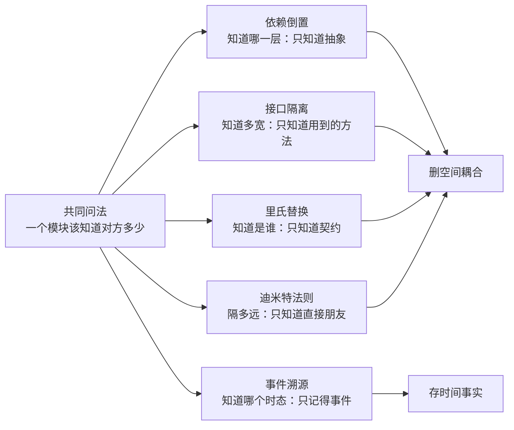
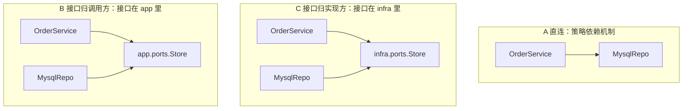
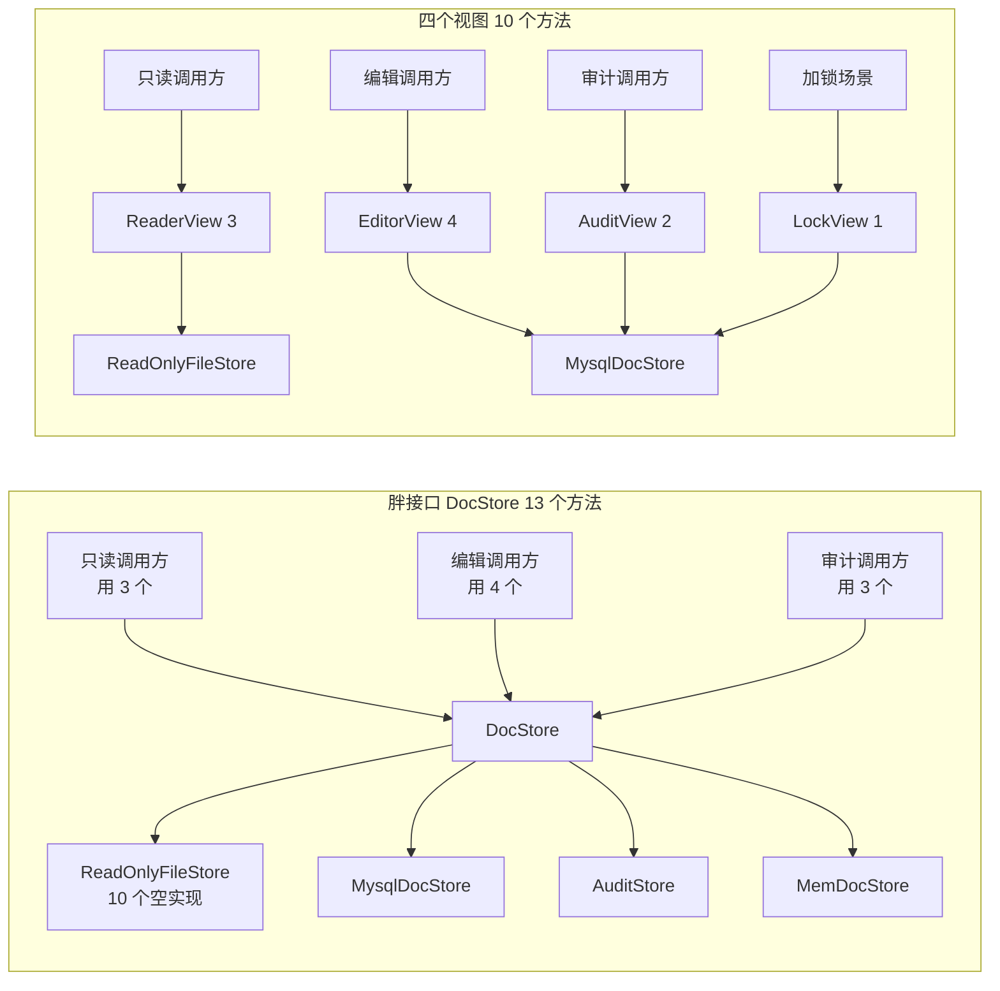
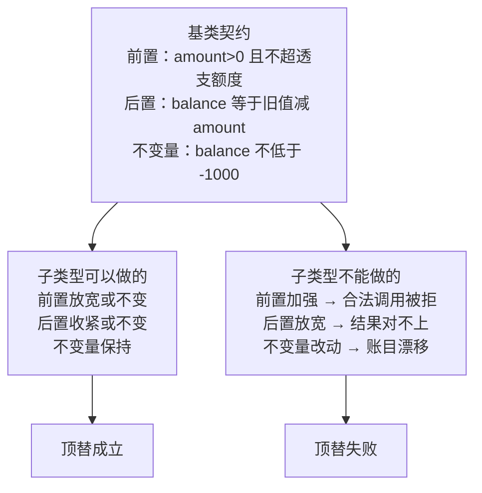
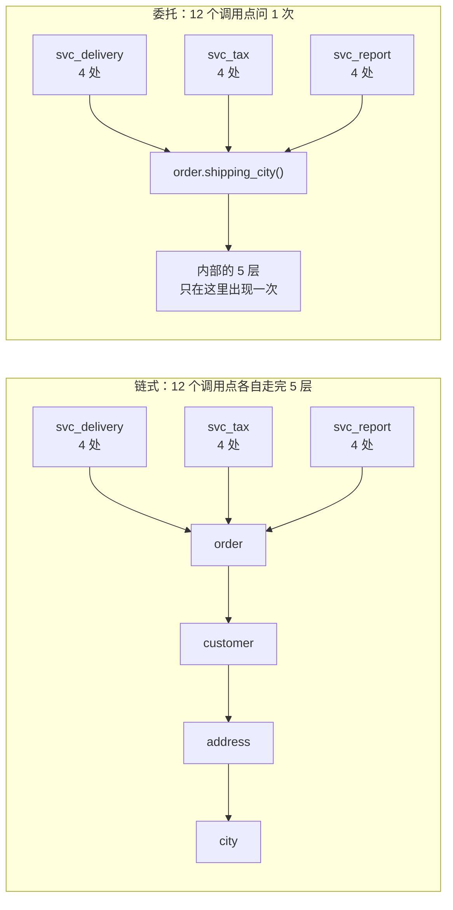
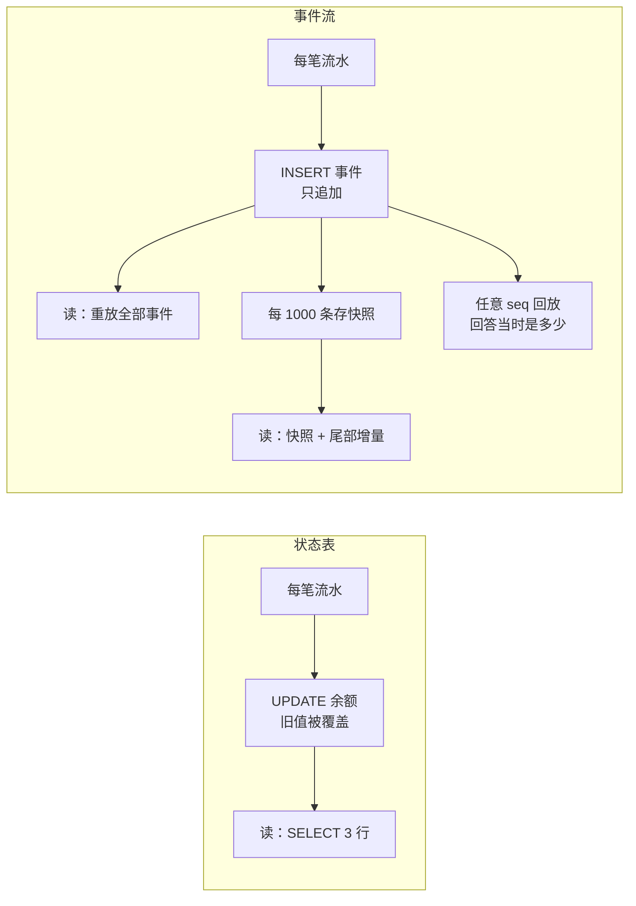

依赖倒置、接口隔离、里氏替换、迪米特法则、事件溯源。前四条是同一个问题的四种切法：一个模块到底该知道另一个模块的多少东西。第五条看着不像一伙的，它把「知道」换成了「记住」。

- **依赖倒置**管方向：高层不该 import 低层，两边都朝抽象看齐，而抽象归调用方所有；
- **接口隔离**管宽度：调用方只该看见自己用到的那几个方法，不该看见实现方的全部能力；
- **里氏替换**管身份：调用方只按父类的契约写代码，换成哪个子类都得照旧能跑；
- **迪米特法则**管距离：一行代码里不该出现从 A 走三步才到 D 的路径；
- **事件溯源**管时间：不存「现在是什么」，存「发生过什么」，现在的样子由事件算出来。

前四条都在删知识，第五条反着来，主动多存一份。不矛盾：前四条删的是空间上的耦合，第五条留的是时间上的事实，而事实这种东西，删掉以后就再也算不出来了。



五组数字都是本机实跑，Python 3.13.14 与 SQLite 3.53.1，脚本和固化输出在 `.workbuddy/_tmp_princ13/`。第三组是 2000 组随机样本，其余四组是真实文件、真实模块与真实数据库。

## 一、依赖倒置

1996 年 Robert Martin 在 C++ Report 的专栏里写下 Dependency Inversion Principle，几年后 Michael Feathers 把这五条的首字母凑成 SOLID。触发点很具体：1980 年代末的图形工具包，Motif 一类的 API 形状直接决定了业务代码怎么写，换一套界面库等于把上层重写一遍。Martin 举的例子更朴素：一个策略模块直接调用底层机制，机制一改，策略跟着改，而策略本该是最稳定的那一层。

传统分层的依赖是单向向下的：策略 import 机制，机制 import 平台。编译期的箭头从上往下走，于是所有变化都从下往上顶。倒置不是把箭头画反过来，而是在中间插一个抽象，让两边都指向它。

难办的地方在 import 那一行，不在调用的时候。app 直接 import infra，infra 的任何形状变化都会落到 app 头上；更要紧的是 app 没法脱离 infra 被验证。本机没有 MySQL，那三个断言的单测一条都跑不起来。这不是「测起来麻烦」，是根本测不了。

**本质一句话：依赖倒置不是「加一个接口」，而是把抽象的所有权交给需要它的那一侧；方向由 import 语句决定，不是由类图上的虚线决定。**



三个版本实现同一段业务：按用户汇总有效订单金额，再下一单。A 直连；C 有接口，但接口定义在 `infra/ports.py`；B 也有接口，接口定义在 `app/ports.py`，infra 反过来 import app。先看不连数据库时单测能跑几条：

```text
  一、本机单测（不连 MySQL，注入内存替身，3 个断言）
    A 直连          通过 0/3   ConnectionRefusedError: mysql 127.0.0.1:3306 -> timed out
    C 接口归实现方  通过 3/3
    B 接口归调用方  通过 3/3
```

A 的三个断言全部倒在构造函数上，因为 `OrderService` 自己去 new 一个 `MysqlRepo`，没有可以插进去的口子。C 与 B 都能把内存替身塞进去。接着把存储换成内存实现，看 app 包被改了几行：

```text
  二、换实现：MySQL -> 内存
    A 直连          app 改 2 行 / 装配改 0 行 / 改后通过 3/3
    C 接口归实现方  app 改 0 行 / 装配改 2 行 / 改后通过 3/3
    B 接口归调用方  app 改 0 行 / 装配改 2 行 / 改后通过 3/3
```

到这一步，C 和 B 打平。C 常常被当成「做了倒置」的样板：接口有了，依赖注入有了，单测也能跑。差别要在第三组才露出来。让 infra 团队把两个模块挪进子包 `infra/storage/`，app 没收到通知：

```text
  三、infra 重组：mysql_repo.py 与 ports.py 挪进 infra/storage/（app 未收到通知）
    A 直连          import 断裂 —— ModuleNotFoundError: No module named 'infra.mysql_repo'    修复需改 app 1 行
    C 接口归实现方  import 断裂 —— ModuleNotFoundError: No module named 'infra.ports'         修复需改 app 1 行
    B 接口归调用方  import 照旧                                                               修复需改 app 0 行
```

C 断得和 A 一样难看。它多出来的那个接口确实解决了可替换性，可 `app/service.py` 第一行仍然写着 `from infra.ports import ...`。app 还是得知道 infra 长什么样。把三条 import 边数出来更清楚：

```text
  四、结构与体量
    版本            app->infra 边   infra->app 边   抽象定义在        有效代码行
    A 直连          1               0               无                43
    C 接口归实现方  1               0               infra/ports.py    60
    B 接口归调用方  0               1               app/ports.py      58
```

B 那一行 `infra->app` 是 1，方向真的反过来了。学费是 15 行代码（43 到 58），买的东西是三件事：单测不需要数据库、换实现不动 app、infra 自己重组也不动 app。

**边界与反例**

- **不是每个边界都值得插抽象。** 纯计算模块、工具函数、只在进程内用一次的胶水，加一层 Protocol 只多一次跳转和一页文档，换不回任何东西。
- **抽象归调用方的前提是「调用方能改」。** 第三方闭源 SDK 你改不动，只能在中间写适配器，那层适配器就是你的抽象，它归你，不归厂商。
- **过度倒置会长出一堆 mapper。** 每层一个端口，A 的 DTO 到 B 的 DTO 再到 C 的 DTO，转换代码比业务代码长。倒置的价值在「隔离变化」，不在「层数多」。
- **最常见的是 C，而且最难自查。** 接口有了，测试过了，架构评审也能过，方向一步没动。判断方法只有一条：把 infra 的模块挪个位置，看 app 断不断。
- **反例：用依赖注入框架代替倒置。** 容器能注入任何东西，包括具体的 `MysqlRepo`。注入并不改变谁 import 谁，只改变了谁 new 谁。

## 二、接口隔离

同一个 1996 年，Martin 另一篇专栏写 Interface Segregation Principle。源头是施乐的打印系统：打印、装订、传真共用一套 Job 抽象，任何一台设备的接口改动都要触发整个系统的重新编译与重新部署。他的观察是，一个「什么都能做」的接口把所有实现者绑在了一起，改动的影响面等于所有实现者的并集。

道理不复杂。接口是所有实现者共同签署的契约，方法越多，最小实现者被迫写的空实现越多。空实现既不能用，也不能删，还会在运行时把「不支持」变成异常。那行异常写在别人的调用路径上。

**本质一句话：接口的粒度由「一个调用方要用多少」决定，不是由「一个实现方能做多少」决定。**



同一份文档存储，两个版本。胖接口 `DocStore` 13 个方法，四个实现类；小接口版本切成 `ReaderView`、`EditorView`、`AuditView`、`LockView`，合计 10 个方法，同样的四个实现。三个调用方加一个加锁场景各有分工，只读的那个真的只用三个方法。

```text
  一、面宽（调用方在接口上能看到的方法）
    形态                抽象方法总数  只读调用方看到的  多出来的
    胖接口 DocStore     13            13                10
    四个小接口          10            3                 0

  二、只读实现被迫写的空实现
    形态                只读实现里的空实现数  为什么还有这么多
    胖接口 DocStore     10                    13 个方法减去真用的 3 个
    四个小接口          0                     ReaderView 里只有 3 个要写
```

面宽 13 对 3。只读调用方在补全列表里能看到 13 个方法，其中 10 个它永远不该调。接口宽的直接代价不在性能，在注意力——调用方得在 13 个名字里认出自己能用的 3 个，认错就是运行时异常。空实现 10 个：`ReadOnlyFileStore` 的存在意义是「文件只读」，可它被迫声明 10 个 `NotImplementedError`，每个都写着「这个角色不支持」。

然后做一次很常见的改动：给接口加一个导出 PDF。

```text
  三、给接口加一个 export_pdf
    形态                加之前          加之后          起不来的实现
    胖接口 DocStore     4/4 可实例化    0/4 可实例化    4 个：ReadOnlyFileStore,MysqlDocStore,AuditStore,MemDocStore
    四个小接口          4/4 可实例化    2/4 可实例化    2 个：MysqlDocStore,MemDocStore

  四、只读调用方误调 purge()，测试能不能拦住
    形态                替身                      结果
    胖接口 DocStore     MagicMock(spec=DocStore)  放过了
    四个小接口          手写 FakeReader           拦住了
```

加一个导出方法，四个实现类全部 `TypeError` 起不来——包括那个只读文件存储，也包括审计存储。加方法的人根本不知道 `AuditStore` 这个类存在，可它照样被拖下水，因为 ABC 的新抽象方法对所有子类生效。切成视图之后只有声明了 `EditorView` 的两个类受影响，只读实现一行都不用改。

第四组更值得琢磨。`MagicMock(spec=DocStore)` 放过了误调 `purge()` 的只读调用方。spec 只检查属性存在，而胖接口上什么属性都存在，替身比被测代码还宽容。手写的 `FakeReader` 只有三个方法，误调当场 `AttributeError`。**接口宽，替身也宽，宽到拦不住错。**

体量上窄接口反而更短：174 行对 108 行，省下的正是那 10 个空实现。

**边界与反例**

- **切太碎的账单在装配侧。** 一个 `MysqlDocStore` 要实现四个接口，调用方要注入四个对象。角色视图的数量应该等于调用方角色的数量，不是方法分组的数量。
- **共用视图不要拆。** 三个调用方都只用 `list_docs` 和 `read_doc`，那是同一个视图。为了「一人一个接口」复制三份，是把隔离做成了仪式。
- **语言差异很大。** Go 在调用方一侧定义接口，天然按使用者切；Java、C# 要显式 `implements`，切细了就得在类名后面堆一列接口；Python 的 `Protocol` 接近 Go 的隐式满足。
- **别为未来的调用方预切。** 四个视图里如果只有一个真被两个以上调用方用到，其余三个是预付，和第十二章那条 YAGNI 是同一笔账。
- **反例：把「接口隔离」做成「一个实现一个接口」。** 那只是把类改名成接口，调用方该知道的一个没少。

## 三、里氏替换

1987 年 OOPSLA 的主题演讲，Barbara Liskov 给了子类型一个行为定义：对每个 S 类型的对象 o1，如果存在 T 类型的对象 o2，使得所有按 T 写的程序 P 在把 o1 换进去之后行为不变，那么 S 是 T 的子类型。1994 年她与 Jeannette Wing 把这句直觉写成了前置、后置与不变量的约束。

这句话读起来像同义反复，落到代码上很具体：前置条件只能放宽或不变，后置条件只能收紧或不变，父类的不变量必须保持。多态的全部价值都建立在「调用方只按父类契约编程」上，子类一旦在契约之外加了条件，按父类写好的代码就会在运行时失败，而且失败发生在别人的模块里，堆栈上还看不到子类的名字。

**本质一句话：子类型不是长得像，而是能顶替：前置只能放宽或不变，后置只能收紧或不变，不变量必须保持。**



一个账户族。基类 `Account` 约定：前置 `amount > 0` 且 `amount <= balance + 1000`（透支额度），后置 `balance == 旧值 - amount` 且 `balance >= -1000`。四个子类各做一种改动：`AuditedAccount` 多记一条流水（合法），`NoOverdraftAccount` 不许透支（加强前置），`RoundingAccount` 余额取整（放宽后置），`FeeAccount` 收 0.5% 手续费（改不变量）。2000 组随机样本，种子固定：

```text
  实现                  合法调用被拒  后置不符    不变量破坏    判定
  Account 基类          0             0           0             基准
  AuditedAccount        0             0           0             可以顶替
  NoOverdraftAccount    320           0           0             前置被加强
  RoundingAccount       0             1158        0             后置被放宽
  FeeAccount            0             1168        2             不变量被改
```

`NoOverdraftAccount` 拒掉了 320 组调用。这 320 组在基类上全部合法。调用方没做错任何事，是子类擅自把「可以透支一千」改成了「不可以透支」。`RoundingAccount` 连不变量都没破坏，只是返回值被取整，1158 组与基类的等式对不上。`FeeAccount` 只有 2 组跌破透支额度，数字最小，可这类最难查：账面上差几分钱，要到审计才浮出来。

真正值得看的是第二张表。把基类自带的 5 条手写用例原样套到子类上：

```text
  基类的 5 条用例原样套到子类上
  实现                  通过    失败项
  Account 基类          5/5     无
  AuditedAccount        5/5     无
  NoOverdraftAccount    4/5     取到透支上限（ValueError）
  RoundingAccount       5/5     无
  FeeAccount            2/5     取 100 后余额减 100（得到 399.5）；取到透支上限（得到 -1005.0）；取 33 元余额为 467（得到 466.835）
```

5 条用例只抓住两个。`RoundingAccount` 5/5 全过，随机样本挂 1158 组，因为手写用例挑的金额都是整数，取整对它没有影响。**用你自己的测试集当判据，判据的密度就决定了你能发现多少违背。** 5 条覆盖的是常见路径，抓不到取整、精度、边界这种类型的偏差。

判据可以更密一点。把基类的用例换成属性测试：随机生成余额与金额，只断言契约里的前置、后置与不变量，不写死具体数字——上面那 2000 组样本就是这么来的，它抓到三个子类，而手写用例只抓到两个。差别不在断言写得对不对，在覆盖的形态。手写用例天然挑整数和常见值，随机样本会撞到取整与边界，恰恰是子类最容易越界的地方。再进一步，可以把前置条件写成运行时可检查的守卫（`assert` 或显式的 `if + raise`），让调用的那一刻就报错，而不是等对账时发现少了几毛钱。

**边界与反例**

- **LSP 只管「按父类契约使用」的场景。** 如果调用方显式 `isinstance` 分支，那已经不算替换，算分类，规则不适用。
- **实现继承与子类型是两件事。** 为了复用代码去继承，LSP 就会和 DRY 打架：复用要求共享实现，LSP 要求行为兼容。冲突时正确答案是组合，不是把契约解释得松一点。
- **语言几乎帮不上忙。** Java 的 `@Override` 查签名不查语义，Python 连签名都不查，TypeScript 的结构类型也只比字段。可执行判据只有一条——把父类的测试套件原样跑在子类上。
- **经典反例有两个。** 正方形继承矩形（`setWidth` 之后 `setHeight` 的语义变了），不可变集合继承可变集合（`add` 从「总是成功」变成「总是抛异常」）。
- **反例：把 LSP 理解成「子类可以覆盖任何方法」。** 覆盖是语法允许，顶替是行为要求。能编译和能替换是两件事。

## 四、迪米特法则

1987 年东北大学的 Demeter 项目，Karl Lieberherr 与 Ian Holland 1989 年在 IEEE Software 上写了 Assuring Good Style for Object-Oriented Programs。原始规则比后来流传的版本硬得多：一个方法只该调用自己的字段、自己的参数、自己创建的对象，以及这些对象的字段，不许顺着返回值一路点下去。项目组当年的口号是「一个点就够」，名字取自希腊神话里的农神。

道理同样朴素。链式取值把整条对象路径写进了调用方，中间任何一环改名、拆分、变懒加载、加一层缓存，调用方全断——而且断在运行时。同一份路径还会在每个调用点重复一遍，包括重复的判空。判空写一次是防御，写十二次是债。

**本质一句话：一个方法只该知道自己的参数、字段和自己创建的对象；它不该知道从 A 怎么走到 D。**



12 个调用点，分属 3 个服务（配送路由、税费计算、报表），取的都是同一个城市字段。两个版本：链式写 `order.customer.address.city.name.upper()`，委托版在 `Order` 上加一个 `shipping_city()`。

```text
  形态                      最长属性链    判空语句    判空里的属性访问  Order 的方法数
  链式 order.customer.address.city  5             12          72                2
  委托 order.shipping_city()        1             0           0                 3
```

链式最长 5 层：`order.customer.address.city.name` 是四个属性访问，末尾的 `.upper` 也算一层，所以是 5。判空语句 12 条，判空里 72 次属性访问。委托版 1 层，调用方一侧零判空。

然后是那次重构：城市从 `Address` 挪到 `Customer`。真实场景里这种改动很常见：地址被拆成省市区，城市变成客户级默认值。

```text
  一、重构前：12 个调用点全部正常
  chain       CALLS 12 OK 12 ERR 0
  delegate    CALLS 12 OK 12 ERR 0

  二、重构后：城市从 Address 挪到 Customer
  链式        CALLS 12 OK 0 ERR 12
              ERRLIST 12 处：carrier_code,hub_name,route_label,...
              按 12 处逐一手改（共 24 行）后：CALLS 12 OK 12 ERR 0
  委托        CALLS 12 OK 12 ERR 0
```

链式 12 个调用点全挂，逐一手改 24 行（每处两行：判空和取值）。委托版一处没动，因为它只知道「问 Order 要城市」，不知道城市原来住在 Address 里。

账单在表格最后一行：`Order` 的方法数从 2 涨到 3。一个方法不算什么，问题是它随「调用方要的投影种类」线性长。3 个服务各要两种字段，`Order` 就长 6 个转发方法；30 个字段就是 30 个 getter，`Order` 变成 `Address` 的镜像。**深度换成了宽度。** 迪米特法则没有让知识消失，它把 12 处的一份知识收进 1 处，从 72 次属性访问降到 Order 内部的 6 次，压缩是真的，消失是假的。

「朋友」的边界值得再划一次。参数、自己的字段、自己 new 出来的对象，这三类可以直接点；从参数再往外走一层，就已经越界。实际项目里最常见的违例不是 `a.getB().getC()` 这种教科书形态，而是 DTO 拼装：把七八个对象的字段拉进一个响应体，每行跨三四层，散在十几个 handler 里。写的时候毫无痛感，等上游改了字段名，报错只有一句 `AttributeError` 和一个看不出所以然的行号——排查时间全花在还原那条路径上。

**边界与反例**

- **转发方法要有人管。** 投影种类超过五六个时，该考虑返回一个只读视图对象，而不是继续往 `Order` 上贴方法。否则你只是把「什么都懂的调用方」换成了「什么都懂的上帝类」。
- **贫血模型下这条规则很别扭。** 逻辑都在 service 里，service 手里只有数据对象，只能顺着点下去。真正的解法是让数据和行为待在一起，不是给 DTO 加一层转发。
- **纯数据结构不受这条管。** Martin 的区分是：对象暴露行为，数据结构暴露数据。对 DTO、JSON、DataFrame 要求迪米特，是把两类东西混成一类。
- **流式 API 天然违反。** `records.stream().filter().map().collect()` 一节三个点，但那是同类型连续变换，链不会跨对象图，风险完全不同。
- **反例：为了合规把 30 个 getter 塞进 Order。** 等于把 `Address` 整个搬过来，还多一层间接：宽度爆了，深度一点没省。

## 五、事件溯源

这个术语 2005 年前后由 Greg Young 提出，Martin Fowler 同年 12 月写了篇同名文章把它讲开。思想比名字老得多：复式记账的账本从来只追加、不修改，任何时点的余额都是把流水加起来；数据库的 audit log 也是同一个思路，只不过它旁挂在主表外面，主表仍然是唯一真相。DDD 社区后来把事件溯源和聚合、限界上下文绑在一起，才成了今天这套工程做法。

它要解决的是一个当前状态表答不出的问题：怎么变成现在这样。对账、追责、复盘、给监管看，问的都是「当时是多少」。状态表只存「现在」，这类问题只能靠另外维护一份审计日志；而审计日志和状态表是两份真相，写入路径一多，它们必然不一致。事件溯源把两份合成一份：状态不再存，由事件算。

**本质一句话：不存「现在是什么」，存「发生过什么」；当前状态是事件流的折叠结果，任何时点都能重算出来。**



两个 SQLite 库，同一批 10 万笔流水，3 个账户，存取大致抵平、每十笔收一次手续费。一个库写 `accounts(balance)`，每笔 UPDATE；另一个库写 `events(seq, account, kind, amount)`，只 INSERT。

```text
  一、写入 100000 笔
  形态            语句                  耗时        文件体积
  状态表          100000 条 UPDATE      117 ms      12 KB
  事件流          100000 条 INSERT      96 ms       2528 KB
```

事件流反而写得更快一点，追加只写页尾，更新要在三个页上反复改。代价在体积：2528 KB 对 12 KB，两百倍。这不是浪费，是它买下的东西：每一个中间状态。事件一旦写下就不再修改——这既是可回放的前提，也是后面所有麻烦的源头。

```text
  二、读当前余额
  形态                读了多少行      耗时          余额 A / B / C
  状态表              3               5 微秒        3138.05 / 3158.80 / 3158.80
  事件流全量重放      100000          64252 微秒    3138.05 / 3158.80 / 3158.80
  事件流 + 快照       快照后 1000 条  706 微秒      3138.05 / 3158.80 / 3158.80
                      99 个快照，建一遍 116 ms
```

5 微秒对 64252 微秒，一万倍。这是事件溯源最硬的一笔账，谁也绕不过去。快照把它拉回 706 微秒，代价是 99 个快照、建一遍 116 ms，用一次性的写换每一次读。注意快照没有让读便宜到和状态表一个量级，三者的排序一直是状态表、快照、全量重放。

```text
  三、问「第 50000 笔办完时余额是多少」
  状态表            答不出。旧值已被覆盖，只剩当前值 3138.05 / 3158.80 / 3158.80
  事件流            回放 50000 条，36968 微秒，余额 1598.15 / 1598.15 / 1566.65
```

第三组是这条原则存在的全部理由。状态表不是慢，是那个值已经不存在了，它被后来的九万次 UPDATE 盖掉了。事件流回放五万条，37 毫秒，给出当时那个数。对账、纠纷、监管问询要的都是这个数。

后两组是账单，写得比前几章的账单更难看。

```text
  四、新版本要一个 currency 字段
  旧事件条数        200
  直接读新字段      200 条 KeyError，严格折叠器当场停摆
  补默认值再折叠    200 条记成 CNY——这个值在当年并不存在
  只跳过不补值      余额比补默认值少 52.00，账对不上

  五、一条删除请求
  状态表            1 条 DELETE，A 的行剩 0 条，原值不在了
  事件流            追加 1 条 erased，A 的事件还有 33335 条，原值仍在磁盘上
```

给事件加一个字段，200 条老事件全缺。补默认值能跑通，但那等于给历史事件编了一个当年不存在的属性：读出来的报表上有 `currency=CNY`，而当时那笔钱根本没有币种这个概念。只跳过不补，余额少 52 元，账对不上。两条路都不干净，这就是为什么事件的 schema 必须当成公开 API 对待：它一旦写下去就冻结了。

删除更直接。状态表一条 DELETE 就结束，事件流只能追一条 `erased`，原值还在磁盘上那三万三千多条事件里。GDPR 那类「删除权」和「不可变事件流」天生冲突，常见解法是加密后丢弃密钥，可那已经是另一笔工程预算。

**边界与反例**

- **读模型要单独建。** 纯粹的事件流读不动，实践中都是事件流加投影（CQRS），投影挂了要能从事件流重建，这也是投影必须无副作用的理由。
- **事件不是消息。** 事件流要有全局顺序（seq）、要能重放、消费者要幂等，缺一样就会在重建时算错。把它当消息队列用，等于放弃了它唯一的长处。
- **不适合 CRUD。** 表单型应用没有「当时是多少」的问题，上事件溯源只拿到读放大和 schema 冻结两笔账。
- **快照不是优化项，是必需品。** 10 万事件 64 ms，1000 万事件就是 6.4 秒，没有快照的读路径在生产上不可用。
- **事件版本要显式管。** 每条事件带 schema 版本，折叠器按版本分支，比事后猜字段可靠得多。

## 六、横向对照

| 原则 | 对知识做了什么 | 账单付给谁 | 一句话判据 | 什么时候不该用 |
|------|----------------|------------|------------|----------------|
| 依赖倒置 | 删掉「高层知道低层是谁」 | 多一层抽象，抽象的定义权归调用方 | 这个接口是谁在改：调用方，还是实现方 | 纯计算、一次性胶水、改不动的第三方 |
| 接口隔离 | 删掉「调用方看见用不到的方法」 | 接口数量与装配复杂度 | 这个调用方实际用到几个方法，占几成 | 多个调用方共用同一视图、只有唯一调用方 |
| 里氏替换 | 删掉「调用方知道是哪个子类」 | 继承不能拿来复用代码 | 把子类塞进父类的测试，挂几个 | 调用方显式分类型、纯实现复用 |
| 迪米特法则 | 删掉「从 A 走到 D 的路径」 | 转发方法把深度换成宽度 | 这一行里有几个点，跨了几个对象 | 纯数据结构、同类型流式变换 |
| 事件溯源 | 反过来，多存一份「发生过什么」 | 读放大、schema 冻结、删除变难 | 你需要回答「当时是多少」吗 | 表单型 CRUD、无审计需求 |

| 五条原则 | 一句话判据 |
|----------|------------|
| 依赖倒置 | 把实现挪个位置，上层会不会断 |
| 接口隔离 | 最小实现者被迫写几个空实现 |
| 里氏替换 | 父类的测试套件跑在子类上，挂几个 |
| 迪米特法则 | 这一行里跨了几个对象 |
| 事件溯源 | 上周三的余额，你答得出来吗 |

🐾 **小结**：这一章的五条原则，四条在删，一条在加，落到根上是同一个问题：一个模块该知道对方多少。

依赖倒置管的是方向。同一个业务的三版实现，单测通过数 0/3、3/3、3/3 只能区分「有没有可注入的口子」，区分不了方向。把 infra 的模块挪进子包，直连版和「接口归实现方」版同时 `ModuleNotFoundError`，只有接口归调用方的那版 import 照旧。差异体现在边数上：app 到 infra 的 import 边，1、1、0。多出来的 15 行代码买的是这条边归零——方向反了，剩下的才是可替换。

接口隔离管的是宽度。13 个方法的胖接口，只读实现被迫写 10 个空实现，只读调用方的补全列表里也有 13 项。加一个导出方法，四个实现类全部起不来，包括加方法的人根本不知道存在的那个。切成四个视图之后只影响两个，体量还从 174 行降到 108 行——空实现不用写，代码自然短。最刺眼的是测试：`MagicMock(spec=DocStore)` 放过了误调 `purge()` 的调用方，因为宽接口的替身也宽。

里氏替换管的是身份。2000 组随机样本下，加强前置的子类拒掉了 320 组合法调用，放宽后置的子类有 1158 组与基类等式不符，改不变量的那个只有 2 组踩线，数字最小，最难查。而基类自带的 5 条手写用例只抓住两个，取整那个 5/5 全过。判据不够密，等于没有判据。

迪米特法则管的是距离。12 个调用点各写一遍五层路径，就多出 12 条判空、72 次属性访问。城市从 Address 挪到 Customer，链式全挂、逐一手改 24 行，委托版一处没动。账单是 `Order` 从 2 个方法涨到 3 个，并且会随投影种类线性增长：深度换宽度，知识从 12 处收进 1 处，压缩是真的，消失是假的。

事件溯源管的是时态。十万笔流水，状态表 12 KB、读一次 5 微秒，事件流 2528 KB、全量重放 64 毫秒，快照压到 706 微秒。问「第 5 万笔办完时余额多少」，状态表答不出。不是慢，是那个值不存在了。代价写在最后：加一个字段，200 条老事件全缺，补默认值等于改写历史，跳过则少算 52 元；一条删除请求，原值还躺在三万三千条事件里。

回头看，前四条的判据都能落成一个动作：挪一下实现看上层断不断、数一数最小实现者写了几个空实现、把父类测试跑在子类上、数这一行跨了几个对象。事件溯源没有这种便宜动作，它要求你先回答一个业务问题：你到底需不需要知道「当时」。

---

**相关阅读**：
- [计算机原则五讲（十二）：省下的开销算在谁账上](/posts/princ-chapter-12/)
- [计算机原则五讲（十一）：状态归谁管](/posts/princ-chapter-11/)
- [计算机原则五讲（八）：同一份东西该存在几处](/posts/princ-chapter-08/)
- [计算机原则五讲（四）：把没说出口的约定写下来](/posts/princ-chapter-04/)
- [计算机原则五讲（二）：故障发生时还剩什么保证](/posts/princ-chapter-02/)
- [Python typing 协议与泛型深度解析](/posts/7ed059a9/)
- [Pipeline 模式：流水线架构的设计与实现](/posts/pipeline-pattern/)
