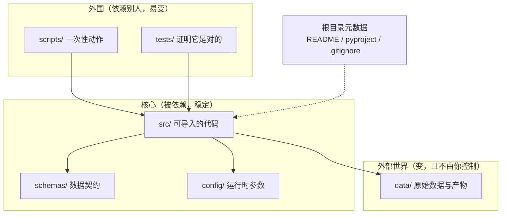
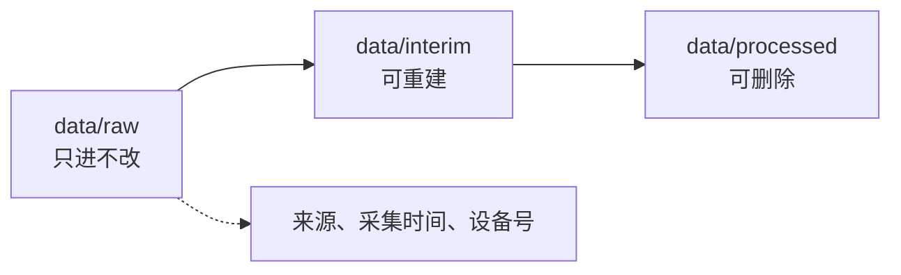

`git init` 之后面对的是一个空目录。接下来的几个小时里，同一个问题会反复出现：**这个文件放哪？**

多数人靠感觉回答。代码放 `src`，测试放 `tests`，剩下的——配置、脚本、数据、校验规则——就地新建一个文件夹，名字取当下最顺口的那个。三个月后回头看，根目录躺着 `temp/`、`new/`、`old_new/`、`utils2/`，没人说得清哪个还活着。

这一篇不讨论某一个文件，而是先给整棵树定形状：一个项目该有哪十个位置，每个位置回答什么问题，位置放错的后果是什么。形状定下来，后面每一处细节才有地方落。

## 一、按文件类型分，是最容易走的那条路

最容易想到的分法是按扩展名：所有 `.py` 放一起，所有 `.json` 放一起，所有 `.csv` 放一起。看起来整齐：

```text
project/
├── py/
│   ├── io.py
│   ├── validate.py
│   └── cli.py
├── json/
│   ├── config.json
│   ├── schema.json
│   └── package.json
└── csv/
    └── 2026-11-08.csv
```

这个结构在第一天是舒服的，第二天开始出问题。改一个「导入功能」，要同时动 `py/io.py`、`json/config.json`、`core/`；打包时说不清哪些该进安装包；新人 clone 下来，第一眼看到的是三种文件格式，而不是这个项目在干什么。

**文件类型回答的是「它是什么」，位置要回答的是「它归谁管」。** 这两件事不是一回事。一个 `.json` 可能是配置、可能是校验规则、可能是测试快照，它们的变化频率、生命周期、该不该进版本库完全不同，唯一共同点是后缀相同。

## 二、树的形状由依赖方向决定

换一个分法：不按「是什么」，按「谁依赖谁」。



这张图的读法：箭头指向被依赖的一方。`scripts` 依赖 `src`，`tests` 依赖 `src`，`src` 读 `schemas` 和 `config`，`src` 读写 `data`。反向不成立——`src` 不能 import `scripts` 里的任何东西，也不该 import `tests`。

依赖方向一旦画出来，位置的规则就自动出现了：

- **被依赖的靠近核心，依赖别人的放在外围。** `src` 是最稳定的一层，改动它要过测试；`scripts` 随时可以重写，删掉也不影响别人。
- **只被读的放在边缘。** `data` 和 `config` 是被读的一方，它们不该 import 任何代码。
- **声明性的东西放根。** `README`、`pyproject.toml`、`.gitignore` 描述的是整个仓库，不属于任何一个子目录。

## 三、十个位置

按这个形状铺开，一个能长期活下去的项目树长这样。这是本文实验用的 `dustlog`（环境采样数据归档）的真实结构，`find` 出来的，不是画的：

```text
dustlog/
├── README.md
├── pyproject.toml
├── .gitignore
├── config/
│   ├── default.toml
│   └── local.toml.example
├── data/
│   ├── raw/
│   ├── interim/
│   └── processed/
├── schemas/
│   └── sample.schema.json
├── scripts/
│   └── import_day.py
├── src/
│   └── dustlog/
│       ├── __init__.py
│       ├── cli.py
│       ├── io.py
│       ├── store.py
│       └── validate.py
└── tests/
    ├── fixtures/
    │   └── sample.csv
    └── test_validate.py
```

十个位置，每个回答一个具体问题：

| 位置 | 回答的问题 | 判断依据 |
| --- | --- | --- |
| `pyproject.toml` 的 `name` | 这棵树叫什么 | 名字要同时是 import 名、发行名、命令名 |
| `README.md` | 别人凭什么在三十秒内知道这是什么 | 根目录唯一给人看的入口 |
| `pyproject.toml` 的依赖表 | 需要什么才能跑起来 | 声明范围，锁定文件定确定值 |
| `.gitignore` | 什么不属于这个仓库 | 可重建的、含密钥的、体积大的一律忽略 |
| `src/dustlog/` | 哪些代码可以被 import | 可导入的代码只有这一处 |
| `data/` | 原料和产物放哪 | 在根，不进安装包 |
| `schemas/` | 什么算合法数据 | 独立成目录，比任何一份数据活得久 |
| `config/` | 环境差异怎么表达 | 默认值进库，本地覆盖不进库 |
| `scripts/` | 一次性动作放哪 | 可执行、不可 import |
| `tests/` | 怎么证明它是对的 | 目录镜像源码结构 |

下面逐条说清楚「为什么在这个位置」，不展开细节。

**项目名**放在元数据里，同时决定 `src/` 下那层目录叫什么。三处必须同形，否则 import、安装、命令行三者对不上。

**项目说明**是根目录唯一的散文文件。它不该讲架构，该讲三件事：这是什么、怎么装、怎么跑。其他内容都属于 `docs/`。

**依赖清单**跟项目名住在同一个文件里（`pyproject.toml` 的 `dependencies`），因为它和名字一样属于「项目身份」。哪些是直接依赖、哪些是传递依赖、锁定在哪，是另一个精度问题，位置不变。

**`.gitignore`** 在根，且它声明的是仓库边界，不是屏蔽名单。写进去的每一条都意味着「这个路径不属于版本库」。

**核心源码包**放在 `src/<name>/`，只有这里的东西能被 import。`src` 这一层的作用是把「工作区里的代码」和「安装后的代码」分开，避免 import 时说不清加载的是哪一份。

**数据存储目录**在根，分三层：`raw/` 原样保存、只进不改；`interim/` 中间结果，可重建；`processed/` 最终产物，可删除。三层分开的价值在于——任何时候都能从 `raw/` 重跑出后面两层。



**数据验证依据**（schema、校验规则、字段定义）单独成目录 `schemas/`。它和数据的关系是「规则约束数据」，不是「规则属于某份数据」。把 schema 放进 `data/` 的后果很直接：数据被清理时，规则一起消失。

**配置**在 `config/`，拆成两份：`default.toml` 进库，是可运行的默认值；`local.toml` 不进库，装本机差异。`local.toml.example` 进库，作为模板。

**脚本包**在 `scripts/`，装的是「跑一次就完」的动作：批量导入、数据迁移、一次性修复。它不属于源码包，因为它不被 import，也不该被 import。

**测试包**在 `tests/`，目录结构镜像 `src/`：`src/dustlog/validate.py` 对应 `tests/test_validate.py`。测试数据放 `tests/fixtures/`，那是测试的输入，不是项目的数据。

## 四、四个判据

十个位置看着多，判断只需要四个问题。任何一份新文件进来，问完这四个就有答案：

**一、它是输入还是产出？** 产出物（构建产物、日志、中间结果）不该进版本库。

**二、它随代码变，还是随环境变？** 随环境变的东西（本机路径、密钥、端口）不能硬编码进库。

**三、删掉它，能不能重建？** 能重建的忽略，不能重建的必须进库。

**四、它会不会被别人 import？** 会被 import 的只有 `src/`，其他都是「被执行的」或「被读的」。

把这四问套到十个位置上，得到一张完整的归属表：

| 位置 | 输入/产出 | 变化频率 | 可重建 | 被 import | 进版本库 | 进安装包 |
| --- | --- | --- | --- | --- | --- | --- |
| 核心源码 | 产出 | 随代码 | 否 | 是 | 是 | 是 |
| 项目说明 | 输入 | 很少 | 否 | 否 | 是 | 否 |
| 依赖清单 | 输入 | 偶尔 | 否 | 否 | 是 | 是（元数据） |
| `.gitignore` | 输入 | 很少 | 否 | 否 | 是 | 否 |
| `data/raw` | 输入 | 每天 | 否 | 否 | 否 | 否 |
| `data/interim` | 产出 | 每次跑 | 是 | 否 | 否 | 否 |
| `data/processed` | 产出 | 每次跑 | 是 | 否 | 否 | 否 |
| `schemas/` | 输入 | 很少 | 否 | 偶尔 | 是 | 视需求 |
| `config/default` | 输入 | 偶尔 | 否 | 是（读） | 是 | 是 |
| `config/local` | 输入 | 每台机器 | 否 | 否 | 否 | 否 |
| `scripts/` | 产出 | 偶尔 | 否 | 否 | 是 | 否 |
| `tests/` | 输入 | 随代码 | 否 | 否 | 是 | 否 |

看「进版本库」和「进安装包」两列的差异——这是最容易搞混的地方。测试进库但不进包，脚本进库但不进包，配置的默认值两处都进，本机配置两处都不进。

## 五、位置放错，代价不在目录里

位置错误通常不会立刻报错。它会在打包、协作、清理这三个时刻各自收一次费。下面三个后果都是在这台机器上跑出来的。

### 后果一：数据挪进源码包，忽略规则会跨层级命中

正常的 `.gitignore` 这样写：

```text
data/raw/*
!data/raw/.gitkeep
data/interim/
data/processed/
```

规则本身没问题，`git check-ignore` 确认它精确命中原始数据：

```bash
$ git check-ignore -v data/raw/2026-11-08.csv
.gitignore:13:data/raw/*	data/raw/2026-11-08.csv
```

现在把 `data/` 挪进源码包，改成 `src/dustlog/data/`，忽略规则不改。结果：

```bash
$ git check-ignore -v src/dustlog/data/raw/2026-11-08.csv \
                    src/dustlog/data/schemas/sample.schema.json
.gitignore:13:data/raw/*	src/dustlog/data/raw/2026-11-08.csv
.gitignore:21:data/	src/dustlog/data/schemas/sample.schema.json
```

两条都被命中。注意第二条——**校验规则跟着数据一起被忽略了**。`git status` 里什么都看不到，`git add` 也不会报错，那些文件就这么从版本库里消失了。等到有人 clone 下来跑不通，才发现 schema 从来没提交过。

`.gitignore` 里不带前导斜杠的 `data/`，匹配的是任意层级的同名目录。规则是对的，位置是错的，两者相乘就是静默丢失。

### 后果二：为了让程序读到数据，只能给打包开口子

有人会想：数据放 `src` 下，至少程序运行时能读到，打包时也不会丢。

前半句对，后半句是错的。实测：把 `data/` 放进 `src/dustlog/` 后直接构建，wheel 里没有任何数据文件——打包工具默认只收 `.py`：

```bash
$ python -m build --wheel --no-isolation
...
Successfully built dustlog-0.1.0-py3-none-any.whl

$ ls -l dist/
-rw-r--r-- 1 FOX 197121 4155 dustlog-0.1.0-py3-none-any.whl
```

4155 是压缩包本体，解压后 5344 字节，与干净布局完全一致。数据被安静地留在了包外。

但程序要读数据，就得让数据进包。于是加一行声明：

```toml
[tool.setuptools.package-data]
dustlog = ["data/**/*"]
```

再构建，数据全进去了：

```text
dustlog/__init__.py
dustlog/cli.py
dustlog/io.py
dustlog/store.py
dustlog/validate.py
dustlog/data/raw/2026-11-08.csv
dustlog/data/schemas/sample.schema.json
dustlog-0.1.0.dist-info/METADATA
...
解压后总大小: 14966 字节
```

从 5344 到 14966，一天的数据（288 行）就让安装包翻了近三倍。这个口子一旦打开，每个装这个工具的人都会拿到一份别人机器上的采样数据。

**位置错了不会立刻报错，但它会逼你在后面开一扇本来不需要开的门。**

### 后果三：脚本写死本机路径，换台机器就断

`scripts/` 里放一个导出脚本，路径写成本机绝对路径：

```python
SRC = "D:/sensor-dropbox/export"
shutil.copy("data/interim/samples.jsonl", SRC)
```

在作者的机器上跑得通。同事 clone 下来，`D:/sensor-dropbox` 不存在，脚本在第一行就停住。这类问题在 `scripts/` 里尤其常见，因为脚本是「一次性的」，写的时候没人觉得需要参数化。

正确的写法是路径来自参数或配置，脚本本身只知道「相对仓库根的位置」：

```python
ROOT = Path(__file__).resolve().parents[1]
```

## 六、把判断变成检查

上面十条判据如果只写在文档里，三个月后就会被忘掉。写成脚本，每次改动后跑一遍，位置才算真正被约束。

```python
import re, sys, tomllib
from pathlib import Path

def audit(root: Path) -> int:
    cfg = tomllib.loads((root / "pyproject.toml").read_text(encoding="utf-8-sig"))
    project = cfg.get("project", {})
    rows = []

    # 1 项目名：发行名与导入名同形
    src = root / "src"
    pkgs = [d for d in src.iterdir() if (d / "__init__.py").exists()]
    got = pkgs[0].name if len(pkgs) == 1 else f"{len(pkgs)} 个包"
    rows.append(("项目名", got == project.get("name", "").replace("-", "_"), got))

    # 2 项目说明
    readme = root / "README.md"
    size = len(readme.read_text(encoding="utf-8-sig")) if readme.exists() else 0
    rows.append(("项目说明", size >= 100, f"{size} 字符"))

    # 3 依赖清单
    deps = project.get("dependencies") or []
    rows.append(("依赖清单", bool(deps) or (root / "requirements.txt").exists(), f"{len(deps)} 项"))

    # 4 .gitignore 覆盖三类产物
    body = (root / ".gitignore").read_text(encoding="utf-8-sig")
    missing = [n for n in ("build/", "__pycache__/", "data/") if n not in body]
    rows.append((".gitignore", not missing, "缺 " + ",".join(missing) if missing else "已覆盖"))

    # 5 核心源码包：代码只在 src，且只有一处
    stray = [p for p in root.rglob("*.py")
             if "src" not in p.parts and not {"scripts", "tests", "build"} & set(p.parts)]
    rows.append(("核心源码包", len(pkgs) == 1 and not stray, f"散落 {len(stray)} 个 .py"))

    # 6 数据目录：在根，不进 src
    inside = [p for p in src.rglob("data") if p.is_dir()]
    rows.append(("数据存储", (root / "data").is_dir() and not inside, f"src 内 {len(inside)} 处"))

    # 7 校验规则独立成目录，不混数据
    schemas = root / "schemas"
    files = list(schemas.glob("*.json")) if schemas.is_dir() else []
    rows.append(("数据验证依据", bool(files), f"{len(files)} 份规则"))

    # 8 配置：默认值进库，本地不进库
    ok = (root / "config" / "default.toml").exists() and "config/local.toml" in body
    rows.append(("配置", ok, f"local.toml 已忽略={'config/local.toml' in body}"))

    # 9 脚本不含绝对路径
    bad = [p.name for p in (root / "scripts").rglob("*.py")
           if re.search(r'["\'][A-Za-z]:[\\/]', p.read_text(encoding="utf-8-sig"))]
    rows.append(("脚本包", not bad, f"{len(bad)} 处绝对路径"))

    # 10 测试在根
    testpaths = cfg.get("tool", {}).get("pytest", {}).get("ini_options", {}).get("testpaths", [])
    rows.append(("测试包", (root / "tests").is_dir() and testpaths == ["tests"], str(testpaths)))

    failed = 0
    for label, ok, detail in rows:
        failed += 0 if ok else 1
        print(f"{'PASS' if ok else 'FAIL'}  {label:<8} {detail}")
    print(f"{len(rows) - failed}/{len(rows)} 项就位")
    return failed

if __name__ == "__main__":
    sys.exit(1 if audit(Path(sys.argv[1])) else 0)
```

对整齐的那棵树跑一遍：

```text
PASS  项目名      dustlog
PASS  项目说明    261 字符
PASS  依赖清单    1 项
PASS  .gitignore 已覆盖
PASS  核心源码包   散落 0 个 .py
PASS  数据存储    src 内 0 处
PASS  数据验证依据  1 份规则
PASS  配置       local.toml 已忽略=True
PASS  脚本包      0 处绝对路径
PASS  测试包      ['tests']
10/10 项就位
```

造一个错位的版本——数据挪进 `src`、schema 跟着进去、多一个写死路径的脚本、`.gitignore` 少一行：

```text
PASS  项目名      dustlog
PASS  项目说明    261 字符
PASS  依赖清单    1 项
FAIL  .gitignore 缺 data/
PASS  核心源码包   散落 0 个 .py
FAIL  数据存储    src 内 1 处
FAIL  数据验证依据  0 份规则
PASS  配置       local.toml 已忽略=True
FAIL  脚本包      1 处绝对路径
PASS  测试包      ['tests']
6/10 项就位
```

四处失败，正好对应前面讲的三类错位加一条忽略规则缺口。**检查脚本的价值不在于它多聪明，而在于它把「位置」从审美问题变成了可执行断言。**

## 七、真实仓库对照

上面那棵树是设计出来的。真实仓库大多是长出来的，两者之间的差距值得看一眼。拿本机的 `seckill-cpp`（C++/Drogon 秒杀服务）的根目录：

```text
.gitignore  CMakeLists.txt  LICENSE  README.md  config.json
build/  docs/  jmeter/  logs/  scripts/  sql/  src/  temp/  uploads/
```

逐项对照十个位置：

| 目录/文件 | 对应位置 | 判断 |
| --- | --- | --- |
| `src/` | 核心源码包 | 位置对 |
| `scripts/` | 脚本包 | 位置对 |
| `sql/` | 数据定义与初始化 | 位置对，属于数据的来源声明 |
| `docs/` | 项目说明的展开 | 位置对，根目录只留 README |
| `jmeter/` | 压测资产 | 位置对，独立的验证资产目录 |
| `config.json` | 配置 | 单文件配置放根可以接受，多环境时会需要 `config/` |
| `build/` | 构建产物 | 该被忽略，已在 `.gitignore` 中 |
| `logs/` | 运行时产物 | 同上 |
| `temp/` | 临时文件 | 同上 |
| `uploads/` | 运行时产生的用户文件 | 同上，但要注意它是否真的在忽略列表里 |

结论不算坏：核心的三层（`src`、`scripts`、`docs`）分得很清楚，产物类目录也都在忽略范围内。真正容易出问题的是 `uploads/` 这种「运行时产生、但看起来像数据」的目录——它既不是源码，也不是可重建的中间结果，一旦有人 `git add .`，几 MB 的用户文件就进了版本库。

**树是长出来的，这不要紧；要紧的是有没有一个收的动作。** 新目录出现的第一个月，加进去最便宜；一年后再动，就得改脚本、改文档、改 CI。

## 八、这棵树跑起来

结构对不对，最终要看它能不能跑。`dustlog` 的测试和命令行都是在这棵树上直接跑通的：

```bash
$ python -m pytest -q
.....                                                                    [100%]
5 passed in 0.03s
```

```bash
$ dustlog import data/raw/2026-11-08.csv
跳过第 4 行: pm25 越界: -1.0
跳过第 5 行: 采样间隔 0:15:00 超过 0:10:00
跳过第 6 行: 采样间隔 0:20:00 超过 0:10:00
写入 2 条，跳过 3 条 -> data\interim\samples.jsonl

$ dustlog query --from 2026-11-01 --to 2026-11-30
2 条  pm25 均值 12.8  峰值 13.1
```

注意几个位置在输出里的角色：`data/raw/` 是输入，`data/interim/` 是写入目标，越界判断的阈值本该来自 `config/default.toml`，字段合法性由 `schemas/sample.schema.json` 描述。**一次运行同时穿过四个位置，而它们各自只回答一个问题。**

再记一个真实的细节：最初的 `io.py` 用 `encoding="utf-8"` 读 CSV，五条数据全部报 `无法解析: 'timestamp'`。原因是传感器导出的 CSV 带 UTF-8 BOM，首行字段名变成了 `\ufefftimestamp`。改成 `utf-8-sig` 才对上。这类问题正是「数据验证依据」该管的事——不是数据脏，是读的人和写的人对「表头长什么样」没有同一份约定。

## 九、三条能带走的

**一、位置按依赖方向定，不按文件类型定。** 按类型分只在第一天整齐；按依赖分，改一个功能只动一处，打包边界也自然清楚。

**二、四个问题足够判断任何新文件的归属。** 输入还是产出、随代码变还是随环境变、能不能重建、会不会被 import。四问的答案直接决定「进不进库」和「进不进包」，这两列经常被混为一谈。

**三、位置错了不会立刻报错，代价在打包和协作时结账。** 数据放进源码包，`.gitignore` 会跨层级把它连同 schema 一起吞掉；为了让程序读到它，又得给打包开 `package-data` 的口子，安装包从 5344 字节涨到 14966 字节。这些都不是目录审美问题，是边界问题。

**本质一句话：一棵项目树不是文件分类表，而是「什么该被谁依赖、什么该进哪个边界」的一次性声明——树定下来，后面每个文件才有唯一正确的落点。**
