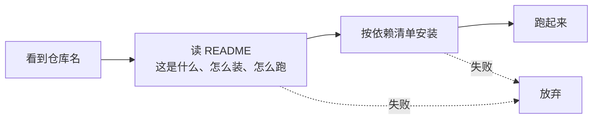

一个仓库被打开时，读的人只做三件事：看它叫什么、看它要干什么、看它需要什么。这三件事对应根目录上的三个位置——项目名、项目说明、依赖清单。

它们的共同点是**都不参与运行**。删掉 README，程序照样跑；把依赖清单写错，本地照样跑。正因如此，它们最容易失真：写的时候随手，改的时候忘记，等到别人用的时候才发现说的和做的不一样。

这一篇处理仓库门口的三份声明，判据只有一个：**它说的是不是真的，以及能不能被验证。**

## 一、三份声明，三种失真的方式

| 声明 | 位置 | 读者 | 失真之后 |
| --- | --- | --- | --- |
| 项目名 | `pyproject.toml` 的 `name`，与 `src/` 下那层目录 | 安装工具、导入语句、终端 | 装得上但导不进，或者和别人的包撞名 |
| 项目说明 | 根目录 `README.md` | 第一次打开仓库的人 | 照着文档做，第一步就失败 |
| 依赖清单 | `[project] dependencies` | 装这个包的人、CI | 作者机器上能跑，别人装不上 |

三份声明排成一条进入路径：



这条路径上的任何一环断了，后面都不用谈。所以三份声明的位置不是「根目录看起来整齐」，而是**它们是进入这个仓库的唯一路径，必须在最外层、唯一一份、且可验证**。

## 二、项目名：一个名字要活过四套规则

名字在仓库里出现七次：仓库目录、`project()`、`src/<name>/`、PyPI 发行名、命令行入口、环境变量前缀、日志文件名。写的时候是同一个词，校验它的规则却来自四个互不相干的体系。

**第一套，Python 标识符。** 发行名带横线、包目录用下划线，是很常见的写法：

```bash
$ python -c "import envlog-probe"
  File "<string>", line 1
    import envlog-probe
                 ^
SyntaxError: invalid syntax
```

`-` 在 import 语句里不是分隔符，是二元减号。所以「发行名带横线、导入名带下划线」不是风格偏好，是语法强制。

**第二套，包装配规则。** 同一个包，三种写法问 pip，回显都是它：

```bash
$ python -m pip show envlog_probe | head -2
Name: envlog-probe
Version: 0.1.0

$ python -m pip show envlog.probe | head -2
Name: envlog-probe
Version: 0.1.0
```

PEP 503 规定：连续出现的 `-`、`_`、`.` 折成一个 `-`，整体转小写。三行代码就能复现：

```python
import re
canonicalize = lambda n: re.sub(r'[-_.]+', '-', n).lower()
```

这条规则意味着索引层面根本不存在「大小写不同的两个包」，`my_cool_tool` 和 `my-cool-tool` 也只能活一个。

**第三套，文件系统。** 装完之后名字在磁盘上被改写。发行名 `envlog-probe`，落地成了：

```bash
$ ls .venv/Lib/site-packages/ | grep -i envlog
envlog_probe
envlog_probe-0.1.0.dist-info
```

用发行名去 grep 目录，得 0 条。任何「按发行名找安装目录」的脚本都会把装好的包判成没装。

**第四套，大小写。** 有个流传很广的说法：Windows 文件系统不区分大小写，所以 import 写错大小写也能跑。本机实测（Python 3.13.14，NTFS）：

```text
Foo  ok   Foo.py
foo  fail No module named 'foo'
FOO  fail No module named 'FOO'
```

三个模块名只差大小写，只有精确的那个能导入。导入系统按目录项里的真实字符逐个比对，文件系统是否宽容并不改变这一步。这条不是跨版本保证，但足够支撑一条实践：名字统一小写，别让「能不能导入」依赖运行环境。

四套规则之外，还有一项本地永远测不出来：**注册表占用**。语法错、导入错、大小写错，跑一次就暴露；撞名要等到发布那天。

```bash
$ curl -s -o /dev/null -w "%{http_code}" https://pypi.org/pypi/envlog/json
200
$ curl -s -o /dev/null -w "%{http_code}" https://pypi.org/pypi/dustlog/json
404
```

200 表示已被占，404 表示可用。五秒钟能查完的事，代价却要拖到发布前才出现。

**名字是仓库里唯一一个「改一行、牵连全仓和已上线数据」的配置项。** 它会走进 CMake 的 `project()`、脚本里硬编码的产物路径、日志文件名、Redis 键空间。前几处 `sed` 能覆盖，最后那处在数据库里，改名等于一次数据迁移。

## 三、项目说明：README 里的每条命令都要能跑

README 只需要回答三件事，顺序固定：

1. 这是什么（一句话，不要讲架构）
2. 怎么装（一条命令）
3. 怎么跑（能立刻看到结果的最小例子）

`dustlog` 的 README 就是这三段。判断它合不合格，方法很简单：**照着执行一遍**。

```bash
$ pip install -e ".[dev]"
$ dustlog import data/raw/2026-11-08.csv
跳过第 4 行: pm25 越界: -1.0
跳过第 5 行: 采样间隔 0:15:00 超过 0:10:00
跳过第 6 行: 采样间隔 0:20:00 超过 0:10:00
写入 2 条，跳过 3 条 -> data\interim\samples.jsonl

$ dustlog query --from 2026-11-01 --to 2026-11-08
2 条  pm25 均值 12.8  峰值 13.1
```

三条命令全部跑通，说明这份 README 是真的。

反例更容易见：很多 README 第一句就写 `pip install <名字>`，而这个包还没发布。在干净环境里试一下：

```bash
$ python -m pip install --dry-run dustlog
ERROR: No matching distribution found for dustlog
```

同一个命令，在作者机器上「已经装好了」所以看不出问题，在别人的空环境里直接失败。**README 不是宣传页，是一份需要被执行验证的文档。** 里面的每条命令都该有人真的跑过一遍，最好就是写它的那个人。

## 四、依赖清单：声明的是条件，不是结论

`pyproject.toml` 里写了两条：

```toml
dependencies = [
    "tomli>=2.0; python_version < '3.11'",
]

[project.optional-dependencies]
dev = ["pytest>=8.0"]
```

装完之后，环境里实际有什么：

```bash
$ pip freeze
colorama==0.4.6
# Editable install with no version control (dustlog==0.1.0)
-e d:\github\_dustlog_lab\dustlog
iniconfig==2.3.1
packaging==26.3
pluggy==1.7.0
Pygments==2.21.0
pytest==9.2.0
```

声明两条，装出六个第三方包。差额去哪了：

```bash
$ pip show pytest | grep -E "^(Name|Requires)"
Name: pytest
Requires: colorama, iniconfig, packaging, pluggy, pygments
```

那五个是 pytest 的**传递依赖**，不需要你声明，但会出现在你的环境里。反过来，`tomli` 那条**根本没装**——它的条件是 `python_version < '3.11'`，而本机是 3.13。声明里写着，环境里没有。

这两件事说明依赖清单的性质：**它声明的是约束条件，不是最终结论。** 结论得靠安装器算出来。

三种精度要分开看：

| 形态 | 写的是什么 | 例子 | 谁在用 |
| --- | --- | --- | --- |
| 声明范围 | 允许的版本区间 | `pytest>=8.0` | 装包的人、包管理器 |
| 锁定确定值 | 某个具体版本 | `pytest==9.2.0` | CI、可复现构建 |
| 环境快照 | 当前环境所有包 | `pip freeze` | 排障、迁移 |

最常见的错误是把三者混为一谈：用 `pip freeze` 的输出当依赖清单。那份输出里混着传递依赖、本机路径、以及只在当前平台生效的包，换台机器就装不上。

比版本精度更要紧的是**完整性**。给 `cli.py` 加一行 YAML 输出，忘了写进清单：

```bash
$ dustlog --version
  File "dustlog\src\dustlog\cli.py", line 2, in <module>
    import yaml
    ^^^^^^^^^^^
ModuleNotFoundError: No module named 'yaml'
```

照着报错补一条安装命令，程序立刻恢复正常：

```bash
$ pip install pyyaml
$ dustlog --version
dustlog 0.1.0
```

然后检查清单：

```bash
$ grep -c yaml pyproject.toml
0
```

**本地能跑，只是因为本地顺手装过。** 依赖清单和代码之间没有任何自动同步机制，漏一条不会被发现，直到有人在干净环境里安装。这是三份声明里唯一一份「错了不会立刻报错、但别人一定跑不起来」的。

## 五、三份声明的共同点：都能被验证

写完三份声明不算完，要能给它们各自找一个验证动作：

| 声明 | 验证方式 | 失败长什么样 |
| --- | --- | --- |
| 项目名 | 查一次注册表 + 装一次看能否 import | `No matching distribution` / `ModuleNotFoundError` |
| 项目说明 | 照着 README 从头执行一遍 | 第一步就报错 |
| 依赖清单 | 空环境装一次，跑最小例子 | `ModuleNotFoundError` |

三个动作都不需要额外工具，成本分别是五秒、两分钟、五分钟。**声明式文件的价值不在于写得多漂亮，而在于它说的和做的一致——而一致性只能靠执行来证明。**

## 六、三条能带走的

**一、名字要同时过四套规则，最后再查一次注册表。** 标识符、PEP 503、文件系统落地名、大小写，四关都过的名字才稳；注册表占用是唯一本地测不出的项，定名前发一个 HTTP 请求即可。

**二、README 里的每条命令都要真跑过。** 最典型的失效是 `pip install <未发布的包>`——在作者机器上装好了所以看不出来，在别人机器上是第一步就失败。

**三、依赖清单是约束，不是快照。** `pip freeze` 混着传递依赖和本机路径，不能当清单用；清单漏一条不会报错，只会在干净环境里报出 `ModuleNotFoundError`。

**本质一句话：仓库门口这三份声明，决定别人能不能进来——它们不参与运行，所以不会被运行检验，只能靠人主动验证一次。**
