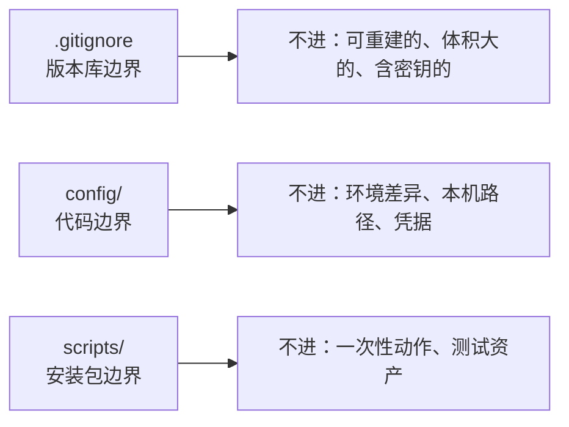

讲目录结构时，大家说的都是「放什么」。但真正决定一棵树清不清爽的，是「不放什么」——而排除这件事没有语法提示，写错了也不会报错。

一个仓库其实有三处边界，各自拦着不同的东西：版本库不收回不来的东西，代码不吸纳随环境变的东西，安装包不带走只跑一次的东西。三处的判断依据不同，失效方式也不同。

这一篇把三处边界拆开，每处都跑一次验证。

## 一、三处边界，三套判据



三处的共同结构是：**边界靠「明确说出不要什么」来定义，而不是靠「尽量小心」。** 小心是没用的，因为默认行为永远是「全都收」。

## 二、.gitignore：什么不进版本库

忽略规则只需要回答三个问题，答「是」就写进去：

| 类别 | 例子 | 判据 |
| --- | --- | --- |
| 可重建 | `build/`、`dist/`、`__pycache__/`、`*.egg-info/` | 删掉之后一条命令能重来 |
| 体积大 | `data/raw/`、导出的 CSV、模型权重 | 进库会让 clone 变成下载 |
| 含凭据 | `.env`、`config/local.toml`、`*.pem` | 一旦推上去就是事故 |

`dustlog` 的 `.gitignore` 就是按这三类写的。逐条验证它到底拦住了什么：

```bash
$ git check-ignore -v build/app.exe logs/dustlog.log config/local.toml data/raw/2026-11-08.csv
.gitignore:2:build/	build/app.exe
.gitignore:23:logs/	logs/dustlog.log
.gitignore:19:config/local.toml	config/local.toml
.gitignore:13:data/raw/*	data/raw/2026-11-08.csv
```

四行输出回答了四个「为什么」：第 2 行拦构建产物，第 23 行拦运行时日志，第 19 行拦本机配置，第 13 行拦原始数据。**每一条规则都能指到它拦的那个文件，这才叫边界；指不到的规则只是继承来的迷信。**

反过来，规则写得越宽，误伤的面积越大。往 `.gitignore` 里加一条 `*.json`，本意是忽略中间结果，实际命中的是校验规则：

```bash
$ git check-ignore -v schemas/sample.schema.json
.gitignore:27:*.json	schemas/sample.schema.json
```

`schema` 是仓库里最不该丢的文件之一，被一条按扩展名写的规则悄悄排除了。这类规则的危险在于安静：`git status` 干净，`git add .` 也不报错，等别人 clone 下来跑不通才发现少了一整个目录。

所以规则尽量写成「路径 + 目录」，而不是「扩展名」：

```text
build/              # 带斜杠：只匹配目录，不匹配同名文件
data/raw/*          # 限定到具体位置
!data/raw/.gitkeep  # 再用感叹号把占位文件捞回来
```

`data/` 这种不带前导斜杠的写法会匹配任意层级，一旦有人把同名目录挪进 `src/`，忽略规则就会跟过去。规则本身没写错，是位置和规则的组合出了问题。

## 三、config：什么不进代码

配置要解决的是一个具体矛盾：同一份代码要跑在三台机器上，而三台机器上总有一两个值不一样。

把这些值写进代码，等于每次换环境都改一次源码；把它们全放进配置文件，又会把「默认值」和「本机值」混在一起。分级的做法是三个层次：

| 层级 | 载体 | 进版本库 | 覆盖谁 |
| --- | --- | --- | --- |
| 默认值 | `config/default.toml` | 是 | 无，它是基线 |
| 本机覆盖 | `config/local.toml` | 否（已在 `.gitignore`） | 默认值 |
| 运行时覆盖 | 环境变量 | 否 | 前两者 |

三级实测，同一份代码，三次输出：

```bash
$ python scripts/read_config.py
raw     : data/raw
pm25_max: 1000.0

$ python scripts/read_config.py      # 加上 config/local.toml 之后
raw     : D:/sensor-dropbox
pm25_max: 500.0

$ DUSTLOG_RAW="//nas01/air-quality" python scripts/read_config.py
raw     : //nas01/air-quality
pm25_max: 500.0
```

第三次输出值得看两行：`raw` 被环境变量换掉了，`pm25_max` 还是 `local.toml` 里的 500。**覆盖是逐字段的，不是整份替换**——这也是分级能用的前提，否则环境变量一设，本地配置就全丢了。

读取逻辑本身很短：

```python
def load() -> dict:
    cfg = tomllib.loads((ROOT / "config" / "default.toml").read_text(encoding="utf-8"))

    local = ROOT / "config" / "local.toml"
    if local.exists():
        deep_merge(cfg, tomllib.loads(local.read_text(encoding="utf-8")))

    env = os.environ.get("DUSTLOG_RAW")
    if env:
        cfg["paths"]["raw"] = env

    return cfg
```

凭据走的是最上面那层，但**永远不写进任何文件**：

```python
token = os.environ["DUSTLOG_TOKEN"]   # 缺失时直接抛 KeyError，不设默认值
```

取法和带默认值的取法，差别在一次运行里就能看出来：

```bash
$ python -c "import os; print(os.environ.get('DUSTLOG_TOKEN', 'change-me'))"
change-me

$ python -c "import os; print(os.environ['DUSTLOG_TOKEN'])"
KeyError: 'DUSTLOG_TOKEN'
```

第一种写法在凭据缺失时会打印 `change-me`，然后带着一个假凭据一路跑下去——请求被服务端拒绝，或者更糟，写进了一份用假凭据创建的记录。第二种写法在启动第一秒就停住，停的位置离原因最近。

**给凭据设默认值，等于给「忘记配置」留了一条静默通道。** 宁可让它启动失败，也不要让它带着一个假值跑起来。

**判断配置分级是否合格的依据只有一条：换一台机器时，改动应该只发生在 `local.toml` 或环境变量里，一行代码都不用动。** 如果每次换机器都要改 `src/` 下的文件，说明那个值放错了层。

## 四、scripts：什么不进安装包

脚本是最容易被放进源码包的东西，毕竟都是 Python。但装完之后，安装包里没有它们：

```bash
$ python -m build --wheel --no-isolation
Successfully built dustlog-0.1.0-py3-none-any.whl

$ python -c "import zipfile, glob; print(zipfile.ZipFile(glob.glob('dist/*.whl')[0]).namelist())"
['dustlog/__init__.py', 'dustlog/cli.py', 'dustlog/io.py', 'dustlog/store.py',
 'dustlog/validate.py', 'dustlog-0.1.0.dist-info/METADATA', ...]
```

十个文件，`scripts/` 出现零次。但用户明明能在终端敲 `dustlog`：

```bash
$ cat dustlog-0.1.0.dist-info/entry_points.txt
[console_scripts]
dustlog = dustlog.cli:main
```

命令不是靠脚本文件提供的，是靠这条入口点声明——安装时由打包工具在 `Scripts/` 目录生成一个启动器，它去调用 `dustlog.cli:main`。**能跑的命令来自包内的函数，不能跑的一次性动作留在仓库里。**

脚本和源码包的关系是单向的：脚本可以 import 源码包，反过来不行。`import_day.py` 就是这么做的：

```python
ROOT = Path(__file__).resolve().parents[1]
sys.path.insert(0, str(ROOT / "src"))

from dustlog.cli import cmd_import
```

三行的作用是把 `src/` 临时挂到搜索路径上，这样脚本不用安装也能调用包里的函数。这个写法在仓库里很常见，代价是脚本只能在仓库结构下运行——它不属于安装包，天然也不需要。

判断一个 `.py` 该放 `src/` 还是 `scripts/`，问一句就够：

> **它会被别人 import 吗？**

会，进 `src/`，跟着安装包分发；不会，进 `scripts/`，只活在仓库里。批量导数据、一次性迁移、压力测试的驱动脚本，全都属于后者。

还有一条容易忽略的：**脚本的依赖不能写进运行依赖**。脚本用了 `requests`，就把它放进 `[project.optional-dependencies]` 的 `dev` 组，不能放进 `dependencies`——否则每个装这个包的人，都要为一个他从不会跑的脚本付下载和体积。

## 五、三处边界的对照

| 边界 | 拦住什么 | 判断依据 | 验证手段 | 失效的样子 |
| --- | --- | --- | --- | --- |
| 版本库 | 可重建、体积大、含凭据 | 删了能不能重建 | `git check-ignore -v` | 仓库膨胀，或密钥泄露 |
| 代码 | 环境差异、本机路径 | 换机器要不要改代码 | 三次覆盖实测 | 每台机器一份分支 |
| 安装包 | 一次性动作、测试资产 | 会不会被 import | 列 wheel 内容 | 安装包带一堆用不上的东西 |

三处的失效方式各不相同：版本库边界失效是**不可逆**的（密钥推上去就收不回来），代码边界失效是**可观察**的（换机器就报错），安装包边界失效是**沉默**的（多带几个文件，没人会注意）。

按不可逆程度排序，写 `.gitignore` 该最谨慎，而它恰恰是最多人直接复制模板的地方。

## 六、三条能带走的

**一、忽略规则要能指到具体文件。** 用 `git check-ignore -v` 逐条问一遍，指不到任何文件的规则就该删；按扩展名写的宽规则迟早误伤源码，`*.json` 盖掉 `schemas/` 是最典型的例子。

**二、配置分三级，覆盖要逐字段。** 默认值进库、本机覆盖不进库、环境变量压在最上层。判断标准是换机器时改动只发生在配置层，而不是源码层。

**三、脚本不进安装包，命令靠入口点。** 会被 import 的进 `src/`，不会被 import 的进 `scripts/`；脚本的依赖放 `dev` 组，别让它污染每个使用者的下载。

**本质一句话：三处边界都是排除，而排除没有默认值可依赖——不写就是全收，写宽了就连该留的一起收走。**
