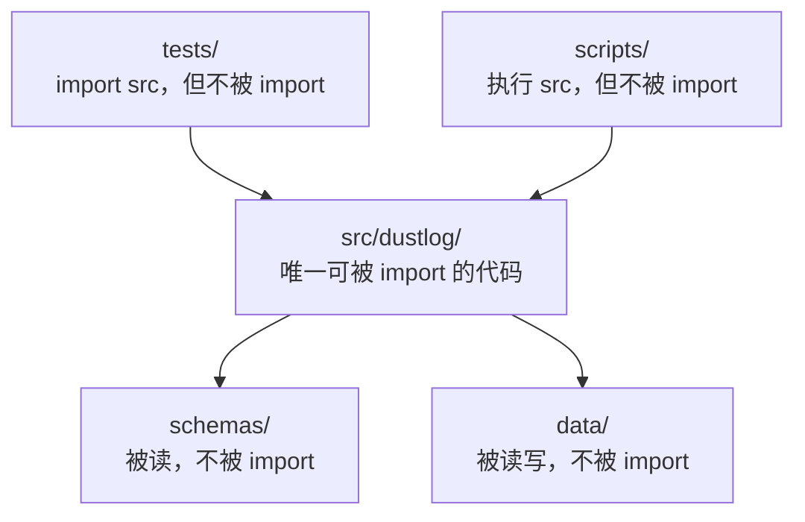

前面三处位置讲的都是「这个文件归谁管」。这一篇换一个更硬的判据：**它能不能被别人 import。**

一个仓库里的 Python 文件，只有两种命运：要么被 import，成为别人代码的一部分；要么不被 import，被执行或被读取。前者必须服从包的分发规则，后者不必。把这条线划清楚，源码包、数据目录、校验规则、测试包的位置就全都定了。

## 一、一条依赖线，四个位置



四个位置的共同点是「都跟 import 有关」，区别在于站在线的哪一端：`src` 是唯一被指向的一方，其余三个都只能指向它，不能被它指向。

## 二、核心源码包：多一层 src 换掉了什么

同样五个 `.py` 文件，放 `src/dustlog/` 和直接放 `dustlog/`，在仓库根目录下的表现完全不同：

```bash
# A. src 布局，站在仓库根
$ python -c "import dustlog"
ModuleNotFoundError: No module named 'dustlog'

# B. 平铺布局，站在仓库根
$ python -c "import dustlog; print(dustlog.__file__)"
导入成功 -> D:\GitHub\_dustlog_lab\demo\flat_layout\dustlog\__init__.py
```

A 导不进来，B 导得进来。多数人凭这一点就判定平铺更方便。但把视角拉到「装完之后」：

平铺布局的仓库根就在 `sys.path` 上，从根目录启动的任何进程，导入到的都是**工作区里的源码**；而在别的目录启动的进程，导入到的是 **site-packages 里的安装副本**。同一台机器上，同一份代码，两个版本同时可被导入，取决于你从哪个目录启动。测试在这种情况下跑的是工作区代码，线上跑的是安装副本，两者是否一致，没人验证过。

`src` 那一层的作用就是切断这条捷径：**不安装，就导不进来。** 所有导入都必须经过一次真实的安装，测试、脚本、线上的入口调用的是同一份东西。

代价很明确：每次改代码都要 `pip install -e .`（可编辑安装，改完立即生效），不能靠「就在当前目录」蒙混。这是把一次性的配置成本，换成了一个长期成立的一致性。

## 三、数据目录：三层与「能不能删」

`data/` 分成三层，判断依据只有一个：**删掉之后能不能从别处重建。**

| 层 | 内容 | 能不能删 | 忽略规则 |
| --- | --- | --- | --- |
| `raw/` | 传感器导出的原始 CSV | 不能（外部来源，丢了就没了） | `data/raw/*` 加 `!data/raw/.gitkeep` |
| `interim/` | 校验后的中间结果 | 能（从 raw 重跑） | `data/interim/` |
| `processed/` | 汇总与报表 | 能（从 interim 重算） | `data/processed/` |

「能重建」不是一句口号，可以测：删掉中间结果，从原始数据重跑两遍，比对指纹：

```bash
$ rm data/interim/samples.jsonl
$ dustlog import data/raw/2026-11-08.csv > /dev/null
$ md5sum data/interim/samples.jsonl
fc1cb280e203d80c655f4e443c5a1964 *data/interim/samples.jsonl

$ rm data/interim/samples.jsonl          # 再来一次
$ dustlog import data/raw/2026-11-08.csv > /dev/null
$ md5sum data/interim/samples.jsonl
fc1cb280e203d80c655f4e443c5a1964 *data/interim/samples.jsonl
```

两次完全相同，说明 `interim/` 确实只是 `raw/` 的函数。这一条成立，忽略规则才有底气：可以放心把 `interim/` 整个目录排除出版本库，因为谁都可以从 `raw/` 再算一遍。

反过来看 `raw/`：它是整条链上唯一不可重建的一层。一旦丢失，`interim` 和 `processed` 都成了无源之水。这也是它「只进不改」的原因——不是洁癖，是它承担了整条数据链的信用。

三层的忽略状态可以逐条验证：

```bash
$ git check-ignore -v data/raw/2026-11-08.csv data/interim/samples.jsonl data/processed/.gitkeep
.gitignore:13:data/raw/*	data/raw/2026-11-08.csv
.gitignore:15:data/interim/	data/interim/samples.jsonl
.gitignore:16:data/processed/	data/processed/.gitkeep
```

注意 `raw/` 用的是 `data/raw/*` 而不是 `data/raw/`，随后用 `!data/raw/.gitkeep` 把占位文件捞回来——这样目录结构本身进了版本库，内容不进。另外两层连占位符都不需要，它们是纯粹的可再生区域。

## 四、校验依据：规则比任何一份数据活得久

`schema` 放在 `schemas/` 而不是 `data/`，理由不是「看起来整齐」，而是两者的生命周期不同：数据每天换一批，规则几个月才改一次。

规则要管三件事：

- **写入时**：解析器按字段定义读 CSV，字段名对不上就报错；
- **运行时**：校验器按取值范围判断一条样本可用不可用；
- **测试时**：`tests/` 用同一份规则构造边界用例。

`dustlog` 真的出过一次与规则相关的问题，值得记下来：最初的 `io.py` 用 `encoding="utf-8"` 读 CSV，五条数据全部解析失败：

```text
跳过第 2 行: 第 2 行无法解析: 'timestamp'
跳过第 3 行: 第 3 行无法解析: 'timestamp'
跳过第 4 行: 第 4 行无法解析: 'timestamp'
跳过第 5 行: 第 5 行无法解析: 'timestamp'
跳过第 6 行: 第 6 行无法解析: 'timestamp'
写入 0 条，跳过 5 条
```

数据一条没坏，坏的是双方对「表头长什么样」的约定：传感器导出的 CSV 带 UTF-8 BOM，首行字段名实际是 `\ufefftimestamp`，肉眼看不见。改成 `utf-8-sig` 立刻恢复正常。

这件事说明规则该放在哪：**它不是某一次运行的一部分，而是采集方和消费方之间的契约。** 契约跟着仓库走、跟着版本走，不跟着某一批数据走。把 schema 塞进 `data/` 的后果很具体——`data/` 被忽略或被清理时，规则跟着一起消失，而它恰恰是最该被保留下来的那一份。

规则放在哪是一回事，放几份是另一回事。`dustlog` 现在有两处写着同一条规则：`schemas/sample.schema.json` 里 `pm25` 的 `maximum` 是 1000，`validate.py` 里 `PM25_MAX` 也是 `1000.0`。两边一致时，用一条 `pm25=800` 的样本去问，得到的答案也一样：

```text
schema 判定: 通过
代码判定: 通过
```

把 schema 的上限改成 500（模拟「有人只改了规则文件」），同一条样本，两边立刻分家：

```text
schema: 拒绝 -> 800 is greater than the maximum of 500
代码  : 通过
```

同一份数据，两套规则给出相反判定，而且谁都不会报错。这是这套结构真实的弱点：**规则有两份实现，就一定会漂移**，漂移之前没有任何征兆。修法不是「记得两边都改」，而是让阈值只存在于一个地方——要么代码从 schema 读上限，要么 schema 由代码里的常量生成，总之不能让两条独立的声明并存。

同一条边界也适用于 `tests/fixtures/`：那里面的 CSV 是**测试输入**，不是项目数据。它要能覆盖边界情况（越界值、断档、坏行），所以故意和真实数据不一样，放 `tests/` 下才不会被人误当成生产数据。

## 五、测试包：目录镜像源码

测试放在哪，标准只有一个：让「改了一个模块，该改哪个测试」不用思考。

```bash
$ find src tests -name "*.py" | sort
src/dustlog/__init__.py
src/dustlog/cli.py
src/dustlog/io.py
src/dustlog/store.py
src/dustlog/validate.py
tests/test_validate.py
```

`src/dustlog/validate.py` 对应 `tests/test_validate.py`，同一个模块名，只多一个 `test_` 前缀。模块多起来之后，这个对应关系就是导航：

```text
src/dustlog/io.py          -> tests/test_io.py
src/dustlog/validate.py    -> tests/test_validate.py
src/dustlog/store.py       -> tests/test_store.py
```

反过来，如果测试按功能分（`test_import_flow.py`、`test_query_flow.py`），一个模块的改动会散落在好几个测试文件里，改的时候要靠全文搜索。

跑起来验证这棵树是活的：

```bash
$ python -m pytest -q
.....                                                                    [100%]
5 passed in 0.03s
```

五个用例覆盖了正常样本、pm25 越界、湿度越界、采样间隔超限、无法解析的行。测试和源码在同一棵树上，跑的时候不需要额外配置——`pyproject.toml` 里两行就够：

```toml
[tool.pytest.ini_options]
testpaths = ["tests"]
pythonpath = ["src"]
```

`testpaths` 告诉 pytest 只去 `tests/` 找，`pythonpath` 让它在不安装的情况下也能导入 `src/`。后者是测试目录的特权：测试要 import 源码，但源码永远不该 import 测试。

## 六、四个位置的归属

| 位置 | 能被 import 吗 | 进版本库 | 进安装包 | 生命周期 |
| --- | --- | --- | --- | --- |
| `src/dustlog/` | 是（唯一） | 是 | 是 | 跟版本走 |
| `data/raw/` | 否 | 否 | 否 | 只增不减 |
| `data/interim/`、`processed/` | 否 | 否 | 否 | 随时可删 |
| `schemas/` | 否（被读） | 是 | 视需求 | 跟版本走 |
| `tests/` | 否 | 是 | 否 | 跟版本走 |

看「能被 import」这一列：只有一行是「是」。其余四个位置无论多重要，都只能被读、被执行、被依赖，不能成为别人代码的一部分。

这条线一旦破了，问题不在目录，在架构：源码开始 import 测试里的辅助函数、import 脚本里的常量、import 某份具体数据的路径，整棵树就从「分层」退化成「互相引用的一坨」。

## 七、三条能带走的

**一、多一层 src，换的是「导入必须经过安装」。** 平铺布局下，从仓库根导入的是工作区代码，从别处导入的是安装副本，同一台机器上两个版本同时存在；src 布局让所有导入统一走安装这条路。

**二、三层数据按「能不能重建」划分。** `raw` 不可重建，所以只进不改、不进库；`interim` 和 `processed` 能重建，所以整个目录都可以排除。实测两次重建 md5 一致，这一条才算成立。

**三、校验规则跟版本走，不跟数据走。** schema 单独成目录，因为它管的是采集方与消费方的约定，比任何一批数据活得久；测试的 fixture 是测试输入，放 `tests/` 下，别混进生产数据。

**本质一句话：一棵树里只有一个位置能被 import，其余位置无论多重要，都只是它的输入、输出或验证——这条线画对，位置自然就对了。**
