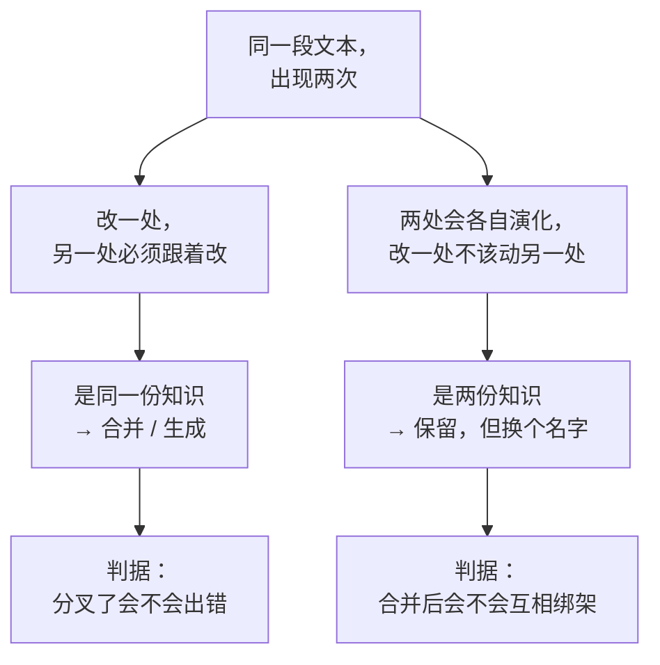
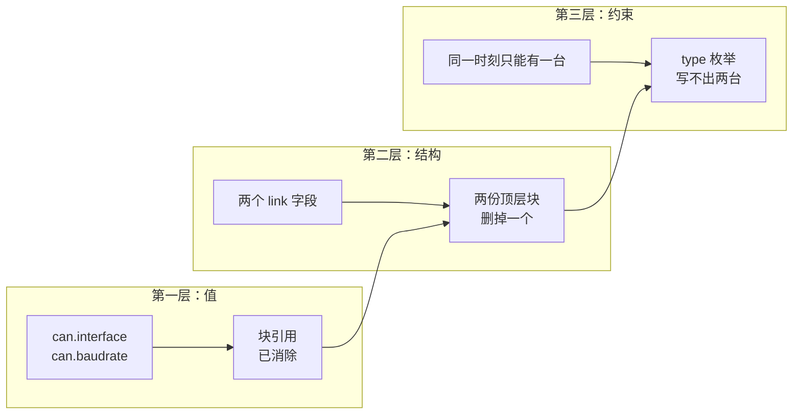
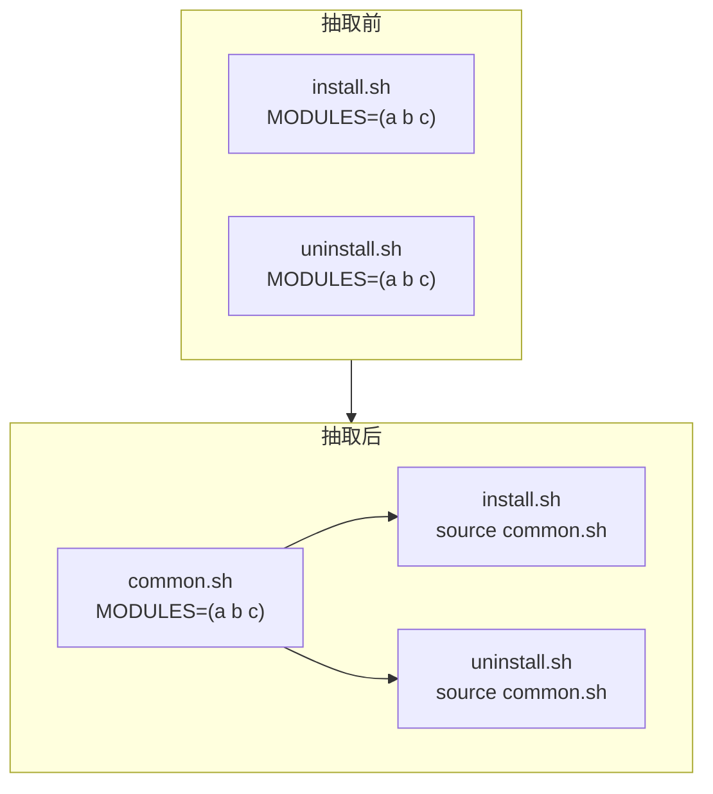
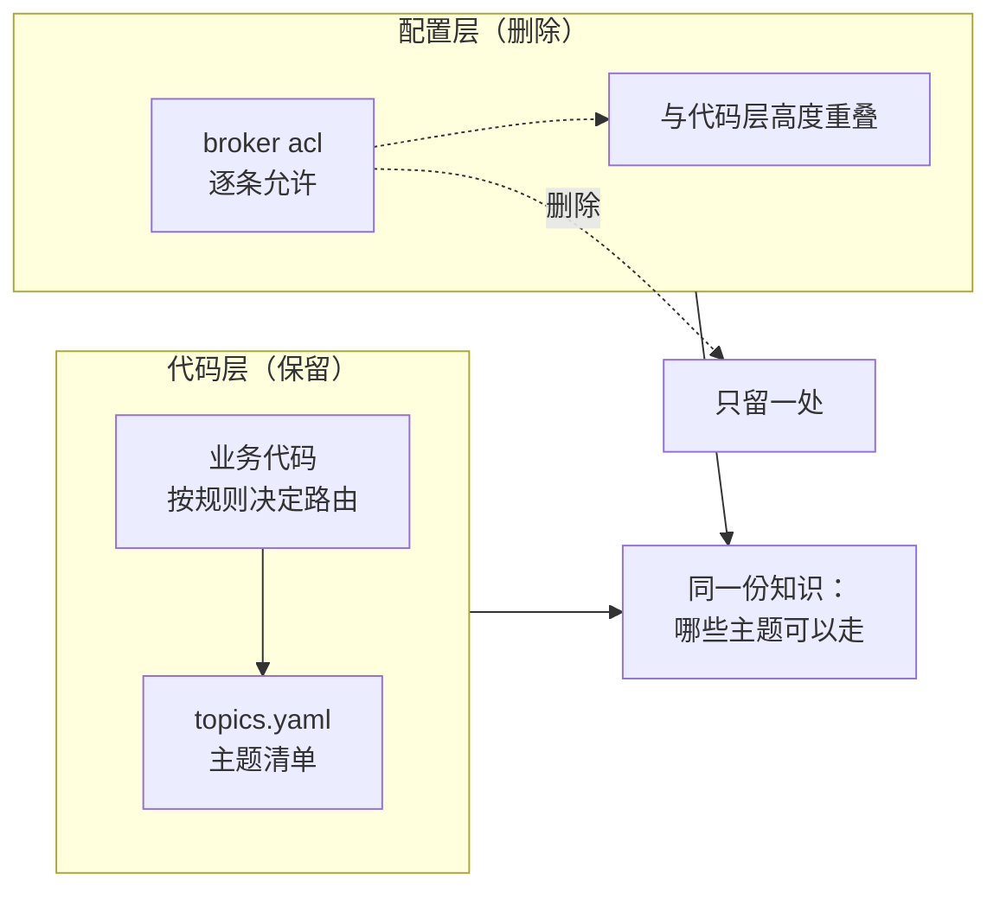
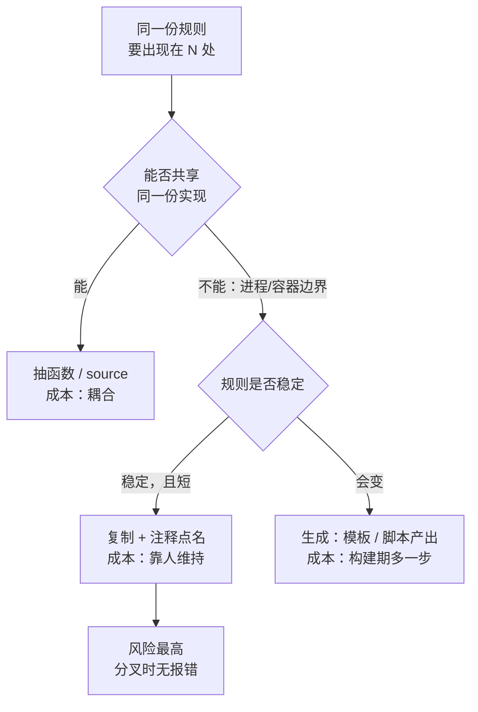
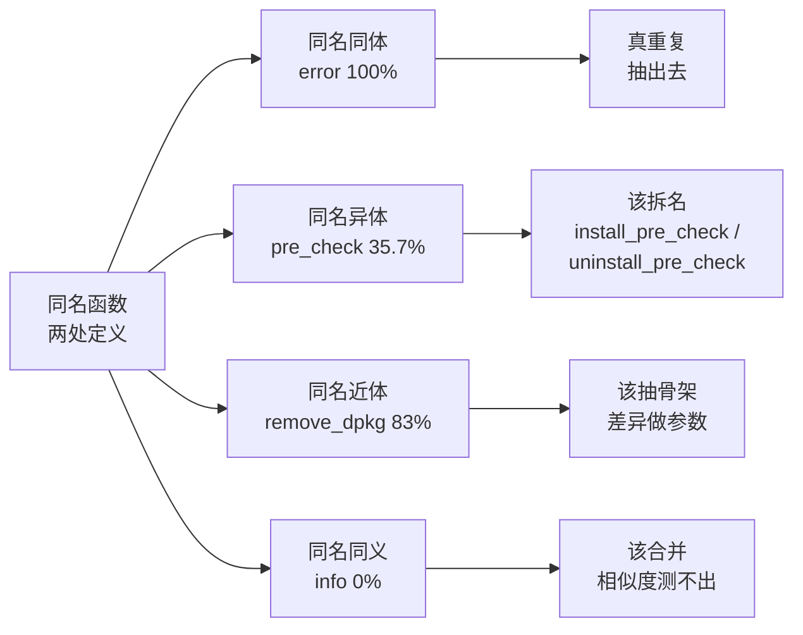

> **说明**：本文案例来自一个已完结的嵌入式项目复盘。为遵守保密约定，**设备类型名、模块名、提交哈希与部分配置细节均已替换为中性示意值**；统计口径（提交数、行数、时间线）保持原样。

## 一、四个现场

手上有个嵌入式设备侧项目，前后约三个月、近百次提交。它是一个典型的嵌入式服务端：C++ 主进程、几个 shell 脚本管构建和安装、一份 YAML 配置描述接哪些硬件。

翻它的提交记录，能挑出四组和 DRY 直接相关的动作。四组里有三组是在削减重复，一组是在**制造**重复，而那一组的提交标题，恰好写着「统一」。

| 现场 | 日期 | 动作 | 净行数 |
|------|------|------|--------|
| 配置合并 | 11-12 | 两份电源设备配置块合成一份 | 全仓库 −5 |
| 脚本抽取 | 09-28 | 装/卸脚本抽出公共文件 | 三个脚本合计 −6 |
| 白名单删除 | 11-11 | 删掉 broker 的主题 ACL | 该文件 −21 |
| 「统一」补零 | 10-28 | 设备 ID 补零规则统一 | +55 |

表格里最扎眼的是第四行：标题写「统一」，实际净增五十五行，因为那条规则被写进了三个文件。而前三行加起来，净减少不到二十行。

这就是本文要处理的问题。DRY 被反复讲成「别复制粘贴」，可如果按这个标准去量，前三组重构几乎什么都没干：行数没少，代码量没降。反过来，第四组明明复制了三份，作者还觉得自己在消除差异。

所以真正的判据不是「像不像」，是另外一句。



## 二、配置合并

这个项目的配置支持块级复用：一个配置块可以整体引用另一个块，只写自己特有的字段。电源部分原本长这样：

```yaml
# ===== 电源设备（CAN 总线）=====
power_device: &power        # 开出可复用的块
  link: true
  can:
    interface: can0
    baudrate: 500000

# ===== 保护型电源（电源保护）=====
protector_device:
  <<: *power                # 复用 power_device 的配置块
  link: false

# ===== 配电盒 =====
distributor_device:
  <<: *power                # 复用 power_device 的 CAN 配置
  link: true
  reclose: true
```

注意这里已经做过一次 DRY 了：块引用把 CAN 接口和波特率收进了 `power_device`，两个子块只留自己特有的字段。按「消灭重复文本」的标准，这个配置已经相当干净，`can.interface` 只出现一次。

问题出在 `link`。两个子块各有一个 `link`，两个都可以写成 `true`。而硬件上这两种电源设备接在同一条 CAN 总线上，同一时刻只能存在一台。这个约束在配置里没有位置，只活在一句注释和一段运行时检查里：

```cpp
// 互斥选择：配电盒作为当前活动电源设备（若两者同时 link，后者生效并 WARN）
if (active_power_status_) {
    LOG_WARN << "[DeviceHub] both protector_device and distributor_device are linked; "
                "distributor_device takes precedence";
}
```

十一月十二日上午有个提交，干的事就一行：把这条日志从 `LOG_WARN` 改成 `LOG_ERROR`。

把警告升级成错误，通常意味着现场真撞上了。同一天下午，下一个提交进来，配置变成：

```yaml
# ===== 电源设备（CAN 总线，二选一）=====
# type 决定实际创建的配电设备：0=保护型，1=配电盒（新增配电类型时追加编号，并在 DeviceHub 中扩展分支）
power_device:
  link: true
  type: 1                  # 配电类型：0=保护型，1=配电盒
  can:
    interface: can0
    baudrate: 500000
  reclose: true            # 配电盒专用（type=1）：短路保护后是否自动重合闸
```

三个顶层块变一个，七个键变六个，配置模板里从十五行压到八行。代码侧把两个 `if` 换成一个 `switch`，然后那段「两者同时 link」的冲突分支被整段删掉——不是修好了，是不需要了：结构上只有一个 `link`，写不出两个都开的状态。

全仓库的账是 `+51 / −56`，净减五行。

### 合并的收益

净减五行这个数字，如果拿去跟「复制粘贴」的标准对账，几乎证明不了什么。但它换来了三样东西：

**第一，互斥关系从运行时检测变成编译期写不出。** 原来那段冲突处理逻辑要一直留着，因为配置是运行期读的，随时可能被运维改成两个都开。现在这个状态在 schema 层面不存在，代码里那八行分支连同它的日志、它的优先级规则一起消失了。

**第二，新增一种电源类型时的改动点收敛。** 原来加第三种设备，要复制一整块配置模板、复制一整段 `createDevice`、再改冲突判断里那句「后者生效」。现在只加一个 `case` 分支和一个 `type` 编号。

**第三，也是最容易被忽略的：配置文档里少了一行需要人记住的规则。** 原来的 README 写着「`protector_device` / `distributor_device`：是否启用、是否自动重合闸」，读者必须自己推断这两者互斥。改完之后那一行变成「`type`（0=保护型 / 1=配电盒）」，互斥写在类型里，不用推断。



块引用解决的是第一层，那天的合并提交解决的是第二层和第三层。这也是为什么这次改动行数几乎不变：第一层的重复早在引入块引用时就消掉了，剩下的重复是**结构重复**和**约束缺失**，它们不吃行数，吃的是「读者要在脑子里维护多少条不变量」。

前一天把 WARN 升成 ERROR 的那次提交值得单独说一句。把 WARN 升成 ERROR，是在承认「这个不可能状态会发生」；第二天把结构改掉，是不再承认它。两句之间隔了不到一天，方向完全相反：一句在加固检查，一句在删除检查。真正做完 DRY 之后，那些防御性代码会显得多余——这不是它们写错了，是它们守的那个漏洞被填上了。

## 三、脚本抽取

九月二十八日那次提交动了十二个文件，`+423 / −759`。看起来是一次大瘦身，但拆开看，其中的主体是删掉一个 288 行的旧配置生成脚本、删掉 41 行已经废弃的服务文件，真正属于「抽公共代码」的部分只有三个脚本：

| 文件 | 改前 | 改后 | 变化 |
|------|------|------|------|
| `install.sh` | 255 | 196 | −59 |
| `uninstall.sh` | 168 | 92 | −76 |
| `common.sh` | 0 | 129 | +129 |
| 合计 | 423 | 417 | −6 |

又是净减六行。流传了三十年的「重构能减少代码量」这个预期，在这里第二次落空。

抽出去的东西里，最有代表性的是服务清单和安装路径。安装脚本要遍历模块逐个装服务，卸载脚本要遍历同一批模块逐个停服务，两份清单在各自的文件里各写一遍。这类重复的危险不在于难看，在于**漏改**：新增一个模块只加进安装清单，卸载时那个服务就留在系统里，下次重装撞端口。



收益不在行数，在「改一处，两处生效」这个性质。这份清单从两份独立演化，变成了一份有单一作者的清单。

但抽完并没有抽干净。同一次提交里，`install.sh` 和 `uninstall.sh` 各自还留着两个同名函数。这件事放到第六节说，它比我预想的更能说明问题。

## 四、白名单删除

十一月十一日那次提交，标题是「改为随包交付 RTSP 服务」，主体是一件交付方式的调整。里面夹着一段顺手的删除，删的是 broker 的主题白名单。

原来的设计里，权限控制分两处写：

- **代码层**：进程内的路由表决定哪些主题允许转发，规则写在 `topics.yaml` 里；
- **配置层**：broker 自己的 `acl` 文件，逐条列出允许读写的主题。

两边表达的是同一件事：「谁可以碰哪些主题」。作者在删掉 `acl` 时留了一段注释，把理由写在配置模板头顶：

```conf
# 不做主题级 ACL：两个 broker 进程互相隔离，主题路由由业务代码决定，
# broker 再设一层白名单只会与代码重复演进
```

「与代码重复演进」这六个字，是这一节的全部内容。

一份知识写在两个地方，除了维护成本翻倍，还有一个更隐蔽的问题：**两份实现会分叉，而分叉之后没有谁对谁错**。代码里允许转发某个主题，`acl` 里忘了加，现象是消息静默丢弃；`acl` 里加了，代码里已经删掉那条路由，现象还是静默丢弃。两个方向都是沉默的，排查时只能靠猜。

删掉之后安全等级降了吗？需要看那层白名单原本防的是什么。它的威胁模型是「broker 上有个客户端试图订阅不该订阅的主题」。而这两个 broker 进程之间的隔离是进程级的：主 broker 只绑回环和现场内网，对外那个只绑回环和一个专用端口，两者之间只有一条单向桥，桥只搬一类主题。也就是说，越权订阅在进程边界上就走不通，`acl` 那层是在一道已经关上的门后面再加一道插销。



这一节的判据可以写得更直白：**当两份实现表达同一份知识，且其中一份的失败是静默的，删掉它比同步它更安全。** 同步要求每次改动都记得改两边，而人的记性不是可靠机制；删除只需要一次。

顺带一提，这次删除之后，那个配置模板的注释里多了一句「broker 再设一层白名单只会与代码重复演进」。这类注释值得写：它记录的不是代码做什么，而是**为什么这里故意没有东西**。后面接手的人看到没有 ACL，第一反应多半是「漏了吧」，这句注释就是答案。

## 五、失败的统一

十月二十八日有个提交，标题是「统一设备 ID 规范化逻辑，不足 3 位自动左补 0」。

设备 ID 是三位数字，`1` 要写成 `001`。这条规则出现在三个地方：

- `build.sh` 解析 `--id` 参数时补零，用于包名和配置；
- `gen_dev_key.sh` 生成密钥文件时要补零，文件名是 `dev_<id>.key`；
- `aarch64_build.sh` 在宿主侧先补零，再传给容器里的 `build.sh`。

提交做的事，是把这条规则在三个文件里各写了一遍，然后用注释互相点名。跑个脚本扫一下现在的状态：

```text
==============================================================
实验 1：设备 ID 补零规则在多少个脚本里各写了一遍
==============================================================
  src/shell/aarch64_build.sh:82
      while [ "${#raw_id}" -lt 3 ]; do
  src/shell/build.sh:1138
      while [ ${#id} -lt 3 ]; do
  src/shell/gen_dev_key.sh:108
      while [ "${#id}" -lt 3 ]; do
  合计：3 处，分布在 3 个文件
```

三处。其中两处是裸循环，一处封装成了 `pad_device_id()` 函数——同一个规则，三种形态。

按「复制粘贴」的标准，这是一次典型的 DRY 违背。但读完注释，判断会变。`aarch64_build.sh` 里那段写着：

```sh
# 设备 ID 规范化：与 build.sh / gen_dev_key.sh 一致，不足 3 位左补 0（-i 2 → 002）
# - 宿主侧先用它生成密钥、容器内 build.sh 也用同一个 id，两边必须写同一种形式，
#   否则 keys/dev_2.* 与 keys/dev_002.* 会分裂成两套密钥
```

最后半句是真实故障模式，不是假想：两处补零规则不一致，密钥文件会分裂成两套，终端按 `002` 预置的公钥对不上 `2` 签出来的密文，现场表现是「认证失败」，而日志里一切正常。

### 未抽取的理由

三个脚本确实可以 `source common.sh`。但代价是：

**第一，可执行性。** `gen_dev_key.sh` 要在构建机上独立运行，`aarch64_build.sh` 在宿主跑、`build.sh` 在容器里跑。容器构建时只挂载部分目录，`common.sh` 不一定在。一个脚本能不能独立执行，是运维层面的硬约束。

**第二，`set -euo pipefail` 会传染。** `common.sh` 里如果带了 `set -e`，被 source 之后会改变调用方的错误处理行为。这类隐式副作用在 shell 里极难排查。

**第三，也是最实际的：这段逻辑只有五行。** 抽一个函数、维护一个依赖、处理 source 顺序，成本高于在三个地方各写五行。而这个规则已经稳定——补到三位、不转数值（避免 `008` 被当八进制）、超长保持原样，三个约束没变过。

所以这里的重复是**合理重复**：它不是「忘了抽」，是「算了账，不抽更便宜」。

但必须承认一个事实：**这三份是靠注释维持一致的。** 注释里写着「与 build.sh / gen_dev_key.sh 一致」，这句话没有任何机制保证。改动其中一处而不改另两处，编译器不会报错，测试大概率也不会挂——只有在现场，用 `-i 2` 构建、按 `002` 预置终端时，问题才会出现。

这正是 DRY 讨论里最容易被跳过的一层：**当你决定复制，你同时决定了一件更贵的事——用文档替代编译器。**



## 六、同名不同体

九月二十八日那次提交抽了 `common.sh`，但没有抽干净。残留的是两个同名函数，`install.sh` 和 `uninstall.sh` 各一份。用 `difflib` 量一下它们的相似度：

```text
============================================================
同名函数的内容相似度（HEAD，difflib.SequenceMatcher）
============================================================
  pre_check                 22 行 vs   6 行   相似度 35.7%
  remove_dpkg_if_managed    27 行 vs  26 行   相似度 83.0%
  error                      3 行 vs   3 行   相似度 100.0%
  info                       3 行 vs   1 行   相似度  0.0%
```

四行结果，四种情况，值得逐个看。

`error` 相似度 100%，三行，逐字相同。这是最标准的 DRY 目标：两份实现完全一致，抽出去零风险。

`pre_check` 相似度 35.7%，22 行对 6 行。差异是这样的：

```text
--- uninstall.sh
+++ install.sh
@@ -2,5 +2,21 @@
 if [ "$(id -u)" -ne 0 ]; then
-echo "❌ 请使用root权限运行（sudo ./Uninstall.sh）"
+echo "❌ 请使用root权限运行（sudo ./Install.sh）"
 exit 1
 fi
+
+REQUIRED_DIRS=()
+for dir in "${REQUIRED_DIRS[@]}"; do
...
+REQUIRED_FILES=("bin/config.yaml" "bin/topics.yaml")
+for file in "${REQUIRED_FILES[@]}"; do
...
```

卸载版只检查 root，安装版还检查必需目录和必需文件。这个差异其实是合理的：卸载不该因为缺文件而拒绝执行，否则用户永远卸不掉一个装坏的系统。但**名字一样**，读到 `pre_check` 的人会默认两边行为一致。

`remove_dpkg_if_managed` 相似度 83%，27 行对 26 行。逐行对完会发现，两边**逻辑完全一致**，差异只有五个动作词：日志里一处「安装」对「卸载」，提示里两处 `Install.sh` 对 `Uninstall.sh`，结尾两处「继续 tar 安装」对「继续 tar 卸载」。也就是说，这是同一份逻辑被抄了两遍，只换了动词。相似度 83% 没到位，是因为五个词恰好散在五行里。

最后一行最反直觉。`info` 相似度 0.0%，三行对一行，文本上一个字都不重合。但把两份摊开看，它们是同一个东西：`deploy_dist.sh` 写 `function info() { echo "[部署] $*"; }`，`gen_dev_key.sh` 写 `info() { echo "${C_CYN}[INFO]${C_RST} $*"; }`。都是给消息加个前缀打到标准输出，一个用中文方括号，一个加彩色标记。

相似度 0%，知识却是同一份。



### 同名的代价

代码一样，读两遍能发现。名字一样但行为不同，读一遍就以为自己懂了。

`pre_check` 这种结构在排障时可能变成这样：现场反馈「卸载脚本报缺文件，装不了」，工程师打开 `install.sh` 看到 `pre_check` 只检查 root，判断「不是这的问题」，因为 `install.sh` 里那个版本确实宽松。真正的检查在 `uninstall.sh` 里，只是它也叫 `pre_check`。

这类问题的成本不在修复，在定位。而 DRY 的讨论通常只关心「有没有重复」，不关心「重复的东西叫什么名字」。

这四行结果加起来，说明文本相似度不能当判据，只能当线索。100% 的是真重复（`error`）；0% 的也可能是真重复（`info`）；83% 那个同样是真重复，只是动作词换了（`remove_dpkg_if_managed`）。四行里只有 35.7% 的 `pre_check` 是真正的两件事——安装要校验目录和配置齐全，卸载只要求 root。

真正的分叉不在相似度最低的那一格，在语义。而相似度既不告诉你哪格是分叉，也不告诉你该合还是该拆。

所以相似度只能回答一个问题：值不值得翻开看一眼。翻完还是要回到那句判据：改一处，另一处是否必须改。

## 七、判据

把四组现场摊开，处置方式其实是五种，按相似度和语义两个维度分：

| 情形 | 判据 | 处置 | 本文案例 |
|------|------|------|----------|
| 文本相同，语义相同，无边界障碍 | 改一处是否必须改另一处 | 抽取 | `error` 100% |
| 结构相同，约束缺失 | 是否存在「不该同时成立」的状态 | 合并到枚举/类型 | 电源配置合并 |
| 跨层表达同一知识，且一份失败静默 | 两份分叉后能否发现 | 删掉冗余那份 | broker ACL 删除 |
| 语义相同，但存在进程/容器边界 | 共享实现是否破坏独立可执行 | 复制 + 注释点名 | 补零规则三份 |
| 名字相同，语义分叉 | 读到名字的人会不会误判行为 | 先改名，再判断是否合并 | `pre_check` 35.7% |

如果只能记一句：**DRY 的对象是知识，不是文本。判断方法是问「改一处，另一处是否必须改」——答「必须」才合并，答「不该」就改名，答不上来就先去把测试补上。**

三次正经的重构，净行数分别是 −5、−6、−21。这个数字本身就是结论：DRY 做完之后，代码量几乎不变，变的是「有多少条规则需要人记在脑子里」。配置合并删掉了一条互斥规则，脚本抽取删掉了一份要同步的清单，白名单删除删掉了一份会静默分叉的权限表。

反过来，那唯一一次「统一」净增五十五行，因为它在三个进程边界之间共享一条五行规则——账算下来，复制更便宜。这不是妥协，是判断。

🐾 **小结**：这个仓库前后三个月里，真正被 DRY 掉的东西都不在行数上。电源配置从「两块 + 一句注释 + 一段冲突日志」变成「一块 + 一个 type」，收益是第二天再也不会有人写出两个 `link: true`；装/卸脚本抽走一份模块清单，收益是新增模块时只改一处；删掉 broker 的 ACL，收益是权限知识只剩一个作者。而那次标题写着「统一」的提交，把一条五行规则写进三个文件——它没有做错，只是它优化的是「读起来一致」，不是「改起来一致」。

---

**相关阅读**：
- [计算机原则五讲（十二）：省下的开销算在谁账上](/posts/princ-chapter-12/)
- [设计模式真的很烂吗：读《Design Patterns Suck》有感](/posts/c610829b/)
- [通用代码审查清单整理](/posts/fce0fcae/)
- [计算机原则五讲（八）：同一份东西该存在几处](/posts/princ-chapter-08/)
