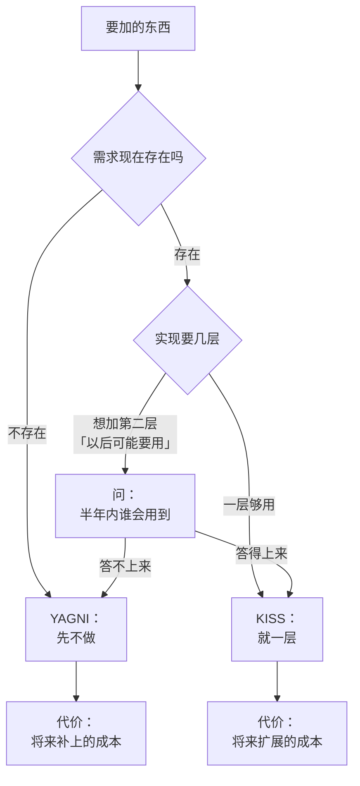
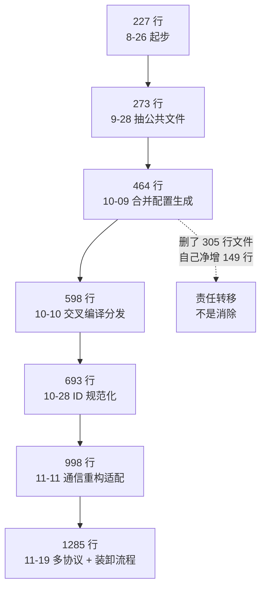
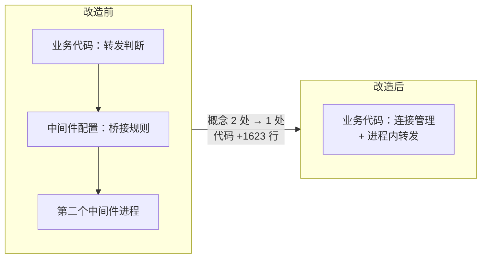
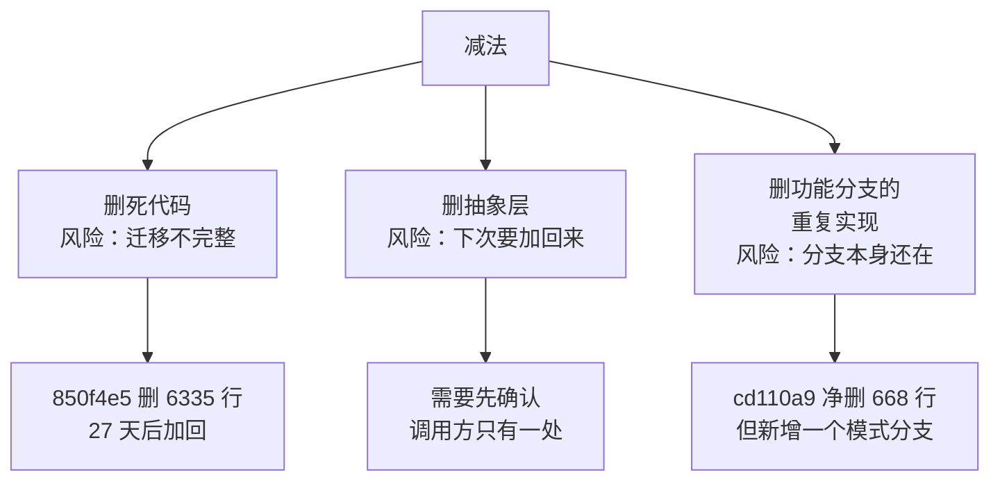

## 一、两条原则

KISS 和 YAGNI 经常被并排提起，好像说的是同一件事：少写点。但它们的指向不同。YAGNI 管的是**要不要做**：这个需求还没来，先不做；KISS 管的是**做的过程**，已经决定要做了，别顺手加三层抽象。

两条原则共用一句潜台词：**复杂度是有价格的，而你付的价格通常高于预期。**

这句话听上去无可反驳，难的是落到具体某一行代码上：你怎么知道这一层抽象是"多余"还是"预留"，这个开关是"过度设计"还是"必要的灵活性"？靠直觉判断，十次里对六次就算不错。

有个更硬的判据：**看它多久被用到，以及删它的时候疼不疼。**

手上有份八十八天的提交记录，正好提供了两个方向相反的样本。一个机制加进去十三天就被整段删除，另一个脚本在八十八天里涨了五点七倍。两份记录放在一起，能把"复杂度"从形容词变成可以量的东西。



两条路径都要付账，区别只在付给谁、什么时候付。所以判断"该不该做"之前，得先承认一件事：**没有零成本的选项**。

## 二、十三天寿命

十月二十九日上午，提交 `e58bd46` 进来，标题是「新增独立投放逻辑，不打入 client 安装包」。

背景是这样：现场需要一路 RTSP 视频服务，用一个开源服务端扛。这个服务端要装到设备上，但它属于"平台级"组件，跟业务安装包不是一回事，于是决定把它做成独立交付：构建产物旁边多一个目录，运维进这个目录执行自己的安装脚本。

这次提交加了六十四行，分布在两个构建脚本里。核心是一个 `stage` 函数，把服务目录整份拷到输出目录：

```sh
function stage_mediamtx() {
    echo "=======暂存 MediaMTX（RTSP，投放到 dist/，不进安装包）======="
    if [ "${CS_SKIP_MEDIAMTX:-0}" = "1" ]; then
        echo "跳过 MediaMTX 暂存（CS_SKIP_MEDIAMTX=1，由宿主侧投放）"
        return 0
    fi
    local src="${root_dir}/mediamtx"
    local dst="${dist_dir}/mediamtx"
    [ -d "$src" ] || { error "缺少 MediaMTX 目录：$src"; exit 1; }
    [ -f "${src}/mediamtx" ] || { error "缺少 MediaMTX 可执行文件：${src}/mediamtx"; exit 1; }
    rm -rf "$dst"
    mkdir -p "$dst"
    cp -a "${src}/." "$dst/" || { error "复制 MediaMTX 到 ${dst} 失败"; exit 1; }
    chmod +x "${dst}/mediamtx" "${dst}/install.sh" 2>/dev/null || true
}
```

这六十四行写得不算草率。它考虑了交叉编译场景（容器内不该重复拷贝，用 `CS_SKIP_MEDIAMTX` 环境变量分流）、考虑了整目录投放的必要性（安装脚本以自身目录为源）、考虑了 git 不保存可执行位（交付前补 `chmod`）、也在帮助文案里加了两行说明。

从任何角度看，这是一份合格的功能代码。

然后，十一月十一日下午六点，提交 `929fdfe`：「改为随包交付 RTSP 服务」。


删掉的东西比加进去的多。除了那六十四行，还连带删了三份文件：独立安装脚本七十三行、systemd 服务定义六十一行、说明文档六十六行。二进制和配置没有丢，它们被移进了包内的 `src/package/` 目录，由主安装脚本统一处理。

那 64 行从进入到删除，活了十三天。

### 是否过度设计

第一反应是：当然是。加的时候想得太细，十三天后全推翻，白干。

但这个结论下得太快。至少有两种解释都成立：

**解释一：这是预付费，赌错了。** 当时判断"平台级组件应该独立交付"，这个判断在现场被证伪——独立安装意味着运维要记住两套流程、两套升级方式、两个卸载入口，实际使用中反而是负担。于是推翻。

**解释二：需求真的变了。** 十月还是"先让它跑起来"，十一月要做"统一对外入口"，交付形态跟着变。这不是预测失误，是目标变了。

从提交记录看不出作者当时的想法，但有一个线索能区分这两种情况：**删除的时候疼不疼。**

如果那六十四行真的被依赖过，推翻时就会留下痕迹——可能是一个开关保留兼容、可能是两条路径并存一段时间、可能是安装脚本里加一个 `if` 判断"如果存在独立目录就走老流程"。而实际的 diff 是干净的整段删除：没有兼容分支，没有过渡开关，连帮助文案都改成了新的说法。

```text
  2026-11-11 929fdfe 改为随包交付：
    src/shell/build.sh             998 →   977  (-21)
    src/shell/aarch64_build.sh     319 →   306  (-13)
    mediamtx/install.sh             73 →     0  (-73)
    mediamtx/mediamtx.service       61 →     0  (-61)
    mediamtx/README.md              66 →     0  (-66)
```

干净到这个程度，至少说明一件事：**它没有被真正依赖。** 如果有一台设备走过独立安装，删除时就必然要留一条兼容路径，哪怕只是为了不阻断在途升级。而这六十四行从头到尾是"为将要发生的事准备好的代码"，那个"将要"没发生。

这就是 YAGNI 的典型形态，但它和常见的说法不太一样。常见说法是"你不需要它"，听起来像懒惰的借口。更准确的说法是：**你为它付了钱，但没收到货。** 那六十四行的成本不是六十四行代码，是它占用的注意力，写它时要想清楚容器与宿主的分流、要验证整目录拷贝的边界、要在帮助文档里解释两套交付方式。这些认知成本，在方向推翻后全部沉没。

## 三、5.7 倍的膨胀

同一份记录里，另有一条完全相反的曲线。构建脚本从二百二十七行长到一千二百八十五行。

```text
  首末对比：227 行 → 1285 行，倍数 5.66x

  ==========================================================
  build.sh 的修改分布（88 次提交中）
  ==========================================================
    改到 build.sh 的提交：38 次 / 总 88 次
    单次新增行：最大 234，中位数 26
    单次删除行：最大 167，中位数 3
    删除超过 100 行的提交：2 次
    新增超过 100 行的提交：9 次
```

两行数字要并排看：**单次新增中位数 26，单次删除中位数 3。**

八十八天里，这个脚本被改了三十八次。绝大多数改动的形态是"加二十几行，删三行"。没有一次是"这次我决定让它变小"——单次净减最多的一次是五十八行，而那次还夹在一连串净增之间。

膨胀的节点拆开看，每一条都有正当理由：

| 日期 | 提交 | 行数 | 当时要解决的问题 |
|------|------|------|------------------|
| 08-26 | `f123a14` | 227 | 项目起步，构建脚本一次成型 |
| 09-28 | `5b81ed0` | 273 | 装/卸脚本抽公共文件，构建脚本承接配置生成 |
| 10-09 | `a5a5e05` | 464 | 删掉独立的配置生成脚本，逻辑并进构建流程 |
| 10-10 | `33d3640` | 598 | 交叉编译要分发 Protobuf 库、要交互式输入设备 ID |
| 10-28 | `bcb1866` | 693 | 设备 ID 规范化的第三份实现（见 DRY 那篇） |
| 11-11 | `614f806` | 998 | 通信模块重构，编译宏与打包路径要跟着改 |
| 11-19 | `f9b7add` | 1285 | 多协议支持、安装卸载流程整体调整 |

10-09 那一行特别值得看。提交标题是「移除独立的配置生成脚本」——它在**删**东西，删的是一个三百零五行的文件，但构建脚本净增一百四十九行。因为逻辑没消失，它从一个文件搬进了另一个文件。

这是 KISS 讨论里最容易被漏掉的一种膨胀：**文件数减少了，单文件的责任变重了。** 看目录结构会觉得"更整洁了"，看任何一个具体文件都会觉得"怎么这么大"。



### 增量的合理性

真正难的地方在于，每一次增量单独看都合理。

没有人在十月十日的早晨决定"我要让这个脚本变成六百行"。那天要解决的是"交叉编译时容器里缺 Protobuf 库"，加三十行判断和拷贝逻辑，是最直接的解法。十一月那次通信重构也一样：编译宏要传进去、打包路径要分开，加一百六十三行是当时最短的路径。

每一笔都对，累积起来就错了。这类问题的名字不叫过度设计，叫**没有上限意识**：从来没有人问过"这个文件的合理上限是多少"，所以它一直长。

如果真要给 KISS 一条可执行的规则，不是"保持简单"（太抽象），而是：**给每个模块定一个规模上限，超了就拆，不管当下的改动有多合理。** 一千二百八十五行的构建脚本不是某一次写坏的，是三十八次都没人拦。

## 四、反例对照

同一份记录里还有第三条曲线，指向相反的方向。

一个通信模块从一千零三十五行长到三千七百八十七行：

```text
  日期             行数     文件数  阶段
  2026-08-26   1035       4  基础框架
  2026-11-04   2164       8  转发链路重构
  2026-11-11   3787       8  连接管理重构
```

11-04 到 11-11 这七天，涨了一千六百二十三行。按"任何增长都是复杂度膨胀"的标准，这该被批评。但它不该。

区别在哪？看那一千多行解决的是什么问题：原来消息要在两个独立的中间件进程之间转一手，转发规则写在中间件的配置文件里，业务代码里另有一套判断，两处各说各话，改一处漏一处。改成进程内直连之后，转发逻辑只剩一套，配置文件里那段桥接规则被整段删掉。

同一次提交里，删掉的是那几段桥接配置，新增的是进程内的连接管理。所以这不是"加了一层"，是"把跨进程的转发收回进程内"，**净效果是概念变少了，代码变多了**。



这引出一个比"该不该加"更实用的判据：**看加进去的东西在多久内被真正用到。**

这批新代码十一月十一日上线，十一月十八日就有一次针对它的修订。七天之内被改了一次，说明它在被使用，也在暴露问题，这是活代码的特征。

对比 MediaMTX 那六十四行：十三天里零改动，然后整段删除。**零改动不是稳定，是没人用。**

## 五、减法过头

KISS 的另一半是敢删，但删这件事同样有失败模式。

十月十三日有个提交，删掉六千三百三十五行的旧版定位设备代码：一整个目录，包括它自己的通信客户端、串口封装、报文解析。理由是这些功能已经并入主进程，旧目录是遗留。

二十七天后，十一月九日，「新增定位设备接入模块」。又加回来了。

不是说那次删除错了。中间二十六天里主进程的接入方案确实在跑，旧目录确实是死代码。但"删掉"和"加回来"之间只隔了二十七天，说明当时的判断漏了一件事：**旧目录里有些解析细节，主进程的实现没有完全覆盖。** 删除时看到的是"功能已迁移"，没看到"迁移得不完整"。

另一种减法失败更隐蔽，出现在十一月十八日那次提交里：

```text
  FusionHandler.h    +156 / -824   净 -668
  15 个文件合计      +870 / -1379
```

同一个提交里，一个融合处理模块净删 668 行（原文说明是"移除不必要的锁与缓存，简化代码结构"），同时新增了一个"非锁本地版"的构建模式（跳过加密、跳过权限校验）。一边在删，一边在加一个新的分支。

净额是减的（−1379/+870），但**分支数增加了**。KISS 从来不等于行数少——一个三百行的文件里塞五个 `if (mode == LOCAL)` 分支，比一千行直线代码更难懂。



所以"删"不是免费的 KISS 手段。删之前要问的问题，和加之前一样：**这个东西的调用方有几个，删掉之后谁来付账。**

## 六、判据

把三条曲线和两次减法摊开，判断"该不该做"其实可以收成几个可回答的问题：

| 情形 | 该问的问题 | 本文案例 |
|------|------------|----------|
| 想提前建一套机制 | 半年内谁会用到它，说得出名字吗 | MediaMTX 独立投放，13 天零使用 |
| 想加一层抽象 | 不加这层，下次改动要动几处 | 通信重构，把跨进程转发收回进程内 |
| 模块在持续变大 | 这个文件的规模上限是多少 | 构建脚本 227 → 1285，无人设限 |
| 想删掉一块代码 | 调用方有几个，迁移完整了吗 | 删 6335 行，27 天后加回 |
| 一次提交同时加和减 | 净额减了，分支数减了吗 | −1379/+870，但多了一个模式 |

如果只记一句：**YAGNI 的赌注是预测，KISS 的判据是可逆性。** 预测错的代价是沉没成本，可逆性差的代价是改不回来。

MediaMTX 那六十四行的问题是预测错了，但它可逆——删得干净，没留疤。构建脚本的问题是每一步都不可逆地往上叠，等到一千二百八十五行时，重构它的成本已经高到没人愿意动。前者损失六十四行，后者损失的是"这个文件以后还能不能改"。

两条原则真正的分界线在这里：**做错一件可逆的事，代价有限；让一件不可逆的事持续变大，代价没有上限。**

🐾 **小结**：八十八天里，那个 RTSP 服务的独立投放机制活了十三天，零改动，然后被整段删除——它不是坏代码，是一笔没收到货的预付款。构建脚本从二百二十七行涨到一千二百八十五行，三十八次改动，新增中位数二十六行、删除中位数三行，没有一次是"我决定让它变小"。而那个通信模块七天涨了一千六百二十三行，却不算过度设计，因为它把两处概念收回了一处，且七天内就被改了一次。同样是变大，一个是把责任挪进同一个文件，一个是把分散的知识收拢。前者是膨胀，后者是重构，区别不在行数，在这笔账最后由谁来付。

---

**相关阅读**：
- [DRY：同一份知识只留一处](/posts/dry-knowledge-single-source/)
- [计算机原则五讲（十二）：省下的开销算在谁账上](/posts/princ-chapter-12/)
- [设计模式真的很烂吗：读《Design Patterns Suck》有感](/posts/c610829b/)
- [通用代码审查清单整理](/posts/fce0fcae/)
